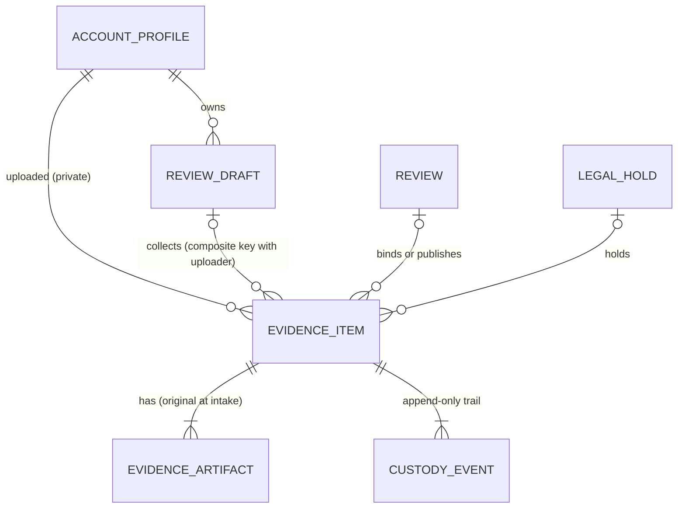

# Entities — U23 `t-303-evidence-intake`

The data shape of this Unit: tables and columns it adds or changes, the stored-object format, the ports, the contracts (inputs, results, view model, event) and the domain types. Behaviour is in `functional-spec.md`; decision logic in `rules.md`. IDs `ENT-0nn` are stable.

## ENT-001 `evidence_items` (module `evidence`, changed by this Unit's migration)

Columns as on `main` (`schema/evidence.ts`), with the changes in bold.

| Column | Type | Null | Written by this Unit | Notes |
|---|---|---|---|---|
| `id` | uuid | no | intake (generated before the bytes are stored, so the key can name it) | |
| `public_id` | text (10, Crockford base32) | no | intake | in the author view model |
| `seed_ref` | text | yes | — | seed only |
| `review_id` | uuid FK → `reviews` (cascade) | **yes** (was no) | intake writes null; U21/U25 set it | **check `evidence_items_published_has_review_check`: `state NOT IN ('published','original_expired') OR review_id IS NOT NULL`** |
| **`review_draft_id`** | **uuid** | **yes** | **intake** | **composite FK with `uploaded_by_account_id` → `review_drafts (id, account_id)` `ON DELETE SET NULL (review_draft_id)`; partial index `evidence_items_review_draft_id_idx` where not null** |
| `group` | `evidence_group` | no | intake (from the request) | |
| `label_en`, `label_bn` | text | yes | — | seed only; not in the author view model |
| `state` | `evidence_state` | no | intake `quarantined`; remove `rejected` | |
| `fail_reason` | `evidence_fail_reason` | yes | — | U24 |
| `declared_mime` | `image/jpeg` \| `image/png` | no | intake | existing check |
| `detected_mime` | same \| null | yes | — | U24 |
| `original_bytes` | bigint | no | intake (measured) | |
| `original_sha256` | text (64 hex) | no | intake (of the plaintext, computed while streaming) | |
| `original_filename_enc` | bytea | no | intake (`Crypto.encrypt`, `APP_ENCRYPTION_KEY`) | private; never selected for a view model; worker has no privilege |
| `page_count` | int | no | intake 1 | |
| `uploaded_by_account_id` | uuid FK → `account_profiles` | no | intake (`actor.accountId`) | private; worker has no privilege |
| `retention_expires_at` | timestamptz | yes | — | U25, U29 |
| `hold_id` | uuid FK → `legal_holds` | yes | — (read by remove) | U29 keeps it in step with holds |
| `published_artifact_id` | uuid | yes | — | U25 |
| `idempotency_key` | text unique | yes (always set by intake) | intake: **HMAC hex of `accountId:clientKey`** | worker has no privilege |
| `created_at`, `updated_at` | timestamptz | | intake; remove sets `updated_at` | |

## ENT-002 `review_drafts` (module `review`, one addition)

| Change | SQL | Why |
|---|---|---|
| unique key `review_drafts_id_account_id_key` on `(id, account_id)` | `ALTER TABLE review_drafts ADD CONSTRAINT review_drafts_id_account_id_key UNIQUE (id, account_id);` | the target of ENT-001's composite key; `id` is already the primary key, so it changes no behaviour |

Declared only in SQL; `schema/review.ts` (U21's file) is not edited (FD-094 collision rule). U21 may add the matching `unique()` when it next edits that file.

## ENT-003 `evidence_artifacts` (row written by intake)

| Column | Value at intake |
|---|---|
| `kind` | `original` |
| `page_no` | null |
| `storage_key` | `quarantine/<itemId>/<objectUuid>` |
| `sha256`, `bytes` | of the plaintext (as `putQuarantine` returns) |
| `mime` | the declared MIME |
| `immutable` | true |
| `public` | false (the existing check refuses true for an original) |
| `deleted_at` | null; set by remove (BR6.3) when not held |

## ENT-004 `evidence_custody_events` (append-only, rows written by this Unit)

| Event | Actor | Details (allowlist) | Written by |
|---|---|---|---|
| `received` | `author` | `{bytes, declaredMime}` | intake |
| `removed` | `author` | `{by: 'author', held}` | remove |

## ENT-005 Worker privileges on `evidence_items` (after this Unit's migration)

| Privilege | Columns |
|---|---|
| SELECT | `id`, `public_id`, `seed_ref`, `review_id`, `review_draft_id`, `group`, `label_en`, `label_bn`, `state`, `fail_reason`, `declared_mime`, `detected_mime`, `original_bytes`, `original_sha256`, `page_count`, `retention_expires_at`, `hold_id`, `published_artifact_id`, `created_at`, `updated_at` |
| UPDATE | `state`, `fail_reason`, `detected_mime`, `page_count`, `updated_at`, `retention_expires_at` |
| INSERT, DELETE | none |
| Never | `original_filename_enc`, `uploaded_by_account_id`, `idempotency_key` |

`evidence_artifacts`, `evidence_custody_events` and `evidence_redactions` keep FD-092's grants. A column added to `evidence_items` later is closed to the worker until granted (column grants do not extend).

## ENT-006 Stored object (adapter `storage-fs`)

| Part | Bytes | Notes |
|---|---|---|
| magic | 4 | ASCII `RKS1` (version 1 of the format) |
| iv | 12 | random per object |
| ciphertext | n | AES-256-GCM of the plaintext |
| tag | 16 | GCM authentication tag |

Applies to `quarantine/` and `private/`. Key: `STORAGE_ENCRYPTION_KEY` (32 bytes, base64), in `infra/compose/.env.example` and the web and worker environments. The seed's legacy `public/<publicId>/…` files stay plaintext and are read as they are. Writes go to `<key>.part` and are renamed when sealed.

## ENT-007 Storage key patterns

| Prefix | Pattern | Written by | Read by |
|---|---|---|---|
| `quarantine/` | `quarantine/<itemId uuid>/<object uuid>` | intake | worker (U24), original route (U25) |
| `private/` | `private/<itemId uuid>/<name>` | worker (U24), redaction (U25) | preview and artifact routes (U25) |
| `public/` | `public/<10-char public id>/<name>` | the seed only (legacy) | artifact route (U25) |

`<name>` = `[A-Za-z0-9][A-Za-z0-9._-]{0,63}`; every resolved path must stay under `STORAGE_ROOT` (BR3.1, BR3.2).

## ENT-008 Ports

```text
Storage (packages/application/src/ports/storage.ts)                  ByteSource = AsyncIterable<Uint8Array>
  putQuarantine(source, {itemId, maxBytes}) -> Promise<{key, bytes, sha256} | {error: 'too_large' | 'aborted' | 'io', bytes}>
  putPrivateDerivative(bytes: Uint8Array, {itemId, name}) -> Promise<{key, bytes, sha256}>          (for U24, U25)
  readPrivate(key, {maxBytes}) -> Promise<Uint8Array | {error: 'too_large' | 'missing' | 'tampered'}>  (for U24, U25)
  head(key) -> Promise<{bytes} | null>
  delete(key, {reason}) -> Promise<void>                                                           (idempotent)

EvidenceRepository (packages/application/src/ports/repositories/evidence.ts), this Unit's methods
  findByIdempotencyKey(scopedKey) -> {itemId, publicId, state} | null
  draftUsage({draftId, reviewId}) -> {count, totalBytes}                       (BR2.4 set)
  insertIntake(tx, IntakeRow) -> ok | {error: 'duplicate_key' | 'draft_link'}  (takes the advisory lock, re-counts, inserts item, artifact, custody)
  listForUploader({accountId, itemIds}) -> AuthorItemRow[]                     (never selects the name or keys)
  loadForRemoval(tx, itemId) -> {uploaderAccountId, state, holdId, artifactKeys} | null
  transition(tx, {itemId, from, to, uploaderAccountId?}) -> boolean            (compare-and-set; U24 adds failReason etc.)
  appendCustody(tx, {itemId, event, actor, details})
  markArtifactsDeleted(tx, itemId) -> string[]                                 (returns the keys to delete)
  itemsOfDraft(tx, {draftId, accountId, itemIds}) -> {itemId, state}[]
  bindToReview(tx, {reviewId, itemIds}) -> number

EvidenceDraftAccess (packages/application/src/modules/evidence/ports.ts; implemented in modules/review)
  openDraftOf({accountId, draftId}) -> Promise<{reviewId: string | null} | null>

Used (U8 T-101): UnitOfWork, Crypto (encrypt, hmac), Clock, IdGenerator, RateLimiter (hit), AuditWriter, Outbox, Logger
```

## ENT-009 Inputs and results (`packages/contracts/src/schemas/evidence.ts`)

| Schema | Shape | Change |
|---|---|---|
| `IntakeEvidenceInput` | `{reviewDraftId: uuid, group: EvidenceGroup, declaredMime: 'image/jpeg' \| 'image/png', declaredName: string (1–255), idempotencyKey: uuid}` strict | **`bytes` removed** (the multipart cannot declare it; the server measures); ids as uuid |
| `UploadEvidenceFields` (new) | `{draftId: uuid, group: EvidenceGroup}` strict | the request's form fields |
| `UploadEvidenceResponse` (new type) | `{items: {clientKey: string, result: Result<{itemId, publicId, state: 'quarantined' \| EvidenceState}>}[]}` | |
| `GetEvidenceForAuthorInput` | `{itemIds: uuid[] (1–10, distinct)}` strict | **was `{draftId}`** (Question 8) |
| `RemoveEvidenceInput` | `{itemId: uuid}` strict | uuid instead of any string |
| `EvidenceLimits` | `EVIDENCE_LIMITS` unchanged (10, 15 MiB, 100 MiB) | pinned equal to `domain/evidence/limits.ts` by a test |

## ENT-010 `EvidenceAuthorItemVM` (`packages/contracts/src/view-models/evidence.ts`, new)

| Field | Type | Notes |
|---|---|---|
| `itemId` | string (uuid) | used by remove and the draft payload |
| `publicId` | string | |
| `group` | `EvidenceGroup` | |
| `state` | `EvidenceState` | |
| `stateKey` | string | `ev.state.<camel>` |
| `failReason?` | `EvidenceFailReason` | only when `failed` |
| `failKey?` | string | `ev.fail.<camel>` |
| `pageCount` | number | 1 in Phase 1; formatted by the component in the active language |
| `previewPages` | `{pageNo, url, width?, height?}[]` | `[]` in this Unit; U25 fills it |
| `privacyConfirmed` | boolean | |
| `canRemove`, `canReplace` | boolean | BR7.3 |

Never present: file name, account id, storage keys, hashes, byte counts, hold, review or draft ids, label (BR7.1). The existing public types (`EvidenceItemVM`, `EvidenceGroupVM`, `ViewerDocVM`) stay as they are for U25 and U28.

## ENT-011 Outbox event `evidence.received` (C15, payload extended)

```json
{ "itemId": "<uuid>", "uploaderAccountId": "<uuid>" }
```

Routed by the relay to `evidence.process` (unchanged). The payload schema lives in `packages/contracts/src/schemas/evidence.ts` as `EvidenceReceivedPayload`, which U24 parses.

## ENT-012 Domain (`packages/domain/src/evidence/`)

| File | Content |
|---|---|
| `evidence.ts` | `EvidenceItem`, `Artifact`, `CustodyEvent` structural types; the state, group and reason literal unions repeated locally (domain imports nothing; a test in `application` pins them equal to `contracts/enums.ts`) |
| `evidence-state.ts` | `TRANSITIONS` table keyed by actor (`worker`, `author`, `publish`, `retention`, `moderator`), `FAIL_REASONS_BY_STAGE`, `AUTHOR_REMOVABLE`, `transition(from, to, by, failReason?) → {ok: true} \| {ok: false, error: 'conflict'}` |
| `limits.ts` | `MAX_FILES = 10`, `MAX_BYTES = 15 * 1024 * 1024`, `MAX_TOTAL = 100 * 1024 * 1024`, `ALLOWED = {jpg: 'image/jpeg', jpeg: 'image/jpeg', png: 'image/png'}`, `DANGEROUS_INNER_EXTENSIONS`, `checkDeclared({name, mime}) → ok \| 'evidence.type_rejected'`, `checkUsage({existingCount, existingTotal}) → ok \| 'evidence.too_many' \| 'evidence.total_too_large'`, `streamLimit(existingTotal) → {maxBytes, bindingLimit: 'file' \| 'total'}` |
| `keys.ts` | `stateKey(state)`, `failKey(reason)` (pure camel-casing) |

## Entity-relationship view



Text fallback: an account owns its drafts and is privately recorded as the uploader of its evidence items. While the author writes, an item is linked to one of that same account's drafts; the database key joins the draft id with the uploader id, so the link can only name the uploader's own draft. When the review publishes, the item is bound to (or published into) the review and the draft link is cleared as the draft is deleted. Each item has its original artifact from intake and later artifacts from the worker, and an append-only custody trail. A legal hold may hold an item.
