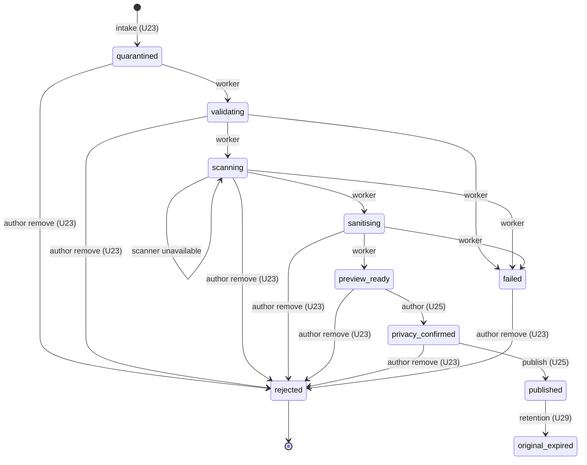

# Functional specification — U23 `t-303-evidence-intake`

Draft written ahead of the stage on 2026-10-29. When the workflow reaches this Unit, the lead finalises it and the reviewer checks it; then the files move to `<record>/construction/t-303-evidence-intake/functional-design/`.

Unit U23 (kind `library`, size L, **high risk**: untrusted files, private evidence, the link between an account and an anonymous review) delivers T-303 for US7.1. It depends on U8 T-101 and U3 T-010; U24 T-304, U26 T-306 and U41 T-502 depend on it, and U25 T-305 and U21 T-301 call into it. Lead perspective: architect. Support perspectives written into this file: developer (streaming, transactions, adapter mechanics, tests: §§ 10–11) and security engineer (threat cases and adversarial angles: § 12), synthesised in § 13.

Inputs: listed in `functional-design-questions.md` (Context). This file is the source of truth for the workflows and state transitions; the data shape is in `entities.md`; the decision logic is in `rules.md`. Questions 1–15 were all decided A by the agent under the owner's no-questions instruction of 2026-10-29. Four of them change a data boundary or a requirement; § 17 gives the FD entries the build appends before code.

## 1. What changes, in one paragraph

A confirmed, unrestricted author can attach JPEG and PNG files to one of their own drafts. `POST /api/evidence/upload` checks the account and the draft before it reads the body, then streams each file part straight into private quarantine through a new filesystem `Storage` adapter that counts bytes, hashes and encrypts while writing, and never holds a whole file in memory. Each accepted file becomes an `evidence_items` row in state `quarantined`, linked to its draft by a new `review_draft_id` column whose composite key with the uploader makes a foreign draft impossible at the database level, with its original artifact, the custody event `received`, an audit row and the outbox event `evidence.received {itemId, uploaderAccountId}`, all in one transaction; the outbox relay starts U24's pipeline. Limits (10 files, 15 MiB each, 100 MiB per draft) are checked before streaming and re-checked under a per-draft lock. Idempotency is per account. The author polls `evidence.getForAuthor {itemIds}` for a view model with no name, account or key in it, and can remove an item in any state before publication. The domain gets the whole evidence state table, written once with every Unit's rows. The worker's privileges on `evidence_items` become column lists that exclude the file name, the uploader and the idempotency key (closes ISS-139 and ISS-239). Custody and audit rows of the author's actions name the opaque actor `author`. The Unit also gives U21 the two evidence operations its publish needs (`itemsOfDraft`, `bindToReview`).

## 2. As is (baseline 2026-10-29) and what this Unit can count on

Baseline: `main` at `9cf860a` (T-010 merged as `14c21a9`); T-011 is building on `bolt/t-011-patient-design-and-motion-system`. U8 T-101 is not built yet; this Unit starts after it merges.

- **Schema** (`schema/evidence.ts`): `evidence_items.review_id` is `NOT NULL` with a cascade key to `reviews`; `original_filename_enc` and `uploaded_by_account_id` are `NOT NULL`; `declared_mime` and `detected_mime` are checked to `image/jpeg|image/png`; `idempotency_key` is unique; there is no draft column. `evidence_artifacts.public` is refused for an `original`. `evidence_custody_events` is append-only (`0003` trigger). `review_drafts` has `id`, `account_id` (cascade from `account_profiles`), `review_id`, `payload_enc`, `expires_at`.
- **Grants**: `0005_grants_part2.sql` gives `rk_worker` table-wide `SELECT, INSERT, UPDATE, DELETE` on the four evidence tables, file name and uploader included. `validator-probes.int.test.ts` keeps ISS-139 as an `it.fails` probe. `02-data-model.md` §16 lists PR2 (file name) and PR3 (uploader) as planned removals for this Unit.
- **Repository stub** `PgEvidenceRepository` throws `NotImplemented` with guessed owners: `intake` → T-303, `getForAuthor` → T-306, `remove` → T-305, `updateState`, `insertArtifact`, `recordCustodyEvent` → T-304, `publish` → T-301, the rest → T-305, T-307, T-308. `not-implemented.test.ts` lists it in `STUB_REPOSITORIES` (ISS-294). `FakeEvidenceRepository` mirrors the stubs.
- **Contracts**: `IntakeEvidenceInput {reviewDraftId, group, declaredMime, declaredName, bytes, idempotencyKey}`, `GetEvidenceForAuthorInput {draftId}`, `RemoveEvidenceInput {itemId}`, `EVIDENCE_LIMITS`, the four `evidence.*` limit codes and the public evidence view models (`TODO(T-308)`). No author view model exists.
- **Test support**: `MemoryStorage` (`putQuarantine(stream: Readable, {itemId}) → key`, `putDerivative` to `public/`); `anEvidenceItem()`; fixtures already built by T-007 (`prescription-1.jpg`, `prescription-2.jpg`, `photo.jpg`, `not-a-png.png`, `broken.jpg`, `flagged.jpg`, `report.pdf`; `oversize.png` generated on demand and git-ignored) with `scripts/build-fixtures.mjs`; the seed writes derivatives under `public/<itemPublicId>/…` and plaintext into `original_filename_enc` (ISS-181, ISS-182).
- **Web**: Next 16.3.4, no multipart dependency, no `/api/evidence` route, no `server/container.ts` (U8 creates it). `proxy.ts`'s matcher excludes `/api`, so the proxy never buffers an upload body.
- **i18n**: the prototype's `ev.state.{quarantine, checking, scanning, redact, processing, ready, failed}`, `ev.failNote`, `ev.replace`, `ev.remove`, `errors.evidence.*` and `evidence.group.*` keys exist in both languages; no code uses the `ev.*` keys yet.
- **From U8 T-101 (draft)**: `defineCommand` (parse → authorize in the order `authenticated → verifiedEmail → notRestricted → …` → `handle` inside `UnitOfWork.run`), `Crypto` (`encrypt`, `hmac(purpose, bytes)`), `RateLimiter.hit`, `Clock`, `IdGenerator`, `AuditWriter` with allowlist builders, `Outbox.append(tx, …)`, `Logger`, `getActor()`, `container.ts`, the worker rule that removes `APP_ENCRYPTION_KEY` from the worker's process, and the mail-only worker key pattern.
- **T-010 constraints**: the boundary matrix (`application` imports no external package and no Node built-in; `database` may not import `domain`; adapters are built only in `apps/web/src/server/container.ts`; components import only server actions; nothing in `apps/*` imports `test-support`); the 80% line floor per package with untested files counted; the migration-count pins; `format:check`; `check:identity`; CI before merge. After T-011, `pnpm check` has eleven steps.

## 3. Settled before this stage

See `functional-design-questions.md` § "Settled before this stage": images only (FD-036), quarantine first and fail closed (FD-035, AD-6, AD-7), worker grants need an FD (FD-092), worker notices in-app only (FD-070), pending files bound at publish (U21 Question 9), moderator removal and original access belong to U25, parallel building without touching U21's files (FD-094), and the hard rules.

## 4. Workflows

Frame for every command and query: parse with the contracts schema → authorize (T-101's `requires`) → load → decide (domain) → persist with audit and outbox in one transaction → `Result`. Intake is the one exception to "handle inside the transaction": the bytes are streamed **before** the transaction opens, so no transaction is held for the length of an upload (finding F9).

### WF0 — Code Generation order (the Unit end to end)

1. **Baseline**: `pnpm infra:up`; `pnpm check` and `pnpm smoke` green on the Bolt branch; read the open `ISSUES.md` rows in the evidence area (ISS-139, ISS-165, ISS-181, ISS-182, ISS-199, ISS-239, ISS-294) and § 9 below.
2. **Decision log**: append the four FD entries of § 17 before any code (`project.md` Mandated). If U24 or U25 merged first and already appended an entry with the same decision, do not append it twice; note the number in the hand-off.
3. **Dependency check**: add a dated entry to `docs/status/dependency-check-log.md` for `@fastify/busboy` (3.2.4 seen on 2026-10-29; confirm it is still the latest stable, skim its changelog and open issues, read its README for the constructor and `file` event signature) before adding it to `apps/web`.
4. **Domain** (`packages/domain/src/evidence/`): `evidence.ts`, `evidence-state.ts` (the whole table of § 5), `limits.ts`, `keys.ts`, `index.ts`, with tests.
5. **Contracts**: schema changes of `entities.md` ENT-009, `EvidenceReceivedPayload`, `EvidenceAuthorItemVM` (ENT-010).
6. **Migration** `<n>_evidence_intake.sql`, `<n>` the next free number (custom migration, as `0007`/`0008`): § 7. Schema file `schema/evidence.ts` (nullable `review_id`, `review_draft_id`, the check, the composite key). Raise both migration-count pins by one.
7. **Ports**: `ports/storage.ts`, `ports/repositories/evidence.ts` (ENT-008), `modules/evidence/ports.ts` (`EvidenceDraftAccess`).
8. **Adapter** `packages/adapters/src/storage-fs/` (WF3) with tests.
9. **Repositories**: `PgEvidenceRepository` methods of ENT-008 (the other stubs keep their owners); `PgReviewDraftAccess` in the new file `repositories/review-draft-access.ts`; int tests; `not-implemented.test.ts` updated.
10. **Application** `modules/evidence/`: `commands/intake.ts`, `commands/remove.ts`, `queries/get-for-author.ts`, `internal/items-of-draft.ts`, `internal/bind-to-review.ts`, `authorization.ts`, `index.ts`; `modules/review/evidence-draft-access.ts`; tests on fakes.
11. **Test support**: `fakes/storage.ts` (reshaped to the port), `fakes/evidence-repository.ts` (the full fake, re-exported from `fakes/repositories.ts` so the superset test keeps its import), a fake `EvidenceDraftAccess`, `builders/evidence.ts` (`toIntakeEvidenceInput` without `bytes`); `port-fakes.test.ts` and `repositories.test.ts` follow. Fixtures: unchanged (§ 13).
12. **Web**: `apps/web/package.json` (`@fastify/busboy`); `src/app/api/evidence/upload/route.ts` (WF1); `src/server/actions/evidence.ts` (`getForAuthor`, `remove` only); `src/server/container.ts` (the storage adapter with `STORAGE_ROOT` and `STORAGE_ENCRYPTION_KEY`, the evidence module, `EvidenceDraftAccess`); `infra/compose/.env.example` (`STORAGE_ENCRYPTION_KEY`, with the generate command); the web environment check reads it when the container builds the adapter, never at module load.
13. **Strings** (§ 8) in `en.json` and `bn.json` in the same commit; `pnpm i18n:keys`.
14. **Smoke**: at least one assertion in `*.smoke.test.ts` (§ 11).
15. **Documents**: `02-data-model.md` §7 (new column, nullable `review_id`, the check, the actor rule), §16 (PR2 and PR3 applied, the column lists of ENT-005), §17 (the evidence table of § 5); `03-routes-and-contracts.md` §1, §3 (`Storage` shape), §4 (`intake`, `getForAuthor`, `remove`), §5 (`evidence.received` payload); `01-conventions.md` §4 (key patterns) and §11 (`STORAGE_ENCRYPTION_KEY` in the worker's list); a dated note in `contract-summary.md` C8, C14 and C15; the U23 row of the deletion-participants table in `unit-of-work.md` read by the next Units revision (§ 18). Correct the T-303 task header (`unit-of-work.md` "Task headers to correct").
16. **Issues**: ISS-139 and ISS-239 fixed in U23 T-303; add the § 9 rows with `Found in U23 T-303`.
17. `pnpm check` (all steps) and `pnpm smoke` green; hand-off filled in.

### WF1 — `POST /api/evidence/upload` (`apps/web/src/app/api/evidence/upload/route.ts`)

`export const runtime = 'nodejs'`; `export const dynamic = 'force-dynamic'`. (`maxDuration` is a hosting setting with no effect in the local demo; it is left out.)

1. `actor = await getActor()` (BR1.1). Anonymous → `401`; unverified → `403 auth.email_unverified`; restricted → `403 forbidden`. The body is cancelled, not read.
2. `Content-Length` present and above 101 MiB (100 MiB plus 1 MiB of multipart overhead) → `413` with `evidence.total_too_large`. A request without `Content-Length` (chunked) is still bounded by WF3's counters.
3. `Content-Type` not `multipart/form-data` → `400 validation`.
4. Build the parser over `Readable.fromWeb(request.body)` with limits `{files: 11, fields: 4, fieldSize: 128, parts: 15, fileSize: MAX_BYTES + 1}`; the parser's own limit is a backstop, the adapter's counter is the rule.
5. Fields `draftId` and `group` must arrive before the first file part; parse them with `UploadEvidenceFields`; missing or invalid → `400 validation`. Then `evidenceDraftAccess` check through the intake command's `prepare` step (WF2 step 1–2): not an open draft of the actor → `404 not_found`, every part drained.
6. For each file part, **one at a time, in arrival order** (BR4.6): the field name must be `file:<uuid>` with a key not used earlier in the request, else per-file `validation`; take `declaredName` from the part's filename and `declaredMime` from its content type; call `evidence.intake` with the part's stream (WF2 steps 3–8). A refused part is drained (`stream.resume()` until it ends) so the parser can reach the next part.
7. An eleventh file part → `400` for the request (`evidence.too_many`), after draining; parts already stored stay (they are valid items).
8. Respond `200 {items: [{clientKey, result}]}`. A client disconnect aborts the current part (WF3 deletes the partial object) and nothing more is written.
9. A thrown error → `500` with an `internal` AppError and a fresh correlation id, logged without input (BR8.5).

The route imports only `web-server` (container, `getActor`), `contracts` and the parser; it never imports `adapters` or `database` directly (FD-093).

### WF2 — `evidence.intake` (application, `modules/evidence/commands/intake.ts`)

The command exposes two calls so the route never streams inside a transaction: `prepare(actor, {draftId, group})` once per request, and `ingest(prepared, {clientKey, declaredName, declaredMime}, source)` once per file.

**prepare** (once per request):
1. Authorize with T-101's `requires` helper: `authenticated`, `verifiedEmail`, `notRestricted` (BR1.1).
2. `draft = evidenceDraftAccess.openDraftOf({accountId, draftId})`; null → `not_found` (BR1.2). Keep `draft.reviewId`.

**ingest** (per file):
3. Parse `{reviewDraftId: draftId, group, declaredMime, declaredName, idempotencyKey: clientKey}` with `IntakeEvidenceInput`; failure → per-file `validation`.
4. `checkDeclared({name, mime})` (BR2.1, BR2.2) → `evidence.type_rejected`.
5. `scopedKey = crypto.hmac('evidence.intake', accountId + ':' + clientKey)`; `repository.findByIdempotencyKey(scopedKey)` → found: return its `{itemId, publicId, state}` (BR4.3; the caller drains the part).
6. `rateLimiter.hit('evidence.intake:account:<accountId>', 40, 3600)` → refused: `rate_limited` with `retryAfterSec` (BR1.6).
7. `usage = repository.draftUsage({draftId, reviewId: draft.reviewId})`; `checkUsage` → `evidence.too_many` or `evidence.total_too_large` (BR2.4, BR2.5); `{maxBytes, bindingLimit} = streamLimit(usage.totalBytes)`.
8. `itemId = ids.newId()`; `stored = storage.putQuarantine(source, {itemId, maxBytes})`:
   - `{error: 'too_large'}` → `evidence.too_large` if `bindingLimit = file`, else `evidence.total_too_large` (BR2.3);
   - `{error: 'aborted' | 'io'}` → `internal` (logged `evidence.intake_store_failed {itemId}`);
   - `bytes = 0` → delete, `validation` with `errors.evidence.empty` (BR2.7).
9. Persist in `unitOfWork.run(tx => …)` (BR4.1, BR2.6): `repository.insertIntake(tx, row)` takes `pg_advisory_xact_lock` for the draft, re-counts with the measured bytes, inserts the item (state `quarantined`, `review_draft_id = draftId`, `original_filename_enc = crypto.encrypt(utf8(NFC(declaredName)))`, `idempotency_key = scopedKey`, `public_id = ids.newPublicId()`), the original artifact and the custody event `received` (actor `author`); then `auditWriter.write(tx, {stream: 'evidence:<itemId>', action: 'intake', actor: 'author', target: 'evidence', details: {group, declaredMime, bytes}})`; then `outbox.append(tx, 'evidence.received', {itemId, uploaderAccountId: accountId})`.
10. Persist outcome: ok → `ok({itemId, publicId, state: 'quarantined'})`. Over the limit at the re-check → roll back, `storage.delete(key, {reason: 'intake_rolled_back'})`, `evidence.too_many` or `evidence.total_too_large`. `duplicate_key` (a concurrent replay won) → delete own object, return the winner's result. `draft_link` (the draft was deleted or changed hands between prepare and commit) → delete own object, `not_found`. Any other error → delete own object, `internal`.

No `JobQueue.enqueue` here (BR4.5). Nothing in this command reads or writes review rows (BR6.6).

### WF3 — `Storage.putQuarantine(source, {itemId, maxBytes})` (`adapters/storage-fs`)

1. Validate `itemId` as a uuid; `key = quarantine/<itemId>/<newUuid>`; check the pattern and the resolved path (BR3.1, BR3.2); `mkdir -p` the item folder (mode `0o700`).
2. `pipeline(Readable.from(source), counter, sha256Tap, cipher, createWriteStream(<path>.part, {flags: 'wx', mode: 0o600}))`: the counter destroys the pipeline with a `too_large` cause as soon as the count exceeds `maxBytes`; `sha256Tap` hashes the plaintext; the cipher is AES-256-GCM with a random 12-byte IV, preceded by the `RKS1` header and the IV, followed by the tag (ENT-006).
3. On success: `fsync`, rename `.part` to the key, return `{key, bytes, sha256}`. On any error: destroy, unlink `.part` (ignore a missing file), return `{error, bytes}` (BR3.4).

`readPrivate(key, {maxBytes})` reads at most `maxBytes + 32` bytes (else `too_large`), checks the header, decrypts and verifies the tag (`tampered` on failure), and returns the plaintext; legacy `public/` seed files are returned as they are. `putPrivateDerivative(bytes, {itemId, name})` writes `private/<itemId>/<name>` the same way and returns `{key, bytes, sha256}`. `head(key)` returns the plaintext size from the file size minus 32 for encrypted prefixes. `delete(key, {reason})` unlinks and logs `{event: 'storage.deleted', itemId, reason}` (BR3.7); the item id is parsed from the key, the key itself is not logged. The adapter reads `STORAGE_ROOT` and `STORAGE_ENCRYPTION_KEY` from its constructor arguments; the containers pass them.

### WF4 — `evidence.getForAuthor({itemIds})` (query)

1. Requires `authenticated`. Parse `{itemIds}` (1–10 distinct uuids).
2. `rows = repository.listForUploader({accountId, itemIds})` (selects only the columns of BR7.1's fields, never the name or keys).
3. `rows.length < itemIds.length` → `forbidden` (BR1.4).
4. Map each row to `EvidenceAuthorItemVM` (BR7.1–BR7.4), in the order of `itemIds`.

The composer polls this through the server action every 2 s while any item is `quarantined`, `validating`, `scanning` or `sanitising` (U26 owns the polling schedule).

### WF5 — `evidence.remove({itemId})` (command)

1. Requires `authenticated` (BR1.5). Parse.
2. In the transaction: `item = repository.loadForRemoval(tx, itemId)` (row lock); missing or `uploaded_by_account_id <> actor.accountId` → `forbidden`, nothing written.
3. Decide with the domain (BR6.1): `rejected` → `ok({state: 'rejected'})`, nothing written; `published`, `original_expired`, `removed` → `conflict`; otherwise `repository.transition(tx, {itemId, from: item.state, to: 'rejected', uploaderAccountId})`; a lost compare-and-set (the worker moved it meanwhile) → reload once and decide again.
4. Custody `removed {by: 'author', held: item.holdId !== null}` actor `author`; audit `evidence:<itemId>` action `remove` actor `author` details `{fromState, held}` (BR6.2). No outbox row.
5. Not held → `keys = repository.markArtifactsDeleted(tx, itemId)`. Held → nothing marked (BR6.3, BR6.4).
6. Commit; then `storage.delete(key, {reason: 'author_removed'})` for each key; a failure is logged and left for U29's sweep.
7. Return `ok({state: 'rejected'})`.

The worker sees `rejected` at its next compare-and-set and stops, deleting any file it wrote (U24 WF9).

### WF6 — `itemsOfDraft` and `bindToReview` (internal, for U21's `EvidenceForPublish`)

Called only inside `review.publish`'s transaction, never from a server action.

- `itemsOfDraft(tx, {draftId, accountId, itemIds})` → `{itemId, state}[]` for listed items with `review_draft_id = draftId`, `uploaded_by_account_id = accountId` and `review_id IS NULL`; an id that is foreign, of another draft or already bound is absent, so U21 refuses with `validation` (U21 BR3.10).
- `bindToReview(tx, {reviewId, itemIds})`: for those items in `quarantined`, `validating`, `scanning`, `sanitising`, `preview_ready`, sets `review_id` only (no state change, no custody, no outbox; nothing becomes public). `review_draft_id` is cleared by the database when U21 deletes the draft in the same transaction (ON DELETE SET NULL).
- `publish` stays U25's. Until U25 merges, U26 wires an `EvidenceForPublish` whose `publish` accepts only an empty list (U26 § "container.ts").

### WF7 — A draft is deleted or expires while it holds items

- **Deleted by publish** (U21): items are bound first (WF6), then the key clears `review_draft_id`; bound items keep `review_id`.
- **Discarded by the author or purged at expiry** (U21, U29 with FD-090's worker DELETE on `review_drafts`): the key clears `review_draft_id`; an unpublished item with `review_id` and `review_draft_id` both null is an orphan. U29's sweep removes orphans (state `rejected`, custody `removed {by: 'system:retention'}`, files deleted unless held) — cross-Unit change X5. Until U29 exists, orphans stay private in quarantine and are invisible (no draft and no review lists them).
- **Upload racing a deletion**: the composite key refuses the insert (`draft_link`), the object is deleted, the file gets `not_found`.

## 5. State transitions

The whole table lives in `packages/domain/src/evidence/evidence-state.ts`, written once here with every Unit's rows and one table test (BR5.1–BR5.3). This Unit performs only intake (`→ quarantined`) and the author's removal (`→ rejected`).

| From | To | By | Reasons (to `failed`) | Unit that performs it |
|---|---|---|---|---|
| (new) | `quarantined` | author | — | U23 intake |
| `quarantined` | `validating` | worker | — | U24 |
| `validating` | `scanning` | worker | — | U24 |
| `validating` | `failed` | worker | `type_mismatch`, `too_large`, `malformed`, `unknown`, `processing_timeout` | U24 |
| `scanning` | `scanning` | worker | — (scanner unavailable, retry) | U24 |
| `scanning` | `sanitising` | worker | — | U24 |
| `scanning` | `failed` | worker | `malware`, `scanner_unavailable` (after 24 h, U24's FD), `unknown`, `processing_timeout` | U24 |
| `sanitising` | `preview_ready` | worker | — | U24 |
| `sanitising` | `failed` | worker | `malformed`, `processing_timeout`, `unknown` | U24 |
| `preview_ready` | `privacy_confirmed` | author | — | U25 |
| `privacy_confirmed` | `published` | publish | — | U25 (inside `review.publish`, or at confirmation of a bound item) |
| `published` | `original_expired` | retention | — | U29 |
| `quarantined`, `validating`, `scanning`, `sanitising`, `preview_ready`, `privacy_confirmed`, `failed` | `rejected` | author | — | **U23 remove** |
| every state except `rejected`, `removed` | `removed` | moderator | — | U25 `removeFile` |

`too_many_pages` and `encrypted` stay in the enum, refused in Phase 1. Staying in `preview_ready` while redactions are applied is not a transition (U25).



Text fallback: intake creates an item in `quarantined`. The worker moves it through `validating`, `scanning` (where it may stay while the scanner is down) and `sanitising` to `preview_ready`, or to `failed` with a reason that fits the stage. The author confirms a `preview_ready` item (`privacy_confirmed`), and publication makes it `published`; retention later moves it to `original_expired`. Before publication the author can remove the item from any of those states, which makes it `rejected`. A moderator can move any item that is not already `rejected` or `removed` to `removed` (not drawn, to keep the diagram readable).

## 6. Interfaces

### 6.1 Commands, queries and internal operations (`modules/evidence`)

| Name | Kind | Input | Result | Errors (beyond validation, forbidden, internal) | Requires |
|---|---|---|---|---|---|
| `evidence.intake` (`prepare`, `ingest`) | command | `prepare(actor, {draftId, group})`; `ingest(prepared, {clientKey, declaredName, declaredMime}, source)` | `{itemId, publicId, state}` per file | `not_found`, `evidence.type_rejected`, `evidence.too_large`, `evidence.total_too_large`, `evidence.too_many`, `rate_limited` | authenticated, verifiedEmail, notRestricted; open draft |
| `evidence.getForAuthor` | query | `{itemIds}` | `EvidenceAuthorItemVM[]` | — | authenticated; uploader of every id |
| `evidence.remove` | command | `{itemId}` | `{state: 'rejected'}` | `conflict` | authenticated; uploader |
| `itemsOfDraft`, `bindToReview` | internal (on the caller's `tx`) | WF6 | WF6 | — | the caller's (U21) |

### 6.2 Ports

`entities.md` ENT-008. `EvidenceDraftAccess` is declared by Evidence and implemented in `modules/review/evidence-draft-access.ts` over `PgReviewDraftAccess.findOpenDraft({accountId, draftId, now})` (`select id, review_id from review_drafts where id = $1 and account_id = $2 and expires_at > $3`). Both files are new, so no U21 file changes (FD-094).

### 6.3 Server actions (`apps/web/src/server/actions/evidence.ts`)

`getForAuthorAction({itemIds})` and `removeEvidenceAction({itemId})`: parse → `getActor()` → query or command → `Result`. Components import only these (FD-093 (1)). U25 adds its actions to the same file later.

### 6.4 Placement under the T-010 boundaries

| Files | Element | May import |
|---|---|---|
| `packages/domain/src/evidence/**` | domain | nothing |
| `packages/contracts/src/{schemas,view-models}/evidence.ts` | contracts | `zod` |
| `packages/application/src/{ports/storage.ts, ports/repositories/evidence.ts, modules/evidence/**, modules/review/evidence-draft-access.ts}` | application | domain, contracts; no Node types (`ByteSource = AsyncIterable<Uint8Array>`) |
| `packages/adapters/src/storage-fs/**` | adapters | application ports, contracts, `node:fs`, `node:path`, `node:crypto`, `node:stream` |
| `packages/database/src/{repositories/evidence.ts, repositories/review-draft-access.ts, schema/evidence.ts, migrations/<n>_evidence_intake.sql}` | database | application ports, contracts, drizzle, pg (not domain) |
| `packages/test-support/src/fakes/{storage,evidence-repository,evidence-draft-access}.ts` | test-support | application, contracts, domain |
| `apps/web/src/app/api/evidence/upload/route.ts` | web | web-server, contracts, `@fastify/busboy`, `node:stream` |
| `apps/web/src/server/actions/evidence.ts` | web-actions | application, contracts, web-server |
| `apps/web/src/server/container.ts` | web-server (container) | adapters (the only place) |

## 7. Migration `<n>_evidence_intake.sql` (forward-only)

```sql
-- U23 T-303: evidence linked to its draft (FD entry (a)), worker column privileges (FD entry (b)).
ALTER TABLE evidence_items ALTER COLUMN review_id DROP NOT NULL;
ALTER TABLE evidence_items ADD COLUMN review_draft_id uuid;
ALTER TABLE evidence_items ADD CONSTRAINT evidence_items_published_has_review_check
  CHECK (state NOT IN ('published', 'original_expired') OR review_id IS NOT NULL);
ALTER TABLE review_drafts ADD CONSTRAINT review_drafts_id_account_id_key UNIQUE (id, account_id);
ALTER TABLE evidence_items ADD CONSTRAINT evidence_items_review_draft_fk
  FOREIGN KEY (review_draft_id, uploaded_by_account_id)
  REFERENCES review_drafts (id, account_id) ON DELETE SET NULL (review_draft_id);
CREATE INDEX evidence_items_review_draft_id_idx ON evidence_items (review_draft_id)
  WHERE review_draft_id IS NOT NULL;
REVOKE SELECT, INSERT, UPDATE, DELETE ON evidence_items FROM rk_worker;
GRANT SELECT (id, public_id, seed_ref, review_id, review_draft_id, "group", label_en, label_bn,
  state, fail_reason, declared_mime, detected_mime, original_bytes, original_sha256, page_count,
  retention_expires_at, hold_id, published_artifact_id, created_at, updated_at)
  ON evidence_items TO rk_worker;
GRANT UPDATE (state, fail_reason, detected_mime, page_count, updated_at, retention_expires_at)
  ON evidence_items TO rk_worker;
```

Statement breakpoints as in the other custom migrations. `ON DELETE SET NULL (column list)` needs PostgreSQL 15 or later (the compose image is 18). In `schema/evidence.ts` the composite key is declared with Drizzle's `foreignKey({columns, foreignColumns}).onDelete('set null')` and a comment that the SQL clears only `review_draft_id`, so `foreign-keys.int.test.ts` (which compares delete actions, not column lists) matches; an int test proves that deleting a draft keeps `uploaded_by_account_id`.

## 8. Strings (`packages/i18n/messages/{en,bn}.json`, same commit)

The Bengali below is drafted here and goes to the owner's Bengali copy review (FD-042). No string holds a quality figure; "15 MB" and "100 MB" follow the language's numerals as the existing keys do.

| Key | en | bn |
|---|---|---|
| `ev.state.quarantined` | In private quarantine | ব্যক্তিগত কোয়ারেন্টাইনে |
| `ev.state.validating` | Checking the file | ফাইল যাচাই হচ্ছে |
| `ev.state.scanning` | Scanning for malware | ম্যালওয়্যার স্ক্যান হচ্ছে |
| `ev.state.sanitising` | Preparing a private copy | একটি ব্যক্তিগত কপি তৈরি হচ্ছে |
| `ev.state.previewReady` | Waiting for you to hide private details | ব্যক্তিগত তথ্য ঢাকার অপেক্ষায় |
| `ev.state.privacyConfirmed` | Checked by you, ready to publish | আপনি দেখে নিয়েছেন, প্রকাশের জন্য প্রস্তুত |
| `ev.state.published` | Published | প্রকাশিত |
| `ev.state.failed` | Could not be published | প্রকাশ করা যায়নি |
| `ev.state.rejected` | Removed by you | আপনি সরিয়ে দিয়েছেন |
| `ev.state.removed` | Removed by moderators | মডারেটররা সরিয়ে দিয়েছেন |
| `ev.state.originalExpired` | Published (original file deleted) | প্রকাশিত (মূল ফাইল মুছে ফেলা হয়েছে) |
| `ev.fail.typeMismatch` | The file's contents do not match its type. Save it again as JPG or PNG, or take a photo of the document. | ফাইলের ভেতরের ধরন তার নামের সঙ্গে মেলে না। JPG বা PNG হিসেবে আবার সংরক্ষণ করুন, অথবা কাগজটির একটি ছবি তুলুন। |
| `ev.fail.tooLarge` | The file is too large to process. Try a smaller photo of the document. | ফাইলটি প্রক্রিয়া করার জন্য অনেক বড়। কাগজটির একটি ছোট ছবি দিয়ে চেষ্টা করুন। |
| `ev.fail.malformed` | The file is damaged or incomplete. Take a new photo of the document and upload it again. | ফাইলটি নষ্ট বা অসম্পূর্ণ। কাগজটির নতুন ছবি তুলে আবার আপলোড করুন। |
| `ev.fail.malware` | The malware check flagged this file, so it will not be shown. Take a new photo of the paper document instead. | ম্যালওয়্যার যাচাইয়ে ফাইলটি চিহ্নিত হয়েছে, তাই এটি দেখানো হবে না। এর বদলে কাগজটির নতুন ছবি তুলুন। |
| `ev.fail.scannerUnavailable` | The file could not be checked for malware, so it will not be shown. Upload it again later. | ফাইলটি ম্যালওয়্যারের জন্য যাচাই করা যায়নি, তাই এটি দেখানো হবে না। পরে আবার আপলোড করুন। |
| `ev.fail.processingTimeout` | Preparing the file took too long. Try a smaller photo of the document. | ফাইলটি প্রস্তুত করতে অনেক সময় লেগেছে। কাগজটির একটি ছোট ছবি দিয়ে চেষ্টা করুন। |
| `ev.fail.unknown` | Something went wrong while preparing the file. Replace it, or take a photo of the document. | ফাইলটি প্রস্তুত করার সময় একটি সমস্যা হয়েছে। ফাইলটি বদলান, অথবা কাগজটির একটি ছবি তুলুন। |
| `ev.fail.tooManyPages` | The document has too many pages. | কাগজটিতে অনেক বেশি পাতা আছে। |
| `ev.fail.encrypted` | Password-protected files cannot be accepted. | পাসওয়ার্ড-সুরক্ষিত ফাইল গ্রহণ করা যায় না। |
| `errors.evidence.empty` | This file is empty. | এই ফাইলটি খালি। |
| `errors.evidence.totalTooLarge` (changed) | All files together must be 100 MB or smaller. | সব ফাইল মিলিয়ে ১০০ এমবি বা তার কম হতে হবে। |

The last two `ev.fail.*` keys exist only so every enum value has a key (BR7.2); no Phase 1 path shows them. The prototype's `ev.state.{quarantine, checking, redact, processing, ready}` stay for U26 to drop when it ports the chip.

## 9. Findings in the inputs (proposed ISS rows, each `Found in U23 T-303`)

| # | Sev | Area | Finding | Resolution |
|---|---|---|---|---|
| F1 | S1 | database/schema | `evidence_items.review_id` is `NOT NULL`; intake on a draft (task step 4: `review_id: null`) fails on its first insert, and there is no draft link to enforce FR61's per-draft limits (U24 F7, U25 F1, the carried open point) | Designed out: Question 1, migration § 7, FD entry (a) |
| F2 | S1 | evidence/identity | Custody actor `account:<id>` (02 §7, the seed) on author actions lets the worker and staff link an account to an anonymous review once the item is bound (U25 F5) | Designed out: actor `author` (Question 11, FD entry (d)) |
| F3 | S2 | database/grants | Task step 8's column-level `REVOKE` does nothing while `0005`'s table-level grant exists (U24 F1), so ISS-139's probe would stay red | Designed out: Question 3, migration § 7, FD entry (b) |
| F4 | S2 | contracts | C15's `evidence.stateChanged` needs `uploaderAccountId`, which the worker cannot read after PR3 (U24 F2) | Designed out: `evidence.received {itemId, uploaderAccountId}` |
| F5 | S2 | evidence/privacy | A global idempotency lookup returns another account's item for a reused key; the stored key would be readable by the worker | Designed out: Question 10, worker grant excludes the column |
| F6 | S2 | evidence/limits | Without a server-side count and a lock, concurrent uploads exceed 10 files or 100 MB | Designed out: BR2.4–BR2.6 |
| F7 | S2 | storage | Task step 2's `putDerivative` writes to `public/` (U24 F5) and returns no hash (U25 F14) | Designed out: Question 9 |
| F8 | S2 | worker/queue | Task step 4's direct enqueue adds a second job under another key (U24 § 6.4) | Designed out: Question 7 |
| F9 | S2 | application | T-101's `defineCommand` runs `handle` inside `UnitOfWork.run`; streaming in `handle` would hold a transaction (and the per-draft lock) for the whole upload | Designed out: `prepare` / `ingest`, stream before the transaction (WF2) |
| F10 | S2 | contracts | `IntakeEvidenceInput.bytes` is required, but a multipart file part has no declared size | Designed out: field removed, size measured (ENT-009) |
| F11 | S2 | scope | Task steps 1 and 7 still list PDF in `ALLOWED` and PDF fixtures; the scope block (FD-036) overrides them | Designed out: images only; fixtures as T-007 built them |
| F12 | S3 | storage | FR67 says originals stay encrypted; the task's adapter writes plaintext (U25 F20, U24 F16) | Designed out: Question 4, FD entry (c) |
| F13 | S3 | storage | The seed's `public/<itemPublicId>/…` keys fail the task's key pattern (U24 F13) | Designed out: legacy read pattern (Question 9) |
| F14 | S3 | copy | "Making the public copy" would describe `sanitising`, which makes a private copy (U24 F12, U26 F30) | Designed out: `ev.state.sanitising` (Question 15) |
| F15 | S3 | ui | U26's task file still has `accept=".jpg,.jpeg,.png,.pdf"` and a test expecting `ev.fail.encrypted`, a Phase 2 reason | Cross-Unit X4 |
| F16 | S3 | contracts | C14 (`200 [{itemId, state}]`, `400` for evidence codes), 03 §4 (`getForAuthor {draftId}`) and T-502 (`413`/`415` per file) disagree with the task's per-file response (U26 F13) | Designed out: Question 13; C14, 03 and T-502 corrected (X7, X9) |
| F17 | S3 | privacy | The outbox keeps `evidence.stateChanged {reviewId, uploaderAccountId}` rows, readable by the worker, so the worker can still link an account to a review through processed outbox rows, as with `comment.posted` today (C15's accepted recipient rule) | Recorded; X8 for U34/U29: purge processed outbox rows after a short window |
| F18 | S4 | docs | `unit-of-work.md`'s deletion-participants row says `evidence.remove` is built in U25; C8 gives the owner's remove to U23 and the moderator's to U25; T-303's own "Not in scope" says T-404 calls T-303's remove | Corrected in the docs (X9); U25 owns `removeFile` |
| F19 | S4 | database | `evidence_items.review_id` cascades from `reviews`, but the append-only custody trigger refuses the cascaded delete, so a hard delete of a review with evidence fails | Recorded; reviews are only soft-deleted or tombstoned (U22), so no path hits it; U39 T-410 confirms |
| F20 | S4 | dependency | Task step 3 names `busboy` (1.6.0, unmaintained since 2022, no types) | Question 5: `@fastify/busboy`, dependency-check entry (WF0 step 3) |
| F21 | S4 | deletion | After PR3 the worker's `data.delete` cannot find an account's items by uploader (U24 F11) | Cross-Unit X6 for U39 T-410 |

ISS-139 and ISS-239 move to `fixed in U23 T-303`. ISS-182 (plaintext seed file names) stays with U24/U21 as their drafts say. ISS-181's `private/` layout is now real (ENT-007); its owner (U24) closes it.

## 10. Developer view — mechanics

- **Parser** (`@fastify/busboy` 3.x): built per request with the request headers; feed it `Readable.fromWeb(request.body)` with `pipeline`. Handle `file` events through a promise queue so exactly one file stream is consumed at a time; a refused part is drained with `stream.resume()` and the code waits for its `end`. Fields that arrive after the first file are ignored (the route has already decided). `partsLimit`/`filesLimit` events → the request answer of WF1 step 7.
- **Two-phase command**: `prepare` and `ingest` use T-101's exported `authorize(requires, actor)` helper and `UnitOfWork`; if T-101 does not export the helper, add a thin `defineStreamingCommand` next to `defineCommand` as a recorded owned-path addition (same `requires` order, same refusal mapping).
- **Advisory lock**: `select pg_advisory_xact_lock(hashtextextended('evidence.draft:' || $1, 0))` as the first statement of `insertIntake`; the re-count runs after it.
- **Error mapping in the repository**: `23505` on `evidence_items_idempotency_key_unique` → `duplicate_key`; `23503` on `evidence_items_review_draft_fk` → `draft_link`; anything else rethrown.
- **HMAC**: `crypto.hmac('evidence.intake', bytes)` returns bytes; stored as lowercase hex (64 characters).
- **Encryption stream**: `createCipheriv('aes-256-gcm', key, iv)`; write `RKS1 || iv` first, then the cipher output, then `cipher.getAuthTag()`. Reads buffer the whole object (at most 15 MiB plus 32 bytes), set the tag, and call `final()` before returning any byte.
- **Key reading**: `STORAGE_ENCRYPTION_KEY` must decode to 32 bytes; the container refuses to build the adapter otherwise, with an error that names the variable but not its value. The seed and tests use a fixed test key.
- **Time**: `expires_at > now` uses the `Clock` port (demo clock aware).
- **Container**: the web container builds `FsStorage({root: resolveStorageRoot(env.STORAGE_ROOT), key: env.STORAGE_ENCRYPTION_KEY, logger})` lazily, like T-101's adapters; the worker container gets the same adapter in U24.

## 11. Developer view — tests

| Level | File | What it proves | Rules |
|---|---|---|---|
| domain | `evidence-state.test.ts` | every allowed pair per actor; every other pair of the 11 × 11 grid refused; reasons per stage; Phase 2 reasons refused | BR5.1, BR5.2 |
| domain | `limits.test.ts` | each extension and MIME combination; `.pdf.exe`, `.exe.jpg`, `.docx`, bidi override, control characters, 256-character names refused; 15 MiB exactly allowed, 15 MiB + 1 refused; 10th file allowed, 11th refused; 100 MiB total exactly allowed; `streamLimit` picks the binding limit | BR2.1–BR2.5 |
| domain | `keys.test.ts` | camel-casing of every state and reason | BR7.2 |
| adapters | `storage-fs.test.ts` | streaming write in chunks; plaintext SHA-256 equals the fixture's; ciphertext differs from the plaintext and round-trips through `readPrivate`; a flipped byte gives `tampered`; oversize aborts and leaves no `.part`; a source error leaves nothing; `../x`, `quarantine/<uuid>/..`, absolute paths and a key resolving outside the root are refused; `quarantine/<uuid>/<uuid>` and the legacy `public/<publicId>/page-1.png` accepted; delete is idempotent and logs no key | BR3.1–BR3.5, BR3.7 |
| application | `intake.test.ts` | happy path (item, artifact, custody, audit actor `author`, one outbox row with exactly `{itemId, uploaderAccountId}`, no enqueue); anonymous, unverified, restricted, foreign draft and expired draft refused with no storage write; replay → one item, one object; another account's identical key → its own new item; rate limit 41st refused and a replay not counted; 11th file and over-total refused before storing; re-check refusal deletes the object; storage failure → nothing inserted; persist failure → object deleted | BR1.1, BR1.2, BR1.6, BR2.*, BR4.1–BR4.5, BR8.1, BR8.4 |
| application | `remove.test.ts` | owner removal from each removable state → `rejected`, custody and audit with actor `author`, files deleted after commit; foreign → `forbidden` with nothing written; `published` → `conflict`; `rejected` → ok with nothing written; held item → `rejected`, nothing deleted, result identical to an unheld one | BR1.5, BR6.1–BR6.4 |
| application | `get-for-author.test.ts` | own items in input order; one foreign id → `forbidden`; the view model has no name, account, key, hash, hold, review or draft id (asserted on the serialised JSON); keys exist in both message files | BR1.4, BR7.1–BR7.4 |
| application | `items-of-draft.test.ts`, `bind-to-review.test.ts` | only the draft's own unbound items; binding sets `review_id` only | WF6 |
| application | `limits-parity.test.ts` | `domain` limits and unions equal `contracts` `EVIDENCE_LIMITS` and enums | ENT-012 |
| database | `evidence.int.test.ts` | each repository method; the composite key refuses a foreign draft; deleting a draft clears only `review_draft_id`; the published-has-review check; concurrent `insertIntake` for one draft never exceeds 10; duplicate key mapping | BR1.3, BR2.6, BR4.3, BR5.4 |
| database | `validator-probes.int.test.ts` | as a real `rk_worker` session: `select original_filename_enc`, `uploaded_by_account_id`, `idempotency_key` denied (ISS-139 probe now a passing `it`); listed columns readable; `update … set review_id` denied; `insert` and `delete` denied | BR8.3 |
| database | `review-draft-access.int.test.ts` | own open draft found; foreign and expired not | BR1.2 |
| web | `upload.route.test.ts` | a counting storage records its first chunk before the request body ends; three files with one `.docx` → per-file results and the refused part drained; anonymous `401`, unverified `403`, foreign draft `404` with zero storage calls; `Content-Length` over the cap `413`; eleventh part `400`; malformed multipart `400`; errors carry no file name (the test container is a small in-file stub, since `apps/*` cannot import `test-support`) | BR1.1, BR1.2, BR3.3, BR4.6, BR8.5 |
| web | `no-original-serving.test.ts` | grep: no file under `apps/web/src` calls `readPrivate` or `head` outside `app/api/evidence/items/**` and `app/api/evidence/artifacts/**` | BR3.6, BR2.8 |
| smoke | `evidence-intake.smoke.test.ts` | the upload route accepts `prescription-1.jpg` for a seeded draft and the item reads `quarantined` through `getForAuthor` | US7.1 |

Every test name reads as a sentence; builders, not hand-written objects; each test can fail.

## 12. Security view

### 12.1 Threat cases

| Abuse | Mitigation | Test |
|---|---|---|
| Memory exhaustion by a huge or endless upload | streaming, byte counter per file and per draft, `Content-Length` cap, parser limits | `storage-fs`, route |
| Zip bomb, polyglot, disguised type | no parsing in the web tier; extension, MIME and name checks; magic bytes in the worker (U24) | `limits`, U24 |
| Path traversal through keys or names | server-generated keys, patterns, resolved-path check; the declared name never reaches a path | `storage-fs` |
| Upload into another account's draft | `openDraftOf` before any byte; composite key at the database | `intake`, `evidence.int` |
| Reading or removing another account's item | uploader checks on every call, all-or-nothing `getForAuthor` | `get-for-author`, `remove` |
| Item disclosure through a reused idempotency key | per-account HMAC key | `intake` |
| Limit bypass by parallel uploads | per-draft advisory lock and re-count | `evidence.int` |
| Original filename leak | encrypted column, never selected for a view model, no log, no error echo, no worker privilege | `get-for-author`, probes, route |
| Account-to-anonymous-review link through custody or audit | actor `author` | `intake`, `remove` |
| Worker compromise | column privileges, no INSERT or DELETE on items, storage-only key (not the app key) | probes |
| Tampered stored object | GCM tag verified before any byte is returned | `storage-fs` |
| Flooding | 40 files per hour per account | `intake` |
| A held file destroyed by its author | no file deletion while `hold_id` is set, and the author is not told | `remove` |

### 12.2 Adversarial angles for the separate agent (3–5 tests, defensive regression checks)

These are for the separate agent that tries to break the Unit before the owner's sign-off. Each one is a defensive regression check against this Unit's own code, in the local test setup.

1. **Foreign and stale drafts.** As account B, upload to account A's open draft, to B's own expired draft, and to a draft deleted between `prepare` and commit (delete it from a second connection while the stream is paused). Expect: `404` or per-file `not_found`, zero objects left under `quarantine/`, zero rows, and no item ever linked to A's draft (query the composite key directly).
2. **Idempotency across accounts and in parallel.** A uploads with key K; B uploads with the same K; A fires the same K twice in parallel. Expect: B gets a new item of its own (never A's id, public id or state); A ends with exactly one item and one stored object; the stored `idempotency_key` contains neither K nor A's account id.
3. **Limit race.** Fire 12 concurrent single-file requests, and separately 3 concurrent 40 MiB uploads, at one draft. Expect: at most 10 items, at most 100 MiB in total, every refused request's object deleted, no `.part` file left.
4. **Names and keys.** Upload names such as `../../etc/passwd.jpg`, `a/b.jpg`, `x.jpg\u0000.exe`, `<U+202E>gpj.exe` (a right-to-left override before `gpj.exe`), a 300-character name, and an empty name; call the adapter directly with crafted keys. Expect: per-file `type_rejected` or a refused key, nothing written outside `STORAGE_ROOT`, and the names absent from every log line, audit row, custody detail, outbox payload, error body and view model (capture the logger and grep).
5. **Worker privileges and the trail.** As a real `rk_worker` session, try to read the three private columns, update `review_id` and `uploaded_by_account_id`, insert and delete an item; then read every custody event and audit row written by intake and removal. Expect: each statement denied; no actor or detail contains an account id.

## 13. Synthesis — decisions and why

- **Draft link with a composite key (Q1, Q2).** FR61's limits and U21's ownership check need to know which draft an item belongs to; the database key makes "an item on someone else's draft" impossible even if a later command has a bug, and the Evidence-declared port keeps Evidence from reading Review's table while letting this Unit run beside U21 without touching its files.
- **Column privileges, narrowed (Q3).** The worker needs states and sizes, never the name, the uploader or the idempotency key; a table-level grant cannot be narrowed by a column revoke, so the migration revokes and re-grants. U24's draft kept INSERT and DELETE; no job needs them, and rows are never deleted.
- **Encryption at rest with its own key (Q4).** FR67 is a Must; a separate key follows the owner's mail-key choice and keeps the application key out of the worker.
- **Two-phase intake (F9).** Streaming outside the transaction keeps transactions short and the per-draft lock brief; the cost is an object to delete when the commit fails, which BR4.2 handles.
- **Relay only (Q7), per-file results (Q13), key in the part name (Q14).** One producer per job; a batch with one bad file keeps the good ones; no ordering puzzle.
- **Remove before publication from any state (Q6).** The prototype offers Remove on every chip; compare-and-set makes it safe against the worker. A held file looks removed to the author and keeps its data, as FD-079 does for reviews and comments.
- **No outbox on removal.** Nothing outside Evidence acts on an author's own unpublished file; U25's moderator removal emits its own event.
- **Fixtures unchanged.** T-007 already built the images-only set the scope block asks for, plus `report.pdf` for the storyboard's refusal step (ISS-165).
- **Domain limits duplicated, pinned.** `domain` may not import `contracts`; a parity test keeps the two copies equal.

## 14. If the owner changes an answer

- Q1 → B: drop the composite key and the `review_drafts` unique key; ownership rests on the application check alone; FD entry (a) loses its database-guarantee sentence.
- Q1 → C: no draft column; BR2.4–BR2.6 count by uploader over unpublished, unbound items instead of per draft; U21's `itemsOfDraft` checks the uploader only (U25's current text).
- Q2 → B: `openDraftOf` moves into `PgEvidenceRepository`; the two `review` files go.
- Q3 → B: the migration grants `SELECT` and `UPDATE` on every column except the two private ones and keeps INSERT and DELETE; U24's FD entry text applies instead of (b).
- Q4 → B: no cipher; ENT-006 goes; FD entry (c) becomes "FR67's 'encrypted' is narrowed to 'private' for the local demo".
- Q6 → B: BR6.1's set shrinks to the task's four states; `canRemove` follows.
- Q8 → B: `getForAuthor {draftId}`; U26 polls by draft.
- Q10 → B: plain client key looked up with the uploader; a cross-account reuse answers `conflict`.
- Q11 → C: actor `account:<id>`; F2 stays open as S1 and needs the owner's explicit acceptance.

## 15. Owned paths and recorded additions

Task owned paths, as adjusted: `packages/domain/src/evidence/{evidence,evidence-state,limits,keys,index}.ts` and tests; `packages/application/src/modules/evidence/{commands/{intake,remove}.ts, queries/get-for-author.ts, internal/{items-of-draft,bind-to-review}.ts, authorization.ts, ports.ts, index.ts}` and tests; `packages/application/src/ports/{storage.ts, repositories/evidence.ts}`; `packages/adapters/src/storage-fs/**`; `packages/database/src/repositories/evidence.ts` and its int test; `apps/web/src/app/api/evidence/upload/route.ts`; `apps/web/src/server/actions/evidence.ts` (`getForAuthor`, `remove`); `packages/contracts/src/{schemas,view-models}/evidence.ts`; `packages/test-support/src/fakes/{storage,evidence-repository}.ts`; `packages/i18n/messages/{en,bn}.json`. `packages/test-support/fixtures/**` and `scripts/build-fixtures.mjs` are not changed (§ 13).

Recorded additions (outside the task's list, each needed by this design): `packages/application/src/modules/review/evidence-draft-access.ts`; `packages/database/src/repositories/review-draft-access.ts` and its int test; `packages/database/src/schema/evidence.ts`; `packages/database/src/migrations/<n>_evidence_intake.sql` and the journal; `migrations.int.test.ts` and `validator-probes.int.test.ts` (pins, probes, ISS-139); `repositories/not-implemented.test.ts`; `schema/foreign-keys.int.test.ts` only if its comparison needs the composite key named; `packages/test-support/src/{fakes/repositories.ts (re-export), fakes/evidence-draft-access.ts, fakes/port-fakes.test.ts, fakes/repositories.test.ts, builders/evidence.ts}`; `apps/web/package.json` and the lockfile; `apps/web/src/server/container.ts`; `apps/web/src/server/env.ts` (or T-101's environment file); `infra/compose/.env.example`; `packages/contracts/src/index.ts` (exports); a `defineStreamingCommand` helper only if T-101 exports no `authorize` helper (§ 10); the documents of WF0 step 15; `docs/status/decision-log.md`, `docs/status/dependency-check-log.md`, `docs/implementation/ISSUES.md`.

**Collision surface for parallel building (FD-094).** Units that could share this Unit's batch (T-104, T-105, T-201, T-301 and any other Unit ready after T-101) collide only in: the migration number and the two migration-count pins; `validator-probes.int.test.ts`; `not-implemented.test.ts` and `fakes/repositories.ts`; `apps/web/src/server/container.ts`; `packages/i18n/messages/{en,bn}.json`; `packages/contracts/src/index.ts`; `02-data-model.md`, `03-routes-and-contracts.md`, `contract-summary.md`, `ISSUES.md`, the two logs. It must not share a batch with U21 T-301 unless the merge plan orders those files (T-301 also adds a migration and edits the same pins). It never shares a batch with U24, U25 or U26, which depend on it.

## 16. Acceptance mapping (T-303 acceptance checks, images only)

| Check | Expected | Where |
|---|---|---|
| Streams, no buffering | first chunk written before the body ends | `upload.route.test.ts`, BR3.3 |
| Limits | 11th file → `evidence.too_many`; 16 MB → `evidence.too_large` and no partial file; total > 100 MB → `evidence.total_too_large`; `.pdf.exe` and `.docx` → `evidence.type_rejected` | `limits.test.ts`, `storage-fs.test.ts`, `intake.test.ts`, route test |
| Idempotent | same key twice → one item, one storage object | `intake.test.ts`, `evidence.int.test.ts` |
| Custody + outbox | `received` and `evidence.received` in the same transaction; storage failure → nothing inserted | `intake.test.ts`, `evidence.int.test.ts` |
| Path traversal | `../x` refused; `quarantine/<uuid>/<uuid>` accepted (the task's `quarantine/<uuid>/a` is accepted too: `a` fits the name pattern) | `storage-fs.test.ts` |
| Owner only | foreign `getForAuthor` → `forbidden`; foreign `remove` → `forbidden` | application tests |
| Remove states | `published` → `conflict`; `failed` → `rejected` and files deleted | `remove.test.ts` |
| Worker grants | `rk_worker` `SELECT original_filename_enc FROM evidence_items` → permission denied | `validator-probes.int.test.ts` |
| Tree | `pnpm check` green (all steps), `pnpm smoke` green, CI green | Build and Test |
| (added) Draft link | foreign or expired draft refused before storage; database refuses a foreign link | `intake.test.ts`, `evidence.int.test.ts` |
| (added) Encryption | stored bytes are not the plaintext and round-trip; tampering detected | `storage-fs.test.ts` |
| (added) Actor | no custody actor or audit actor written by this Unit contains an account id | `intake.test.ts`, `remove.test.ts` |

The task's command `pnpm --filter @rk/…` uses an old package scope; the real scope is `@rogikotha/…`.

## 17. FD entries the build appends before code

Appended to `docs/status/decision-log.md` in WF0 step 2, each with the next free FD id at build time in place of `FD-<next>` (FD-094 is the last on `main`; T-101, T-104, T-105, T-201, T-301 and others may append theirs first). Keep the text; only the number is filled in.

| FD | Decision | Notes |
|---|---|---|
| FD-<next> | **Evidence is linked to its draft (U23 T-303 draft Questions 1 and 2; closes the "Evidence-to-draft link" open point of `unit-of-work.md`)**: `evidence_items.review_id` becomes nullable and a new nullable `review_draft_id` links an item to the draft it was uploaded for. A composite foreign key `(review_draft_id, uploaded_by_account_id) → review_drafts (id, account_id) ON DELETE SET NULL (review_draft_id)`, backed by a new unique key on `review_drafts (id, account_id)`, lets the database refuse any item linked to another account's draft; a check keeps `published` and `original_expired` items tied to a review. Upload limits (10 files, 15 MB each, 100 MB in total, FR61) are counted per draft, including the items of the published review a draft edits, and re-checked under a per-draft lock. Before any byte is stored, intake asks Evidence's `EvidenceDraftAccess` port, implemented on the Review side over `review_drafts (id, account_id, review_id, expires_at)` (FD-067's direction), whether the draft is the actor's open draft. When a draft is deleted or purged the link clears; U21's publish binds the draft's pending items to the new review first, and U29's retention sweep removes unpublished items left with neither a draft nor a review. Changes `02-data-model.md` §7, C8 and T-303 step 4 ("no new column"). | Without the link the server cannot enforce FR61 per draft or check that a published review names only its own draft's files. Data-model and module-boundary change. Decided by the agent under the owner's no-questions instruction of 2026-10-29. Appended by U23 T-303 before its code |
| FD-<next> | **Worker column privileges on `evidence_items` (closes ISS-139 and ISS-239; U23 T-303 draft Question 3, with U24 T-304 draft Questions 1 and 2)**: `rk_worker` loses every table-level privilege on `evidence_items` and gets back `SELECT` on every column except `original_filename_enc`, `uploaded_by_account_id` and `idempotency_key`, and `UPDATE` on `state`, `fail_reason`, `detected_mime`, `page_count`, `updated_at` and `retention_expires_at` only; no `INSERT` and no `DELETE` (no job inserts items, and items are never deleted because their custody trail is append-only). A column added later stays closed to the worker until granted, as FD-037 does for tables. The uploader's account id reaches the worker only in the `evidence.received` payload `{itemId, uploaderAccountId}`, written by the web tier at intake, and travels on in `evidence.stateChanged` as C15 already says. `02-data-model.md` §16 records PR2 and PR3 as applied, with the column lists. Applied by U23 T-303's migration; U24 T-304 does not append its own entry for this. | A column-level `REVOKE` has no effect while a table-level grant exists, so the form planned in T-303 step 8 and ISS-139 would not have closed the hole; AD-6 gives the worker no general database credentials. Data-boundary change. Decided by the agent under the owner's no-questions instruction of 2026-10-29 |
| FD-<next> | **Evidence originals are encrypted at rest with a storage-only key (FR67; U23 T-303 draft Question 4)**: the filesystem storage adapter encrypts every object under `quarantine/` and `private/` with AES-256-GCM (format `RKS1 · IV · ciphertext · tag`, a random IV per object) while streaming, and every read verifies the tag before returning a byte. The key is a new secret, `STORAGE_ENCRYPTION_KEY` (32 bytes, base64), given to the web tier and the worker and to nothing else; the worker still never receives `APP_ENCRYPTION_KEY`. Sizes and SHA-256 hashes describe the plaintext. The seed's legacy `public/` derivatives stay plaintext. Adds the variable to `infra/compose/.env.example` and to the worker's environment list in `01-conventions.md` §11. | FR67 requires originals to stay encrypted and private; a separate key follows the owner's choice of a mail-only worker key and keeps the application key out of the worker. Changes the worker's secret set. Decided by the agent under the owner's no-questions instruction of 2026-10-29 |
| FD-<next> | **Author evidence actions carry no account id (U23 T-303 draft Question 11; U25 T-305 draft Question 3)**: custody events and audit rows written when the author uploads, removes, redacts, confirms or publishes evidence name the opaque actor `author`, never `account:<id>`. Staff actions keep `account:<staffId>`, the worker `worker`, retention `system:retention`, deletion `system:deletion`. The link between an item and its uploader stays only in `evidence_items.uploaded_by_account_id`, which no view model, staff view, log, audit detail or worker privilege carries; a Super Admin reaches the person through `identity.reveal` on the review (FD-016). Changes `02-data-model.md` §7's actor list. Appended by U23 T-303, the first Unit that writes these rows; U25 T-305 does not append its own entry (a). | Custody and audit are readable by staff and custody by the worker; `account:<id>` there would link an account to an anonymous review once the item is bound, bypassing the audited reveal (FD-015, FD-016, FD-022). Identity data-boundary rule. Decided by the agent under the owner's no-questions instruction of 2026-10-29 |

## 18. Cross-Unit changes other drafts must pick up

| Id | Unit | Change |
|---|---|---|
| X1 | U24 T-304 | Drop its FD entry (a): U23 appends the privileges entry above (narrower: `UPDATE` on six columns, no `INSERT`/`DELETE`, `idempotency_key` also closed). Its § 6.4 needs are met: `evidence.received {itemId, uploaderAccountId}`, no direct enqueue, `readPrivate`/`putPrivateDerivative` returning `{key, bytes, sha256}`, the † state rows, a nullable `review_id`. Storage is encrypted transparently; the worker container passes `STORAGE_ENCRYPTION_KEY`. Custody actor `worker`. `transition` is U23's compare-and-set; U24 extends it with `failReason`, `detectedMime`, `pageCount`. |
| X2 | U25 T-305 | Drop its FD entry (a) (appended here). `itemsOfDraft` and `bindToReview` are built here; `itemsOfDraft` filters on `review_draft_id = draftId` as well as uploader and unbound. `getForAuthor {reviewId}` is its additive form; `previewPages`, `redactionCount`, `needsSkipAcknowledgement` are its fields. `readPrivate` reads the legacy `public/` seed keys. The author's removal of a review-bound unpublished item is already allowed here (actor `author`). `removeFile` and `purgeOriginal` stay its. |
| X3 | U21 T-301 | `EvidenceForPublish.itemsOfDraft`/`bindToReview` exist with WF6's semantics; deleting the draft after binding clears `review_draft_id` automatically. The new `review_drafts_id_account_id_key` (SQL only) may be declared in `schema/review.ts` when T-301 next edits it. `modules/review/evidence-draft-access.ts` is a new Review file written by U23; T-301 may later route it through its own repository. |
| X4 | U26 T-306 | Upload as one multipart request: fields `draftId`, `group`, then parts named `file:<uuid>`; response `{items: [{clientKey, result}]}`. `getForAuthor {itemIds}` kept. File input `accept=".jpg,.jpeg,.png,image/jpeg,image/png"` (no `.pdf`, FD-036); its test should expect a Phase 1 reason (for example `ev.fail.malformed`), not `ev.fail.encrypted`. Chips render `stateKey`/`failKey`; the server never returns a file name (its Q12: "Document {n}" after reload). Replace = remove then upload. |
| X5 | U29 T-309 | Sweep orphans: unpublished items with `review_id` and `review_draft_id` both null → `rejected`, custody `removed {by: 'system:retention'}`, files deleted unless held. Retry deletion of artifacts whose `deleted_at` is set. Keep `evidence_items.hold_id` in step with active holds, since the author's removal reads it. Failed and rejected originals expire too (U24 F9). |
| X6 | U39 T-410 | The worker cannot select items by uploader: the web step of `dataRequest.delete` lists the account's item ids (as `rk_app`) into the plan's `target_ids`; the worker deletes by id. |
| X7 | U41 T-502 | The route already counts bytes, caps `Content-Length` (`413`) and limits parts; T-502 adds the origin check. Its "16 MB → 413" and "`.exe` renamed `.png` → 415" rows read as per-file `evidence.too_large` / `evidence.type_rejected` results in a `200` body. If `proxy.ts`'s matcher ever includes `/api`, set Next's proxy body limit so uploads are not buffered or cut at 10 MB. |
| X8 | U34 T-405 / U29 T-309 | F17: purge processed `outbox_events` rows after a short window (for example 7 days) so the worker-readable outbox does not keep a long-lived account-to-review map. |
| X9 | Docs (next Units or Contract revision) | C8 (intake input without `bytes`, `getForAuthor {itemIds}`, `itemsOfDraft`/`bindToReview` by U23), C14 (upload responses of Question 13), C15 (`evidence.received {itemId, uploaderAccountId}`); `unit-of-work.md` deletion-participants row for evidence (U23 builds the owner's remove, U25 `removeFile`); 03 §1, §3, §4, §5. |
| X10 | U36 T-407, U33 T-404 | Staff evidence actions write custody actor `account:<staffId>`; the quarantine view never shows the uploader. |

## 19. Risks to verify in Code Generation and Build and Test

- `@fastify/busboy`'s API (constructor, `file` event arguments, `limits` events) must be read from its README at the checked version; the mechanics in § 10 are written for its documented behaviour.
- `ON DELETE SET NULL (review_draft_id)` with a composite key: verify with the int test that `uploaded_by_account_id` stays and that a worker-session `DELETE FROM review_drafts` (FD-090's grant, U29) succeeds although the worker holds no `UPDATE` on `review_draft_id` (referential actions run as the table owner).
- The Drizzle declaration of the composite key must not make a future `drizzle-kit generate` emit a different constraint; keep the custom-migration pattern of `0005`/`0007`/`0008`.
- `Readable.fromWeb(request.body)` under Next 16's Node runtime: confirm chunks arrive before the body ends (the acceptance row) and that a client abort surfaces as a stream error.
- T-101 may name `authorize`, `UnitOfWork` or `Crypto.hmac` differently; align and record.
- The parity of `domain` limits and `contracts` limits must be checked by a test in a package that may import both (application).
- Every message key added must keep `i18n:check` green; the Bengali drafts await the owner's copy review.

## Rules summary (derived from `rules.md`)

- **Authorization (BR1.1–BR1.6):** verified, unrestricted account checked before the body; actor's own open draft before any byte; composite key at the database; uploader-only reads and removals; 40 files per hour.
- **Limits (BR2.1–BR2.8):** JPEG and PNG with matching MIME; safe names; 15 MiB, 10 files, 100 MiB per draft by measured bytes, re-checked under a lock; empty files refused; no content parsing in the web tier.
- **Storage (BR3.1–BR3.7):** fixed key patterns under the root; streamed, hashed and encrypted while writing; no partial files; no public writes; nameless, idempotent deletes.
- **Persistence (BR4.1–BR4.6):** one transaction with custody, audit and outbox; no orphan rows or files; per-account idempotency; encrypted name; relay only; per-file results.
- **States and removal (BR5.1–BR6.6):** one table keyed by actor; compare-and-set; removal before publication; files kept under a hold without telling the author; evidence never touches the text.
- **View model and privacy (BR7.1–BR8.5):** no name, account, key or hold in the view model; keys for every state; actor `author`; allowlisted details; worker column privileges; errors never echo input.

## Sources

- `docs/implementation/tasks/T-303-evidence-intake.md` (scope block, goal, steps 1–9, acceptance checks, tests, threat notes, hard-rule checklist); `T-304`, `T-305`, `T-306`, `T-309`, `T-405`, `T-407`, `T-410`, `T-502` task files (consumers).
- `aidlc/spaces/default/intents/261011-aidlc-adoption/inception/units-generation/unit-of-work.md` (U23, U24, U25, U26, deletion participants, open points), `unit-of-work-dependency.md`, `unit-of-work-story-map.md`.
- `inception/requirements-analysis/requirements.md` FR44, FR60–FR68, NFR2; `inception/user-stories/stories.md` US7.1, AC6.1.6; `inception/contract-design/contract-summary.md` C8, C14, C15, common and ownership rules.
- `docs/status/decision-log.md` FD-015, FD-016, FD-021, FD-022, FD-035–FD-038, FD-041, FD-042, FD-067, FD-070, FD-076, FD-079, FD-090, FD-092–FD-094.
- `docs/implementation/01-conventions.md` §1–§5, §10, §11, §13; `02-data-model.md` §0, §6, §7, §10, §16, §17; `03-routes-and-contracts.md` §1–§5.
- Code on `main` at `9cf860a` listed in `functional-design-questions.md` (Context).
- Sibling drafts in `docs/aidlc-migration/design-drafts/`: `t-101-better-auth-adapter/` (§ 6.2, § 10.1), `t-301-review-module-core/` (Question 9, Question 10, BR3.10, BR4.6, § 6), `t-304-worker-evidence-pipeline/` (§ 5, § 6, F1–F20, § 18), `t-305-privacy-preview-redaction-publish/` (F1, F5, F11, F14, F20, WF4, WF10, § 17 (a)), `t-306-composer-wizard/` (F6, F13, F26, F30, the evidence flow), `t-201-directory-and-taxonomy-modules/` (format).
- `docs/implementation/ISSUES.md` ISS-139, ISS-165, ISS-169, ISS-181, ISS-182, ISS-199, ISS-239, ISS-294; `docs/aidlc-migration/OWNER-REVIEW-QUEUE.md`.
- npm registry, read 2026-10-29: https://registry.npmjs.org/@fastify/busboy/latest (3.2.4), https://registry.npmjs.org/busboy/latest (1.6.0).
