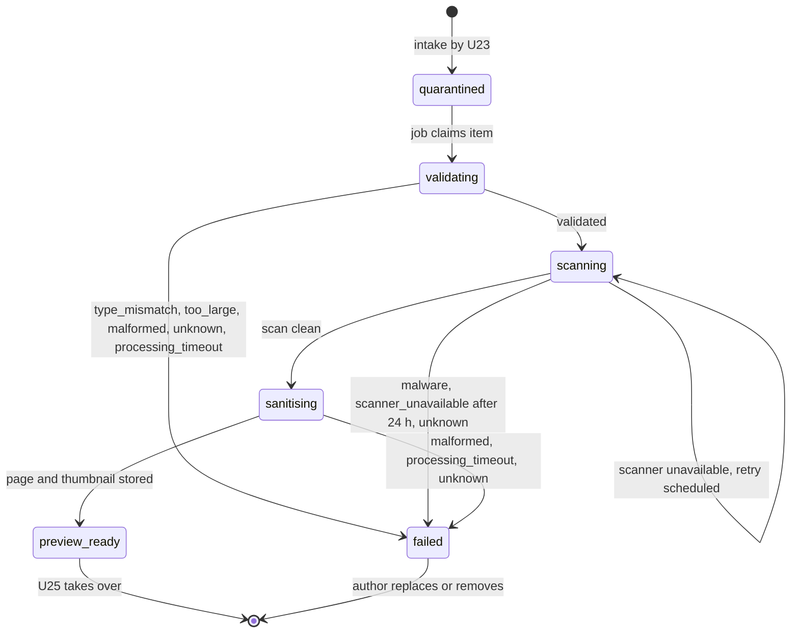
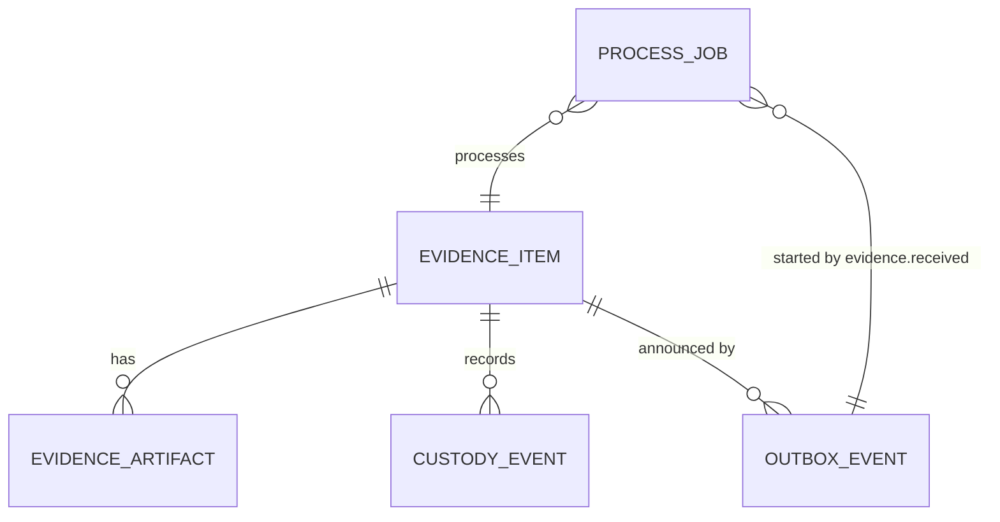

# Functional specification — U24 `t-304-worker-evidence-pipeline`

Unit U24 (kind `service`, size L, **high risk**: evidence) delivers T-304 for US7.1 (AC7.1.1, AC7.1.2, AC7.1.4–AC7.1.6) and the evidence part of US10.1 (AC10.1.1, AC10.1.5 as narrowed by FD-070). Lead perspective: architect. Support perspectives: developer (pg-boss, sharp and clamd mechanics, repository SQL, tests, §§ 8 and 10) and security (threat cases and adversarial tests, § 11). Draft written ahead of the stage on the owner's instruction to overlap design with builds; the lead finalises it and the reviewer checks it when the workflow reaches this Unit. Because the Unit is high risk, collaborators are on at the stage, a separate agent writes the adversarial tests of § 11.2, and the owner signs off in writing before the phase gate.

Baseline read on 2026-10-29: `main` at `9cf860a`, with T-010 (`14c21a9`), CR-006, CR-011 and CR-012 merged. U23 T-303, which this Unit depends on, is **not built and has no Functional Design draft yet**. This design therefore states, in § 6.4, the exact shapes it needs from U23; whoever drafts T-303 takes them from there (cross-Unit change X1).

Inputs: T-304 with its FD-070 amendment and the 2026-09-12 images-only scope block; T-303 (its owned paths, steps 2, 4, 6 and 8); `unit-of-work.md` (U24: ISS-139, ISS-181, ISS-182) and `unit-of-work-dependency.md` (U23, U3, U4); `requirements.md` FR44, FR60–FR62, FR66–FR68, FR87, FR88, NFR2; `stories.md` US7.1, AC6.1.6, AC10.1.1, AC10.1.5; `contract-summary.md` C8, C15 and the common rules; `docs/status/decision-log.md` (FD-002, FD-023, FD-035, FD-036, FD-037, FD-038, FD-041, FD-047, FD-050, FD-068, FD-070, FD-076, FD-092, FD-093, FD-094); `01-conventions.md` §1–§5, §10, §11, §13; `02-data-model.md` §0, §7, §12, §16, §17; `03-routes-and-contracts.md` §3–§5; ARCHITECTURE-SPINE AD-6, AD-7, AD-15; the code listed in § 2; the drafts of U8 T-101 (worker entry, `UnitOfWork`, `JobQueue`, worker environment) and U21 T-301 (`EvidenceForPublish`, Question 9, its seed `Crypto` FD); T-305, T-309, T-405 and T-407 task files for what they consume; `docs/implementation/ISSUES.md` rows ISS-072, ISS-139, ISS-164, ISS-175, ISS-181, ISS-182, ISS-239, ISS-251, ISS-279; `docs/aidlc-migration/OWNER-REVIEW-QUEUE.md`; the prototype's evidence chips (`app.js` `evFileHtml`), `ev.*` strings and notifications n1, n7, nA9.

This file is the source of truth for the workflows and state transitions. The data shape is in `entities.md`; the decision logic is in `rules.md`. Every open point is in `functional-design-questions.md` (Questions 1–19), all decided by the recommended option under the owner's no-questions instruction of 2026-10-29. § 18 holds the two FD entries the build appends before code.

## 1. What changes, in one paragraph

The worker gets its first real job. `evidence.process` takes a quarantined JPEG or PNG through `validating → scanning → sanitising → preview_ready` in that exact order, with a compare-and-set state change, its custody events and its outbox events in one transaction per step, so a retried or duplicated job resumes at the stored state and can never apply a step twice. Validation re-checks the quarantined bytes against the size and SHA-256 recorded at intake, then checks the magic bytes, the declared type and the 40 MP pixel limit before any scan. Scanning talks clamd's `INSTREAM` protocol through a new `node:net` adapter and **fails closed**: only an exact `stream: OK` reply with a known signature version advances an item. A scanner that cannot answer keeps the item in `scanning` and reschedules it (30 s, 2 min, 10 min, then hourly). After 24 hours without a scan the item fails with `scanner_unavailable`, so the author can replace or remove it (FD entry (b), Question 3). Sanitising re-encodes the image with sharp (EXIF orientation applied, every metadata block dropped, the same format kept) and writes one page and one 320 px thumbnail under `private/<itemId>/`, each with its hash and tool versions, never public. The author gets in-app notices only, through outbox events (FD-070): ready for privacy review, failed, and a one-time "could not be checked yet". The worker learns the author's account id from the intake event, not from the database, so the worker's database role loses its read of the two private columns of `evidence_items` (FD entry (a), closes ISS-139).

## 2. As is (baseline 2026-10-29) and what this Unit can count on

- **Worker.** `apps/worker/src` has `env.ts` (already parses `STORAGE_ROOT`, `CLAMD_HOST`, `CLAMD_PORT`), `container.ts`, `registry.ts` (`JOBS` holds only `outbox.relay`; a `JobDefinition.handler` gets `(payload, ctx)` and no job metadata), `main.ts` and `handlers/outbox-relay.ts`. The relay routes `evidence.received → evidence.process` with the C15 envelope `{eventId, name, payload}` and key `evidence.process:<eventId>` (`jobKey`).
- **Queue.** `packages/database/src/queue/queue-declaration.ts` declares `evidence.process` as `exclusive`, `retryLimit 3`, `retryBackoff true`, `retryDelaySeconds 10`, `expireInSeconds 300` (ISS-251: U24 sets its own value). Under `exclusive`, pg-boss refuses a second queued, retrying **or active** job with the same key, so a handler cannot reschedule its own item under its own key (finding F3). `PgBossQueue.work` passes only `job.data` to the handler and supports `batchSize` and polling only; `enqueue` accepts `startAfter` and an `executor` (the caller's transaction). pg-boss 12.31.0 offers `includeMetadata` (`retryCount`, `retryLimit`) and a per-job `signal`, and its `stately` policy keys one job per state (`created`, `retry`, `active`) per key (`plans.js` `job_i3`).
- **Database.** `schema/evidence.ts`: `evidence_items.review_id` is `NOT NULL` with a cascade FK to `reviews` (U23's open point, finding F7); `original_filename_enc` and `uploaded_by_account_id` are `NOT NULL`; `detected_mime` may only be `image/jpeg`, `image/png` or null; `evidence_artifacts` has `sanitiser_version`, `scanner_version`, `signature_version`, `public` (refused for `original`) and `bytes integer`. `0005_grants_part2.sql` grants `rk_worker` table-wide `SELECT, INSERT, UPDATE, DELETE` on the evidence tables; `validator-probes.int.test.ts` keeps ISS-139 as an `it.fails` tripwire. `migrations.int.test.ts` and `validator-probes.int.test.ts` pin 9 applied migrations. `repositories/evidence.ts` is a stub class; `updateState`, `insertArtifact` and `recordCustodyEvent` throw `NotImplemented('T-304')`, and T-010's `not-implemented.test.ts` checks every stub method and its owner.
- **Application and adapters are empty** (`application/src/index.ts` "Filled by T-101"; `adapters/src/index.ts`). U8 T-101 creates `defineCommand`, `UnitOfWork`, the `JobQueue` port (`enqueue(tx, name, payload, {key})`), `Clock`, `Logger`, the `@rogikotha/application/worker` subpath (`packages/application/src/worker.ts`) and the worker environment rule that deletes `APP_ENCRYPTION_KEY` and `BETTER_AUTH_SECRET` from the worker's process. U23 T-303 creates the evidence domain (`evidence-state.ts` with the full table, `limits.ts`), the `Storage` port and `storage-fs`, `ports/repositories/evidence.ts`, the intake command (custody `received`, outbox `evidence.received`) and the `ev.state.*` / `ev.fail.*` keys.
- **Test support.** Fakes exist with the old 03 shapes: `ScriptedScanner` (falls back to `unavailable` when its script runs out), `PassthroughImageSanitiser` (`{png, width, height, version}`), `MemoryStorage`, `MemoryJobQueue` (records `startAfter`), `FakeEvidenceRepository` (its `updateState`, `insertArtifact`, `recordCustodyEvent` mirror the stub); `repositories-superset.test.ts` makes each fake a superset of its stub's method names. Fixtures: `photo.jpg` (EXIF GPS, fixed by CR-008), `not-a-png.png`, `broken.jpg`, `flagged.jpg`, `prescription-1.jpg`, `prescription-2.jpg`, `report.pdf`; `oversize.png` is generated on demand. No fixture carries an EXIF orientation tag, a PNG text chunk or animation; those are generated inside the tests (§ 10).
- **Boundaries (T-010, FD-093).** `application` imports `domain` and `contracts` only, with no external package and no Node built-in (the `lib` is `ES2023`, so `AbortSignal` and `Buffer` are not even in scope there). `database` may not import `domain`. The worker imports application values only from `@rogikotha/application/worker`, and never `better-auth`, `drizzle-orm` or `pg`. Adapters are built only by the composition roots. Every package keeps an 80% line floor with untested files counted; `pnpm check` runs nine steps (eleven once U45 T-011 merges, per its refreshed draft), and CI runs before merge with PostgreSQL only (ISS-279).
- **i18n.** `notif.evidenceReady` ("…finished processing and is now attached to your experience") is the prototype's n1 copy, which describes publication, not the worker's `preview_ready`; prototype n7 ("…is waiting for you to cover any private details before it can be shown") is the copy for `preview_ready`. `ev.failNote` and the `ev.state.*` chips are ported.

## 3. Settled before this stage

- **Images only (FD-036).** No PDF, no `pdfjs-dist`, no `@napi-rs/canvas`, no `PdfRasteriser` port or fake, no `adapters/pdf-pdfjs/`, no `EVIDENCE_MAX_PAGES`. `too_many_pages` and `encrypted` stay unused enum values.
- **Fail closed (FD-035, 01 §11, AD-6).** A scan that cannot run never advances an item.
- **Worker notices are in-app only (FD-070, FD-041, FD-071).** The worker queues no `mail.send`, writes no `email_deliveries` row, calls no mail port and reads no address.
- **Job rules (FD-076, C15, the owner's CR-011 Q5 answer).** `evidence.process` keeps 3 retries and a 120 s bound per item; jobs are idempotent; the relay is transactional (FD-038).
- **Worker boundary (AD-6, FD-093).** No auth, identity, reveal, delete or account code in the worker.
- **Construction may run in parallel (FD-094).** U24 depends on U23, so it never shares a batch with it; § 15 lists the files it shares with Units that could be in its batch.
- **Since 2026-10-29 agents decide every open point by recommendation** (the owner's instruction); each decision is listed in `OWNER-REVIEW-QUEUE.md` when the stage finalises it.

## 4. Workflows

### WF0 — Code Generation order (the Unit end to end)

1. Baseline: `pnpm infra:up`, `pnpm check` and `pnpm smoke` green on the Bolt branch; read open `ISSUES.md` rows in the area (ISS-072, ISS-139, ISS-164, ISS-181, ISS-182, ISS-251, ISS-279). Read U23 as merged and compare it with § 6.4; any shape that differs is adapted here as a recorded addition, or becomes a finding.
2. Dependency check (AGENTS.md): `sharp` (pinned `^0.35.4`, last checked 2026-09-14, older than 3 days) and the `clamav/clamav:1.5.4` image; append a dated entry to `docs/status/dependency-check-log.md`. `file-type` is not added (Question 6).
3. Append the two FD entries of § 18 to the decision log, with the next free numbers.
4. Domain and application: the pipeline policy (`modules/evidence/pipeline.ts`), the ports (§ 6.1), the use case `processEvidenceItem` (`modules/evidence/jobs/process.ts`), the custody-details builders, the export from `@rogikotha/application/worker`.
5. Adapters: `scanner-clamd`, `image-sharp`, subpath exports (Question 18), `sharp` dependency.
6. Database: the worker methods of `PgEvidenceRepository` with explicit column lists (BR8.2); the grants migration if U23 did not apply it in effective form (Question 2); the queue declaration (`stately`, `expireInSeconds 150`, Question 4); `PgBossQueue.work` job context (Question 16).
7. Worker: `handlers/evidence-process.ts`, the `JOBS` entry, the container wiring, the relay entry for `evidence.scanDelayed`.
8. Test support: reshaped fakes (`ScriptedScanner`, `PassthroughImageSanitiser`, `FakeEvidenceRepository` worker methods, `MemoryStorage.putPrivateDerivative`), image builders for generated test images.
9. i18n keys in both files (§ 6.5); docs (03 §3–§5, 02 §16 and §17, C15, fixtures README, compose README); `ISSUES.md` rows.
10. Pins in the same commit: `not-implemented.test.ts`, the superset test, the two migration-count pins (if a migration was added), the queue-declaration tests, the ISS-139 probe turned from `it.fails` into `it`.
11. `pnpm check`, `pnpm smoke` (the Unit adds `evidence-process.smoke.test.ts`), then a local run of `clamd.int.test.ts` against a real clamd that must not be skipped (BR10.3).

### WF1 — Job entry (`apps/worker/src/handlers/evidence-process.ts`)

1. pg-boss delivers one job (batch size 1, one evidence job at a time per worker process) with `includeMetadata`, so the handler receives `{data, retryCount, retryLimit, signal}`.
2. The handler parses `data` with `EvidenceProcessJob` (contracts zod): the C15 envelope `{eventId, name: 'evidence.received', payload: {itemId, uploaderAccountId}}`, both ids UUIDs. A parse failure logs `evidence.payload_invalid {eventId?}` and completes the job without retry and without any write (BR1.1).
3. It builds a run signal that aborts at 120 s or when pg-boss aborts the job, whichever comes first (BR1.7), and calls `processEvidenceItem({itemId, uploaderAccountId, eventId, attempt: {retryCount, retryLimit}}, deps, signal)` from `@rogikotha/application/worker`.
4. The use case returns `ok({outcome})` where `outcome ∈ {advanced, preview_ready, failed, rescheduled, skipped, superseded}`, or throws an unexpected error. On a throw the handler rethrows, so pg-boss retries (retry delay 30 s with backoff, limit 3), unless the use case already turned the final attempt into `failed(unknown)` (WF8).
5. The handler logs `evidence.process.done {itemId, eventId, outcome, durationMs}`; nothing else.

### WF2 — The run loop (`processEvidenceItem`)

1. Load the item through `EvidenceRepository.loadForProcessing(itemId)`: `{id, state, failReason, declaredMime, originalBytes, originalSha256, reviewId, originalKey}` where `originalKey` is the storage key of the item's `original` artifact. Missing → log `evidence.item_missing`, outcome `skipped` (BR1.2).
2. If `state` is not one of `quarantined`, `validating`, `scanning`, `sanitising`, the outcome is `skipped` (BR1.3): the job is a replay, or the author or a moderator acted first.
3. If `state = quarantined`, compare-and-set it to `validating` (no custody event; the stage's event is written when the stage ends). A lost compare-and-set is `superseded` (BR1.5).
4. Loop: `while ((stage = nextStage(state)) !== null)` run the stage (WF3, WF4, WF6) and continue with the state it committed. `nextStage` is the pure function of `pipeline.ts`: `validating → validating`, `scanning → scanning`, `sanitising → sanitising`, anything else `null`. A stage either commits the next state, commits a failure, or (scanning only) commits a reschedule and ends the run.
5. Every stage re-reads the original from storage and re-checks its integrity (BR2.2), so a resumed run never trusts bytes from an earlier run.

### WF3 — Validating

1. `Storage.readPrivate(originalKey, {maxBytes: MAX_BYTES + 1})` returns the bytes. More than `MAX_BYTES` (15 MB) → `failed(too_large)` (BR2.1).
2. Integrity: the length must equal `original_bytes` and the SHA-256 must equal `original_sha256`; otherwise `failed(unknown)` with custody detail `check: integrity` (BR2.2, Question 10).
3. Magic bytes (domain `sniffImageType`): JPEG `FF D8 FF`, PNG `89 50 4E 47 0D 0A 1A 0A`; anything else is `other`. The sniffed type must equal `declared_mime`, else `failed(type_mismatch)` (BR2.3).
4. `ImageSanitiser.inspect(bytes)` (sharp, header only): its `format` must agree with the sniffed type (else `type_mismatch`); `pages > 1` → `malformed`; `width × height > 40 000 000` → `too_large`; an unreadable header → `malformed` (BR2.4).
5. No scanner call has happened yet (BR2.5). On a pass: compare-and-set `validating → scanning`, set `detected_mime`, custody `validated {detectedMime, width, height, bytes}` (BR2.6).

### WF4 — Scanning

1. `MalwareScanner.scan(bytes, signal)` returns `clean {scannerVersion, signatureVersion}`, `detected {signature, scannerVersion, signatureVersion}` or `unavailable {cause}` (BR3.1, BR9.1–BR9.4).
2. `clean` → compare-and-set `scanning → sanitising`, custody `scan_clean {scanner: clamav, scannerVersion, signatureVersion}`; continue.
3. `detected` → compare-and-set `scanning → failed`, `fail_reason = malware`, custody `scan_detected {signature, scannerVersion, signatureVersion}` and `failed {stage: scanning, reason: malware}`, outbox `evidence.stateChanged {state: failed, failReason: malware}`. The original stays in quarantine for custody; nothing is deleted and no artifact is written (BR3.2).
4. `unavailable` → WF5.

### WF5 — Scanner outage (fail closed)

1. Count the item's earlier `scan_unavailable` events (`attempt = count + 1`) and read the time of the first one (`firstAt`, the current time when there is none).
2. If `Clock.now() − firstAt ≥ 24 h`, fail instead: compare-and-set `scanning → failed`, `fail_reason = scanner_unavailable`, custody `scan_unavailable {attempt, cause, nextAttemptInSec: 0}` and `failed {stage: scanning, reason: scanner_unavailable}`, outbox `evidence.stateChanged {state: failed, failReason: scanner_unavailable}` (BR3.5, FD entry (b)).
3. Otherwise, in one transaction: assert the state is still `scanning` (`touchIfState`, which sets `updated_at`), custody `scan_unavailable {attempt, cause, nextAttemptInSec}`, and `JobQueue.enqueue(tx, 'evidence.process', sameEnvelope, {key: 'evidence.process:<eventId>', startAfter: now + delay(attempt)})` with `delay = 30 s, 120 s, 600 s, then 3600 s` (BR3.3, BR3.4). On the first attempt only, the same transaction appends `evidence.scanDelayed {itemId, reviewId?, uploaderAccountId}` (BR3.6).
4. The run ends with outcome `rescheduled`; the handler completes the job normally, so it never also enters pg-boss's retry state (BR6.4). Under the `stately` policy the follow-up job (`created`) coexists with the running one (`active`) under the same key, and a second follow-up for the same key is refused as `deduplicated` (Question 4).
5. The item never advances while unavailable; the composer keeps showing "Scanning for malware" with no promised time (AC7.1.5).

### WF6 — Sanitising and preview

1. `ImageSanitiser.sanitise(bytes, {maxPixels, signal})` → `{page: {bytes, mime, width, height}, thumbnail: {bytes, mime, width, height}, version}` (BR4.1). sharp applies EXIF orientation (`.rotate()`), drops every metadata block, and re-encodes PNG as PNG and JPEG as JPEG at quality 85 with mozjpeg (Question 7); the thumbnail is 320 px wide, never enlarged, same format.
2. The adapter re-inspects both outputs and refuses any that still carries EXIF, ICC, XMP, IPTC or text comments, has a different format, or exceeds the pixel limit (BR4.2). A decode error → `malformed`; a sharp timeout or the run signal → `processing_timeout` (BR4.6).
3. `Storage.putPrivateDerivative(bytes, {itemId, name})` writes `private/<itemId>/page-1.<ext>` and `private/<itemId>/thumbnail-1.<ext>` (atomic write-then-rename that replaces an earlier, unreferenced file of the same name) and returns `{key, bytes, sha256}` (BR4.4, Question 8).
4. One transaction: compare-and-set `sanitising → preview_ready`, `page_count = 1`; two artifact rows (`page_png` page 1, `thumbnail` page 1) with `sha256`, `bytes`, `mime`, `width`, `height`, `sanitiser_version`, `scanner_version`, `signature_version`, `public = false`, `immutable = true`; custody `sanitised {sanitiserVersion, pageMime, width, height, thumbnailWidth}` and `preview_ready {pages: 1}`; outbox `evidence.stateChanged {itemId, reviewId?, state: preview_ready, uploaderAccountId}` (BR4.5, BR4.7). The scan versions come from the item's latest `scan_clean` custody event, so a run resumed at `sanitising` records the versions of the scan that actually passed.
5. A lost compare-and-set or a failure after the files were written deletes the files this run wrote and nothing else (BR4.8).

### WF7 — Failure (any stage)

The failure transaction is always: compare-and-set `<stage> → failed` with `fail_reason`; custody `validation_failed {reason, detectedMime?, check?}` (validating) or `scan_detected` (malware) or nothing extra (other stages), then `failed {stage, reason}`; outbox `evidence.stateChanged {itemId, reviewId?, state: failed, failReason, uploaderAccountId}`. The original is kept, no artifact row survives, the review is never touched (BR6.1–BR6.6). The author's composer then shows the chip `ev.state.failed`, the reason `ev.fail.<reason>`, `ev.failNote` and Replace and Remove (U23, U26).

### WF8 — Timeouts and retries

- **Run budget.** 120 s per run (`EVIDENCE_RUN_BUDGET_MS`, a constant, Question 9), enforced by the run signal; pg-boss `expireInSeconds` is 150, so the job expires only after the use case had its chance to record the outcome (closes ISS-251).
- **Abort in validating or sanitising** → `failed(processing_timeout)`. **Abort in scanning** → the scan reports `unavailable {cause: timeout}` → WF5 (BR6.3).
- **Unexpected errors** (storage read failure, database error, a defect): the use case rethrows while `retryCount < retryLimit`; on the final attempt it commits `failed(unknown)` with custody `failed {stage, reason: unknown}` instead of rethrowing (BR6.4). If even that write fails (database down), the job ends failed in pg-boss and the item stays in its stage; this is visible to staff through `evidence.listForStaff` and recorded as risk K5.

### WF9 — Concurrent or replayed jobs, and actors who act first

- Two jobs for one item (a crash retry overlapping a follow-up, or a replayed relay send) both read the same state. Every write is a compare-and-set in the same transaction as its custody and outbox rows, so exactly one commits; the other's transaction rolls back, it deletes any files it wrote, and ends `superseded` (BR1.5).
- The author removes an item in `quarantined` (U23: state `rejected`, files deleted) → the job's first compare-and-set fails → `superseded`. A moderator's `removeFile` (any state → `removed`) during sanitising → the final compare-and-set fails → the run deletes its own derivative files (BR4.8).
- U21's `bindToReview` sets `review_id` on an item in flight; the pipeline never writes `review_id` and reads it fresh in each transaction, so the outbox payload carries the review id when one exists (AC6.1.6).

## 5. State transitions

The evidence state machine lives in `packages/domain/src/evidence/evidence-state.ts` (U23 writes the whole table once). This Unit uses the rows below and needs two that 02 §17 does not list (marked †); if U23's table lacks them, this Unit adds them to the table and its test as a recorded addition (Question 17, FD entry (b)).

| From | To | Trigger (this Unit) | Custody | Outbox |
|---|---|---|---|---|
| `quarantined` | `validating` | job claims the item | — | — |
| `validating` | `scanning` | magic, type, integrity and pixel checks pass | `validated` | — |
| `validating` | `failed` | `type_mismatch`, `too_large`, `malformed`, `unknown` (integrity), `processing_timeout` | `validation_failed`, `failed` | `evidence.stateChanged` |
| `scanning` | `scanning` | scanner unavailable, within 24 h | `scan_unavailable` | `evidence.scanDelayed` (first time only) |
| `scanning` | `sanitising` | exact clean reply | `scan_clean` | — |
| `scanning` | `failed` | `malware`; † `scanner_unavailable` after 24 h; `unknown` on the final attempt | `scan_detected` or `scan_unavailable`, then `failed` | `evidence.stateChanged` |
| `sanitising` | `preview_ready` | page and thumbnail stored | `sanitised`, `preview_ready` | `evidence.stateChanged` |
| `sanitising` | `failed` | † `malformed` (decode error), `processing_timeout`, `unknown` | `failed` | `evidence.stateChanged` |

Text fallback: an item enters as `quarantined`; the job moves it to `validating`, then to `scanning` once every check passes, or to `failed`. In `scanning` an unavailable scanner keeps it in `scanning` and schedules another attempt; a clean reply moves it to `sanitising`; malware, 24 hours of outage or a final unexpected error move it to `failed`. In `sanitising`, storing the page and thumbnail moves it to `preview_ready`, where U25 takes over; a decode error, timeout or final unexpected error moves it to `failed`. Every other state (`preview_ready`, `privacy_confirmed`, `published`, `failed`, `rejected`, `removed`, `original_expired`) is left alone by the job.

## 6. Interfaces

### 6.1 Ports (`packages/application/src/ports/`), all with application-owned types

The application cannot name Node or library types (§ 2), so bytes are `Uint8Array` and cancellation is `AbortSignalLike {readonly aborted: boolean; addEventListener(type: 'abort', listener: () => void, options?: {once?: boolean}): void; removeEventListener(type: 'abort', listener: () => void): void}`, which a real `AbortSignal` satisfies structurally.

| Port | Methods | Real adapter | Fake |
|---|---|---|---|
| `MalwareScanner` (`scanner.ts`, new) | `scan(bytes: Uint8Array, signal: AbortSignalLike) → Promise<ScanResult>`; `ScanResult = {status: 'clean', scannerVersion, signatureVersion} \| {status: 'detected', signature, scannerVersion, signatureVersion} \| {status: 'unavailable', cause: 'refused' \| 'timeout' \| 'error_reply' \| 'size_limit' \| 'protocol' \| 'version_unknown'}`; never throws | `adapters/scanner-clamd` | `ScriptedScanner` (reshaped; records calls; falls back to `unavailable`) |
| `ImageSanitiser` (`image-sanitiser.ts`, new) | `inspect(bytes) → Promise<{format: 'jpeg' \| 'png' \| 'other', width, height, pages} \| {error: 'unreadable'}>`; `sanitise(bytes, {maxPixels, signal}) → Promise<Result-like {ok: true, page, thumbnail, version} \| {ok: false, error: 'malformed' \| 'timeout' \| 'metadata_left' \| 'too_large'}>` | `adapters/image-sharp` | `PassthroughImageSanitiser` (reshaped; scriptable failures and a never-resolving mode) |
| `Storage` (U23, extended) | `readPrivate(key, {maxBytes}) → Promise<Uint8Array \| {error: 'too_large' \| 'missing'}>`; `putPrivateDerivative(bytes, {itemId, name}) → Promise<{key, bytes, sha256}>`; `delete(key, {reason})` | U23 `storage-fs` (this Unit adds the two methods if U23 has not) | `MemoryStorage` |
| `EvidenceRepository` (U23, extended with worker methods) | `loadForProcessing(itemId)`; `transition(tx, {itemId, from, to, failReason?, detectedMime?, pageCount?}) → boolean`; `touchIfState(tx, itemId, state) → boolean`; `appendCustody(tx, {itemId, event, details})` (actor `worker`); `insertArtifact(tx, row)`; `custodyStats(itemId, event) → {count, firstAt?}`; `latestCustody(itemId, event) → details \| null` | `database/repositories/evidence.ts` | `FakeEvidenceRepository` |
| `JobQueue` (U8, extended) | `enqueue(tx, name, payload, {key, startAfter?})` | `database/queue` | `MemoryJobQueue` |
| `Outbox`, `UnitOfWork`, `Clock`, `Logger`, `IdGenerator` (U8) | as U8 | — | — |

Deliberately absent from the use case's dependency type: any mail port, `EmailDeliveryRepository`, `Crypto`, `AuditWriter`, `ConfigProvider` and any account or identity port (BR5.1, BR7.4, BR8.3). The type itself proves FD-070 structurally; a test also asserts it.

### 6.2 The use case

`processEvidenceItem(input: {itemId, uploaderAccountId, eventId, attempt: {retryCount, retryLimit}}, deps: EvidencePipelineDeps, signal: AbortSignalLike) → Promise<Result<{outcome}>>`, in `modules/evidence/jobs/process.ts`, exported from `packages/application/src/worker.ts`. Pure helpers in `modules/evidence/pipeline.ts`: `nextStage(state)`, `failureFor(stage, cause)`, `scanRetryDelaySec(attempt)`, `scanWindowExpired(firstAt, now)`, `sniffImageType(bytes)`, `custodyDetails(event, input)` (allowlist builder). Constants (`EVIDENCE_RUN_BUDGET_MS = 120_000`, `SCAN_RETRY_WINDOW_MS = 24 h`, `MAX_PIXELS = 40_000_000`, `THUMBNAIL_WIDTH = 320`, `JPEG_QUALITY = 85`) sit beside them; `MAX_PIXELS` joins U23's `limits.ts` when that file exists.

### 6.3 Events and job (C15, additive)

| Name | Payload | Written by | Routed to |
|---|---|---|---|
| `evidence.received` | `{itemId, uploaderAccountId}` (**`uploaderAccountId` is new**, written by U23's intake in the web tier, Question 1) | U23 | `evidence.process` |
| `evidence.stateChanged` | `{itemId, reviewId?, state, failReason?, uploaderAccountId}`; this Unit writes it for `preview_ready` and `failed` only (Question 5) | U24 (and U25 for its states) | `notification.deliver` (U34), `search.refresh` (added by U25) |
| `evidence.scanDelayed` (**new**) | `{itemId, reviewId?, uploaderAccountId}`, once per item | U24 | `notification.deliver` (relay entry added by this Unit, Question 5) |
| job `evidence.process` | envelope `{eventId, name, payload}`; key `evidence.process:<eventId>` for the relay's send and every follow-up; policy `stately`; `retryLimit 3`, `retryDelay 30`, `retryBackoff`, `expireInSeconds 150` | U24 | — |

### 6.4 What this Unit needs from U23 T-303 (cross-Unit change X1)

1. `evidence.received` payload `{itemId, uploaderAccountId}` (Question 1); no direct enqueue of `evidence.process` from the intake command (the relay is the one producer, so every job carries the envelope and the relay's key; T-303 step 4's "fast path" would add a second job under another key).
2. The worker's privileges on `evidence_items` as column lists (Question 2, FD entry (a)), applied by T-303 step 8's migration in the effective form.
3. `Storage.readPrivate(key, {maxBytes})` and `putPrivateDerivative(bytes, {itemId, name})` writing under `private/<itemId>/` (T-303 step 2 has `putDerivative` writing to `public/`, which this Unit never uses; finding F5).
4. The state-table rows marked † in § 5.
5. Repository reads that the worker uses select named columns only (BR8.2).
6. `review_id` nullable (or another draft link) so an item exists before its review (U23's open point; finding F7 is S1 for U23 if it is left).

If U23 merges without one of these, this Unit adds it as a recorded addition in U23's files and records the difference in its Build and Test record.

### 6.5 New strings (`packages/i18n/messages/{en,bn}.json`, same commit)

| Key | en | bn |
|---|---|---|
| `notif.evidence.previewReady` | A document you attached is waiting for you to cover any private details before it can be shown. | আপনার যুক্ত করা একটি কাগজ দেখানোর আগে ব্যক্তিগত তথ্য ঢাকার অপেক্ষায় আছে। |
| `notif.evidence.failed` | A document you attached could not be prepared, so it will not be shown. Your words are not affected. You can replace or remove the file. | আপনার যুক্ত করা একটি কাগজ প্রস্তুত করা যায়নি, তাই এটি দেখানো হবে না। আপনার লেখায় কোনো প্রভাব পড়েনি। আপনি ফাইলটি বদলাতে বা সরাতে পারেন। |
| `notif.evidence.scanDelayed` | A document you attached could not be checked yet. We will try again, and it stays private until it passes. | আপনার যুক্ত করা একটি কাগজ এখনো যাচাই করা যায়নি। আমরা আবার চেষ্টা করব, আর যাচাই না হওয়া পর্যন্ত এটি ব্যক্তিগত থাকবে। |

The en copy of `previewReady` is prototype n7 without the label (notification params carry no content, 02 §12); `failed` follows `ev.failNote` and FR66's Replace/Remove guidance; `scanDelayed` follows the task's in-app copy and promises no time (AC7.1.5). No string holds a number. The Bengali is drafted here and goes to the owner's Bengali copy review (FD-042). No `email.evidence.*` key (FD-070).

## 7. Placement under the T-010 boundaries

| Files | Element | May import | Note |
|---|---|---|---|
| `packages/application/src/ports/{scanner,image-sanitiser}.ts`, `modules/evidence/{pipeline.ts, jobs/process.ts, custody-details.ts}` | application | domain, contracts | no external, no Node built-in; `process.ts` imports no `modules/evidence/index.ts`, `commands/` or `authorization.ts` (they can reach account code) |
| `packages/application/src/worker.ts` | application | — | gains `export { processEvidenceItem }` and its types |
| `packages/adapters/src/scanner-clamd/**` | adapters | application ports, contracts, `node:net` | ~120 lines, no third-party clamd client |
| `packages/adapters/src/image-sharp/**` | adapters | application ports, contracts, `sharp` | the only importer of `sharp` outside test-support scripts |
| `packages/database/src/repositories/evidence.ts`, `migrations/00NN_evidence_worker_columns.sql` (only if needed), `queue/{queue-declaration,pg-boss-queue}.ts` | database | application ports, contracts, drizzle, pg | never `domain` |
| `apps/worker/src/{handlers/evidence-process.ts, registry.ts, container.ts, main.ts}`, `handlers/outbox-relay.ts` (one relay entry) | worker | `@rogikotha/application/worker` (values), `@rogikotha/application` (types), contracts, database, adapters | no `better-auth`, `drizzle-orm`, `pg` |
| `packages/test-support/src/fakes/{scanner,image-sanitiser,storage,repositories}.ts`, `builders/evidence-images.ts` | test-support | application, contracts, domain | builders may import `sharp` (external allowed in test-support) |
| `packages/contracts/src/schemas/evidence-jobs.ts` (`EvidenceProcessJob`, event payload schemas) | contracts | zod | — |

## 8. Developer view — mechanics

- **pg-boss.** The queue changes from `exclusive` to `stately` (Question 4). The stored policy of an existing queue does not change on `createQueue`, so `ensureQueue` throws `QueuePolicyMismatchError` on an old local database: run `pnpm db:reset` once (CI starts from empty). `PgBossQueue.work(name, handler, {includeMetadata: true})` passes a `JobContext {jobId, retryCount, retryLimit, signal}` as the handler's second argument, and `JobDefinition.handler` becomes `(payload, ctx, job)`; the outbox relay ignores the third argument. Follow-up sends use the caller's transaction (`executor`), so the custody row and the next job commit together.
- **clamd.** One TCP connection per command (`zVERSION\0`, then `zINSTREAM\0`); chunks of at most 64 KiB, each prefixed with a 4-byte big-endian length, then a zero-length terminator; read until `\0` or 4 KiB; connect timeout 5 s, whole scan 30 s; the version is cached for 10 minutes and a failed version query makes the scan `unavailable {cause: version_unknown}` (Question 11). Version reply `ClamAV 1.5.4/28115/Sun Sep 6 06:26:06 2026` gives `scannerVersion 1.5.4` and `signatureVersion 28115`. Only `stream: OK` is clean; `stream: <sig> FOUND` is detected; `INSTREAM size limit exceeded` is `size_limit`; anything else, including an extra reply after the first `\0`, is `protocol` or `error_reply`.
- **sharp 0.35.** `sharp.concurrency(1)`, `sharp.cache(false)` at adapter construction; `sharp(bytes, {limitInputPixels: maxPixels, failOn: 'error', sequentialRead: true})` (libvips `error` level also stops on truncation, so `broken.jpg` fails); `.rotate()`; `.timeout({seconds: 30})`; `.png({compressionLevel: 9})` or `.jpeg({quality: 85, mozjpeg: true})`; never `withMetadata`, `keepMetadata`, `keepExif`, `keepIccProfile` or `withExif`. The output check re-reads `metadata()` and requires `exif`, `icc`, `xmp`, `iptc` and `comments` to be absent and `orientation` to be absent or 1. `version` is `sharp@<sharp.versions.sharp> libvips@<sharp.versions.vips>`. sharp keeps no reference to the run signal; the adapter races the pipeline against the signal and returns `timeout` on abort (the libvips work stops at its own 30 s timeout).
- **Repository SQL.** Every worker query names its columns. With column-level privileges, a Drizzle `db.select().from(evidenceItems)` (all columns) or `returning()` without fields fails with `permission denied` for `rk_worker` (BR8.2). `transition` is one `UPDATE evidence_items SET state = $to, fail_reason = …, detected_mime = …, page_count = …, updated_at = now() WHERE id = $id AND state = $from` and returns whether one row changed.
- **Storage.** `putPrivateDerivative` writes to a temp file in the same directory and renames it, so a crashed run leaves at most one stale, unreferenced file that the next run replaces. Files under `private/` are served by no route; U25 publishes by writing public copies (its design).
- **Worker container.** Builds `ClamdScanner({host: CLAMD_HOST, port: CLAMD_PORT})`, `SharpImageSanitiser()`, the storage adapter from `STORAGE_ROOT` (anchored at the repo root, ISS-169), `PgEvidenceRepository` on the worker pool, the U8 `UnitOfWork`, `Outbox`, `JobQueue`, `Clock` and logger. It builds no mail transport for this job's dependencies.

## 9. Findings and proposed ISS rows (each `Found in U24 T-304`)

| # | Sev | Area | Finding | Resolution |
|---|---|---|---|---|
| F1 | S2 | database/grants | ISS-139's suggested fix `REVOKE SELECT (original_filename_enc) … FROM rk_worker` does nothing in PostgreSQL while the role holds the table-level `SELECT` that `0005` grants; T-303 step 8 plans the same form. The `it.fails` probe would stay red and the hole open. | Designed out: revoke table-level `SELECT, UPDATE`, then grant both on the column list (Question 2, FD entry (a)). |
| F2 | S2 | contracts | C15 gives `evidence.stateChanged` an `uploaderAccountId`, but `evidence.received` carries `{itemId}` only and PR3 removes the worker's read of `uploaded_by_account_id`, so the worker cannot fill the payload. T-304 step 6 proposed keeping the read. | Designed out: the web tier puts the id in `evidence.received` (Question 1); needs U23 (X1). |
| F3 | S2 | worker/queue | Under the declared `exclusive` policy, a handler that reschedules its own item with the same key is refused as `deduplicated` (the running job counts), so the task's "reschedule with `startAfter`" silently drops the retry and leaves the item in `scanning` with no job. | Designed out: `stately` policy and one key per item chain (Question 4). |
| F4 | S2 | application/boundaries | Task step 1 puts `file-type` and sharp calls in the application handler; T-010 forbids any external package in `application`, and `AbortSignal`/`Buffer` are not in its type scope. | Designed out: inspection behind `ImageSanitiser`, magic bytes as a pure function, application-owned byte and signal types (§ 6.1, Question 6). |
| F5 | S2 | storage | T-303 step 2's `putDerivative` writes to `public/<itemId>/…`; worker derivatives must stay private until U25 publishes them (AD-6, hard rule: only published items have public artifacts). | Designed out: `putPrivateDerivative` under `private/` (Question 8); needs U23 (X1). |
| F6 | S2 | worker/queue | The task's `teamSize`/`teamConcurrency` is the pg-boss 9 API; `PgBossQueue.work` exposes neither concurrency nor job metadata, so "retries exhausted" cannot be detected. | Designed out: job context with `retryCount`, `retryLimit`, `signal` (Question 16). |
| F7 | S1 for U23 | database/schema | `evidence_items.review_id` is `NOT NULL` with a FK to `reviews`, but intake happens on a draft before any review exists (T-303 step 4 writes `review_id: null`). | Open in U23 (its carried open point); this Unit treats `reviewId` as optional everywhere. |
| F8 | S2 | product/state | "Never fails for this cause" plus U23's `remove` (refused in `scanning`) leaves an item stuck forever with no way out for the author while the scanner is down, against AC7.1.4. | Designed out: fail with `scanner_unavailable` after 24 h (Question 3, FD entry (b)). |
| F9 | S2 | retention | Originals of failed items (malware included) never get `retention_expires_at` (U25 sets it at publish; the expiry index covers `published` only), so they are kept forever, against FR67's 90-day default. | Cross-Unit X4 for U29 T-309: failed and rejected items expire `originalDays` after their `failed` or `removed` custody event. |
| F10 | S2 | notification | T-405's dedupe key `<event>:<targetId>:<accountId>` gives every `evidence.stateChanged` notice of one item the same key, so a later notice (failed after a replace, published, removed) is swallowed; its routing expects a pseudo-state `scan_unavailable` and keys `notif.evidence.<state>`. | Cross-Unit X3 for U34: key includes the state; route `evidence.scanDelayed`; explicit key table (Question 5, Question 15). |
| F11 | S2 | deletion | After PR3, a worker `data.delete` step cannot select evidence items by `uploaded_by_account_id`. | Cross-Unit X5 for U39 T-410: find the account's items in the web step, or by review ids. |
| F12 | S3 | copy | `ev.state.sanitising` maps to the prototype chip "Making the public copy", but sanitising happens before redaction and makes a private copy. | Cross-Unit X1/X6 for U23 and U26 (copy only). |
| F13 | S3 | storage | The seed's derivative keys use the item's public id (`public/<itemPublicId>/page-1.png`, fixtures README), which T-303's key pattern (`[0-9a-f-]{36}`) refuses. | Cross-Unit X1 for U23 (accept or re-key seeded items) and U28 T-308. |
| F14 | S3 | docs | ISS-072: `infra/compose/README.md` tells readers to grep for a log line clamd never prints. | Fixed here (recorded addition). |
| F15 | S4 | i18n | `notif.evidenceReady` (n1) describes publication; the seeded n7 uses it for a privacy-review notice (ISS-260). | New `notif.evidence.previewReady` carries n7's meaning; ISS-260's owner may point n7 at it. |
| F16 | S4 | worker | If U23 ever encrypts originals at rest (FR67 says "encrypted"), the worker cannot use `APP_ENCRYPTION_KEY` (U8 deletes it from the worker's process). | Cross-Unit X1: a storage-only key, as the owner chose a separate mail-only worker key. |
| F17 | S4 | parallel build | FD-094's swarm: this Unit shares files with any Unit in its batch that adds a migration, a worker job, an outbox route or i18n keys (§ 15). | Recorded for Delivery Planning's batch choice. |
| F18 | S4 | seed | ISS-182: the seed writes plaintext bytes into `original_filename_enc`; the worker cannot fix it (it never reads the column and has no `APP_ENCRYPTION_KEY`). | Question 14: fixed here through U21 T-301's seed `Crypto` edge when that is merged at this Unit's baseline, otherwise re-owned to U21. |
| F19 | S4 | seed/moderation | ISS-164: how an auto-hidden evidence item is represented is a moderation decision, not a pipeline step. | Question 19: re-owned to U32 T-403. |
| F20 | S4 | ci | ISS-279: CI has no ClamAV, and this is the first Unit whose tests use one. | Question 12: explicit skip in CI, mandatory local run at Build and Test. |

## 10. Developer view — tests

| Level | File | What it proves |
|---|---|---|
| application | `modules/evidence/jobs/process.test.ts` (fakes) | stage order from `quarantined` is exactly `validating, scanning, sanitising, preview_ready`; custody `validated, scan_clean, sanitised, preview_ready` once each and in order; resume at `scanning` does not re-validate (no `validated` event added); every failure mapping of `rules.md` BR6.1; type mismatch before any scan (`scanner.calls === 0`); malware keeps the original and writes no artifact; outage keeps `scanning`, writes `scan_unavailable`, enqueues with `startAfter` 30 s → 2 min → 10 min → 1 h, one `evidence.scanDelayed` across three outages, continues after a later `clean`, never `preview_ready` while unavailable; 24 h of outage → `failed(scanner_unavailable)`; a never-resolving sanitiser with a 200 ms budget → `processing_timeout`; final attempt error → `failed(unknown)`, earlier attempts rethrow; lost compare-and-set → `superseded` and the run's files deleted; skipped states; FD-070 rows: `emailEvidence` on, no mail port in the deps, no `mail.send` in `MemoryJobQueue`, no email-delivery write, outbox payloads exactly the allowlisted keys |
| application | `modules/evidence/pipeline.test.ts` | `nextStage`, `failureFor` table, `scanRetryDelaySec`, `scanWindowExpired` at 24 h − 1 ms and 24 h, `sniffImageType` (JPEG, PNG, PDF, GIF, empty, 3 bytes), `custodyDetails` drops unknown keys and refuses a filename-like value |
| adapters | `scanner-clamd/clamd.test.ts` | an in-process `net.createServer` stub asserts the exact bytes (`zINSTREAM\0`, length prefixes, zero terminator) and maps `OK`, `FOUND`, `ERROR`, size limit, garbage, two replies, an over-long reply, a silent server (timeout), ECONNREFUSED and a failed version query |
| adapters | `scanner-clamd/clamd.int.test.ts` | real clamd: `flagged.jpg` → `detected`, `photo.jpg` → `clean` with versions; unreachable within 3 s → skipped with `clamd not reachable at <host:port>; start infra (pnpm infra:up) to run scanner tests` |
| adapters | `image-sharp/image-sharp.test.ts` | `photo.jpg` output has no EXIF and no GPS; a generated orientation-6 JPEG comes out rotated (width and height swapped); a PNG with `tEXt`/`iTXt` and a JPEG with a COM marker lose them (byte search); thumbnail 320 px wide and never enlarged; animated input → `malformed`; a crafted 30000 × 30000 PNG header → `too_large` in under 2 s; `broken.jpg` → `malformed`; PNG stays PNG, JPEG stays JPEG |
| database | `repositories/evidence.int.test.ts` | each worker method as `rk_worker`; compare-and-set with two concurrent transactions (one wins); artifacts' `sha256` matches the stored bytes, `sanitiser_version` non-empty, `public = false`; `rk_worker` gets `permission denied` for `original_filename_enc`, `uploaded_by_account_id` and `select *`, and can read and update every other column |
| database | `validator-probes.int.test.ts` | ISS-139 probe turns from `it.fails` into `it` |
| database | queue tests | `evidence.process` is `stately` with `expireInSeconds 150`; a same-key follow-up is accepted while one job is active and a second is `deduplicated` |
| worker | `handlers/evidence-process.test.ts`, `evidence-process.smoke.test.ts` | parse refusal without retry; the run budget; outcome logging with allowlisted fields; the container builds no mail transport into the pipeline deps; the import graph of `application/src/worker.ts` reaches no `modules/{account,identity,data-requests}` or mail module |

Coverage: the new adapter and application files must reach the 80% line floor with the unit tests alone, because CI skips the clamd integration test (Question 12).

## 11. Security view

### 11.1 Threat cases

| Abuse | Mitigation | Rule | Test |
|---|---|---|---|
| Scanner outage used to slip a file through | only an exact clean reply with a known version advances | BR3.1, BR9.2 | outage tests, clamd stub |
| Misread scanner reply (`ERROR`, size limit, two replies, junk) | strict parser; everything else is `unavailable` | BR9.2 | `clamd.test.ts` |
| Polyglot or renamed file | magic bytes, declared type and sharp's own format must all agree | BR2.3, BR2.4 | type-mismatch tests |
| Tampered quarantine bytes between intake and processing | length and SHA-256 re-checked on every run | BR2.2 | integrity test |
| Pixel or decompression bomb | header pixel check, `limitInputPixels`, 30 s sharp timeout, 120 s run budget, one job at a time, `sharp.concurrency(1)` | BR2.4, BR4.6, BR1.7, BR1.8 | pixel bomb, timeout |
| Metadata leak (GPS, comments, XMP) into the copy the public will see | re-encode without metadata, then verify the output | BR4.1, BR4.2 | image tests, byte search |
| Duplicate or replayed jobs writing twice | compare-and-set in the same transaction as custody and outbox | BR1.5 | concurrent test |
| Worker reading private linkage or filenames | column-level grants; uploader id from the payload | BR8.1, BR1.6 | grants tests |
| Worker reaching mail, auth or identity | dependency type, import graph, boundary lint | BR5.1, BR8.3 | worker tests, `pnpm lint` |
| Leaks in logs or custody | allowlisted builders; filename never read | BR7.1, BR7.3 | log and custody assertions |
| Payload naming a storage path | the key comes from the database, never the payload | BR8.5 | payload test |

### 11.2 Adversarial angles for the separate agent (3–5 tests, defensive regression checks)

1. **Hostile scanner.** A stub clamd that answers `stream: OK FOUND`, `stream: OK` without its terminator before closing, `stream: X FOUND\0stream: OK\0`, an 8 KiB reply, or `OK` after a 29 s stall. No variant may move an item past `scanning`.
2. **Disguised and metadata-carrying files.** A PNG with a ZIP or HTML payload appended after `IEND`, a JPEG renamed `.png`, a WebP and an SVG declared `image/png`, a JPEG whose EXIF, XMP, IPTC and COM segments all hold a unique marker string. Mismatches must fail before any scan; the processed copy must contain none of the markers and none of the trailing payload.
3. **Resource exhaustion.** A 30000 × 30000 header, a 7000 × 5700 PNG of zeros (inside the limit, highly compressed), an animated PNG, and a sanitiser that never returns. Each ends `too_large`, `malformed` or `processing_timeout` within its bound, and the worker keeps processing the next item.
4. **Races.** Two jobs for one item started together; a moderator removal committed while sanitising; an author removal while quarantined. Exactly one set of artifacts and custody events, no orphan files, no `preview_ready` after a removal.
5. **Privilege and leak probe.** As `rk_worker`, `select *`, `select original_filename_enc` and `select uploaded_by_account_id` must be refused; after a full run, no log line, custody row or outbox payload holds the original filename, and the only account id is `uploaderAccountId` in the outbox payloads.

## 12. Synthesis — decisions and why

- **The uploader travels with the event (Question 1).** C15 already says recipients are resolved in the web tier; the web tier knows the uploader at intake. This lets the worker's role lose both private columns, which AD-6 ("no general database credentials") asks for.
- **Fail after 24 hours of outage (Question 3).** Fail closed holds either way, because `failed` never advances. A permanent `scanning` gives the author no exit and contradicts AC7.1.4's "cannot run → not published, reason and Replace/Remove". The enum already has `scanner_unavailable`.
- **`stately` with one key (Question 4).** It is the pg-boss policy built for "one running, one waiting" per entity, and it keeps a duplicated chain from growing. Compare-and-set protects the rare overlap it allows.
- **Custody is the record (Question 13).** Custody events are append-only and per item; audit rows are for human and staff actions. The worker's `INSERT` on `audit_events` is "live, not ratified" (FD-092 (e)), so the pipeline does not lean on it.
- **No new dependency (Question 6).** Two magic numbers do not need `file-type`; sharp's own format is the second, independent check.
- **Constants, not environment knobs (Question 9).** The limits come from FD-036, 03 and C15; an environment variable would let a deployment weaken them silently.

## 13. If the owner changes an answer

- Question 1 → B (keep the worker's read of the uploader): FD entry (a) shrinks to PR2 only; X1 item 1 is dropped; BR1.6 reads the column.
- Question 3 → B (retry hourly forever): FD entry (b) is dropped; BR3.5 goes; U23's `remove` should then allow `scanning`.
- Question 4 → B: keys become `evidence.process:<itemId>:scan-<attempt>` under `exclusive`; no database reset; the concurrency test gains the duplicated-chain case.
- Question 12 → B: CI gets a ClamAV service with a cached signature volume; ISS-279's ClamAV half closes in this Unit.

## 14. Owned paths and recorded additions

Owned (T-304, images only): `packages/adapters/src/scanner-clamd/**`, `packages/adapters/src/image-sharp/**`; `packages/application/src/modules/evidence/jobs/process.ts`, `modules/evidence/pipeline.ts` and tests; `packages/application/src/ports/{scanner,image-sanitiser}.ts`; `apps/worker/src/handlers/evidence-process.ts`; `packages/test-support/src/fakes/{scanner,image-sanitiser}.ts`; `infra/compose/docker-compose.yml` (clamav healthcheck only, if needed); `packages/i18n/messages/{en,bn}.json` (three keys).

Recorded additions (outside the task's list, each needed by this design): `modules/evidence/custody-details.ts`; `packages/application/src/worker.ts` (one export); `ports/storage.ts`, `ports/repositories/evidence.ts`, `ports/job-queue.ts` (additive methods and options); `packages/contracts/src/schemas/evidence-jobs.ts`; `packages/database/src/repositories/evidence.ts` (worker methods) and its int test, `repositories/not-implemented.test.ts`, `queue/{queue-declaration,pg-boss-queue}.ts` and their tests, `migrations/00NN_evidence_worker_columns.sql` with the two migration-count pins (only if U23 did not apply FD entry (a)), `validator-probes.int.test.ts` (ISS-139 probe); `apps/worker/src/{registry,container,main}.ts`, `handlers/outbox-relay.ts` (one entry, `OUTBOX_EVENTS`); `packages/adapters/package.json` (`sharp`, subpath exports); `packages/test-support/src/fakes/{storage,repositories,job-queue}.ts`, `builders/evidence-images.ts`; `packages/domain/src/evidence/evidence-state.ts` (two rows, only if U23 lacks them); `infra/compose/README.md` (ISS-072); `packages/test-support/fixtures/README.md` (ISS-181); docs `03-routes-and-contracts.md` §3–§5, `02-data-model.md` §16 and §17, `contract-summary.md` C8 and C15, `docs/status/dependency-check-log.md`, `docs/status/decision-log.md`, `docs/implementation/ISSUES.md`; the task file's header correction (unit-of-work "Task headers to correct") and hand-off.

## 15. Parallel build under FD-094 — collision surface

U24 runs only after U23 is merged. Units that could share its batch (T-302, T-306, T-307, T-206 by the task's "parallel-safe" list, and any other dependency-ready Unit) collide with it only in these shared files: `packages/i18n/messages/{en,bn}.json`; `apps/worker/src/{registry,container}.ts` and `handlers/outbox-relay.ts` (T-205, T-309, T-405, T-410 add jobs or routes); `packages/database/src/queue/queue-declaration.ts`; `packages/application/src/worker.ts`; `repositories/not-implemented.test.ts` and `fakes/repositories.ts`; a migration number and the two migration-count pins; `02-data-model.md`, `03-routes-and-contracts.md`, `contract-summary.md`, `ISSUES.md` and the decision log's next FD number. None changes behaviour another Unit relies on; each is a textual merge that the engine's one-at-a-time squash merge resolves by rebasing the later Unit and re-running its checks. Recommended: do not batch U24 with a Unit that adds a migration or a worker job, so the pins and the registry need no rebase.

## 16. Acceptance mapping (T-304 acceptance checks, images only)

| T-304 row | Where it is met |
|---|---|
| Stage order; custody one event per stage | WF2–WF6, BR7.2; `process.test.ts` |
| Resume after crash | WF2 step 4, BR1.4 |
| Fail closed (backoff 30 s → 2 m → 10 m → 1 h; continues after clean; never `preview_ready` while unavailable) | WF5, BR3.3–BR3.5 |
| Malware | WF4 step 3, BR3.2 |
| Type mismatch before any scan | WF3, BR2.3, BR2.5 |
| Encrypted PDF | N/A (FD-036); `encrypted` stays unused |
| Metadata stripped; orientation applied | WF6, BR4.1, BR4.2 |
| Pixel bomb under 2 s | BR2.4 |
| PDF pages | N/A (FD-036) |
| Timeout | WF8, BR6.3 (budget injected in the test, Question 9) |
| Artifact rows | WF6 step 4, BR4.5 |
| Real clamd (if up) | `clamd.int.test.ts`, BR10.3 |
| Worker boundary | BR8.3; T-010's lint and fixture |
| FD-070 rows (ready, failure, outage notice, no address) | BR5.1–BR5.4, BR3.6, BR1.6 |
| Tree | WF0 step 11 |

## 17. Risks to verify in Code Generation and Build and Test

- K1: sharp 0.35's `metadata().comments` and the PNG `tEXt`/`iTXt`/`zTXt`/`eXIf` handling on re-encode; verify with byte searches, not only `metadata()`.
- K2: libvips `failOn: 'error'` stops on a truncated JPEG (`broken.jpg`); if not, use `'truncated'` as well and record it.
- K3: APNG detection: sharp may report one page for an APNG; if so, the sniff function also checks for an `acTL` chunk before `IDAT`.
- K4: the clamav image's `StreamMaxLength` must be at least 16 MB, or every large file is a `size_limit` outage; the int test asserts a 15 MB clean scan.
- K5: a database outage on the final attempt leaves an item in a non-terminal stage with no job; staff see it in the quarantine list. A sweep that re-enqueues stale items is a follow-up for U29.
- K6: the demo clock (if the worker's `Clock` applies it) can end the 24 h window early after a clock jump; documented in the storyboard note.
- K7: pg-boss `stately` with `retry`: a job that throws after its follow-up committed would leave two pending jobs; BR6.4 forbids that order, and the concurrency test covers the overlap.

## 18. FD entries the build appends before code

Appended to `docs/status/decision-log.md` in WF0 step 3, each with the next free FD id at build time in place of `FD-<next>` (FD-094 is the last on `main`; T-101, T-201, T-202, T-301 and others may append theirs first).

| FD | Decision | Notes |
|---|---|---|
| FD-<next> | **Worker column privileges on `evidence_items` (closes ISS-139 and ISS-239; U24 T-304 Questions 1 and 2)**: `rk_worker` loses table-level `SELECT` and `UPDATE` on `evidence_items` and gets both back on every column except `original_filename_enc` and `uploaded_by_account_id`; `INSERT` and `DELETE` stay as FD-092 left them. A column added later is closed to the worker until granted, like FD-037's tables. The author's account id reaches the worker in the `evidence.received` payload `{itemId, uploaderAccountId}`, written by the web tier at intake, and travels on in `evidence.stateChanged` and the new `evidence.scanDelayed`, as C15's recipient rule already says. Applied by U23 T-303 step 8's migration in this effective form, or by U24 if U23 did not; `02-data-model.md` §16 records PR2 and PR3 as applied. | A column-level `REVOKE` has no effect while the table-level grant exists, so the planned form would not have closed the hole; AD-6 gives the worker no general database credentials. Data-boundary change. Decided by the agent under the owner's no-questions instruction of 2026-10-29 |
| FD-<next> | **Scanner outage ends after 24 hours (U24 T-304 Question 3)**: while clamd cannot scan, an evidence item stays in `scanning` and is retried after 30 s, 2 min and 10 min, then hourly; once 24 hours have passed since its first failed attempt, it moves to `failed` with reason `scanner_unavailable`, the author gets the in-app failure notice and can replace or remove the file. The item never advances without a clean scan. Adds `scanning → failed(scanner_unavailable)` and `sanitising → failed(malformed)` to the evidence state machine (`02-data-model.md` §17), and replaces T-304's "never fails for this cause". | Fail closed (FD-035) is unchanged; AC7.1.4 asks that an unscannable file end with a reason and Replace/Remove, which an endless `scanning` never gives, and U23's removal refuses items in `scanning`. Changes the hard-rule mechanism of "scanning that cannot run fails closed" without weakening it. Decided by the agent under the owner's no-questions instruction of 2026-10-29 |

## Entity-relationship view (derived from `entities.md`)

Text fallback: an evidence item has artifacts (its original from intake, then one page and one thumbnail from this Unit) and an append-only chain of custody events; outbox events announce its changes. A process job is started by one `evidence.received` event and processes exactly one item; follow-up jobs for the same item share its key.

## Rules summary (derived from `rules.md`)

- **Job entry and claim (BR1.1–BR1.8):** envelope parse without retry; item loaded by id; only the four pipeline states are acted on; resume at the stored state; compare-and-set with custody and outbox in one transaction; uploader id from the payload only; 120 s run budget; one job at a time.
- **Validating (BR2.1–BR2.6):** size cap; integrity against intake; magic bytes, declared type and sharp format agree; 40 MP header check; no scan before validation.
- **Scanning (BR3.1–BR3.7):** exact clean reply only; malware keeps the original; outage keeps `scanning` with a schedule; 24 h window; one delayed notice.
- **Sanitising (BR4.1–BR4.8):** re-encode without metadata in the same format; verify the output; private storage; artifact rows with hashes and versions; one closing transaction; clean up own files.
- **Notices (BR5.1–BR5.5):** outbox only, no mail path; which states notify; payload allowlist; copy without content or promised time.
- **Failures (BR6.1–BR6.6):** mapping table; failure transaction; timeouts; retries and the final attempt; originals kept; review text untouched.
- **Custody and privacy (BR7.1–BR7.5), privileges and boundaries (BR8.1–BR8.6), adapters (BR9.1–BR9.6), build and tests (BR10.1–BR10.6).**

## Sources

- `docs/implementation/tasks/T-304-worker-evidence-pipeline.md` (amendment FD-070, scope change 2026-09-12, steps, acceptance checks, tests, threat notes, hard-rule checklist); `T-303-evidence-intake.md` (steps 1, 2, 4–6, 8); `T-305`, `T-306`, `T-309`, `T-405` (routing table rows for evidence), `T-407`, `T-502` (consumers).
- `aidlc/spaces/default/intents/261011-aidlc-adoption/inception/units-generation/unit-of-work.md` (U23, U24, U25, decision-change table, open points), `unit-of-work-dependency.md`, `unit-of-work-story-map.md` (US7.1).
- `.../inception/requirements-analysis/requirements.md` FR44, FR60–FR62, FR66–FR68, FR87, FR88, NFR2; `.../inception/user-stories/stories.md` US7.1 (AC7.1.1–AC7.1.6), AC6.1.6, AC10.1.1, AC10.1.5.
- `.../inception/contract-design/contract-summary.md` C8, C15, common rules, ownership rules, task-file amendments.
- `docs/status/decision-log.md` FD-002, FD-023, FD-035, FD-036, FD-037, FD-038, FD-041, FD-042, FD-047, FD-050, FD-068, FD-070, FD-071, FD-076, FD-092, FD-093, FD-094; `docs/architecture/ARCHITECTURE-SPINE.md` AD-6, AD-7, AD-15.
- `docs/implementation/01-conventions.md` §1–§5, §10, §11, §13, §14; `02-data-model.md` §0, §7, §12, §16, §17; `03-routes-and-contracts.md` §3, §4 (evidence, notification), §5; `05-demo-storyboard.md` Part 3 step 12, Fixtures.
- Code on `main` (`9cf860a`): `eslint.boundaries.mjs`, `tsconfig.base.json`, `packages/application/{package.json,tsconfig.json,src/index.ts}`, `packages/adapters/{package.json,src/index.ts}`, `packages/database/src/schema/evidence.ts`, `migrations/0005_grants_part2.sql`, `repositories/evidence.ts`, `validator-probes.int.test.ts`, `migrations.int.test.ts`, `queue/{queue-declaration,pg-boss-queue}.ts`; `apps/worker/{package.json,src/env.ts,src/registry.ts,src/handlers/outbox-relay.ts}`; `packages/test-support/src/fakes/{scanner,image-sanitiser,job-queue,repositories}.ts`, `fixtures/` and its README; `packages/i18n/messages/{en,bn}.json`; `infra/compose/{docker-compose.yml,.env.example}`; pg-boss 12.31.0 `dist/plans.js` (`job_i3`, `job_i6`) and `dist/types.d.ts` (`includeMetadata`, `JobWithMetadata`, `Job.signal`).
- Sibling drafts: `docs/aidlc-migration/design-drafts/t-101-better-auth-adapter/functional-spec.md` §§ 6.2, 6.4, 10.1, 10.6, WF13; `t-301-review-module-core/functional-spec.md` § 6 (`EvidenceForPublish`), § 18 (seed `Crypto` FD) and `functional-design-questions.md` Question 9; format models `t-201-directory-and-taxonomy-modules/`.
- `docs/implementation/ISSUES.md` ISS-072, ISS-139, ISS-164, ISS-169, ISS-175, ISS-181, ISS-182, ISS-239, ISS-251, ISS-260, ISS-279; `docs/aidlc-migration/OWNER-REVIEW-QUEUE.md` (no-questions instruction, CR-011 Q5, the separate mail-only worker key); prototype `ui-design-prototype/shared/rogikotha-data.js` (`ev.*` strings, evidence e1–e12, notifications n1, n7, nA2, nA9) and `concepts/concept-04b-quiet-clinic-minimal/app.js` `evFileHtml`.
