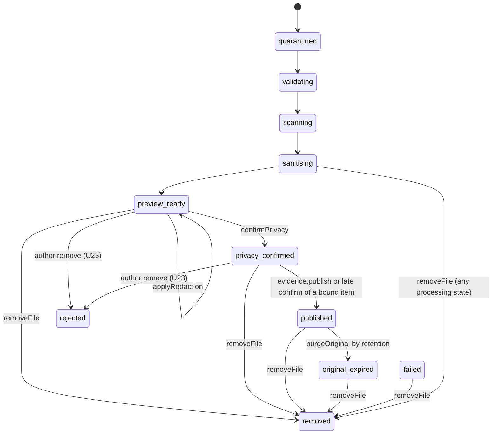
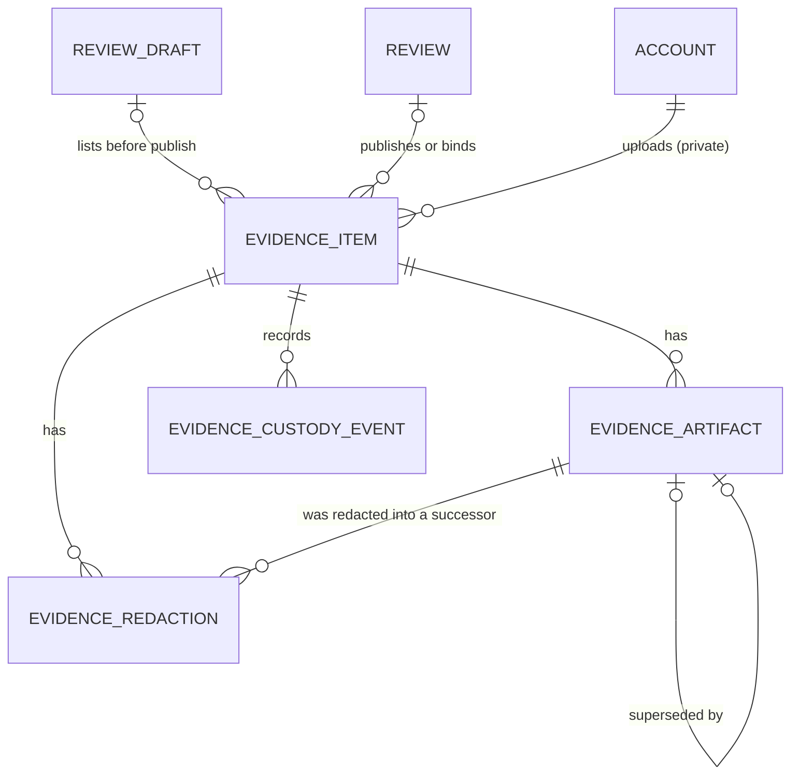

# Functional specification — U25 `t-305-privacy-preview-redaction-publish`

Unit U25 (kind `library`, size M, **high risk**: evidence) delivers T-305 for US7.2 (AC7.2.1–AC7.2.6), with the original-access part of AC7.3.7 and the noindex part of AC7.1.6. Bolt 28 in `bolt-plan.md`, after U24 T-304 (Bolt 27) and U3 T-010. Lead perspective: architect. Support perspectives: developer (repository mechanics, the compare-and-set redaction, tests: §§ 10–11) and security engineer (authorization, serving, original access, adversarial tests: §§ 8–9), synthesised in § 13. Collaborators run for this Unit, a separate agent writes the adversarial tests of § 9.2, and the owner signs off in writing before the phase gate (team practice step 5).

**Draft written 2026-10-29**, ahead of the stage, on the owner's instruction to overlap design with builds. The lead finalises it and the reviewer checks it when the workflow reaches this Unit; then the files move to `<record>/construction/t-305-privacy-preview-redaction-publish/functional-design/`. Baseline: `main` at `9cf860a` with T-010 merged (`14c21a9`). U23 T-303 has no Functional Design draft yet, so this design is written against its task file and names what it needs from it (§ 10, "Cross-Unit changes"). **Refreshed 2026-10-29** against the U24 T-304 draft written the same day: the storage methods take its names (`Storage.readPrivate(key, {maxBytes})`, `Storage.putPrivateDerivative(bytes, {itemId, name}) → {key, bytes, sha256}`, which closes F14), a redaction names its files with the new artifact id so U24's replace-on-same-name write can never overwrite a current file, and a moderator's `removeFile` may now take a still-processing item to `removed`, because U24's compare-and-set loses to it and deletes its own files (F18 closed). Every open point is decided by the recommended option under the owner's no-questions instruction of 2026-10-29 (Questions 1–18 in `functional-design-questions.md`); three of them touch a data boundary or a founder decision, and § 17 holds the FD entry texts the build appends before any code. **Second pass 2026-10-29:** BR7.1 and F18 now match the refresh (a moderator removal of a still-processing item is allowed); F22 and Question 18 add the dependency edges the swarm needs (FD-094); the artifact route's live check also covers a review restored by its author within 30 days (U22 T-302); U24's note that U25 "publishes by writing public copies" is answered by Question 12 (no copies).

This file is the source of truth for the workflows and state transitions. The data shape is in `entities.md`; the decision logic is in `rules.md` (BR ids).

## 1. What changes, in one paragraph

An author sees the exact processed copy of each image they attached (an owner-only preview route), draws black rectangles that are flattened into the pixels of a **new** page image and a **new** thumbnail (the old ones stay private and are marked superseded), and confirms per item that unnecessary personal information is removed (FD-023); an item without any redaction needs the extra "Skip privacy editing" acknowledgement, checked on the server (AC7.2.3). Only a confirmed item publishes, and only through `review.publish` (Review's `EvidenceForPublish` port, which this Unit implements), or at once when an item that was still processing at publish time is confirmed later (T-301 Question 9). Publishing marks only the current processed page and thumbnail public and starts the original's retention clock. Readers get the evidence through `evidence.getPublic` (three groups, public ids only, "Documents attached — not medically validated"), which also fills the experience page's `evidenceGroups`; Search gets `evidence.presenceForReview` in place of T-205's no-evidence default. The public artifact route serves an artifact only while its item and its review are publicly visible, checked on every request, with a short revalidated cache. Staff with the original-evidence capability, an approved device and a fresh step-up open an original through an audited one-time ticket, never for a file that failed or skipped the malware scan. Moderators remove a file through a new internal operation that T-404 calls, and retention and deletion get an original-purge primitive. Author actions are recorded with the opaque actor `author`, so no staff-readable record ties an account to an anonymous review. No PDF is built (FD-036).

## 2. As is (baseline 2026-10-29) and what Bolt 28 can count on

- **Schema (`packages/database/src/schema/evidence.ts`)** already has everything the task's step 3 asked a migration for: `evidence_artifacts.superseded_by_id` (self reference), `deleted_at`, `public` (default false), `immutable`, and the check `evidence_artifacts_original_not_public_check` (`not (kind = 'original' and public)`). `evidence_redactions {item_id, page_no, rects jsonb, applied_to_artifact_id}` and `evidence_custody_events` (append-only through `0003_triggers.sql`) exist. `evidence_items.published_artifact_id` has a deferrable key (`0004_deferred_fks.sql`). The custody enum already holds `redaction_applied`, `privacy_confirmed`, `published`, `original_accessed`, `removed`, `original_expired`. **No column migration is needed** (finding F12); this Unit's one migration is the partial unique index of BR2.7.
- **`evidence_items.review_id` is `NOT NULL`** with `ON DELETE CASCADE`, while T-303 step 4 inserts `review_id: null` for a draft's item. U23 must make the column nullable (finding F1, S2); if it merged without that, this Unit's migration does it.
- **Contracts.** `schemas/evidence.ts` has `ApplyRedactionInput` (rects as plain numbers, no cap), `ConfirmPrivacyInput {itemId, confirmed: z.literal(true)}` (so `confirmed: false` fails parsing as `validation`, not `evidence.confirmation_required`: F6), `PublishEvidenceInput {reviewId}` (C8 says `{reviewId, itemIds}`), `ReadOriginalEvidenceInput {itemId, reason: min(1)}`. `view-models/evidence.ts` has `EvidenceGroupVM`, `EvidenceItemVM`, `ViewerDocVM` with `TODO(T-308)`; `ViewerDocVM.itemId` would expose the internal id. `errors.ts` has `evidence.not_previewable` and `evidence.confirmation_required`; both i18n keys exist (`errors.evidence.notPreviewable`, `errors.evidence.confirmationRequired`).
- **Repository stub** `PgEvidenceRepository` names owners by guess (ISS-091 precedent): `applyRedaction`, `confirmPrivacy`, `remove` → T-305, `publish` → T-301, `getPublic` → T-308, `readOriginal` → T-407, `listForStaff` → T-407. T-303 and T-304 replace their own methods before Bolt 28. `not-implemented.test.ts` lists `PgEvidenceRepository` in `STUB_REPOSITORIES` (ISS-294).
- **Seed** (`seed-evidence.ts`): items e1–e7, six `published` with `page_png` and `thumbnail` rows `public: true` under `STORAGE_ROOT/public/`, no `original` row (ISS-181), custody `received … published` all with actor `worker`, `published_artifact_id` set, `retention_expires_at = published_at + 90 d`. e5 is `failed(malformed)` with no artifacts.
- **Upstream Units by Bolt 28** (task files and drafts; Construction follows the engine's dependency levels, not the Bolt list, so U21, U10, U34, U18 and U26 are guaranteed only once Question 18's edges are in the record, F22): U8 T-101 (`defineCommand` with `requires` order, `onRefused`, `recorded`; `RateLimiter` in memory; `Crypto`), U10 T-103 (capabilities only with an approved staff device, `rk_stepup` five-minute window, `Crypto.signClaims/verifyClaims` with per-purpose keys, `STEP_UP_PURPOSES` including `evidence.original`), U21 T-301 (`EvidenceForPublish` port with `itemsOfDraft`, `publish`, `bindToReview`; `ExperiencePageVM.evidenceGroups: []`, `hasDocuments: false` marked "(U25)"), U22 T-302, U23 T-303 (intake, `Storage`, `getForAuthor`, author `remove` → `rejected`, `evidence-state.ts` table), U24 T-304 (pipeline to `preview_ready`, `ImageSanitiser` in `adapters/image-sharp`, page re-encoded PNG or JPEG q85), U26 T-306 (composer canvas calling the server actions `applyRedaction` and `confirmPrivacy` against fakes), U27 T-307, U18 T-205 (`EvidencePresence` port with a no-evidence default in the worker's composition), U34 T-405 (`notification.deliver`, staff kinds).
- **Not yet built at Bolt 28:** U29 T-309 (retention policy, holds; Bolt 38), U33 T-404 (moderation decide; Bolt 35), U36 T-407 (staff evidence console; Bolt 39), U39 T-410 (deletion; Bolt 41), U38 T-409 (workspace; Bolt 37).
- **FD-082** dropped the retention block from `ConfigValues`, so the task's fallback "use the config default 90 from `ConfigProvider`" does not exist (finding F2, Question 14).
- **T-010 as merged:** `application` imports no external package and no Node built-in (so no `sharp`, no `node:crypto`); `database` does not import `domain`; adapters are built only in `apps/web/src/server/container.ts` (and the worker's own container); the worker reaches application code only through `@rogikotha/application/worker` and imports no `better-auth`, `drizzle-orm` or `pg`; components import server actions only; nothing in `apps/*` imports `test-support`; 80% line floor per package with untested files counted; migration-count pins in `migrations.int.test.ts` and `validator-probes.int.test.ts`; `format:check`, `check:identity` and CI before merge.

## 3. Settled before this stage

Listed in `functional-design-questions.md` ("Settled before this stage" and "Settled in this design without a question"). The ones that shape every workflow: images only and no PDF (FD-036); fail-closed scanning (FD-035); author confirmation of the processed copy with no automated PII detection (FD-023); no persistence warning (FD-003); originals never public and original access a separate audited permission (PRODUCT.md); failed items visible only to their author (`02-data-model.md` §7); `evidence.stateChanged {itemId, reviewId?, state, uploaderAccountId}` routed to `notification.deliver` and `search.refresh` (FD-084, C15); retention periods only from `retention_policies` (FD-068, FD-082); the evidence item is the private account link the domain design accepts (T-301 Question 10).

## 4. Workflows

### WF0 — Code Generation order (the Unit end to end)

1. **Before building:** `pnpm check` green on the Bolt branch; read open `ISSUES.md` rows in the evidence area (ISS-139, ISS-164, ISS-181, ISS-182, ISS-239, ISS-291); append the three FD entries of § 17 to `docs/status/decision-log.md`; confirm U23 made `evidence_items.review_id` nullable and built `itemsOfDraft` and `bindToReview` (F1, Question 1). No new dependency: `sharp` is already T-304's; no dependency-check entry unless Code Generation finds otherwise.
2. **Contracts:** `schemas/evidence.ts` (BR9.1, § 7): `Rect` integers, `ApplyRedactionInput.rects` max 200, `ConfirmPrivacyInput {itemId, confirmed: boolean, skipEditing?: true}`, `PublishEvidenceInput {reviewId, itemIds}`, `AuthorizeOriginalInput {itemId, purpose, reason}` (replaces `ReadOriginalEvidenceInput`), `GetPreviewPageInput`, `PresenceForReviewInput`; `enums.ts` `ORIGINAL_ACCESS_PURPOSES` and `PUBLIC_EVIDENCE_STATES`; `view-models/evidence.ts` (§ 7).
3. **Domain** (`packages/domain/src/evidence/`): `redaction.ts` (`normaliseRects`, BR2.1–BR2.4), `serving.ts` (`isCurrent`, `isPubliclyServable`, `assertPublishable`, BR2.7, BR4.3, BR5.6), `original-access.ts` (`originalAccessAllowed` from custody and state, BR6.3), with tests. `evidence-state.ts` is T-303's; this Unit adds no transition beyond §17 and extends its test only if a row is missing.
4. **Ports** (`packages/application/src/ports/`): `image-redactor.ts` (`flatten`), Storage's `readPrivate` and `putPrivateDerivative` returning `{key, bytes, sha256}` (U24's draft shapes; F14); `modules/evidence/ports.ts`: `ReviewVisibility`, `OriginalRetentionPolicy`.
5. **Application** (`modules/evidence/`): queries `get-preview-page.ts`, `get-public.ts`, `presence-for-review.ts`; commands `apply-redaction.ts`, `confirm-privacy.ts`, `authorize-original.ts`; internal operations `internal/publish.ts`, `internal/bind-to-review.ts` (if U23 did not build it), `internal/remove-file.ts`, `internal/purge-original.ts`; `evidence-for-publish.ts` (the `EvidenceForPublish` implementation); `original-ticket.ts` (ticket issue and redeem through `Crypto`); `modules/review/review-visibility.ts` (Review's implementation of the evidence port, FD-067 pattern) and the `getExperience` edit that fills `evidenceGroups` and `hasDocuments` (BR5.10); `index.ts` and `worker.ts` exports (`presenceForReview` and `purgeOriginal` only, BR1.10).
6. **Adapters:** `adapters/image-sharp/redactor.ts` (composite and re-encode, BR2.5) with `redactor.test.ts`.
7. **Database:** `repositories/evidence.ts` methods of § 8; migration `<n>_evidence_current_artifact_unique.sql` (BR2.7); the migration-count pins move by one (BR9.3); `not-implemented.test.ts` entry for `PgEvidenceRepository` reduced to its remaining stub methods (`listForStaff` → T-407) or removed (ISS-294).
8. **Web:** route handlers `api/evidence/items/[id]/preview/[page]/route.ts`, `api/evidence/artifacts/[artifactId]/route.ts`, `api/evidence/items/[id]/original/route.ts`; `server/actions/evidence.ts` (extend: `applyRedaction`, `confirmPrivacy`; new `server/actions/evidence-admin.ts` gets `authorizeOriginal` only if T-407's file does not exist yet, else the action lives here and T-407 imports it); `server/container.ts` wires `EvidenceForPublish`, `ReviewVisibility`, `ImageRedactor`, `OriginalRetentionPolicy` (interim) and replaces U26's interim evidence port.
9. **Worker:** `apps/worker/src/container.ts` replaces T-205's no-evidence `EvidencePresence` with `presenceForReview`; the relay route table gains `evidence.originalAccessed → notification.deliver` and `notification.deliver`'s staff mapping gains `security / notif.staff.originalAccessed` (recorded additions in U34's files, § 12).
10. **Test support:** `fakes/image-redactor.ts`, `fakes/review-visibility.ts`, `fakes/evidence-repository.ts` methods, builders `anEvidenceItem()` and `anArtifact()`; the seed writes actor `author` for its `privacy_confirmed` and `published` custody events (FD entry (a)).
11. **i18n:** `notif.staff.originalAccessed` in both files (Bengali flagged for the owner's review, FD-042); no other new key (§ 7).
12. **Docs:** `03-routes-and-contracts.md` §1 and §4 evidence lines, `02-data-model.md` §7 (custody actor forms, reason in details) and §17 (public states), `01-conventions.md` §5 (actor `author`), `05-demo-storyboard.md` step 6 (`→ 404`), the T-305 task file header (stories US7.2, scope-change notes for PDF leftovers); each with a dated note.
13. **Gate:** unit, integration, adversarial and smoke tests (§ 11), `pnpm check`, `pnpm smoke`; Build and Test lists the `ISS-` ids found and fixed.

### WF1 — `evidence.getPreviewPage({itemId, pageNo})` and the preview route

1. Route `GET /api/evidence/items/{id}/preview/{page}` builds the Actor (`getActor`), parses `id` (UUID) and `page` (integer); a malformed value → 404.
2. Query: `authenticated`; owner (`uploaded_by_account_id = actor.accountId`) else `forbidden`; `pageNo !== 1` → `not_found` (Phase 1, one page); state ∈ {`preview_ready`, `privacy_confirmed`} else `evidence.not_previewable` (BR1.1).
3. Repository `currentPage(itemId, pageNo)` → the one `page_png` with `superseded_by_id is null and deleted_at is null` (BR2.7); none → `not_found`.
4. Bytes through `Storage.readPrivate(storageKey)`; the route streams them with `Content-Type` from the row, `Cache-Control: private, no-store`, `X-Robots-Tag: noindex`, `X-Content-Type-Options: nosniff`, `Content-Security-Policy: sandbox; default-src 'none'`, `Cross-Origin-Resource-Policy: same-origin` (BR5.8). Every refusal is 404 except a signed-out request on this owner route, which is also 404 (BR1.11).

### WF2 — `evidence.applyRedaction({itemId, pageNo, rects})` (command, owner)

1. **Parse:** `rects` 1–200 objects of integers (BR2.1); else `validation`.
2. **Authorize:** `authenticated` and owner (Question 11 A: any account status, because redaction only reduces exposure); else `forbidden`. Rate limit `evidence.redact:account:<id>`, 120 per hour → `rate_limited` (BR1.2).
3. **Load (no transaction):** item; state `preview_ready`, else `conflict` for `privacy_confirmed` (the UI hides the tool after confirming) and `evidence.not_previewable` for every other state (BR2.9); `pageNo === 1`; current page `P` and current thumbnail `T` (BR2.7).
4. **Decide (domain):** `normaliseRects(rects, {width: P.width, height: P.height})` clamps, drops zero-area, duplicate and contained rectangles, and refuses more than 50 → `validation` (BR2.2–BR2.4).
5. **Flatten (outside the transaction):** `ImageRedactor.flatten({bytes, mime: P.mime, rects})` → `{page: {bytes, mime, width, height}, thumbnail: {bytes, mime, width, height}, version}` (BR2.5; opaque black, same MIME as the source, Question 8). Two new artifact ids from `IdGenerator`; `Storage.putPrivateDerivative(bytes, {itemId, name: 'page-1-<newPageId>' | 'thumbnail-1-<newThumbId>'})` twice → `{key, bytes, sha256}` each (keys `private/<itemId>/page-1-<id>.<ext>`: unique per attempt, so neither U24's same-name replace nor a concurrent redaction can overwrite a current file, and `storage_key` stays unique). The source bytes come from `Storage.readPrivate(P.storage_key, {maxBytes: 15 MB})`.
6. **Persist (one transaction, compare-and-set, BR2.8):** lock the item row (`for update`); if the state is no longer `preview_ready` or the current page id is no longer `P.id` → roll back, delete the two new files after the rollback (best effort, logged `evidence.redaction_orphan_deleted`), return `conflict`. Else insert the two artifacts (`immutable: true`, `public: false`, `sanitiser_version = version`, `scanner_version` and `signature_version` copied from `P` because the bytes descend from the same clean scan, `page_no` 1 for both), set `P.superseded_by_id = newPage.id` and `T.superseded_by_id = newThumb.id`, insert `evidence_redactions {item_id, page_no, rects (normalised), applied_to_artifact_id: P.id}`, custody `redaction_applied {pageNo, count}` actor `author`, audit `evidence:<itemId>` action `redaction_applied` actor `author` details `{pageNo, count}` (BR8.1, BR8.2). No outbox event (BR8.4).
7. **Return** `ok({pageNo, width, height, redactionCount})`; the canvas reloads the preview with a cache-busting query (T-306 step 7).

### WF3 — `evidence.confirmPrivacy({itemId, confirmed, skipEditing?})` (command, owner)

1. **Authorize:** `authenticated`, `verifiedEmail`, `notRestricted`, owner (Question 11 A: confirming is a step toward publication); rate 60 per hour (BR1.3).
2. `confirmed !== true` → `evidence.confirmation_required` (BR3.1).
3. Load the item; state `privacy_confirmed` → `ok` with no new row (idempotent, BR3.3); state other than `preview_ready` → `conflict`.
4. `redactionCount = count(evidence_redactions where item_id)`; `redactionCount === 0 && skipEditing !== true` → `evidence.confirmation_required` (Question 10 A, BR3.2).
5. **Persist (one transaction):** lock; state → `privacy_confirmed`; custody `privacy_confirmed {redactions, skippedEditing}` actor `author`; audit `evidence:<itemId>` action `privacy_confirmed`, same details.
6. **Late publication (Question 2 A, BR3.5):** if the item already has a `review_id` (bound at `review.publish`, T-301 Question 9), run the publish operation of WF4 for this one item in the same transaction.
7. Return `ok({state: 'privacy_confirmed' | 'published'})`.

### WF4 — `EvidenceForPublish` (Review's port, implemented here; C8 `evidence.publish`)

Called only inside `review.publish`'s transaction (T-301 WF5 steps 4 and 6), never as a server action (BR1.4).

- `itemsOfDraft(tx, {draftId, accountId, itemIds})` → `{itemId, state}[]` for items whose id is listed, `uploaded_by_account_id = accountId` and `review_id is null`; foreign or already-bound ids are simply absent, so T-301 refuses with `validation`. Built by U23 if it did (Question 1); else here.
- `publish(tx, {reviewId, itemIds})`, per item (BR4.2–BR4.5):
  1. lock the item; skip it (log `evidence.publish_skipped {count}`; the review still publishes) unless state is `privacy_confirmed` and `review_id` is null or equals `reviewId`;
  2. load its current `page_png` and `thumbnail`; `assertPublishable([page, thumb])` (domain; throws on an `original`, a superseded or a deleted artifact: a programmer error);
  3. repository `markCurrentPublic(tx, itemId)`: `update evidence_artifacts set public = true where item_id = $1 and kind in ('page_png','thumbnail') and superseded_by_id is null and deleted_at is null` (never touches `original`; the database check refuses it anyway);
  4. item: `review_id = reviewId`, `state = published`, `published_artifact_id = page.id`, `retention_expires_at = clock.now() + (await originalRetention.originalDays(tx))` days (Question 14), `updated_at`;
  5. custody `published {pageCount: 1}` actor `author`; outbox `evidence.stateChanged {itemId, reviewId, state: 'published', uploaderAccountId}` (exactly four keys, FD-084, C15).
- `bindToReview(tx, {reviewId, itemIds})`: for items in `quarantined`, `validating`, `scanning`, `sanitising`, `preview_ready` with `review_id` null: set `review_id` only; nothing public, no custody (no state change), no outbox (BR4.6). Built by U23 if it did (Question 1).
- No file moves between storage prefixes (Question 12 A): public-ness is the row flag plus the live check of WF7.

### WF5 — `evidence.getPublic({reviewId})` and the experience page

1. Internal query. `reviewVisibility.isPublic(reviewId)` false → `not_found` (BR5.2).
2. Repository `publicItemsOfReview(reviewId)`: items in `PUBLIC_EVIDENCE_STATES` (`published`, `original_expired`; BR5.1) with their current page and thumbnail, ordered by group (`reviewed`, `later`, `outcome`), then by the time of the item's `published` custody event, then public id (a chronological timeline, AC7.2.4).
3. Map to `EvidenceSectionVM` (§ 7): all three groups always present (an empty group has `items: []`, so the viewer can show "No documents" per section, AC7.2.4), `hasDocuments`, `statusKey: 'evidence.status'`, `noticeKey: 'evidence.notice'`; each item `{publicId, label?, pageCount: 1, pages: [{pageNo: 1, url: '/api/evidence/artifacts/<pageId>', width, height}], thumbnailUrl, downloadUrl: '/api/evidence/artifacts/<pageId>?download=1'}`. `label` from `label_en`/`label_bn` by `actor.locale` (seed labels; uploads have none). Nothing else: no storage key, filename, uploader, state, fail reason, hash or internal item id (BR5.3).
4. **Review projection (BR5.10, recorded addition in `modules/review`):** `review.getExperience` and `review.preview` call `evidence.getPublic` for a visible review and set `ExperiencePageVM.evidenceGroups` and `hasDocuments`; the preview of a draft shows `[]` because no item is public before publish (T-301 "preview equals public" stays true: the preview shows what readers will see at publish only for confirmed items, which T-306 already marks). T-308 renders.

### WF6 — `evidence.presenceForReview({reviewId})` (Search's `EvidencePresence.forReview`)

Distinct groups of the review's items in a public state, in `EVIDENCE_GROUPS` order; no ids, no counts, no filenames (BR5.5). Runs in the worker (`search.refresh`), so it is exported from `@rogikotha/application/worker` and wired in `apps/worker/src/container.ts` in place of T-205's default; it reads only `evidence_items` (worker grant (a), 02 §16) and does not check the review's visibility (Search builds documents only from published reviews).

### WF7 — Artifact route `GET /api/evidence/artifacts/{artifactId}[?download=1]`

1. Malformed id → 404. Repository `artifactForServe(id)` returns the artifact with its item's `state`, `review_id` and `public_id` only when `public = true`, `kind in ('page_png','thumbnail')`, `superseded_by_id is null`, `deleted_at is null` and the item state is in `PUBLIC_EVIDENCE_STATES` (BR5.6).
2. `reviewVisibility.isPublic(item.review_id)` (published and `deleted_at is null`); false → 404. Everything not served is 404, never 403 (no existence oracle).
3. `If-None-Match` equal to the ETag → 304. Else stream `Storage` bytes with `Content-Type` from the row, `ETag: "<sha256>"`, `Cache-Control: public, max-age=300` (Question 4 A, FD entry (b)), `X-Content-Type-Options: nosniff`, `X-Robots-Tag: noindex`, `Content-Security-Policy: sandbox; default-src 'none'`, `Cross-Origin-Resource-Policy: same-origin`; with `download=1` on a `page_png`: `Content-Disposition: attachment; filename="rogikotha-processed-<itemPublicId>.<png|jpg>"` (BR5.7). `download` on a thumbnail is ignored.

### WF8 — Original access: `evidence.authorizeOriginal` and the ticket route

1. **Server action → command** `evidence.authorizeOriginal({itemId, purpose, reason})`: `requires` `authenticated`, `staffRole: [super_admin, admin, moderator]`, `capability: 'evidence.original'`, `stepUp` (U8 order; capabilities exist only on an approved staff device, T-103). Rate `evidence.original:account:<id>`, 20 per hour (BR1.7). `onRefused` writes audit `evidence:<itemId>` action `original_access_refused` details `{code}` in its own committed transaction (BR6.5).
2. **Validate:** `purpose` ∈ `ORIGINAL_ACCESS_PURPOSES` (Question 17); `reason` trimmed 10–500 characters (BR6.1).
3. **Load:** the item's `original` artifact with `deleted_at is null`, else `not_found` (seeded items have none; expired originals have `deleted_at`) (BR6.2); `originalAccessAllowed(item, custody)`: a `scan_clean` custody event exists and the item is not `failed(malware)`; else `conflict` (Question 6 A, BR6.3).
4. **Persist (one transaction):** custody `original_accessed {purpose, reason, staffRole}` actor `account:<staffId>`; audit `evidence:<itemId>` action `original_access` details `{purpose, step_up: true}`; outbox `evidence.originalAccessed {itemId, custodyEventId}` → staff notice `security`, `notif.staff.originalAccessed` (BR6.4, BR8.4).
5. **Ticket:** `Crypto.signClaims('evidence.original', {i: itemId, a: accountId, s: sessionId, e: custodyEventId, u: now + 60 s})` (Question 5 A, BR6.6). The action returns `{url: '/api/evidence/items/<itemId>/original?ticket=<value>'}`; T-407's console opens it.
6. **Route** `GET /api/evidence/items/{id}/original?ticket=`: `getActor`; `Crypto.verifyClaims('evidence.original', ticket)` (constant-time MAC first); claims match the route id, the actor's account and current session, `u > now`; the actor still holds `evidence.original` and a live step-up; `rateLimiter.hit('evidence.original.ticket:<e>', 1, 60)` allows the first use only. Any failure → 404, except a missing or stale step-up → 403 `auth.step_up_required` (Question 7 A, BR1.11); each failure is logged `evidence.original_ticket_refused {code}` (allowlisted).
7. **Stream** `Storage.readPrivate(original.storage_key)` with `Content-Type` = `detected_mime ?? declared_mime`, `Content-Disposition: attachment; filename="original-<itemPublicId>.<jpg|png>"` (never the uploaded name), `Cache-Control: private, no-store`, `X-Robots-Tag: noindex`, `X-Content-Type-Options: nosniff`, `Content-Security-Policy: sandbox; default-src 'none'` (BR6.7). The route writes no second custody row: the access was recorded at step 4, and the ticket is single-use.

### WF9 — `evidence.removeFile` and `evidence.purgeOriginal` (internal operations)

- `removeFile(tx, {itemId, actorAccountId, caseCode})` (Question 13 A; called by U33 T-404's `moderation.decide` for the `removeFile` action, which has already checked `content.act` and writes the case audit): states `preview_ready`, `privacy_confirmed`, `published`, `original_expired`, `failed` → `removed`; `quarantined`, `validating`, `scanning`, `sanitising` → `removed` as well (U24's draft WF9: its next compare-and-set fails, it skips the item and deletes the derivative files it wrote; F18); already `removed` → `ok` (idempotent); `rejected` → `conflict`. If U24 as merged does not stop on `removed`, the build refuses the four processing states with `conflict` instead and records an ISS row. Every artifact of the item `public = false`; files stay private for custody until retention removes them; custody `removed {by: 'moderator', caseCode}` actor `account:<staffId>`; outbox `evidence.stateChanged {itemId, reviewId?, state: 'removed', uploaderAccountId}` (search drops the group; notification decides any notice) (BR7.1, BR7.2).
- `purgeOriginal(tx, {itemId, by: 'retention' | 'deletion'})`: sets `deleted_at` on the `original` artifact; custody `original_expired` (retention; also moves a `published` item to `original_expired`, §17) or `removed {part: 'original', by: 'system'}` actor `system:deletion` (deletion); returns `{storageKey}`; the caller deletes the file after commit (BR7.3, BR7.4). Hold checks belong to the callers and are wired by U29 (FD-073, C3).

### WF10 — `evidence.getForAuthor` (U23's query, extended)

For items in `preview_ready` or `privacy_confirmed`, `previewPages` gets `[{pageNo: 1, url: '/api/evidence/items/<itemId>/preview/1', width, height}]` of the current page, plus `redactionCount` and `needsSkipAcknowledgement` (`redactionCount === 0`). U23 left these to this Unit (T-303 step 5 "T-305 fills"). Question 16 A adds a `{reviewId}` form so the author can finish items bound to an already published review (U38 T-409).

## 5. State transitions

### 5.1 Evidence item (this Unit's part of `02-data-model.md` §17)



Text fallback: the worker takes an item from `quarantined` to `preview_ready` (U24). In `preview_ready` the author may apply redactions any number of times (the state stays) and then confirm, which moves it to `privacy_confirmed`. A confirmed item becomes `published` inside `review.publish`, or at once when it was bound to an already published review. Retention later purges the original and moves a published item to `original_expired`, which stays publicly visible. A moderator's `removeFile` moves any item except a `rejected` one to `removed`, including one still processing (the worker then stops on it, F18); the author's own remove (U23) moves an unpublished item to `rejected`. Only `published` and `original_expired` items have public artifacts.

### 5.2 Artifact currency

For each item and kind (`page_png`, `thumbnail`) exactly one row has `superseded_by_id is null and deleted_at is null` (the current one; a partial unique index enforces it, BR2.7). A redaction inserts a new current page and thumbnail and points the old ones at them; the old rows stay private for ever (custody history) and are never served. `public` is true only on the current page and thumbnail of an item in a public state, set at publish and cleared by `removeFile`. The `original` row is never public (database check) and gets `deleted_at` when purged.

### 5.3 Original-access ticket

`issued` (custody row written, 60 s) → `redeemed` (first GET within 60 s by the same account and session with capability and step-up) or `expired`. A second GET with the same ticket is refused (404).

## 6. Interfaces

| Operation | Kind | Input | Requires | Rate | Audit (stream `evidence:<itemId>`) | Custody | Outbox | Expected errors |
|---|---|---|---|---|---|---|---|---|
| `evidence.getPreviewPage` | query | `{itemId, pageNo}` | authenticated, owner | — | — | — | — | `forbidden`, `not_found`, `evidence.not_previewable` |
| `evidence.applyRedaction` | command | `ApplyRedactionInput` | authenticated, owner | 120/h | `redaction_applied` (actor `author`) | `redaction_applied` | — | `validation`, `forbidden`, `conflict`, `evidence.not_previewable`, `rate_limited` |
| `evidence.confirmPrivacy` | command | `ConfirmPrivacyInput` | authenticated, verifiedEmail, notRestricted, owner | 60/h | `privacy_confirmed` (`author`) | `privacy_confirmed` (+ `published` when bound) | `evidence.stateChanged` when bound | `evidence.confirmation_required`, `conflict`, `forbidden` |
| `EvidenceForPublish.publish` | internal | `{reviewId, itemIds}` | review.publish's tx | — | (review's publish row) | `published` | `evidence.stateChanged` | none (skips) |
| `EvidenceForPublish.bindToReview` | internal | `{reviewId, itemIds}` | review.publish's tx | — | — | — | — | none |
| `evidence.getPublic` | query (internal) | `{reviewId}` | — | — | — | — | — | `not_found` |
| `evidence.presenceForReview` | query (internal, worker) | `{reviewId}` | — | — | — | — | — | — |
| `evidence.authorizeOriginal` | command | `AuthorizeOriginalInput` | authenticated, staffRole, `evidence.original`, stepUp | 20/h | `original_access`; refusals `original_access_refused` | `original_accessed` | `evidence.originalAccessed` | `forbidden`, `auth.step_up_required`, `not_found`, `conflict`, `validation`, `rate_limited` |
| `evidence.removeFile` | internal | `{itemId, actorAccountId, caseCode}` | moderation.decide's tx | — | (case audit) | `removed` | `evidence.stateChanged` | `conflict`, `not_found` |
| `evidence.purgeOriginal` | internal | `{itemId, by}` | retention / deletion | — | (caller's) | `original_expired` or `removed` | — | `not_found` |

Ports declared or used:

```text
ImageRedactor (packages/application/src/ports/image-redactor.ts; adapters/image-sharp/redactor.ts; fake in test-support)
  flatten({bytes, mime, rects}) -> {page: {bytes, mime, width, height}, thumbnail: {bytes, mime, width, height}, version}

ReviewVisibility (declared in modules/evidence/ports.ts; implemented by Review in modules/review/review-visibility.ts, built here; FD-067)
  isPublic(reviewId) -> boolean        (state published and deleted_at is null)

OriginalRetentionPolicy (declared in modules/evidence/ports.ts)
  originalDays(tx) -> Promise<int>     (interim: 90, ASSUMPTION(T-305) naming FD-004; U29 T-309 wires retention.currentPolicy().originalDays)

Implemented here: Review.EvidenceForPublish (publish; itemsOfDraft and bindToReview if U23 did not), Search.EvidencePresence (forReview)
Shared ports used: Storage (readPrivate(key, {maxBytes}), putPrivateDerivative(bytes, {itemId, name}) -> {key, bytes, sha256}, delete(key, {reason}); U23/U24 shapes), Crypto (signClaims, verifyClaims), Clock, IdGenerator, RateLimiter (hit), AuditWriter (allowlist builders), Outbox, Logger, UnitOfWork (defineCommand)
```

## 7. View models, inputs and copy (`packages/contracts`)

- `EvidenceSectionVM {groups: EvidenceGroupVM[3], hasDocuments: boolean, statusKey: 'evidence.status', noticeKey: 'evidence.notice'}`; `EvidenceGroupVM {group, labelKey: 'evidence.group.<g>', items: EvidenceItemVM[]}`; `EvidenceItemVM {publicId, label?, pageCount: 1, pages: EvidencePageRefVM[], thumbnailUrl, downloadUrl}`; `EvidencePageRefVM {pageNo, artifactUrl, width, height}`; `ViewerDocVM {publicId, label?, pages, downloadUrl}` (`itemId` replaced by `publicId`). T-308 refines presentation fields only and keeps these.
- `ExperiencePageVM.evidenceGroups` becomes `EvidenceGroupVM[]` from the section and `hasDocuments` from it (T-301 left both to this Unit).
- Inputs: `Rect {x, y, w, h}` all `z.number().int()` within ±100 000 (any sign; the domain clamps to the page, BR2.2); `ApplyRedactionInput {itemId, pageNo: int 1, rects: Rect[1..200]}`; `ConfirmPrivacyInput {itemId, confirmed: boolean, skipEditing?: literal true}`; `AuthorizeOriginalInput {itemId, purpose: enum ORIGINAL_ACCESS_PURPOSES, reason: string trimmed 10..500}`; `PublishEvidenceInput {reviewId, itemIds: string[]}` (C8).
- Enums: `ORIGINAL_ACCESS_PURPOSES = ['moderation_case', 'legal_request', 'author_request', 'security_review']`; `PUBLIC_EVIDENCE_STATES = ['published', 'original_expired']`.
- Copy: the public section reads `evidence.status` ("Documents attached — not medically validated") and `evidence.notice` (uploaded by the person who wrote the experience, privacy not independently checked, processed copy, original never public), both already ported (ISS-056 records that `viewer.notice` is the viewer's own disclaimer). No key or VM field contains "verified" or "approved" (grep test, BR8.6). No persistence warning (FD-003). New key `notif.staff.originalAccessed`: en "Original evidence {item} was opened", bn "মূল প্রমাণ {item} খোলা হয়েছে" (flagged for the owner's Bengali review, FD-042). The task's `ev.derivativeTitle` is not added (no PDF, F13). Numerals in any count follow the active language in the UI (`pageCount` is a number, formatted by T-308).

## 8. Authorization and audit matrix (high risk)

| Who | Preview route | applyRedaction | confirmPrivacy | Artifact route | authorizeOriginal | Original route |
|---|---|---|---|---|---|---|
| Signed out | 404 | `forbidden` (no session) | `forbidden` | 200 only if servable (WF7), else 404 | refused (not audited: no account) | 404 |
| Account, not the uploader | 404 | `forbidden`, audited by nothing (no state change) | `forbidden` | as above | `forbidden`, audited `original_access_refused` | 404 |
| Uploader, unverified or restricted | 200 (own) | allowed | `forbidden` | as above | `forbidden`, audited | 404 |
| Uploader, verified and active | 200 in `preview_ready`/`privacy_confirmed` | allowed in `preview_ready` | allowed in `preview_ready` | as above | `forbidden`, audited | 404 |
| Staff without `evidence.original` (or without an approved device) | 404 | `forbidden` unless uploader | same | as above | `forbidden`, audited | 404 |
| Staff with the capability, no live step-up | 404 | as above | as above | as above | `auth.step_up_required`, audited | 403 `auth.step_up_required` |
| Staff with capability and step-up | 404 (not the owner) | as above | as above | as above | granted for a clean-scanned original; `conflict` otherwise; audited | 200 once per ticket, same account and session |
| Worker | — | never | never | — | never (not exported to the worker) | — |

Audit and custody rows per action are in § 6; custody actors per BR8.1; all audit details allowlisted (no rects, no reason text in audit, no filename, no storage key). Logs carry ids and codes only (BR8.5).

## 9. Security view

### 9.1 Threats and mitigations

| Abuse case | Mitigation | Rules |
|---|---|---|
| Unredacted page or thumbnail reaches the public after a redaction | old page and thumbnail superseded together; publish and serving use only current rows; partial unique index | BR2.6, BR2.7, BR4.3, BR5.6 |
| Two concurrent redactions fork the current page (each missing the other's rectangle) | compare-and-set under the item lock; unique index as backstop | BR2.8, BR2.7 |
| Redaction reversible (overlay, alpha, metadata) | opaque black composited into the raster and re-encoded; no layer, no alpha trick, metadata dropped | BR2.5 |
| Guessing artifact ids for private pages or originals | `public` filter, kind filter, current filter, live visibility, 404 for all | BR5.6 |
| Evidence stays reachable after hide, delete, hold or removal | live review visibility per request; 300 s cache with ETag revalidation | BR5.6, BR5.7, FD entry (b) |
| Publishing a foreign or unconfirmed item through `review.publish` | `itemsOfDraft` scoped to the account; publish requires `privacy_confirmed` under lock | BR1.4, BR4.2 |
| Staff reading originals silently or in bulk | capability + device + step-up + custody + audit + staff notice + 20/h + one-time ticket | BR6.* |
| Staff downloading malware | originals served only after a clean scan | BR6.3 |
| Staff linking an anonymous review to an account through custody | author actor `author` | BR8.1, FD entry (a) |
| Reason or purpose leaking through URLs and logs | ticket in URL, reason only in custody details | BR6.6, BR8.5 |
| MIME sniffing or script in served bytes | `nosniff`, CSP sandbox, CORP same-origin, content type from the row | BR5.7, BR6.7 |
| CPU exhaustion through redaction | 120/h per account, ≤ 50 rectangles, sharp pixel limit inherited from T-304 | BR1.2, BR2.4 |

### 9.2 Candidate adversarial tests (for the separate agent)

1. **Stale artifact hunt.** Upload, redact twice, confirm, publish. Request every artifact id the item ever had (both superseded pages, both superseded thumbnails, the original) through the artifact route, with and without `download=1`, and through the preview route as another account: only the current page and thumbnail return 200. Then sample pixels of the served page and thumbnail inside every rectangle of both redactions: all black.
2. **Redaction race.** Fire two `applyRedaction` calls with different rectangles at once on the same item: exactly one succeeds, the other returns `conflict`, exactly one current page and one current thumbnail exist, the orphan files are gone, and a publish afterwards marks exactly two artifacts public.
3. **Publish smuggling.** As account A, call `review.publish` naming B's confirmed item, A's `preview_ready` item, A's removed item and an original artifact id; then call `markCurrentPublic` on an item in `preview_ready` from a crafted test: nothing of B becomes linked, no unconfirmed item becomes public, and `select count(*) from evidence_artifacts where kind = 'original' and public` is 0 (the database check also refuses a direct update).
4. **Original-access abuse.** Anonymous, an ordinary account, the item's own author, staff without the capability, staff with the capability but no step-up, staff on an unapproved device: all refused with the codes of § 8 and an audit row for each signed-in attempt; a granted ticket replayed, used by another session, used after 61 s, or used on another item id: refused; a `failed(malware)` original: `conflict`. Exactly one `original_accessed` custody row per granted request, and the reason never appears in any log line or URL.
5. **Visibility after the fact.** Publish a review with evidence, then hide the review (critical report), soft-delete it, and moderator-remove the file in turn: after each, the artifact route returns 404 (also with a matching `If-None-Match`, never 304) and `getPublic` returns `not_found` or drops the item, and `presenceForReview` drops the group after `removeFile`. An author restore within 30 days (U22) brings the page back; a removed file stays 404.

## 10. Findings and proposed ISS rows (each `Found in U25 T-305`)

| # | Sev | Area | Finding | Resolution | Owner |
|---|---|---|---|---|---|
| F1 | S2 | database/evidence | `evidence_items.review_id` is `NOT NULL`, but T-303 inserts draft items with `review_id: null`; intake fails on its first insert | U23 makes it nullable in its migration; if not, this Unit's migration does | U23 T-303 (fallback U25) |
| F2 | S2 | evidence/retention | Task step 5's fallback "config default 90 from `ConfigProvider`" no longer exists (FD-082 dropped the block) | `OriginalRetentionPolicy` port, interim 90 days marked `ASSUMPTION(T-305)` (Question 14) | U25; U29 replaces |
| F3 | S1 | evidence/serving | The artifact route served any `public = true` row with a one-year immutable cache, so a hidden, deleted, held or removed review's images stayed reachable | live visibility check and 300 s revalidated cache (Question 4, FD entry (b)); designed out | U25 |
| F4 | S1 | evidence/redaction | Step 3 regenerates the thumbnail but supersedes only the page; publish marks "current thumbnail" public, so the unredacted thumbnail could go public | page and thumbnail superseded together; current predicate on both (BR2.6); designed out | U25 |
| F5 | S1 | evidence/identity | Custody actor `account:<id>` on author actions (02 §7, seed) lets any staff who reads custody (T-407's quarantine view is "any staff") link an anonymous review to an account without `identity.reveal` (FD-016, FD-022) | opaque actor `author` (Question 3, FD entry (a)); designed out here; U23 applies it to intake and author remove | U25, U23 |
| F6 | S3 | contracts | `ConfirmPrivacyInput.confirmed` is `z.literal(true)`, so `confirmed: false` gives `validation`, while the acceptance row expects `evidence.confirmation_required` | input becomes `boolean` (BR3.1) | U25 |
| F7 | S2 | api/original | C14 puts the staff `reason` in the GET query string (browser history, server and proxy logs) and T-407 expects a one-time signed URL | ticket flow (Question 5, FD entry (c)) | U25; C14 amended |
| F8 | S3 | api/original | Task acceptance (anonymous and no-capability → 404) contradicts C14 (403 `forbidden`) and storyboard step 6 ("→ 403") | 404 for every refusal except step-up 403 (Question 7); storyboard step 6 edited | U25 |
| F9 | S1 | evidence/redaction | Concurrent redactions could leave two current pages, and publish would mark both public, each missing a rectangle | compare-and-set plus partial unique index (BR2.7, BR2.8); designed out | U25 |
| F10 | S2 | composer/workspace | Items bound to a published review (T-301 Question 9) have no screen on which the author can redact and confirm them after the draft is deleted | `getForAuthor {reviewId}` here; the screen in U38 T-409, reusing T-306's canvas (Question 16) | U38 T-409 (open until built) |
| F11 | S2 | evidence/moderation | `evidence.remove` ownership disagrees: the task says T-404 calls T-303's remove; C8 and `unit-of-work.md` give the moderator and deletion paths to U25; T-404, T-407 and T-410 depend on T-305 for it | `removeFile` and `purgeOriginal` here (Question 13) | U25 |
| F12 | S3 | task file | Steps 3 and 9 ask for a `superseded_by_id` migration that already exists; the owned paths and checks still list `PdfAssembler`, `pdf-assemble`, `derivative_pdf` and `ev.derivativeTitle` | not built; task header corrected with the PDF leftovers struck (FD-036) | U25 |
| F13 | S3 | task file | Step 7's `Content-Disposition` for `derivative_pdf` and T-308's `derivativePdfUrl` | `download=1` on the current page, filename by MIME; T-308 uses `downloadUrl` (its scope-change block already says so) | U25, U28 |
| F14 | S3 | ports/storage | `Storage.putPrivateDerivative` returns only a key (03 §3) and the application cannot hash (no `node:crypto`), but every artifact row needs `sha256` | `putPrivateDerivative` returns `{key, bytes, sha256}`, like `putQuarantine` | U23/U24 (U25 if absent) |
| F15 | S2 | evidence/states | §17 moves a published item to `original_expired` when retention purges the original, but every public read (T-201 BR1.5 document counts, this task's `getPublic`, search) tested only `published`, so evidence would vanish after 90 days | `PUBLIC_EVIDENCE_STATES = [published, original_expired]` everywhere (BR5.1) | U25; U14 T-201 BR1.5, U29 |
| F16 | S3 | evidence/projection | `getPublic` via `ReviewRepository.stateOf` would make Evidence import Review, a cycle (Review depends on Evidence) | `ReviewVisibility` port, implemented in `modules/review` (FD-067) | U25 |
| F17 | S4 | evidence/serving | UUIDv7 artifact ids in public URLs reveal the artifact's creation time to the millisecond | accepted; the review's exact date stays private (`exact_date_enc`), and upload time is not the experience date | — |
| F18 | S3 | worker/evidence | `removeFile` on an item still processing: the worker loop must stop when it finds `removed` | closed by U24's draft (its compare-and-set loses to `removed` and deletes its own derivative files); `removeFile` takes every processing state to `removed`; if U24 as merged does not, the build refuses those four states with `conflict` and records an ISS row (BR7.1) | U24 |
| F22 | S2 | plan/dependencies | U25's `depends_on` lists only U24 and U3, yet it implements U21's `EvidenceForPublish` and edits U21's `get-experience.ts`, uses U10's capability, step-up and `signClaims`, adds rows to U34's relay table, replaces U18's worker default and makes U26's server actions real. Computed levels: U25 6, U21 6, U18 7, U26 7, so a dependency-ready swarm (FD-094, owner queue 2026-10-27) can build U25 beside U21 and before U18 and U26 | add U21, U10, U34, U18 and U26 to U25's `depends_on` in `unit-of-work-dependency.md` (U25 moves to level 8; U28 follows); this must land before the swarm schedules level 6 (Question 18) | record (Units revision) |
| F19 | S4 | database/deletion | A hard delete of a review cascades to `evidence_items` and `evidence_custody_events`, which the append-only trigger refuses, so the delete fails | noted for U39 T-410 and U29 (deletion and retention plan around custody) | U39 |
| F20 | S4 | storage/originals | FR67 says originals "remain encrypted"; T-303's filesystem adapter is not specified to encrypt at rest | `Storage.readPrivate` is the only read path here, so encryption can be added in the adapter without changing this Unit | U23 / production composition |
| F21 | S3 | composer | T-306 calls `applyRedaction` once per rectangle on pointer-up, so each stroke is a full re-encode and is irreversible | rate 120/h; batching is a T-306 improvement, not required | U26 |

## 11. Developer view — tests

| Level | File | Proves | Rules |
|---|---|---|---|
| domain | `redaction.test.ts` | clamp, negative and oversize coordinates, zero area dropped, duplicates and contained dropped, never expanded, 51 → refused, empty after clamp → refused | BR2.1–BR2.4 |
| domain | `serving.test.ts` | `isPubliclyServable` truth table (kind × public × superseded × deleted × state × review visible); `assertPublishable` throws on original, superseded, deleted | BR4.3, BR5.6 |
| domain | `original-access.test.ts` | allowed only with `scan_clean` and not malware; quarantined, scanning, malware refused | BR6.3 |
| adapter | `redactor.test.ts` | generated PNG and JPEG fixtures: every pixel inside each rectangle `#000000` for PNG, interior pixels (≥ 8 px from the edge) ≤ 8 per channel for JPEG; pixels outside unchanged for PNG (equal to input) and within JPEG tolerance; no EXIF/ICC/XMP in the output; same MIME and size; a PNG with alpha comes out opaque inside the rectangles; thumbnail 320 px wide and black where the rectangle maps | BR2.5 |
| application | `apply-redaction.test.ts` | owner only; states; new page and thumbnail, old ones superseded, never public; redaction row with normalised rects; custody and audit actor `author`, allowlisted details; CAS conflict deletes the orphans; rate limit | BR1.2, BR2.* , BR8.1 |
| application | `confirm-privacy.test.ts` | `confirmed: false` → `evidence.confirmation_required`; no redaction and no `skipEditing` → same; with `skipEditing` → ok; idempotent; unverified or restricted → `forbidden`; bound item → published with one outbox event | BR1.3, BR3.* |
| application | `publish.test.ts` | only `privacy_confirmed` items publish; a `preview_ready` item on the same draft untouched and the review publishes; original never public; superseded never public; `retention_expires_at` from the port; outbox exactly four keys; skipped item does not abort | BR4.* |
| application | `get-public.test.ts` | three groups in order; `not_found` for a hidden or deleted review; `original_expired` items included; failed, removed, `privacy_confirmed` excluded; serialized VM has no `storage_key`, `original`, `quarantine`, filename, internal id or the words verified/approved | BR5.1–BR5.4 |
| application | `presence-for-review.test.ts` | the FD-084 row: `[reviewed]` for one published reviewed and one `preview_ready` outcome item; `[]` with none; no id or filename | BR5.5 |
| application | `authorize-original.test.ts` | the § 8 matrix through `defineCommand`; refusals audited; granted writes custody, audit and outbox in one transaction; ticket claims; 21st call → `rate_limited` | BR6.* |
| application | `remove-file.test.ts`, `purge-original.test.ts` | state table, idempotence, artifacts private, events | BR7.* |
| database | `evidence.int.test.ts` additions | `markCurrentPublic` never touches originals or superseded rows (crafted call → 0 rows); the partial unique index refuses a second current page; `artifactForServe` filters; `publicItemsOfReview` order | BR2.7, BR4.3, BR5.6 |
| web | `preview.route.test.ts`, `artifacts.route.test.ts`, `original.route.test.ts` | headers of BR5.7, BR5.8, BR6.7; 304 on ETag; 404 everywhere a refusal applies; 403 only for step-up; ticket single use | BR1.11, BR5.*, BR6.* |
| integration | `evidence-publish-search.int.test.ts` | the FD-084 rows: publish, run the relay and `search.refresh` → `evidence_groups = {reviewed}`, `has_documents = true`; the relay enqueues `notification.deliver` and `search.refresh` for the event | BR5.5, BR8.4 |
| smoke | `evidence-public.smoke.test.ts` | a seeded published item's page returns 200 with `X-Robots-Tag: noindex`; a random artifact id returns 404 | BR5.6, BR5.7 |
| adversarial | `evidence.adversarial.test.ts` (separate agent) | § 9.2 | — |

Coverage: every new file has tests; the 80% floor applies to `domain`, `application`, `adapters`, `database`, `web` and `test-support` (new fakes exercised by the application tests).

## 12. Owned paths and recorded additions

Owned (task file, minus the PDF parts): `packages/domain/src/evidence/redaction.ts` (+ `serving.ts`, `original-access.ts` as additions), `packages/application/src/modules/evidence/commands/{apply-redaction,confirm-privacy}.ts`, `queries/{get-public,get-preview-page,presence-for-review}.ts`, `packages/adapters/src/image-sharp/` (redactor; the task named `composite.ts`), the three route handlers, `apps/web/src/server/actions/evidence.ts` (extend), `packages/database/src/repositories/evidence.ts` (extend), `packages/contracts/src/schemas/evidence.ts`, `view-models/evidence.ts`, `packages/test-support/src/fakes/evidence-repository.ts`, `packages/i18n/messages/{en,bn}.json`.

Recorded additions (each listed in the Code Generation plan):

| Path | Why |
|---|---|
| `modules/evidence/commands/authorize-original.ts`, `original-ticket.ts` (task named `read-original.ts`) | Question 5 |
| `modules/evidence/internal/{publish,bind-to-review,remove-file,purge-original}.ts`, `evidence-for-publish.ts`, `ports.ts` | WF4, WF9, Questions 1, 13, 14 |
| `modules/evidence/queries/get-for-author.ts` (U23's file, extended) | WF10, Question 16 |
| `modules/review/review-visibility.ts`; `modules/review/queries/get-experience.ts` and `preview.ts` (one call each) | F16, BR5.10 |
| `packages/application/src/ports/image-redactor.ts`, `ports/storage.ts` (`putPrivateDerivative` result) | WF2, F14 |
| `packages/application/src/worker.ts` export of `presenceForReview` | WF6 |
| `apps/web/src/server/container.ts`, `apps/worker/src/container.ts` | wiring, replacing T-205's and U26's interim ports |
| notification relay route table and `notification.deliver` staff mapping (U34's files): one row each | `evidence.originalAccessed` |
| `packages/database/src/migrations/<n>_evidence_current_artifact_unique.sql`, `migrations.int.test.ts`, `validator-probes.int.test.ts` (count pins), `repositories/not-implemented.test.ts` | BR2.7, BR9.4, ISS-294 |
| `packages/contracts/src/enums.ts` | two enums |
| `packages/test-support/src/fakes/{image-redactor,review-visibility}.ts`, `builders/evidence.ts`, `seed/seed-evidence.ts` (custody actor `author`) | tests, FD entry (a) |
| `docs/implementation/{01-conventions,02-data-model,03-routes-and-contracts,05-demo-storyboard}.md`, the T-305 task file header | WF0 step 12 |

**Collision list for parallel building (FD-094).** This Unit shares files with U23, U24 (same module, same repository, same fakes, same adapter folder), U18 and U34 (worker container, relay table, notification mapping), U21/U22 (review projection files), U26 (`server/actions/evidence.ts`), and every Unit that adds a migration (number and the two count pins) or i18n keys (`en.json`, `bn.json`). It depends on U24 anyway, so it is never in the same batch as U23 or U24; within its batch it must not run beside a Unit that edits the migration pins, the containers or the two message files without a merge plan.

## 13. Synthesis — decisions and why

- **Supersede both page and thumbnail, serve only current rows, and back it with a unique index** (F4, F9): the only way a later bug cannot publish an unredacted copy is that the database itself refuses two current rows.
- **Compare-and-set, not a long lock:** the image work runs outside the transaction, so a slow re-encode never holds a row lock; the commit checks that nothing changed and discards its own files otherwise.
- **Same MIME as the source** (Question 8): T-304 already chose JPEG q85 for large photos; forcing PNG would make a redacted 12 MP photo several times larger than its unredacted version for no privacy gain, because the rectangle's pixels are replaced before encoding.
- **Server-checked skip acknowledgement** (Question 10): AC7.2.3's "extra confirmation" is otherwise only a UI promise; one optional field makes it testable.
- **Live visibility with short caching** (Question 4): bytes never change, but whether they may be shown does; ETag revalidation keeps the cost at one cheap query per view while every hide takes effect within minutes.
- **Ticketed original access** (Questions 5–7): keeps the staff reason out of URLs and logs, makes each access one recorded event, gives T-407 the one-time URL it expects, and never hands staff a file the scanner did not clear.
- **Opaque `author` actor** (Question 3): custody is staff-visible by design; Evidence cannot reach the persona without a cycle; the account link stays in the one private column the domain design accepts.
- **Late confirmation publishes at once** (Question 2): it is the only order in which T-301's binding has a purpose; serving still checks the review live, so a hidden review's new evidence shows only when the review does.
- **Ports for review visibility and retention** (F2, F16): both keep the dependency graph acyclic and let later Units (U29) change one wiring line.

## 14. If the owner changes an answer

| Question | Alternative | What changes |
|---|---|---|
| 2 | B (stay confirmed until republish) | WF3 step 6 removed; a bound item needs a separate publish action (new command and UI) |
| 3 | B (`account:<id>`) | FD entry (a) dropped; T-407 must hide custody actors from staff without `identity.reveal` |
| 4 | B (immutable one year) | WF7 drops the review check; FD entry (b) dropped; hides do not reach cached copies |
| 5 | B (reason in query) | WF8 becomes one route running the command; FD entry (c) changes; T-407 builds the URL itself |
| 6 | B (all originals) | BR6.3 removed; staff can download malware |
| 8 | B (always PNG) | adapter output PNG; download filename always `.png`; larger files |
| 10 | B (UI only) | `skipEditing` removed; AC7.2.3 tested only in T-306 |
| 13 | B (leave to T-404/T-410) | WF9 removed; those Units write evidence code in this module |
| 14 | C (no expiry until T-309) | `retention_expires_at` null; T-309 must back-fill (FD-020 forbids changing existing deadlines without the bulk action) |
| 18 | B (no new edges) | U25 must check at build start that U21, U10, U34, U18 and U26 are merged and stop otherwise; the swarm may still schedule it too early |

## 15. Acceptance mapping (T-305 acceptance checks)

| Task row | Status | Where |
|---|---|---|
| Redaction flattened | kept (JPEG tolerance added) | `redactor.test.ts`, BR2.5 |
| New artifact, old kept | kept, thumbnail added | `apply-redaction.test.ts`, BR2.6 |
| Confirm required | kept; "builds `derivative_pdf`" struck (FD-036) | `confirm-privacy.test.ts`, BR3.1 |
| Derivative has no text/JS | struck (no PDF, FD-036); replaced by "no metadata in the redacted output" | `redactor.test.ts` |
| Publish marks derivatives only | kept | `publish.test.ts`, `evidence.int.test.ts`, BR4.3 |
| Unconfirmed stays private | kept | `publish.test.ts`, BR4.2 |
| Artifact route | changed: `Cache-Control: public, max-age=300` and live visibility; `download=1` for the attachment | `artifacts.route.test.ts`, BR5.6, BR5.7 |
| Original route | changed: ticket flow; anonymous and no-capability 404, no step-up 403, granted 200 with one custody and one audit row | `authorize-original.test.ts`, `original.route.test.ts`, BR6.* |
| Public VM has no original | kept, wider list | `get-public.test.ts`, BR5.3 |
| Unpublished review | `not_found` | `get-public.test.ts`, BR5.2 |
| FD-084 presence, search document, routing | kept | § 11 |
| Tree | kept | `pnpm check`, `pnpm smoke` |

## 16. Risks to verify in Code Generation and Build and Test

- U23 or U24 may have named the storage, sanitiser or repository methods differently; align before writing, and keep this design's behaviour.
- The in-memory `RateLimiter` makes the ticket single-use per web process; the demo runs one. A production composition with several processes needs a shared limiter (record as a follow-up if Code Generation sees a second process).
- JPEG tolerance in the pixel test must be tight enough to fail if the rectangle is missing (a test must be able to fail): check by mutating the adapter to skip the composite.
- `sharp` concurrency in the web process: 40 MP inputs take seconds; the rate limit bounds abuse, not one heavy legitimate redaction.
- `Storage.readPrivate(key, {maxBytes})` must read any stored key (the seed's are under `public/`, U24's under `private/`); the key always comes from the row, never from the request. If U23's adapter limits it to `private/`, add a prefix-checked `read` and record it.
- The seed's items keep actor `worker` on author events until the seed edit lands in this Unit; the adversarial linkage hunt must run after it.

## 17. FD entries the build appends before code

The next free FD numbers at build time (FD-094 is the latest on 2026-10-29; earlier Units may append theirs first). Text, with the decision-log columns:

- **(a) Author evidence actions carry no account id (T-305 Question 3)**: custody events and audit rows written when the author redacts, confirms or publishes evidence, and when the author removes an item (U23 T-303 applies the rule to its intake and remove), name the opaque actor `author`, never `account:<id>`. Staff actions keep `account:<staffId>`, the worker `worker`, retention `system:retention`, deletion `system:deletion`. The link between an item and its uploader stays only in `evidence_items.uploaded_by_account_id`, which no view model, staff view, log or audit detail carries; a Super Admin reaches the person through `identity.reveal` on the review (FD-016). The seed writes `author` for its `privacy_confirmed` and `published` custody events. `02-data-model.md` §7 (custody actor forms) and `01-conventions.md` §5 say so. | Custody is shown to any staff member in the evidence quarantine (T-407), so an account id there would link an anonymous or pseudonymous review to its account without the reveal capability (FD-015, FD-016, FD-022, AD-3); Evidence cannot ask Review for the persona without a dependency cycle (FD-067). Decided by the agent under the owner's no-questions instruction of 2026-10-29 |
- **(b) Public evidence is served only while it is publicly visible (T-305 Question 4)**: `/api/evidence/artifacts/{artifactId}` serves an artifact only when it is the current processed page or thumbnail of its item, marked public, the item is `published` or `original_expired`, and its review is `published` with no `deleted_at`, checked on every request; anything else is 404. Responses carry `Cache-Control: public, max-age=300` with the artifact's SHA-256 as `ETag` (a matching `If-None-Match` gets 304), `X-Robots-Tag: noindex`, `X-Content-Type-Options: nosniff` and a sandbox CSP, instead of a one-year immutable cache. `download=1` adds `Content-Disposition: attachment; filename="rogikotha-processed-<itemPublicId>.<png|jpg>"`. Amends C14 and T-305 step 7. | A moderation hide (FR83), an author's deletion, a legal hold's public hiding (FR86, FD-021) and a moderator's file removal must reach evidence images; with a public flag alone and a year of immutable caching none of them would. The bytes never change, so revalidation stays cheap. Decided by the agent under the owner's no-questions instruction of 2026-10-29 |
- **(c) Original evidence is opened through an audited one-time ticket, and only after a clean scan (T-305 Questions 5, 6, 7, 17)**: a staff member with `evidence.original`, an approved staff device and a live step-up asks through a server action, giving a purpose from a closed list (`moderation_case`, `legal_request`, `author_request`, `security_review`) and a reason of 10–500 characters. In one transaction the command writes the custody event `original_accessed` (purpose, reason and staff role in its details), an audit row (purpose only) and the outbox event `evidence.originalAccessed {itemId, custodyEventId}`, which creates a `security` staff notice; it returns a ticket signed with a per-purpose key, valid 60 seconds and bound to the item, the account, the session and that custody event. `GET /api/evidence/items/{id}/original?ticket=` streams the original once, as an attachment named `original-<itemPublicId>.<ext>`, with `no-store`. Originals of items that never had a clean scan (quarantined, scanning, failed with malware) are never served. Every refusal to a signed-in account is audited (`original_access_refused`); signed-out visitors, ordinary accounts and staff without the capability get 404, a missing step-up gets 403. 20 requests per hour per staff account. Amends C14 (the `reason` query parameter becomes `ticket`), 02 §7 (custody details may carry the staff reason) and storyboard step 6 ("→ 404"). | Keeps the reason out of URLs and server logs, makes each access one recorded event (PRODUCT.md hard rule, AC7.3.7), gives T-407 the one-time URL it expects, never puts malware on a staff machine, and reveals nothing about which items exist. Decided by the agent under the owner's no-questions instruction of 2026-10-29 |

## Cross-Unit changes other drafts must pick up

- **U23 T-303:** `evidence_items.review_id` nullable (F1); `itemsOfDraft` and `bindToReview` if it builds them (Question 1); custody and audit actor `author` on intake and author remove (FD entry (a)); `Storage.putPrivateDerivative → {key, bytes, sha256}` (F14); `getForAuthor` accepts `{reviewId}` and leaves `previewPages`, `redactionCount`, `needsSkipAcknowledgement` to U25 (WF10).
- **U24 T-304:** `nextStage` returns null for `removed` (F18); derivatives under `private/` stay there and are never copied to `public/` (Question 12): strike "U25 publishes by writing public copies" from its Storage note.
- **Record (Units revision, before level 6 is scheduled):** U25 `depends_on` gains U21 T-301, U10 T-103, U34 T-405, U18 T-205 and U26 T-306 (F22, Question 18).
- **U14 T-201:** BR1.5 counts documents in `PUBLIC_EVIDENCE_STATES` (`published`, `original_expired`), not `published` only (F15).
- **U18 T-205:** its worker-side no-evidence default is replaced in `apps/worker/src/container.ts`; `presenceForReview` comes through `@rogikotha/application/worker`.
- **U21 T-301:** `ExperiencePageVM.evidenceGroups` and `hasDocuments` are filled by U25 in `get-experience.ts` and `preview.ts`; `PublishEvidenceInput` follows C8 `{reviewId, itemIds}`; the late-confirmation publish (Question 2) is what its Question 9 relies on.
- **U26 T-306:** server actions `applyRedaction` and `confirmPrivacy` become real; `confirmPrivacy` takes `skipEditing: true` after the extra confirmation when the item has no redaction; the canvas uses `previewPages[0]` and `naturalWidth` of the current page; a per-item confirm control is needed (no prototype string names it: reuse `compose.confirm2`'s sentence or add one key pair in T-306); `pageCount > 1` selector is dead in Phase 1.
- **U28 T-308:** `downloadUrl` (not `derivativePdfUrl`); `EvidenceSectionVM` with three groups and per-group "No documents"; `ViewerDocVM.publicId`.
- **U29 T-309:** wires `OriginalRetentionPolicy` to `retention.currentPolicy().originalDays`; calls `purgeOriginal` from `retention.expire`; adds any hold-based public hiding in `isPubliclyServable` (one predicate).
- **U33 T-404:** the `removeFile` action calls `evidence.removeFile(tx, {itemId, actorAccountId, caseCode})`.
- **U34 T-405:** route row `evidence.originalAccessed → notification.deliver` and staff mapping `security / notif.staff.originalAccessed` (added by U25 in its files); `evidence.stateChanged` arrives with `published` and `removed` only from U25.
- **U36 T-407:** `readOriginal` action calls `authorizeOriginal` and opens the returned URL; the purpose picker uses `ORIGINAL_ACCESS_PURPOSES` with its own labels; custody actor `author` is shown as "Author", never an account.
- **U38 T-409:** a "documents waiting for you" list for items bound to a published review, with T-306's canvas and confirm (Question 16).
- **U39 T-410:** the evidence participant calls `purgeOriginal` (deletion) and leaves derivatives with the review; F19 (cascade versus append-only custody).

## Entity-relationship view (derived from `entities.md`)



Text fallback: an account uploads evidence items (a private link). A draft lists its items before publish; at publish each confirmed item is published into the review and each pending item is bound to it. An item has artifacts (one original, and page and thumbnail rows of which one each is current; older ones point at their successor), redaction rows (each naming the page it was applied to) and append-only custody events.

## Rules summary (derived from `rules.md`)

BR1 authorization (owner, statuses, staff capability, step-up, internal-only operations, refusal codes); BR2 redaction (rectangles, flattening, currency, compare-and-set); BR3 privacy confirmation (FD-023, skip acknowledgement, late publication); BR4 publication and binding; BR5 public projection and serving; BR6 original access; BR7 removal and purge; BR8 audit, custody, events, logging and copy; BR9 placement, migration, tests and gates. The one-line table is at the end of `rules.md`.

## Sources

- `docs/implementation/tasks/T-305-privacy-preview-redaction-publish.md` (amendments FD-084, scope change CR-001/FD-036, steps, acceptance, threat notes); `T-303`, `T-304`, `T-306`, `T-307`, `T-308`, `T-309`, `T-404`, `T-405`, `T-407`, `T-410`, `T-205` task files (what they give and expect).
- `aidlc/spaces/default/intents/261011-aidlc-adoption/inception/units-generation/unit-of-work.md` (U25, deletion participants), `unit-of-work-dependency.md`, `unit-of-work-story-map.md`; `delivery-planning/bolt-plan.md` (Bolt 28), `team-allocation.md` (high risk).
- `inception/user-stories/stories.md` US7.1, US7.2, US7.3; `inception/requirements-analysis/requirements.md` FR53–FR57, FR59, FR62–FR68, FR83, FR86, NFR2, NFR6, NFR8.
- `inception/contract-design/contract-summary.md` common rules, C2, C3, C8, C9, C12, C14, C15, task-file amendments.
- `docs/status/decision-log.md` FD-002, FD-003, FD-004, FD-015, FD-016, FD-021, FD-022, FD-023, FD-035, FD-036, FD-064, FD-067, FD-068, FD-070, FD-073, FD-079, FD-082, FD-084, FD-088, FD-093, FD-094.
- `docs/implementation/01-conventions.md` §2, §3, §5, §10, §11; `02-data-model.md` §0, §7, §16, §17; `03-routes-and-contracts.md` §1–§5; `05-demo-storyboard.md` steps 6, 12, 13, 22.
- Code on `main` at `9cf860a`: `packages/database/src/schema/evidence.ts`, `migrations/0004_deferred_fks.sql`, `repositories/evidence.ts`, `repositories/not-implemented.test.ts`, `packages/contracts/src/{actor.ts, errors.ts, enums.ts, schemas/evidence.ts, view-models/evidence.ts}`, `packages/i18n/messages/en.json`, `packages/test-support/src/seed/seed-evidence.ts`, `eslint.boundaries.mjs`.
- Design drafts: `t-301-review-module-core` (EvidenceForPublish, Question 9, FD entry (d)), `t-103-staff-access-and-devices` (step-up, capabilities, `STEP_UP_PURPOSES`, `Crypto.signClaims`), `t-101-better-auth-adapter` (`defineCommand`, `RateLimiter`), `t-104-identity-module` (reveal pattern), `t-201-directory-and-taxonomy-modules` (BR1.5, format).
- `ui-design-prototype/shared/rogikotha-data.js` (`compose.redact*`, `compose.confirm1..3`, `evidence.status`, `evidence.notice`, `ev.state.*`), `concepts/concept-04b-quiet-clinic-minimal/app.js` (`buildRedactDoc`, `evFileHtml`, `VIEWER_STRINGS.rxRedacted`).
- `docs/implementation/ISSUES.md` ISS-056, ISS-129, ISS-139, ISS-164, ISS-181, ISS-182, ISS-239, ISS-291, ISS-294; `docs/aidlc-migration/OWNER-REVIEW-QUEUE.md` (instructions and answers to 2026-10-29).
