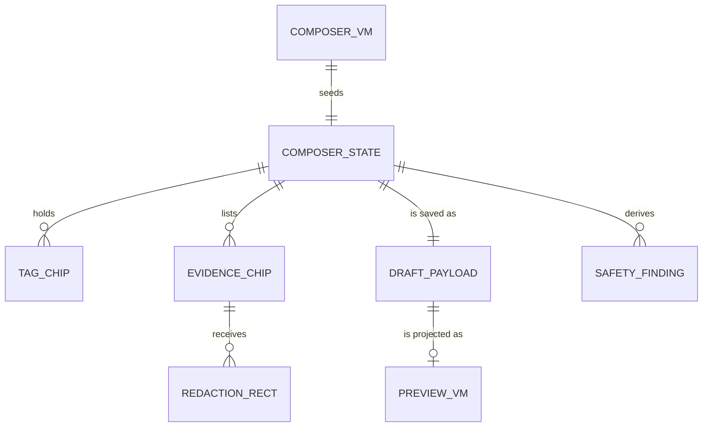

# Functional specification — U26 `t-306-composer-wizard`

**Refreshed 2026-10-29** against `main` at `14c21a9` (T-010 merged) and the working tree of `bolt/t-011-patient-design-and-motion-system` (T-011 in Code Generation: `PublishTick({children})`, `RouteTransition` in the patient layout, `motion.css` with `[data-step-dir]`, `[data-press]` and `data-static="emergency"|"disclaimer"`). Upstream interfaces are the 2026-10-29 drafts of U21 T-301, U14 T-201, U9 T-102, U17 T-204, U45 T-011, U8 T-101, U12 T-105, and, downstream, U25 T-305, U22 T-302, U24 T-304 and U27 T-307. U23 T-303 has no draft yet; its task file is the interface. What the refresh took in:
1. **T-204's draft.** `profile_submissions` gains a public id (T-204 Q16 A), so the draft field stays T-301's `doctorSubmissionPublicId` (old F14 closed). `AddDoctorPanel` owns its own `compose.addDoctor` toggle and gate and calls `onSubmitted(submissionPublicId)`; this Unit asks for the name too (§ 15).
2. **T-305's draft.** `confirmPrivacy` takes `skipEditing: true` when an item has no redaction (AC7.2.3, T-305 Q10 A), the canvas uses `previewPages[0].url`, a per-item confirm control is needed, and per-stroke redaction re-encodes each stroke (T-305 F21). Designed in: BR8.6–BR8.9, Q14 (masks are batched).
3. **T-302's F17** asks the composer to add later-care entries after publish. Declined by Q13 (§ 13); AC6.2.5 is served by T-302's `addFollowUp`, T-307's display and T-409's entry point.
4. **T-304's F12.** `ev.state.sanitising` must not read "Making the public copy"; the composer renders T-303's `stateKey`, so the fix is T-303's key map (§ 15).
5. **Owner answers.** No questions to the owner (2026-10-29): Q1–Q14 are pre-answered A by the agent. Counts only, "Former member", the masked own email (never on `/write`, T-102 Q14 A), no public anonymity caveat with the lawful-access text on Terms and Privacy (T-301 FD entry (b)), FR46 deferred (T-301 FD entry (a)), the facility criteria model and one hospital name per branch (T-203), FD-094 parallel building.
6. **T-010 constraints.** Components import `contracts`, `i18n`, server actions and `web-shared` only, which rules out the task's `period.ts` domain re-export (F1). 80% lines in `apps/web` with untested files counted. No migration and no repository change, so the migration-count pins and `not-implemented.test.ts` (ISS-294) do not move unless a § 12 fallback is used.

| Field | Value |
|---|---|
| Unit | U26 `t-306-composer-wizard` (kind `ui`, size XL, not high risk); Bolt 21; depends on U21 T-301, U23 T-303, U9 T-102, U17 T-204, U14 T-201, U3 T-010, U45 T-011 |
| Source | `docs/implementation/tasks/T-306-composer-wizard.md` with its FD-091 amendment and the CR-001/FD-036 images-only block |
| Stories | US6.1, US6.2, US7.1, US3.3, US5.3 (`unit-of-work-story-map.md`); the author-side UI of AC7.2.3 (US7.2, U25) is built here |
| Requirements | FR10, FR36, FR37, FR39–FR45, FR47, FR55, FR60–FR63, FR66, FR68, FR95, NFR2, NFR4, NFR6, NFR7, NFR13 |
| Decisions | FD-008, FD-009, FD-014, FD-015, FD-022, FD-023, FD-024, FD-032, FD-036, FD-042, FD-091, FD-093, FD-094; T-301's proposed entries (a) FR46 deferral, (b) anonymity copy, (c) three suggested labels; the two entries of § 17 |
| Questions | Q1–Q14 in `functional-design-questions.md`, all answered A by the agent under the owner's no-questions instruction of 2026-10-29 |
| Status | Draft ahead of the stage. No upstream Unit is built; their drafts and task files are the interface, and § 16 lists what Code Generation checks first |

`entities.md` holds the shapes, `rules.md` the rules (BR1.1–BR13.6), `frontend-components.md` the components, files, styles and tests.

## 1. What changes, in one paragraph

The `/write` placeholder becomes the composer: a five-step, mobile-first wizard over the prototype's composer blocks, kept in the prototype's order and copy (Q1). Step 1 is the care (target, mode, doctor or add-a-doctor, relationship, period, optional private exact date). Step 2 is the story (quick or four sections), the tags and the live safety checks. Step 3 is how it went (sentiment, outcome, Reviewer's labels, all optional). Step 4 is identity and documents (upload, live pipeline states, covering private details, per-item confirmation). Step 5 is check and publish (safety checks, the full preview, the four confirmations, Publish, Save and finish later). A sticky aside shows the exact public preview from `review.preview` and the persistent disclaimer. Drafts save on the server, encrypted, 1.5 s after each change; nothing is kept in the browser. Signed-out visitors see only the gate. Unconfirmed accounts can write and save; Publish, upload and add-a-doctor stay closed. A facility target reuses the wizard with branch, story, nine optional criteria and identity (T-301 R1). Motion comes only from T-011: the step slide in the reading direction, press feedback, one `PublishTick` on success; nothing safety-related moves. The Unit adds about 40 message keys, rewords two, wires the review commands in the container and appends two FD entries (§ 17).

## 2. As is and what Bolt 21 can count on

| Element | Today (`main` `14c21a9`) | By Bolt 21 |
|---|---|---|
| `/write` | `ViewShell(view="compose")` with `shell.placeholder` | T-102 adds `WriteGateCallout` and the banner above it (T-102 Q1 A); this Unit replaces the page |
| Container, Actor | none | T-101: lazy `server/container.ts`, `getActor()`, `await config.current()`; T-105: `emergency.ambulance`, `featureVisibility.facilityAccounts` |
| Review | empty | T-301: `saveDraft → {draftId, expiresAt}`, `getDraft → ComposerDraftVM`, `preview → PreviewVM (= ExperiencePageVM)`, `publish`, `facilityReview.publish`, `DraftPayload`; container wiring is this Unit's (T-301 F21) |
| Evidence | empty | T-303 (Bolt 18): `POST /api/evidence/upload`, `getForAuthor {itemIds}`, `remove`; items stay `quarantined` until T-304 (Bolt 27); `applyRedaction`, `confirmPrivacy`, `previewPages` and the preview route arrive with T-305 (Bolt 28) |
| Directory, taxonomy | stubs | T-201: `listDoctors` (≤ 100 per page), `listFacilities`, `taxonomy.resolve`, `listSuggested({group})`; T-204 (Bolt 16): `AddDoctorPanel`, `submitProfile → {submissionPublicId}` |
| Look, motion | T-011 in progress | tokens incl. `--space-*`, press list (`.opt`, `.c-mode`, `.btn`), `check:motion`, `contrast:patient`, `useAnnounce()` (CR-004) |
| Keys | the prototype's 74 `compose.*` keys (incl. `compose.step`, `of`, `next`, `back`, `identity.label`), prototype `ev.state.*`, `ev.failNote`, `crit.*` (nine + `good|mixed|poor`), `errors.evidence.*` (incl. `confirmationRequired`, `notPreviewable`), `errors.review.minFields`, `attestationRequired` | + T-303's product-state keys, T-301's `errors.review.*` field keys (`periodInvalid` included), T-105's `{ambulance}` on `compose.safetyEmergFix` |
| Gate | `pnpm check` nine steps, CI before merge | eleven steps after T-011 |

## 3. Settled before this stage

See `functional-design-questions.md` § "Settled before this stage". In short: T-011's look (FD-091) with page rules in T-306's own `patient.css` section; drafts server-only; review rules T-301's, upload rules T-303's, redaction and confirmation semantics T-305's (FD-023); FR46 deferred; three suggested Reviewer's labels only; facility feedback in scope; `/write` indexable with no address; provisional terms created at publish, never by the composer (T-201 F12).

## 4. Workflows

### WF1 — Request `/{locale}/write?draft=&doctor=&facility=&step=`

1. `actor = await getActor()`.
2. **Signed out** (BR1.1): `ViewShell(view="compose")` > `.a-head` (`nav.compose`, `h1.display compose.title`, `.lede compose.intro`) + T-102's `WriteGateCallout`. No form control and no composer data. Stop.
3. **Signed in.** In parallel through the container (BR1.3): `directory.listDoctors({page: 1, pageSize: 100})`; `taxonomy.listSuggested({group})` × 4; `await config.current()` once (`emergency.ambulance`, `featureVisibility.facilityAccounts`); `directory.listFacilities` when facility feedback is on (labels by T-202's `facilityLabel`); with `?draft=`: `review.getDraft` (`not_found` → new draft and `compose.draftMissing`, BR4.6), else also `review.preview` and `review.repeatHint` for the first render. Default period = `formatMonthYear(clock.now(), locale)`.
4. Build `ComposerVM` (ENT-001). Query values only preselect (BR1.5).
5. Render `ViewShell(view="compose")` > `Composer`. Unconfirmed: T-102's `PendingVerificationBanner` without an address (BR1.2).
6. `generateMetadata()` → `documentTitle('compose')`, indexable.

### WF2 — Moving between steps (Q1)

1. The rail (`nav > ol.c-steps`, five buttons) and Back/Next (`compose.back`, `compose.next`) set the step; every step is reachable; nothing is checked until Publish (BR2.2).
2. The incoming panel gets `data-step-dir="forward"|"back"`; the outgoing panel leaves at once (T-011 BR6.3). Focus moves to the step's `h2[tabindex=-1]`; `useAnnounce()` speaks "Step {n} of 5: {name}" (BR2.3).
3. `history.replaceState` writes `?draft=<id>&step=<n>`; no history entry (BR2.4). Reduced motion: instant swap.

### WF3 — Editing a field

The reducer applies the change (ENT-002); toggles follow the prototype (a second press clears sentiment and outcome; claims and tags toggle; mode, identity and relationship are single choice). Safety checks recompute from state (WF6) without remounting the text field; the autosave timer restarts (WF4).

### WF4 — Autosave (BR4.1–BR4.7)

1. 1.5 s after the last change, `saveDraftAction({draftId?, payload})`. One save in flight; changes meanwhile cause one more save after it. The first save creates the draft; no second create is sent before it returns.
2. Ok → keep `draftId`, `replaceState`, `#saved-flag.on` with `compose.draftSaved` for 1.8 s (no movement), then `previewAction` and `repeatHintAction`, each tagged with the save's sequence number; older responses are dropped.
3. Error → `compose.draftNotSaved`; retry after 5, 15, 30 s, then on the next change. `validation` → `errors.common.validation`, no retry until a change. `not_found` → the next save creates a new draft from the current state; `compose.draftMissing` once.
4. Save and finish later (`#save-draft`) flushes, then `router.push('/{locale}/me?tab=drafts')`; on error it stays.
5. `beforeunload` asks only while a save is pending or failed; unmount flushes. Autosave pauses during publish and stops after success.

### WF5 — Tags (BR5.1–BR5.6)

1. Each of the four `TAG_GROUPS` shows its `listSuggested` chips (`.opt`, `aria-pressed`); a press toggles `{group, termPublicId}`.
2. A free-text input per group (`compose.tagFree`) and Add (`compose.tagAdd`). Add or Enter → `resolveTagAction({text, kind: group})`: one term → canonical chip; none or ambiguous or error → `{group, freeText}`, chip `title = condition.provisional`. Terms are created at publish by T-301 (T-201 F12).
3. Not sure is its own chip (`notSure`), not exclusive. At most 20 tags (`compose.tagsMax`). Each add or remove is announced.

### WF6 — Safety checks (BR6.1–BR6.6)

1. `safetyChecks({texts, ambulance, ignored, duplicate})` (pure) runs on the story and every section (F19): `pii` (warn), phone pattern with Bengali digits mapped first; `emerg` (danger), the prototype's words plus the configured ambulance number in both scripts (F20); `dup` (warn), from `repeatHintAction` (Q6).
2. Ignore (`data-ignore`, `compose.ignore`) adds to `ignoredChecks`. The list shows on step 2 and again on step 5; with no finding, the ok item (`compose.safetyPass` + `compose.publishedNote`). No check blocks Publish (FR44, FD-009); the list carries `data-static="emergency"` and never moves.

### WF7 — Evidence (Q4, Q5, Q12; BR7.1–BR7.11)

1. Unconfirmed accounts see `auth.gate.verifyToAct` in place of `#add-file` (T-303 requires a confirmed account).
2. The group `.opt-row` (`evidence.group.reviewed|later|outcome`, default `reviewed`) sets the group of the next upload.
3. `#add-file` opens `<input type="file" multiple accept="image/jpeg,image/png,.jpg,.jpeg,.png">` (FD-036, F2).
4. Pre-checks before any byte is sent: extension and type, 15 MB each, 10 per draft, 100 MB total; a refused file shows its `errors.evidence.*` message and is not sent. The server checks again.
5. No draft yet → flush the save and wait for `draftId`.
6. One `POST /api/evidence/upload` (multipart: `draftId`, `group`, one `idempotencyKey` per file, the files). Pending chips show `compose.uploading`. Per-file results (T-303 shape, F13): ok → append `itemId` to `evidenceItemIds`; error → the chip shows the message with Remove.
7. `useEvidencePolling` while any item is `quarantined|validating|scanning|sanitising`: `getForAuthorAction({itemIds})` every 2 s for 2 min, then every 10 s; paused while hidden; stopped at 15 min with `compose.evidenceStillProcessing` and Check again (`compose.checkAgain`), no promised time (AC7.1.5).
8. `EvidenceFileChip` (port of `evFileHtml`): name = the in-memory file name for this page session, else `compose.evidenceItem {n}` (Q12); state text `t(stateKey)`; static bar `--w` = stage / 6; `failed` → `.bad`, `t(failKey)`, `compose.evidenceFailedNote` (F27), Replace and Remove (FR66). State changes are announced once. `rejected` and `removed` items leave the list and `evidenceItemIds`.

### WF8 — Preview (Q7, Q10; BR9.1–BR9.7)

1. After each successful save, `previewAction({draftId})` → `PreviewVM` (doctor) or the facility preview (Q10).
2. `ComposerPreview` renders it compact in `aside.c-side > section.panel.preview-card` (`.k` `compose.preview`): byline as readers will see it (anonymous: "Written anonymously", no alias before publish), doctor, flags (or "Not provided"), title, 220-grapheme excerpt, claims under "Reviewer's label", tags (provisional ones as written). `evidenceGroups` is `[]` in a draft preview (T-305 WF5); the aside lists no files. Before the first save: `compose.previewEmpty`.
3. At 360 px the aside follows the form; on steps 1–4 the preview sits in a closed `details` (`summary` `compose.preview`), open on step 5. The disclaimer panel is never inside it (BR9.6).
4. Period error: when `periodText` is not empty and the VM has no `margin.period`, the field shows `errors.review.periodInvalid` after its first blur (Q3).
5. When T-307 merges, it swaps the compact body for `ExperienceBody` (§ 15).

### WF9 — Covering private details and confirming (Q4, Q14; BR8.1–BR8.11)

Dormant until T-304 and T-305 merge: before then no item reaches `preview_ready` and `getForAuthor` carries no `previewPages`.
1. A `preview_ready` chip (`.pending-confirm`) shows Cover private details (`compose.redactOpen`) and the per-item confirmation.
2. Cover private details opens `RedactionCanvas` inside `.redact` (`compose.redact`, `compose.redactBody`, `compose.redactTool`) on `previewPages[0].url` + `?v=<n>` (one page, FD-036), `alt` `compose.redactAlt`.
3. Drawing (Q14): pointer down/move/up with capture draws a `.mask` span (prototype). Masks stay local and removable (Undo last, Clear: `compose.redactUndo`, `compose.redactClear`) until the author presses Cover these areas (`compose.redactApply`). A mask under 4 × 4 css px is dropped.
4. Keyboard: the canvas is focusable (`role="application"`, `aria-label` `compose.redactTool`, hint `compose.redactKeyboard`): arrows move a 10 px box (Shift 50), Alt + arrows resize, Enter adds it as a mask, Escape cancels the box.
5. Cover these areas → `toPagePixels` for each mask (rounded, clamped) → one `applyRedactionAction({itemId, pageNo: 1, rects})` (≤ 200). Note under the button: `compose.redactApplyNote` (covering cannot be undone; Replace starts again). Ok → `v + 1`, masks cleared, `compose.redactApplied` announced. Error → `.callout.warn` `t(messageKey)`.
6. Confirmation: checkbox `compose.confirmItem`. When the VM says `needsSkipAcknowledgement` (no area covered), a second checkbox `compose.skipEditing` must be checked first (AC7.2.3); the call is then `confirmPrivacyAction({itemId, confirmed: true, skipEditing: true})`, else without `skipEditing`. Ok → `privacy_confirmed`, the canvas and checkboxes go (no unconfirm; Replace to change). `evidence.confirmation_required` → `errors.evidence.confirmationRequired`.
7. Before T-305 merges, both actions are stubs returning `evidence.not_previewable` (BR8.7), unreachable while no item is `preview_ready`.

### WF10 — Publish (Q8; BR10.1–BR10.9)

1. `#publish` is enabled only for a confirmed account with the four confirmations (`compose.confirm1–3`, `compose.age`), no failing save, no pending doctor submission, not in flight. Otherwise `disabled` with its reason in `aria-describedby`.
2. Flush the save, then `publishAction({draftId, identityMode, attestation: true})` or `facilityPublishAction`.
3. `ok {publicId}` → the step area becomes the published state: `PublishTick` with `compose.publishedNote`, a focused link `compose.publishedLink` to `/{locale}/experiences/{publicId}`, the same text announced. No automatic redirect (Q8). Items not confirmed stay private (AC6.1.6): `compose.evidenceUnconfirmed` lists them.
4. `review.min_fields` with `fieldErrors` → `.callout.warn` summary above the rail: `errors.review.minFields` + one link per missing field in the server's order; go to the first field's step, focus it, announce the summary (AC6.1.3); each line disappears when its field changes.
5. `review.attestation_required` → step 5, focus the first unchecked box. `rate_limited` → `errors.common.rateLimited {minutes}` in the active language's digits. `forbidden`, `conflict`, `validation`, `internal` → callout `t(messageKey)`; the draft is kept and autosave resumes.

### WF11 — Facility target (T-301 R1; Q10; BR11.1–BR11.6)

1. Only when `featureVisibility.facilityAccounts` is on: a target `.c-modes` pair at the top of step 1 (`compose.target.doctor`, `compose.target.facility`). Switching keeps story, period, exact date, identity and confirmations; the rest is hidden but stays in the draft.
2. Facility steps: 1 branch (required) and period; 2 story (`compose.facilityStoryHint`) and the nine criteria (`crit.*`, each `good|mixed|poor` or none, all optional, no score); 3 skipped; 4 identity only (no documents); 5 checks, preview, confirmations, Publish → `facilityPublishAction`; refusals as WF10 (`fieldErrors.branch` → step 1).

### WF12 — Add a doctor who is not listed (T-204)

1. T-204's `AddDoctorPanel` sits under the doctor select; it owns its `compose.addDoctor` toggle, its fields and its gate (`useAuthGate()`).
2. `onSubmitted({submissionPublicId, name})` → the draft stores `doctorSubmissionPublicId` and clears `doctorPublicId`; the field shows the name with `compose.addPending`; T-301 saves the draft as blocked (its BR2.4); Publish stays disabled. If T-204 passes only the id, the field shows `compose.addPending` alone.
3. Choosing a listed doctor clears the submission from the draft.

### WF13 — Code Generation order

1. Baseline: `pnpm infra:up`, `pnpm check` and `pnpm smoke` green on the Bolt branch; open `ISSUES.md` rows in the area and § 9 read.
2. The § 17 FD entries appended to `docs/status/decision-log.md` before any code.
3. Check the interfaces (§ 16); adapt the wiring, not the rules; record every difference.
4. Server: `server/actions/{review,taxonomy}.ts`; `server/actions/evidence.ts` gains the two stubs; the container wires the review module and the interim `EvidenceForPublish` (§ 12).
5. Pure helpers and their tests: `safety-checks.ts`, `evidence-stage.ts`, `redaction-geometry.ts`, `lib/graphemes.ts`.
6. Components and the page, `loading.tsx` (`frontend-components.md`).
7. Copy: ENT-009 keys in both files in one commit; the two rewordings; Bengali flagged for the owner's review (FD-042, ISS row).
8. Styles: T-306's section of `patient.css`.
9. Tests, the `pages.test.tsx` `/write` row, `composer.smoke.test.tsx`.
10. Gate: `npx impeccable detect apps/web/src --no-advisory`, `pnpm contrast`, `pnpm check`, `pnpm smoke`, CI green on the Bolt head; hand-off with every § 12 addition.

## 5. State transitions

| From | Event | To | Rule |
|---|---|---|---|
| — | request, signed out | gate (no form) | BR1.1 |
| — | request, signed in, no `?draft=` or not found | editing, unsaved (note when not found) | BR1.4, BR4.6 |
| — | request, `?draft=` found | editing, saved | BR4.7 |
| editing | change | save pending (1.5 s) | BR4.1 |
| save pending | ok / error | saved (flag 1.8 s) / save failed (retry) | BR4.2, BR4.3 |
| editing | Publish (allowed) | publishing (autosave paused) | BR10.2 |
| publishing | ok / refused | published (final) / editing with summary or callout | BR10.3–BR10.7 |
| editing | Save and finish later, ok | left for `/me?tab=drafts` | BR4.5 |
| doctor chosen | panel submitted | blocked on own submission, Publish disabled | BR3.2 |
| blocked | listed doctor chosen / T-204 approves (on reload, `ComposerDraftVM.doctorPublicId`) | doctor chosen | BR4.7 |

Evidence item as the composer sees it:

| Server state | Chip | Stage /6 | Actions | Polled |
|---|---|---|---|---|
| (uploading) | `compose.uploading` | 0 | — | — |
| `quarantined` | `t(stateKey)` | 1 | Remove if `canRemove` | yes |
| `validating` / `scanning` / `sanitising` | `t(stateKey)` | 2 / 3 / 4 | — | yes |
| `preview_ready` | `.pending-confirm` | 5 | Cover, confirm (with skip when no redaction), Replace, Remove | no |
| `privacy_confirmed` | `.done` | 6 | Replace, Remove | no |
| `failed` | `.bad` + `t(failKey)` + `compose.evidenceFailedNote` | full | Replace, Remove | no |
| `rejected`, `removed` | leaves the list | — | — | no |

Polling: idle → fast (2 s, ≤ 2 min) → slow (10 s) → stopped (15 min; Check again → fast). Hidden → paused. No item in flight → idle.

## 6. Ports and data access

The Unit adds no port. It calls, through `server/container.ts` and server actions:

| Call | Owner | Use |
|---|---|---|
| `review.saveDraft`, `getDraft`, `preview`, `publish`, `facilityReview.publish` | U21 T-301 | WF1, WF4, WF8, WF10, WF11 |
| `review.repeatHint({draftId}) → {duplicate}` | U21 T-301 (asked, Q6); fallback here | WF6 |
| `taxonomy.resolve`, `listSuggested`; `directory.listDoctors`, `listFacilities` | U14 T-201 | WF1, WF5 |
| `directory.submitProfile` (inside `AddDoctorPanel`) | U17 T-204 | WF12 |
| `POST /api/evidence/upload`, `evidence.getForAuthor`, `evidence.remove` | U23 T-303 | WF7 |
| `evidence.applyRedaction`, `confirmPrivacy`, `GET /api/evidence/items/{id}/preview/{page}` | U25 T-305 (stubs until then) | WF9 |
| `getActor()`, `ConfigProvider.current()`, `Clock` | U8 T-101, U12 T-105 | WF1 |

Each action runs `parse → getActor → container call → Result`; a thrown error becomes `err('internal')` with a fresh correlation id and a log line with allowlisted fields only (no story text, no file name).

## 7. View models

`ComposerVM`, `ComposerState`, `TagChip`, `SafetyFinding`, `EvidenceChipVM`, `RedactionRect`, the step model and the actions are in `entities.md`. No type is added to `packages/contracts`: `ComposerVM` lives in `components/patient/composer/types.ts`, built from T-301's, T-201's and T-303's contracts.

## 8. Developer view — mapping details

- **Identity.** State and payload use `named | pseudonymous | anonymous`; buttons show `compose.identity.real | pseudo | anon`; the group label is `compose.identity.label` (F9).
- **Period.** Prefill `formatMonthYear({year, month}, locale)` from the server clock ("অক্টোবর ২০২৬" under `bn`); the composer never parses it (Q3). Exact date: `<input type="date">` → `exactDate` `YYYY-MM-DD`; T-301 checks it lies inside the period.
- **Excerpt.** `truncateGraphemes(text, 220)` (`lib/graphemes.ts`, `Intl.Segmenter`), never `slice` (01-conventions §4).
- **Numbers.** Step numbers, counts and minutes through `formatNumber` / `formatDigits`.
- **Payload.** `DraftPayload` ≤ 64 KiB (T-301 BR2.2); `maxLength` 10 000 on the story and 5 000 per section.
- **Pixels.** `toPagePixels(rectCss, {clientWidth, clientHeight, naturalWidth, naturalHeight})`: 50 × 20 css px on a 400 px-wide preview of a 1200 px image → `w: 150, h: 60` (acceptance row; one rect in the `rects` array).

## 9. Findings and proposed ISS rows

Proposed with `Found in U26 T-306` and the next free numbers (the register on `main` ends at ISS-302; other drafts propose rows first).

| # | Sev | Area | Finding | Owner |
|---|---|---|---|---|
| F1 | S1 if built as written (designed out) | web/boundaries | The owned paths put `period.ts` "re-exported from domain" in components; FD-093 forbids components to import `@rogikotha/domain`, so `pnpm lint` fails. The period is checked on the server (Q3) | U26 |
| F2 | S2 (designed out) | web/evidence | Step 6 writes `accept=".jpg,.jpeg,.png,.pdf"`, against FD-036. Images only | U26 |
| F3 | S2 (designed out) | evidence/sequencing | At Bolt 21, T-304 (27) and T-305 (28) are not built: no item leaves `quarantined`; `applyRedaction`, `confirmPrivacy` and the preview route do not exist. Built as written, the composer polls forever and imports missing actions. Q4 (stubs, dormant canvas), Q5 (bounded polling) | U26; U25 replaces the stubs |
| F4 | S2 (designed out) | taxonomy/identity | The owned paths and 03 §4 give the composer `taxonomy.createProvisional`; calling it while writing an anonymous review ties the account to the wording (T-201 F12). Terms are created at publish | U26 |
| F5 | S2 (designed out) | copy/identity | The prototype's `compose.identity.anonNote` speaks of legal disclosure, against FD-008, FD-022, AC3.3.6. Reworded with T-301 FD entry (b)'s text | U26 |
| F6 | S2 (open, being designed elsewhere) | evidence/workspace | Items bound to a review while processing (AC6.1.6) reach `preview_ready` after the composer is gone. T-305 Q16 A adds `getForAuthor {reviewId}`; T-409 builds the "documents waiting for you" screen reusing this Unit's chip and canvas, so both must be props-driven (BR8.10) | U25 T-305, U38 T-409 |
| F7 | S2 (designed out) | review/identity | The task's duplicate check uses `ExperienceCardVM.mine` or a `myPublished` list, which put an account-to-anonymous-review link in a view model. A server-side boolean instead (Q6, FD entry (b)) | U21 T-301; U26 |
| F8 | S2 (designed out) | review/facility | `review.preview` has no facility projection, so facility feedback would publish without FR39's preview (Q10) | U21 T-301; fallback U26 |
| F9 | S3 (designed out) | prototype/copy | `T('compose.identity')` reads a namespace object; the label key is `compose.identity.label` | U26 |
| F10 | S3 (designed out) | prototype/copy | The prototype preview hard-codes "Your name", `shirin_88`, "March 2026", shows claims without "Reviewer's label" and drops a missing outcome. Keys, the real VM, the prefix and "Not provided" | U26 |
| F11 | S3 (designed out) | copy | `compose.redact` says "before you upload"; covering happens on the processed copy after upload (Q9) | U26 |
| F12 | S3 (designed out) | task | The acceptance row expects `ev.fail.encrypted` (Phase 2); the test uses `ev.fail.malware` | U26 |
| F13 | S3 | contracts | Upload response: C14 `[{itemId, state}]` vs T-303 `{items: [{clientKey, result}]}`; `getForAuthor`: 03 §4 `{draftId}` vs T-303 `{itemIds}`. This design follows T-303 | U23 T-303 |
| F14 | closed | contracts | Submission id naming: closed by T-204 Q16 A (`profile_submissions.public_id`, `submissionPublicId`) | — |
| F15 | S3 | workspace | T-409's Edit links to `/write?draft=` through a `saveDraft {reviewId}` no Unit defines; T-302's `correct` is direct. The composer does not edit published reviews | U38 T-409 |
| F16 | S3 (designed out) | a11y | Step 9's 1.5 s automatic redirect changes context without a request (WCAG 2.2.1, 3.2.5) (Q8) | U26 |
| F17 | S3 (designed out) | behaviour | The prototype preselects the first doctor and "The patient", so AC6.1.3's missing relationship cannot happen and a review can be misattributed (Q2) | U26 |
| F18 | S3 | structure | FR39 and AC6.1.2 ask for steps with progress and Back/Next; the prototype is one long form that FD-091 keeps. FD entry (a) (Q1) | U26 |
| F19 | S4 (designed out) | behaviour | The prototype checks only the first story field; all story text is checked | U26 |
| F20 | S4 (designed out) | config | The emergency pattern hard-codes 999 while the number is configurable (T-105 BR10.1) | U26 |
| F21 | S4 | directory | The doctor select lists at most 100 doctors; a search picker is needed at real volume | later Unit |
| F22 | S4 | review | Two tabs on one draft: the last save wins (drafts have no version) | accepted |
| F23 | S4 | auth | T-102's `WriteGateCallout` sends `next=/write` and drops `?doctor=` / `?facility=` | U9 T-102 |
| F24 | S4 | contracts | `DraftPayload` has `notSure` both top-level and as a tag entry; the composer writes the top-level flag only | U21 T-301 |
| F25 | S4 | requirements | FR41 lists more detailed sections and AC5.3.1 five tag groups; release 1 keeps the prototype's four sections and four groups (outcome is its own field) | recorded |
| F26 | S4 | process | A file chip shows the file name only in the page session that uploaded it; after a reload it reads "Document {n}" (Q12) | accepted |
| F27 | S3 (designed out) | copy | The prototype shows `ev.failNote` ("Your words stayed published") in the composer, before anything is published. The composer uses `compose.evidenceFailedNote`; `ev.failNote` stays for published reviews | U26 |
| F28 | S3 (declined) | review/composer | T-302 F17 asks the composer to add later-care entries through `addFollowUp` after publish. The prototype composer has no later-care field and the task puts follow-up entry points in T-409 (Q13) | U22 T-302, U38 T-409 |
| F29 | S3 (designed out) | evidence/redaction | One `applyRedaction` per stroke is a full, irreversible re-encode each time (T-305 F21). Masks are batched and undoable until Cover these areas (Q14) | U26 |
| F30 | S3 | copy | T-303's state key for `sanitising` must not be the prototype's "Making the public copy" (T-304 F12): sanitising makes a private copy | U23 T-303 |

Existing rows, no new row: ISS-269 (seed drafts; T-301), ISS-240 (worker can read `exact_date_enc`; this Unit lets authors fill it, encrypted by T-301), ISS-137 (whole dictionary shipped to the client; the composer adds keys).

## 10. Accessibility and responsive (summary)

One `h1`; each step an `h2` that takes focus; `fieldset` + `legend` per choice group with `aria-pressed` buttons (prototype); labels for inputs; the rail is `nav[aria-label=compose.steps]` with `aria-current="step"`. The error summary is announced through `useAnnounce()` (no second live region) and takes focus only when no field does. Disabled Publish keeps its reason in `aria-describedby`. The canvas has a keyboard path and an `alt`. At 360 px: one column, five 44 px rail targets, wrapping chips, no horizontal scroll, the preview in a `details`; Bengali uses T-011's `:lang(bn)` sizes, no uppercase. Details in `frontend-components.md` § 5.

## 11. Tests

Test-after (team.md). The full list is `frontend-components.md` § 8: pure helpers, component tests in `en` and `bn` with builders in `composer-test-support.ts` (never `@rogikotha/test-support`), the `pages.test.tsx` row and the smoke test.

## 12. Owned paths and recorded additions

Owned (task file): `write/page.tsx`, `loading.tsx`, `components/patient/composer/**`, `server/actions/review.ts`, `server/actions/evidence.ts` (extend), `server/actions/taxonomy.ts`, the composer tests, T-306's `patient.css` section.

| Path | Change | Why |
|---|---|---|
| `components/patient/composer/period.ts` | not created | F1 |
| `server/actions/taxonomy.ts` | `resolveTagAction` only; no `createProvisional` | F4 |
| `server/actions/evidence.ts` | two stubs for T-305's actions; `getForAuthor` and `remove` stay T-303's | Q4 |
| `server/container.ts` (+ its test) | wire the review module (commands, queries, `RevealTarget` registration as T-301 designs) and an interim `EvidenceForPublish` over T-303's methods whose `publish` accepts only an empty list until T-305 replaces it | T-301 F21 |
| `apps/web/src/lib/graphemes.ts` (+ test) | `truncateGraphemes` (`web-shared`) | § 8 |
| `app/pages.test.tsx` | the `/write` row and its mocks | T-010 harness |
| `packages/i18n/messages/{en,bn}.json` | ENT-009 keys; `compose.identity.anonNote` and `compose.redact` reworded | ENT-009 |
| `docs/status/decision-log.md` | § 17 | project.md Mandated |
| Fallbacks, only if T-301 merged without them | `modules/review/queries/repeat-hint.ts` and the facility branch of `preview.ts` (+ tests, the review fake) | Q6, Q10 |

Nothing changes in `tokens.css`, `motion.css`, `packages/{domain,database}` or `apps/worker`. A missing token is an ISSUES row for U45, never an edit.

## 13. Decisions and why

- **Wizard over the prototype's blocks (Q1).** FR39, AC6.1.1 and AC6.1.2 ask for steps, progress and Back/Next; the task's FD-091 amendment asks for a step slide; the prototype has the step keys but one long form. Grouping keeps every block, order and string and gives a phone a short screen; free navigation keeps "nothing blocks until Publish".
- **No preselected doctor or relationship (Q2).** The relationship is FD-014's attestation.
- **Server checks the period (Q3).** One parser, T-301's; components cannot import the domain.
- **Whole evidence UI now, bounded polling (Q4, Q5).** T-305 then changes two action bodies, not a screen; polling never runs forever.
- **Duplicate hint on the server (Q6).** Only a boolean reaches the browser, only for the author's own draft.
- **Preview from the exact VM, body swapped by T-307 (Q7).** No fixed merge order between the two Units.
- **No auto-redirect (Q8).** Screen-reader users hear the confirmation and choose when to leave.
- **No later care in the composer (Q13).** The prototype composer has none, the task puts follow-ups in T-409, and a post-publish second call would make publish half-succeed on failure; the "after" section takes free text.
- **Batched, undoable masks (Q14).** Covering is irreversible and each call re-encodes the image; the author sees every mask before committing.

## 14. If an answer changes

- Q1 → B: one long form; no rail or step slide; AC6.1.2's progress clause becomes a gap; FD entry (a) dropped. → C: per-step checks on Next.
- Q2 → B: first doctor and "The patient" preselected; AC6.1.3's relationship case untestable.
- Q3 → B: `parsePeriod` moves to `contracts` (T-301 change), checked on blur; → C: a `checkPeriodAction` per blur.
- Q4 → B: no canvas, confirmation or stubs here; T-305 builds them in the composer. → C: Bolt 21 after Bolt 28.
- Q5 → B: 2 s while the page is open. → C: Check again only.
- Q6 → B: the page passes the author's published doctor and condition pairs (FD entry (b) reworded). → C: no `dup` check; AC6.1.5's duplicate clause a gap.
- Q7 → B: this Unit creates `ExperienceBody`. → C: Bolt 22 first.
- Q8 → B: `router.push` after 1.5 s, at once with reduced motion.
- Q9 → B: prototype wording. Q10 → B: a labelled local sketch; → C: no facility preview. Q11 → B: no exact-date input; FR42's author half a gap. Q12 → B: chips named by state.
- Q13 → B: an optional later-care block on step 3 saved in the draft (T-301 payload field) and posted with `addFollowUpAction` after publish (adds a U22 dependency).
- Q14 → B: one `applyRedaction` per stroke (task text).

## 15. Cross-Unit changes other drafts must pick up

| Unit | Change |
|---|---|
| U21 T-301 | Add `review.repeatHint({draftId}) → {duplicate}` (owner only, `identity.ownsAnyPersona`, no review id) (Q6, FD entry (b)); a facility branch in `review.preview` (Q10); keep one `notSure` representation (F24); confirm `parsePeriod` reads `formatMonthYear` output in both languages and the preview omits `margin.period` when it does not parse (Q3) |
| U23 T-303 | Keep the per-file upload response and `getForAuthor {itemIds}` with `stateKey`, `failKey`, `canRemove`, `canReplace`, no file name; correct C14 and 03 §4 (F13); map `sanitising` to private-copy wording, not "Making the public copy" (F30, T-304 F12); `itemsOfDraft` and `bindToReview` so pending items bind at Bolt 21 |
| U25 T-305 | Replace the two stub actions; `confirmPrivacy` with `skipEditing` as this Unit sends it; `previewPages[0].url` and `needsSkipAcknowledgement` in `getForAuthor`; `applyRedaction` receives batches (Q14, closes T-305 F21); acceptance row "cover, confirm, publish, see the processed copy"; T-305 merges after T-306 or adds the actions itself and T-306 skips its stubs |
| U17 T-204 | `AddDoctorPanel` calls `onSubmitted({submissionPublicId, name})` so the composer can show the pending name; it keeps its own toggle and gate |
| U9 T-102 | `WriteGateCallout` takes `next` (path and query) (F23); T-306 replaces T-102's `/write` hunk |
| U27 T-307 | Swap `ComposerPreview`'s compact body for `ExperienceBody` (recorded addition in T-307); no anonymity note in the margin |
| U22 T-302 | F17 declined (Q13): later care is added after publish through `addFollowUp` from T-409's entry point, not by the composer |
| U38 T-409 | Drafts link to `/write?draft=`; editing goes through T-302, not the composer (F15); the "documents waiting for you" list reuses `EvidenceFileChip` and `RedactionCanvas` (F6); the add-follow-up entry point serves AC6.2.5 (Q13) |
| U12 T-105 | `compose.safetyEmergFix {ambulance}` as designed; this Unit passes the parameter |
| U42 T-503 | Composer journeys at 360 px and 1280 px in both languages, with reduced motion |

**Parallel building (FD-094).** T-306 changes no package code (unless a § 12 fallback is used), so it does not collide with backend Units (T-302, T-304, T-405, T-205). It shares append-only files with UI Units built at the same time (`patient.css`, the two message files, `pages.test.tsx`, `container.ts`): rebase at merge, no blocking. It collides with T-305 on `server/actions/evidence.ts` and with T-307 on `ComposerPreview.tsx` only through T-307's later recorded addition.

## 16. Risks to verify in Code Generation and Build and Test

- Upstream shapes are drafts: T-301's actions and `PreviewVM`, T-303's response, T-204's panel props, T-102's exports. Check, adapt the wiring, record differences.
- `parsePeriod` round-trips the Bengali prefill: run the real preview once in `pnpm smoke`.
- `useAutosave` must send the reducer state at send time, not a stale closure.
- `history.replaceState` with the App Router must not reset the page.
- The coverage floor in `apps/web` after about 25 new files.
- `pnpm check:motion`: T-306's CSS has no `transition` or `animation`.

## 17. FD entries appended before code

Appended in WF13 step 2 with the next free FD ids at build time in place of `FD-<next>` (FD-094 is the last on `main`'s working tree; T-101, T-104, T-105, T-201 and T-301 append theirs first).

```text
| FD-<next> | **The composer is a five-step wizard over the prototype's composer blocks (T-306 Question 1)**: `/write` shows the prototype's blocks in its order and with its copy, grouped into five steps: (1) the care: target, mode, doctor or add-a-doctor, relationship, period and the private exact date; (2) the story, tags and safety checks; (3) sentiment, outcome and Reviewer's labels; (4) identity and documents; (5) safety checks, preview, the four confirmations, Publish and Save and finish later. A step rail and Back/Next move freely between steps; nothing is checked until Publish, which names each missing field and goes to its step. The preview and the disclaimer stay in the aside. This applies FR39 and AC6.1.2 and sets aside FD-091's "prototype structure" for this one screen; content, fields, states and behaviour stay the prototype's. | FR39 and AC6.1.2 require a step-by-step wizard with progress and Back/Next, the T-306 FD-091 amendment requires a step slide, and the prototype's data already has the step copy; one long form is hard to use at 360 px. Decided by the agent under the owner's no-questions instruction of 2026-10-29 |
| FD-<next> | **The composer's duplicate warning is computed on the server (T-306 Question 6)**: `review.repeatHint({draftId})` (U21 T-301) returns only `{duplicate: boolean}` to the draft's own author: true when one of the author's eligible published reviews, in any identity mode, is about the same doctor and shares a condition term or a normalised free-text condition with the draft. Persona ownership is checked through Identity (`identity.ownsAnyPersona`), so no other module reads `persona_links`. No review id, title, persona or count is returned, nothing is written, and no public view model gains an ownership field. The warning stays advisory (FR44, FD-009); the moderator flag stays `review.published.repeatEpisode` (FD-080). | A list of the author's reviews in the page, or a `mine` flag on public cards, would carry the link between an account and its anonymous reviews outside Identity (AD-3, FD-015). Decided by the agent under the owner's no-questions instruction of 2026-10-29 |
```

Neither entry changes a `project.md` hard rule. Entry (a) changes a founder decision's scope (FD-091) and entry (b) a data boundary (persona links), which is why both are written. Each goes to `OWNER-REVIEW-QUEUE.md` with its number when this draft is finalised.

## Entity-relationship view (derived from `entities.md`)



Text fallback: the page's view model seeds the client state; the state holds tag chips and evidence chips, derives the safety findings and is saved as the draft payload; the saved draft is projected as the preview; a preview-ready chip receives a batch of redaction rectangles.

## Rules summary (derived from `rules.md`)

| Group | Rules |
|---|---|
| Page and gate | BR1.1–BR1.6 |
| Wizard | BR2.1–BR2.5 |
| Fields | BR3.1–BR3.9 |
| Autosave | BR4.1–BR4.7 |
| Tags | BR5.1–BR5.6 |
| Safety checks | BR6.1–BR6.6 |
| Evidence | BR7.1–BR7.11 |
| Covering and confirmation | BR8.1–BR8.11 |
| Preview | BR9.1–BR9.7 |
| Publish | BR10.1–BR10.9 |
| Facility | BR11.1–BR11.6 |
| Look, motion, a11y, copy | BR12.1–BR12.8 |
| Build constraints | BR13.1–BR13.6 |

## Sources

- `docs/implementation/tasks/T-306-composer-wizard.md`; neighbours T-301, T-302, T-303, T-304, T-305, T-307, T-409, T-204.
- `aidlc/spaces/default/intents/261011-aidlc-adoption/inception/`: `units-generation/unit-of-work.md` (U26), `unit-of-work-dependency.md`, `unit-of-work-story-map.md`, `delivery-planning/bolt-plan.md`, `user-stories/stories.md`, `requirements-analysis/requirements.md`, `contract-design/contract-summary.md` (C6–C9, C14).
- Drafts under `docs/aidlc-migration/design-drafts/`: `t-301`, `t-201`, `t-102`, `t-204`, `t-011`, `t-101`, `t-105`, `t-104`, `t-202`, `t-203`, `t-302`, `t-304`, `t-305`, `t-307` (questions only).
- `docs/status/decision-log.md` (to FD-094), `docs/implementation/01-conventions.md`, `02-data-model.md`, `03-routes-and-contracts.md` §1, §4, `PRODUCT.md`, `docs/aidlc-migration/OWNER-REVIEW-QUEUE.md`, `docs/implementation/ISSUES.md` (no open row names T-306).
- Prototype `ui-design-prototype/concepts/concept-04b-quiet-clinic-minimal/app.js` (`TAG_GROUPS` 1411, `safetyChecks` 1428, `renderCompose` 1449, `evFileHtml` 1629, `advanceFile` 1648, `renderPreview` 1663, `buildRedactDoc` 1691, handlers 3105–3165 and 3290–3320; the task's line numbers are stale), `styles.css` composer blocks, `shared/rogikotha-data.js` `compose.*`, `ev.*`.
- Code: `apps/web/src/app/[locale]/(patient)/write/page.tsx`, `components/patient/motion/PublishTick.tsx`, `styles/{patient,motion}.css`, `lib/announce.ts`, `eslint.boundaries.mjs`, `packages/contracts/src/enums.ts`, `packages/i18n/src/format.ts`, `packages/i18n/messages/{en,bn}.json`.
