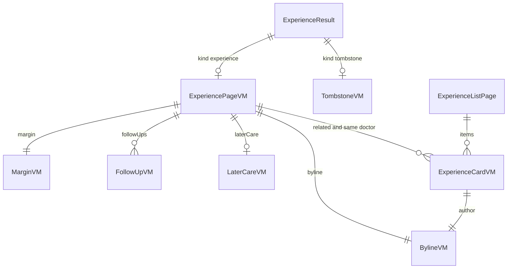

# Entities — U27 `t-307-experience-page-and-index`

Source of truth for the data shapes this Unit reads and the few it defines. The Unit owns no table, column, migration, port, query or command. It renders view models defined upstream: the page model by U21 T-301 (extended by U22 T-302 and, from Bolt 28, U25 T-305), the card and byline models by U14 T-201 and U11 T-104. Where this design needs a field the drafts do not give, the field is marked **ask** with its owner and the fallback the build uses when it is missing (`functional-spec.md` § 14). Workflows are in `functional-spec.md`; decision logic in `rules.md`; props in `frontend-components.md`.

`packages/contracts/src/view-models/experience.ts` is named in T-307's owned paths, but T-301 replaces its T-003 stub (`TODO(T-307)`) with `ExperiencePageVM`, T-302 extends it, and T-201 moves `ExperienceCardVM` to `experience-card.ts`. By Bolt 22 this Unit edits it only for the additive fields below, and only if the owning Unit merged without them.

```yaml
entities:
  - id: ENT-001
    name: ExperienceResult
    owner: Review (U21 T-301, U22 T-302)
    source: "packages/contracts/src/view-models/experience.ts"
    description: "What review.getExperience returns inside Result: the live page or the tombstone, tagged by kind"
    attributes:
      - { name: kind, type: enum, required: true, allowed_values: [experience, tombstone] }
    constraints:
      - "err not_found for every non-eligible review (hidden, soft-deleted, unpublished, rejected) -> 404 (BR1.3)"

  - id: ENT-002
    name: ExperiencePageVM
    owner: Review (U21 T-301; follow-up fields U22 T-302; evidence fields U25 T-305)
    source: "packages/contracts/src/view-models/experience.ts"
    attributes:
      - { name: kind, type: "'experience'", required: true }
      - { name: publicId, type: text, required: false, constraints: "absent in the composer preview (BR4.11)" }
      - { name: reviewKind, type: enum, required: true, allowed_values: [quick, detailed] }
      - { name: title, type: text, required: true, constraints: "may hold the redaction token (BR4.7)" }
      - { name: condition, type: "{publicId?, name, provisional?}", required: false, constraints: "kicker and margin; free text has no publicId and renders without a link (T-203 ConditionLink)" }
      - { name: byline, type: "BylineVM + relationship + postedMonthYear?", required: true, constraints: "T-301's PageBylineVM; this Unit reads only the T-104 BylineVM fields plus relationship and postedMonthYear; profileUsername is never read (Question 2)" }
      - { name: flags, type: "FlagVM[]", required: true, constraints: "T-301 BR6.5: sentiment or label.notProvided, outcome or label.notProvided, condition, review.episodeDate period" }
      - { name: sentiment, type: "enum | null", required: true, allowed_values: [positive, mixed, negative, null], constraints: "badge class; null -> plain" }
      - { name: outcome, type: "enum | null", required: true, allowed_values: [helped, none, worse, uncertain, null] }
      - { name: claims, type: "[{labelKey}]", required: true, constraints: "release 1: claim.wrongDx, claim.wrongRx, claim.secondOpinion (T-301 R3)" }
      - { name: reviewerLabelKey, type: text, required: true, constraints: "label.reviewerLabel" }
      - { name: reviewerLabelNoteKey, type: text, required: true, constraints: "label.reviewerLabelWhy" }
      - { name: body, type: text, required: false }
      - { name: sections, type: "[{key: symptoms|diagnosis|treatment|after, body}]", required: true, constraints: "ordered, empty ones dropped by T-301" }
      - { name: contentLanguage, type: enum, required: true, allowed_values: [en, bn, mixed], constraints: "BR4.8" }
      - { name: followUps, type: "FollowUpVM[]", required: true, constraints: "U22; date order oldest first; [] in preview" }
      - { name: currentStatus, type: "{dated: MonthYear, body} | null", required: true, constraints: "U22; the summary at the top (BR4.4)" }
      - { name: laterCare, type: "LaterCareVM | null", required: true, constraints: "U22" }
      - { name: editedAt, type: "MonthYear | null", required: true, constraints: "U22; every author correction, never a redaction" }
      - { name: documentsCount, type: integer, required: false, min: 0, constraints: "ask U21 T-301 (or U22 T-302): published items of this review, the count T-201 BR1.5 puts on cards (Question 3); fallback: heading only and an S2 row" }
      - { name: hasDocuments, type: boolean, required: true, constraints: "false until U25 T-305 fills it" }
      - { name: evidenceGroups, type: "EvidenceGroupVM[]", required: true, constraints: "[] until U25; rendered by U28 T-308, not here" }
      - { name: discussion, type: "{threadSlot}", required: false, constraints: "threadSlot = the review's public id; absent in preview" }
      - { name: relatedByCondition, type: "ExperienceCardVM[]", required: true, constraints: "up to 6" }
      - { name: sameDoctor, type: "ExperienceCardVM[]", required: true, constraints: "up to 6" }
      - { name: margin, type: "MarginVM", required: true }
    constraints:
      - "No percentage, score, account id, persona id, exact date, version, reason code or internal id (T-301 BR6.2, T-302 BR9.3)"
      - "Field names follow the finalised T-301 and T-302 drafts; where they differ at build time the component adapts its props and keeps the rules (functional-spec.md § 16)"

  - id: ENT-003
    name: MarginVM
    owner: Review (U21 T-301)
    attributes:
      - { name: anonymous, type: boolean, required: true, constraints: "drives nothing visible here except other accounts being empty (no caveat, BR2.7)" }
      - { name: period, type: MonthYear, required: true }
      - { name: posted, type: MonthYear, required: false, constraints: "absent in preview" }
      - { name: doctor, type: "{publicId, name, registrationNotVerified: true}", required: true }
      - { name: condition, type: "{publicId?, name}", required: false }
      - { name: tags, type: "TagVM[] {group, label}", required: true }
      - { name: otherAccounts, type: "[{publicId, title}]", required: true, constraints: "[] for anonymous and Former member (T-301 BR6.9)" }

  - id: ENT-004
    name: BylineVM
    owner: Identity (U11 T-104)
    source: "packages/contracts/src/view-models/persona.ts"
    attributes:
      - { name: personaKind, type: enum, required: true, allowed_values: [named, pseudonymous, anonymous] }
      - { name: displayName, type: text, required: false, constraints: "named only; plain text (Question 2)" }
      - { name: username, type: text, required: false, constraints: "pseudonymous only; link to /authors/{username}" }
      - { name: alias, type: text, required: false, constraints: "anonymous on the page only (thread alias); absent on cards and in preview" }
      - { name: initials, type: text, required: false, constraints: "named and pseudonymous; the avatar shows '—' otherwise" }
      - { name: avatarHue, type: integer, required: true, min: 0, max: 359 }
      - { name: formerMember, type: boolean, required: false, constraints: "then no other optional field; renders byline.formerMember" }
    constraints:
      - "The page adds relationship and postedMonthYear beside it (T-301 PageBylineVM)"

  - id: ENT-005
    name: FollowUpVM
    owner: Review (U22 T-302)
    attributes:
      - { name: kind, type: enum, required: true, allowed_values: [follow_up, correction, later_care] }
      - { name: dated, type: MonthYear, required: true }
      - { name: body, type: text, required: true, constraints: "may hold the redaction token" }
      - { name: laterProvider, type: "{text?, doctor?: {publicId, name}}", required: false, constraints: "later_care entries in the spine" }
      - { name: isCurrent, type: boolean, required: true, constraints: "exactly one true when any follow_up exists; never chosen by the page" }

  - id: ENT-006
    name: LaterCareVM
    owner: Review (U22 T-302)
    attributes:
      - { name: dated, type: MonthYear, required: true }
      - { name: body, type: text, required: true }
      - { name: providerText, type: text, required: false }
      - { name: doctor, type: "{publicId, name, registrationNotVerified: true}", required: false, constraints: "present only while the doctor is visible" }
      - { name: offerProfileSubmission, type: boolean, required: true, constraints: "true when no doctor is linked (AC6.2.5)" }

  - id: ENT-007
    name: TombstoneVM
    owner: Review (U22 T-302)
    attributes:
      - { name: kind, type: "'tombstone'", required: true }
      - { name: publicId, type: text, required: true }
      - { name: removedBy, type: enum, required: true, allowed_values: [author, moderation] }
      - { name: messageKey, type: text, required: true, allowed_values: [experience.tombstone, experience.tombstoneRemoved] }
      - { name: whyKey, type: text, required: true, constraints: "experience.tombstoneWhy" }
      - { name: threadSlot, type: text, required: true, constraints: "the public id" }
      - { name: noindex, type: "true", required: true }
    constraints:
      - "No title, story, author, doctor, tags, period, related cards or follow-ups (T-302 BR9.1)"

  - id: ENT-008
    name: ExperienceCardVM
    owner: Review read side (U14 T-201)
    source: "packages/contracts/src/view-models/experience-card.ts"
    attributes:
      - { name: publicId, type: text, required: true }
      - { name: title, type: text, required: true }
      - { name: excerpt, type: text, required: true, constraints: "grapheme-truncated by the query; ask U14/U21: never cut inside a redaction token" }
      - { name: truncated, type: boolean, required: true }
      - { name: sentiment, type: enum, required: false }
      - { name: outcome, type: enum, required: false }
      - { name: condition, type: "{publicId?, name}", required: false }
      - { name: documentsCount, type: integer, required: true, min: 0 }
      - { name: author, type: BylineVM, required: true, constraints: "no alias on cards" }
      - { name: relationship, type: enum, required: true }
      - { name: period, type: MonthYear, required: true }
      - { name: doctor, type: "{publicId, name}", required: true }

  - id: ENT-009
    name: ExperienceListPage
    owner: Review (U21 T-301)
    source: "review.listExperiences({cursor?, limit?}) -> CursorPage<ExperienceCardVM>"
    attributes:
      - { name: items, type: "ExperienceCardVM[]", required: true, constraints: "newest first (published_at, public_id), limit 20" }
      - { name: nextCursor, type: text, required: false }
      - { name: total, type: integer, required: false, min: 0, constraints: "ask U21 T-301: count of eligible experiences (Question 13); the count line is left out when absent" }

  - id: ENT-010
    name: RedactionSegment
    owner: this Unit (web-shared helper)
    source: "apps/web/src/lib/redaction.ts"
    description: "One piece of author text after splitting on T-302's token U+2063 '[redacted]' U+2063"
    attributes:
      - { name: kind, type: enum, required: true, allowed_values: [text, redacted] }
      - { name: text, type: text, required: false, constraints: "kind text only" }
    constraints:
      - "split(text) is total: the concatenation of text segments and tokens rebuilds the input"
      - "clip(text, max) counts graphemes with Intl.Segmenter and never ends inside a token"

  - id: ENT-011
    name: MessageKey (added by this Unit)
    owner: packages/i18n (keys added by U27 T-307)
    description: "Both dictionaries in one commit, Bengali flagged for the owner's review (FD-042). Values are proposals."
    attributes:
      - { name: "experience.readUpdate", type: message, constraints: "en 'Read the update'; bn 'আপডেটটি পড়ুন' (Question 17)" }
      - { name: "experience.moreExperiences", type: message, constraints: "en 'More experiences'; bn 'আরও অভিজ্ঞতা' (Question 13)" }
      - { name: "experience.backToNewest", type: message, constraints: "en 'Back to the newest'; bn 'সবচেয়ে নতুনগুলোতে ফিরুন'" }
      - { name: "experience.pagerLabel", type: message, constraints: "en 'More pages of experiences'; bn 'অভিজ্ঞতার আরও পাতা' (pager landmark)" }
      - { name: "experience.aboutThis", type: message, constraints: "en 'About this experience'; bn 'এই অভিজ্ঞতা সম্পর্কে' (margin landmark)" }
      - { name: "experience.loading", type: message, constraints: "en 'Loading experiences…'; bn 'অভিজ্ঞতা লোড হচ্ছে…' (skeleton status, screen readers only)" }
      - { name: "experience.laterCarePending", type: message, constraints: "en 'Submitted. An administrator checks it for duplicates and obvious abuse before it appears.'; bn 'জমা হয়েছে। প্রকাশের আগে একজন অ্যাডমিন ডুপ্লিকেট ও অপব্যবহার যাচাই করবেন।' (AddDoctorPanel pending note outside the composer, F12)" }
    constraints:
      - "Reused, not added: experience.publishedLabel, experience.currentStatus, experience.currentNote, experience.laterCare, experience.laterCareNote, label.followUp, label.noDocuments, label.notProvided, label.notVerified, label.reviewerLabel, label.reviewerLabelWhy, evidence.status, evidence.notice, disclaimer.long, index.experiencesNote, index.beFirst, nav.discover, nav.account, nav.compose, errors.common.notFound"
      - "From other Units: experience.tombstone, experience.tombstoneRemoved, experience.tombstoneWhy, experience.editedOn, experience.laterCareSubmit, label.correction, label.redacted (U22 T-302; this Unit adds label.redacted only if U22 has not); label.documentsCount, sentiment.totalAccounts (U15 T-202); byline.formerMember (U11 T-104); compose.addDoctor (U17 T-204)"
      - "Not used: compose.identity.anonNote (BR2.7), mine.empty under the discussion (BR2.5)"
```

## What the Unit does not hold

- No database row, migration, port, query, command or server action. Reactions, bookmarks and comments are U31 T-402's; reports U32 T-403's; evidence groups U25 T-305's and their rendering U28 T-308's.
- No cookie, local storage or client state beyond what `useAuthGate()` and T-204's `AddDoctorPanel` hold. Paging lives in the URL.
- No new view-model type. The two asked fields (`documentsCount` on the page, `total` on the list) belong to U21; this Unit adds them only as recorded additions with their tests if U21 merged without them.

## Relationships at a glance



Text fallback: a result is either a page or a tombstone. A page has one byline, one margin, any number of follow-ups, at most one later-care entry and up to twelve related cards. The index page holds cards; every card has one byline.
