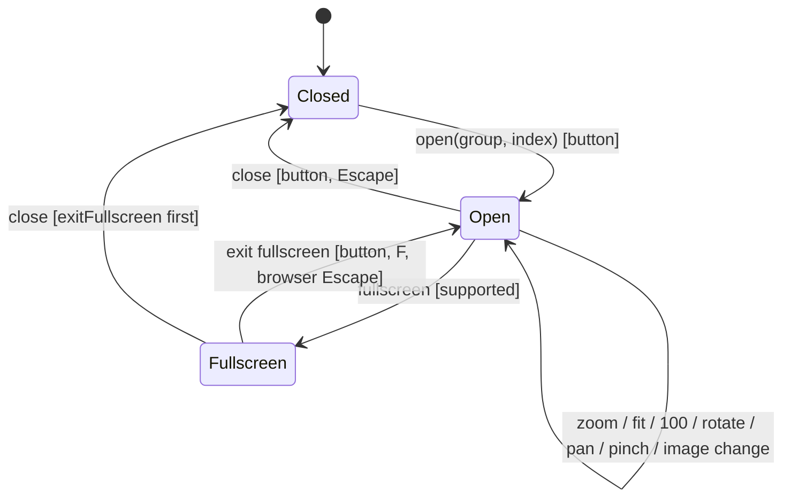
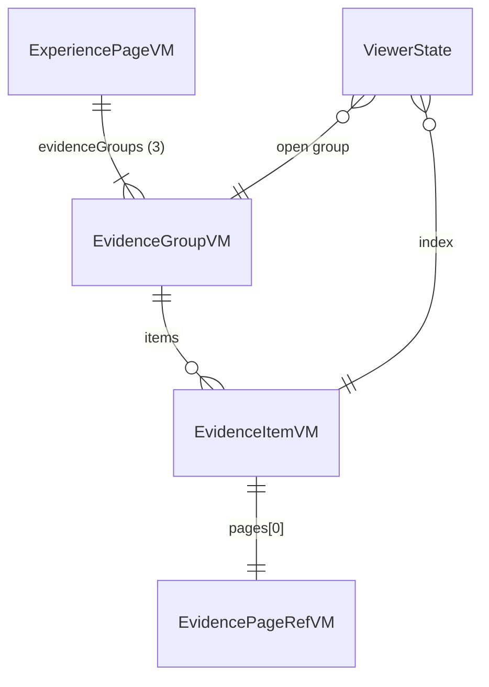

# Functional specification — U28 `t-308-evidence-viewer`

**Draft written 2026-10-29**, ahead of the stage, on the owner's instruction to overlap design with builds. Baseline: `main` at `9cf860a` with T-010 merged (`14c21a9`) and CR-012 merged; the working tree is `bolt/t-011-patient-design-and-motion-system` with T-011's phase A committed (`1401e06`). U25 T-305 and U27 T-307 are not built; T-305's draft (refreshed 2026-10-29) and T-307's questions file are the interface this design builds on. Every open point is decided by the recommended option under the owner's no-questions instruction of 2026-10-29 (Questions 1–15 in `functional-design-questions.md`). No answer changes a hard rule, a data boundary or a founder decision, so no FD entry is appended (§ 16).

| Field | Value |
|---|---|
| Unit | U28 `t-308-evidence-viewer` (kind `ui`, size M, not high risk); Bolt 29; depends on U25 T-305, U27 T-307, U3 T-010, U45 T-011; U42 T-503 depends on it |
| Source | T-308 (`docs/implementation/tasks/T-308-evidence-viewer.md`, with the FD-091 amendment and the CR-001/FD-036 images-only block) |
| Stories | US7.2 (AC7.2.4, AC7.2.5, AC7.2.6 rendered here; AC7.2.1–AC7.2.3 are U25/U26), US7.1 (no public part; AC7.1.6 partly) — `unit-of-work-story-map.md` |
| Requirements | FR53, FR56, FR59, FR65, FR68 (rendering), FR95, NFR4, NFR6, NFR7, NFR13; NFR2 correction (Question 14) — `requirements.md` |
| Decisions | FD-023 (confirmed processed copy only), FD-024 (equal languages), FD-032 (plain CSS), FD-036 (images only), FD-042 (Bengali review), FD-091 (patient redesign and motion), FD-093 (import boundaries), FD-094 (parallel Units) |
| Upstream design | `contract-summary.md` C8 (evidence, U25 provides `getPublic`) and C14 (artifact route); drafts `t-305-privacy-preview-redaction-publish` (WF5, WF7, § 7, BR5.x), `t-307-experience-page-and-index` (`EvidenceSlot`, Questions 3 and 11), `t-011-patient-design-and-motion-system` (tokens, `--target`, `Reveal`, `data-press`, sheet entry, static set) |
| Questions | Q1–Q15, all answered A, decided by the agent under the owner's no-questions instruction of 2026-10-29; each goes to `OWNER-REVIEW-QUEUE.md` when this draft is finalised; § 13 lists the changes under each other option |
| Status | Draft; moves to `<record>/construction/t-308-evidence-viewer/functional-design/` when the stage runs |

This file is the source of truth for the Unit's workflows and state transitions. `entities.md` holds the data shapes, `rules.md` the numbered rules (BR ids), and `frontend-components.md` the component props, files, styles and tests.

## 1. What changes, in one paragraph

The experience page's evidence slot becomes the real evidence section, and the prototype's synthetic page generator becomes a client-side viewer over the real processed images. With no documents the section shows its heading and "No documents". With documents it shows the static "Documents attached — not medically validated" callout, then the three treatment-path groups as an ordered timeline (reviewed → later → outcome; an empty group says "No documents"), each row with the processed thumbnail, the label (or "Image {n}") and "View processed copy", then the note that the original is never public. Any row opens one shared `Sheet` titled "Processed copy" at that row's image; its previous and next buttons move between the images of the same group ("1 of 2"). The prototype's chrome is kept in order: zoom out, 100 %, zoom in, Fit, rotate, previous, "n of N", next, fullscreen, zoom readout and "Download processed copy", now a plain link to the current image's `downloadUrl`. The design fixes what the prototype got away with because its page was synthetic: Fit fits on a 360 px phone, rotation turns about the centre, every part of a zoomed image is reachable by pointer, wheel, pinch and keyboard, and there is one dialog with one focus trap. Motion comes only from T-011 (sheet rise, group reveal, press feedback); pan, zoom, rotate and image changes are instant. Five keys are added and the 25 synthetic page keys are removed. The seed gets a second image for the three corpus items the prototype drew with two pages, so storyboard step 6 can page between two prescription photos.

## 2. As is (2026-10-29) and what Bolt 29 can count on

| Element | Today | By Bolt 29 |
|---|---|---|
| Evidence route | `experiences/[id]/page.tsx` is T-008's placeholder | U27 T-307: `experiences/[publicId]/page.tsx` renders `ExperiencePage` with `EvidenceSlot` (heading, and per its Question 3 A an interim count until this Unit) |
| View model | `contracts/src/view-models/evidence.ts`: `EvidencePageRefVM {artifactUrl, width, height}`, `EvidenceItemVM {publicId, label?, pages, downloadUrl, pageCount}`, `EvidenceGroupVM {group, items}`, `ViewerDocVM {itemId, …}`, all `TODO(T-308)` | U25 T-305: three groups always, `pageNo` on pages, `thumbnailUrl`, `labelKey`; `ExperiencePageVM.evidenceGroups` and `hasDocuments` filled in `get-experience.ts` (its BR5.10) |
| Repository | `PgEvidenceRepository.getPublic` throws `NotImplemented('T-308')`; `not-implemented.test.ts` lists the class (ISS-294) | U25 implements the public read as `publicItemsOfReview` and updates the stub list; nothing for this Unit |
| Artifact route | none | U25: `GET /api/evidence/artifacts/{artifactId}[?download=1]`, live visibility check, 300 s revalidated cache, `noindex`, attachment on `download=1` (its FD entry (b)) |
| `Sheet` | `components/shared/Sheet.tsx`: `.overlay > .sheet[role=dialog][aria-modal]`, `h2` title, close button focused on open, document-level Escape and Tab trap, focus returned to the trigger on close | T-011 restyles it and adds the entry rise; markup and focus behaviour unchanged |
| Announce | `lib/announce.ts` `useAnnounce()` writes `#sr-live` and clears after 1 s | unchanged |
| Motion | `Reveal` (`data-reveal-list`, first six children), `RouteTransition` in the patient layout, `motion.css` sheet entry and `[data-press]` | unchanged; `check:motion` fails on any motion declaration in `patient.css` |
| Styles | `patient.css` holds the ported `.ev-groups`, `.ev-group h4`, `.ev-item`, `.doc-icon`, `.lbl`, `.viewer-shell`, `.viewer-meta`, `.viewer-stage` (`overflow: auto`, `touch-action: none`), `.viewer-pages` (`transform-origin: top left`), the synthetic `.viewer-page` (720 px, A4 ratio, padding) with `.doc-head`, `.seal`, `.row`, `.table`, `.sig`, and `.viewer-controls .vctrl` (about 33 px tall); tokens `--target: 44px`, `--space-1…8` | T-011 restyles; this Unit appends its own section |
| Keys | 781 keys; all 39 prototype `viewer.*` keys (14 product, 25 synthetic); `evidence.status`, `evidence.notice`, `evidence.group.*`, `experience.openEvidence`, `experience.evidenceOnly`, `filter.evidence`, `label.noDocuments`, `a11y.close` | earlier Units add keys; this Unit's changes are additive and subtractive in its own commit |
| Numerals | `formatNumber(n, locale)`, `countParams` in `@rogikotha/i18n` | unchanged |
| Seed | 12 corpus items (e1–e12), one image each (CR-001); e5 and e11 failed; e1, e4, e9 had two pages in the prototype; no seeded group holds two published images | this Unit adds `e1-p2`, `e4-p2`, `e9-p2` (Question 11) |
| Gate (T-010, T-011) | eleven-step `pnpm check` (typecheck, lint with boundaries, unit and integration tests, coverage 80% lines per package with untested files counted, i18n parity, `format:check`, contrast, `contrast:patient`, `check:motion`, build), `check:identity`, CI on `bolt/**` | unchanged |

## 3. Settled before this stage

- The look is T-011's (FD-091); this Unit's rules go in its own appended section of `patient.css`, marked `/* added: T-308 reason */`, using only T-011 tokens and kept class names. A needed token is an `ISSUES.md` row, never an edit to `tokens.css` or `motion.css`.
- Images only (FD-036): one image per item; the viewer pages through a group's items; the download is the processed image.
- The public data is T-305's; this Unit adds no query, command, route, table or migration, and renders only what the view model holds.
- The prototype is the source of truth for content and behaviour (copy, control order, keys in the titles, pan and wheel rules), not for the look.
- T-010's boundaries, coverage floor and CI apply as merged (FD-093).

## 4. Workflows

### WF0 — Code Generation order

1. Baseline: `pnpm infra:up`, `pnpm check` and `pnpm smoke` green on the Bolt branch; read open `ISSUES.md` rows in `evidence` and `experience`.
2. Confirm U25 and U27 are merged on the base: `evidenceGroups` has three groups and `EvidenceSlot` exists. If T-305 still exports `ViewerDocVM`, remove it (nothing uses it) as a recorded change in `contracts/src/view-models/evidence.ts`.
3. Pure modules first, each with its tests: `viewer-transform.ts` (BR4.1–BR4.5), `viewer-keys.ts` (BR5.4), `viewer-pointer.ts` (BR5.1, BR5.2), `artifact-url.ts` (BR1.2).
4. Keys: add five, remove 25, exclude them in `port-from-prototype.mjs`, regenerate `keys.ts` (BR7.1); both files in one commit.
5. Server components: `EvidenceSection`, `EvidenceGroup`, `EvidenceItem`; fill T-307's `EvidenceSlot` with `EvidenceSection` (recorded edit).
6. Client components: `EvidenceViewerProvider`, `EvidenceOpenButton`, `EvidenceViewer`.
7. CSS section in `patient.css` (BR8.1, `frontend-components.md` § 7).
8. Seed: `e1-p2`, `e4-p2`, `e9-p2` in `seed-evidence.ts`, seed test counts, storyboard line "12 evidence items" → 15 and CR-012 DC13 note (BR9.3).
9. Smoke assertion; `npx impeccable detect apps/web/src --no-advisory`; `pnpm contrast`; `pnpm check`; `pnpm smoke`; hand-off with the ISS ids.

### WF1 — Rendering the section (server, on every experience request)

1. `EvidenceSlot` passes `evidenceGroups` and `hasDocuments` from `ExperiencePageVM`.
2. Each group's items are filtered by `isArtifactUrl` on every URL (BR1.2). This guard is expected never to drop anything; T-305's contract tests are the primary check.
3. If nothing remains or `hasDocuments` is false: `h2.section-head` `filter.evidence` and `p.note` `label.noDocuments` (BR2.1). Stop.
4. Otherwise: `h2`, then the callout `div.callout.warn[data-static="notice"]` `<b>evidence.status</b> evidence.notice` (BR2.2), then `EvidenceViewerProvider groups={…}` wrapping `Reveal as="ol" className="ev-groups ev-timeline"` with one `li.ev-group` per group in `EVIDENCE_GROUPS` order: `h3` `evidence.group.<g>`, then either `p.note label.noDocuments` (BR2.3) or the rows; then `p.note experience.evidenceOnly`.
5. A row: `span.doc-icon` holding `img.doc-thumb` (decorative), `span.lbl > b#<rowId>` with the label or `evidence.untitled {n}` (n = position in the group, through `formatNumber`), and `EvidenceOpenButton {group, index}` described by `#<rowId>` (BR2.5).

### WF2 — Opening the viewer

1. A reader activates "View processed copy" (`button.btn.small.ghost[aria-haspopup="dialog"][data-view-evidence=<publicId>]`).
2. The provider sets `open = {group, index}` and mounts `EvidenceViewer` through `createPortal` into `document.body`.
3. `Sheet` (title `viewer.title`) records the focused button as its trigger and focuses its close button; then the viewer's effect moves focus to "Zoom out" (BR3.2).
4. State: index from the click, zoom 1, rotation 0, pan 0. The current and the next image load eagerly; others lazily (BR6.3). T-011's sheet entry runs unless motion is reduced.

### WF3 — Looking at an image

1. **Zoom** (−, +, keys `-`/`+`, Ctrl/Meta + wheel, pinch): `zoomBy(±0.1)` or `pinchZoom`, clamped 0.5–3, 2 decimals (BR4.1, BR5.2, BR5.3). The readout (`aria-live="polite"`) shows the percentage in the active numerals.
2. **100 %** (button, key `1`): zoom 1, pan 0. **Fit** (button, key `0`): BR4.2 from the stage's measured size and the VM's width and height; rotation and pan reset.
3. **Rotate** (button, key `R`): +90°, four turns back to 0; announces "Rotation: {deg}°".
4. **Pan**: one pointer drag with capture; wheel or trackpad without Ctrl/Meta; `↑`/`↓` and Shift + arrows by 48 px (Shift: 192 px). No easing on any of these (BR4.5).
5. **Image change** (‹ ›, `←`/`→`, `PageUp`/`PageDown`, `Home`/`End`): clamped within the group; the file line and the download link follow the new image; announces "{label}, page {n} of {total}"; zoom, rotation and pan are kept (prototype).
6. Each state change writes `transform: translate(x px, y px) rotate(deg) scale(z)` to `.viewer-pages` through its CSSOM style in a layout effect (never a server-rendered attribute).

### WF4 — Fullscreen

1. Rendered only when `document.fullscreenEnabled` (absent on iPhone Safari).
2. Button or key `F`: `.viewer-shell.requestFullscreen()`, or `document.exitFullscreen()` when already fullscreen. `fullscreenchange` sets the label (`viewer.fullscreen` / `viewer.exitFullscreen`) and `aria-pressed`.
3. In fullscreen the browser's Escape leaves fullscreen first; a second Escape closes the viewer (Sheet). Closing while fullscreen calls `exitFullscreen()` first (BR6.1).

### WF5 — Download

`a.vdownload[href=current.downloadUrl][download]` "Download processed copy". The server sends `Content-Disposition: attachment; filename="rogikotha-processed-<itemPublicId>.<png|jpg>"` (T-305 BR5.7). No canvas, no `data:` or `blob:` URL (BR6.2).

### WF6 — Closing

Close button or Escape → `onClose` → exit fullscreen if needed → provider sets `open = null` → the portal unmounts → the Sheet's cleanup returns focus to the row's button (BR3.2). Pointer capture and listeners are released on unmount.

### WF7 — Seed for storyboard step 6 (Question 11)

`seed-evidence.ts`: for every corpus item with `pageCount` n > 1, after seeding the item as today, seed n − 1 more items in the same review and group with the same label, seed refs `<ref>-p2…`, one page and one thumbnail each, published like the first, with custody actor as the first item's. The item public id is derived from the new seed ref the same way as today. Second run: 0 inserted. The seed test's item counts become 15 items, 13 published; the storyboard's "12 evidence items" becomes 15.

## 5. State transitions

### 5.1 Viewer (per section)



Text fallback: Closed → Open on a row's button (state reset, focus to Zoom out). In Open, every viewing action changes zoom, rotation, pan or index and stays in Open. Open ↔ Fullscreen through the fullscreen control or the browser's Escape. Closing from either state ends in Closed, with focus back on the row's button.

### 5.2 Pointer handling (on the stage)

| From | Event | To | Effect |
|---|---|---|---|
| Idle | pointerdown (left button, touch or pen, not on the controls) | Panning | capture, `.dragging`, remember start |
| Panning | pointermove | Panning | pan = client − start |
| Panning | second pointerdown | Pinching | pinchStart = {distance, zoom}; pan paused |
| Pinching | pointermove | Pinching | zoom = BR5.2 |
| Pinching | one pointer up or cancelled | Panning | restart pan from the remaining pointer |
| Panning | pointerup, pointercancel, lostpointercapture | Idle | release, remove `.dragging` |

### 5.3 What the view model's states mean on the page

| VM | Page |
|---|---|
| `hasDocuments: false` or all groups empty | heading + "No documents" |
| groups with items | callout, timeline of three groups, empty ones "No documents", note |
| item without `label` | "Image {n}" |
| an item whose URLs fail BR1.2 | not rendered (guard) |
| `pageCount > 1` (Phase 2 only) | a count line; not reachable in Phase 1 |

## 6. Interfaces

This Unit declares no port and calls no command or query. Its interfaces are component props (`frontend-components.md` § 3–5):

```text
EvidenceSection    (server)  { groups: EvidenceGroupVM[], hasDocuments: boolean }
EvidenceGroup      (server)  { group: EvidenceGroupVM, groupIndex: number, hasDocuments: true }
EvidenceItem       (server)  { item: EvidenceItemVM, group: EvidenceGroup, index: number }
EvidenceViewerProvider (client) { groups: EvidenceGroupVM[], children }
EvidenceOpenButton (client)  { group: EvidenceGroup, index: number, publicId: string, describedBy: string }
EvidenceViewer     (client)  { items: EvidenceItemVM[], groupLabelKey, startIndex: number, onClose: () => void }
Pure:  viewer-transform.ts  zoomBy, fitZoom, baseSize, rotate, goTo, panBy, toTransform
       viewer-keys.ts       keyToAction(key, {shift, ctrl, meta, alt, composing}) -> ViewerAction | null
       viewer-pointer.ts    pinchZoom(startDist, startZoom, p1, p2), distance
       artifact-url.ts      isArtifactUrl(url)
```

Used: `Sheet` (shared), `useAnnounce` (web-shared), `Reveal` (T-011), `formatNumber` (`@rogikotha/i18n`), `useTranslations`, `useLocale` (next-intl), `createPortal` (react-dom).

## 7. View models

Read, not changed (definitions: T-305 § 7, `entities.md` ENT-001–ENT-004): `EvidenceGroupVM {group, labelKey?, items}`, `EvidenceItemVM {publicId, label?, pageCount, pages, thumbnailUrl, downloadUrl}`, `EvidencePageRefVM {pageNo, artifactUrl, width, height}`, `ExperiencePageVM.evidenceGroups` and `hasDocuments`. `ViewerDocVM` is not used: the viewer's document is the open group. T-305's `statusKey` and `noticeKey` are fixed keys the component writes itself.

## 8. Developer view — mapping from the prototype

| Prototype (`app.js`) | Product |
|---|---|
| `evidenceSection(r)` | `EvidenceSection` + `EvidenceGroup` + `EvidenceItem`; empty groups now say "No documents" (Q6); no failed branch (BR1.4); the grid becomes `ol` (Q13); `h4` → `h3`; inline `style="margin-top"` → T-308 classes on `--space-*` |
| `bn(e.pages) + 'pages'` | omitted while `pageCount` is 1 (Q8) |
| `.doc-icon` stripes | thumbnail, stripes as the loading fallback (Q7) |
| `data-view-evidence` click handler | `EvidenceOpenButton` with `aria-haspopup="dialog"` and `aria-describedby` |
| `openEvidenceViewer` | provider `open(group, index)` + portal + Sheet; reset state; focus Zoom out |
| `renderViewerBody` | `EvidenceViewer` chrome in the same order; no inner `role=dialog`, no `h3.sr-only`; `.viewer-page-wrap[hidden]` per image with `img.viewer-img`; `#viewer-fullscreen` added before the spacer; the download `button` becomes `a.vdownload[download]` |
| `buildViewerPages`, `viewerPageHtml` | not ported (real images) |
| `applyViewerTransform` | `toTransform(state)` written in a layout effect; readout and pager through `formatNumber` |
| `viewerZoom`, `viewerRotate`, `viewerPage` | `zoomBy`, `rotate`, `goTo` (same clamps) |
| `viewerFit` (`offsetWidth`) | `fitZoom` on the base size from the VM's width and height (Q2) |
| `bindViewer` pan handlers, `viewerWheel` | React pointer handlers + one native `wheel` listener with `passive: false`; wheel without Ctrl/Meta now pans (Q3); pinch added (Q5) |
| `viewerDownload` (canvas, `data:` URL) | a link to `downloadUrl` |
| `trapFocus` | the Sheet's trap |
| `VIEWER_STRINGS` synthetic block | removed (Q12) |

## 9. Findings and proposed ISS rows (each `Found in U28 T-308`)

| # | Sev | Area | Finding | Resolution | Owner |
|---|---|---|---|---|---|
| F1 | S2 | seed/storyboard | Storyboard step 6 asks to "move between the two prescription photos" on r1, but the seed has one image per item and no group holds two published images (CR-001 collapsed e1's two pages) | Designed out: second image for e1, e4, e9 (Q11, BR9.3, WF7) | U28 |
| F2 | S2 | viewer | Task step 3's Fit (natural size, floor 0.5) cannot fit the 1240 × 1754 seed pages on a 360 px phone or most laptops | Designed out: base-size model (Q2, BR4.2); task acceptance row amended to 0.55 | U28 |
| F3 | S2 | viewer | `transform-origin: top left` with rotation moves the image to negative coordinates that scrolling cannot reach | Designed out: centre origin, clipped stage, pan (Q3, BR4.5) | U28 |
| F4 | S2 | viewer/a11y | Pan has no keyboard path (AC7.2.6: every action by keyboard) | Designed out: arrow-key pan (Q3, Q4, BR5.4) | U28 |
| F5 | S3 | viewer/a11y | Prototype nests `role=dialog` inside the Sheet's dialog | One dialog (Q1, BR3.1) | U28 |
| F6 | S3 | css | Ported `.viewer-page` styles a synthetic A4 page (fixed width, ratio, padding) and would distort an image; task step 2 and the owned-path CSS line disagree | New class `viewer-img`; T-011 asked to drop the synthetic rules (Q12) | U28, U45 |
| F7 | S3 | task file | Steps 2 and 7 still name `derivativePdfUrl` | `downloadUrl` (CR-001 block, T-305 F13); task header corrected at Code Generation | U28 |
| F8 | S3 | i18n | All 39 `viewer.*` keys are already ported, 25 of them synthetic page text the task says not to port; the task counts 16 product keys, the prototype has 14 | Remove the 25 and exclude them from the port script (Q12, BR7.1) | U28 |
| F9 | S3 | contracts | T-305 draft WF5 names the page field `url`; its § 7, the contracts and 03 §4 say `artifactUrl` | `artifactUrl` (cross-Unit change for U25) | U25 |
| F10 | S3 | copy/AC | Prototype hides empty groups; AC7.2.4 requires "No documents" per section | All three groups when any has documents (Q6, BR2.3) | U28 |
| F11 | S3 | requirements | NFR2's verification column says T-308 shows the pipeline chips; the public page holds only published items | Correction: T-306 and T-409 (Q14) | Requirements record |
| F12 | S3 | task file | `useFocusTrap.ts` would duplicate the Sheet's trap | Not created (BR3.3) | U28 |
| F13 | S3 | a11y | Every row's button reads "View processed copy" | `aria-describedby` to the row's label (BR2.5) | U28 |
| F14 | S3 | css/a11y | `.vctrl` and `.vdownload` are about 33 px tall; T-011's 44 px list does not include them | 44 px minimum in T-308's section (BR8.3) | U28 |
| F15 | S3 | data | Uploads have no label | "Image {n}" (Q9) | U28 |
| F16 | S3 | viewer | `touch-action: none` disables pinch without a replacement | Pinch zoom (Q5, BR5.2) | U28 |
| F17 | S3 | viewer | A `position: fixed` overlay inside a transformed reveal item or the article's stacking contexts can be clipped or mis-stacked | Portal to `document.body` (Q1) | U28 |
| F18 | S4 | a11y | The section heads skip from `h2` to `h4` | `h3` (T-011 asked for `.ev-group :is(h3, h4)`; fallback rule in T-308's section) | U28, U45 |
| F19 | S4 | a11y | `role="toolbar"` (kept from the prototype) implies arrow-key focus movement, but `←`/`→` change the image | Kept as the prototype; Tab moves between controls; recorded for T-503's keyboard run | U42 |
| F20 | S4 | viewer | The per-item "{n} pages" line is always 1 | Omitted in Phase 1 (Q8) | — |
| F21 | S4 | product | FR59's optional side-by-side comparison is not built | Deferred (Q10) | later |
| F22 | S4 | seed | Seed artifact keys use the item's public id (T-304 F13); the viewer reads only artifact URLs, so it is unaffected | Noted | U23 |

No S1 problem was found in the inputs.

## 10. Developer view — accessibility and responsive details

- One dialog (`Sheet`), labelled by its `h2` "Processed copy"; focus starts on Zoom out and returns to the row's button.
- `.viewer-stage` is focusable (`tabindex=0`, `role=region`, `aria-label` `viewer.zoomLabel`, as in the prototype) so keyboard pan is discoverable; the focus ring is T-011's.
- Titles carry the key: "Zoom out (−)", "Zoom in (+)", "100% (1)", "Fit (0)", "Rotate (R)", "Previous page (←)", "Next page (→)", "Full screen (F)". The bracketed keys are symbols, not words, and are the same in both languages.
- Single-key shortcuts act only while focus is in the viewer and never with Ctrl, Meta or Alt (WCAG 2.1.4).
- Images: `alt` "Page {n} of {total}"; the file line names the document; thumbnails are decorative (`alt=""`).
- The zoom readout is a polite live region (prototype); image changes and rotation go through `useAnnounce`.
- 360 px: the Sheet is full width, the toolbar wraps, every control is 44 × 44 px, the stage keeps 320 px minimum height, and Bengali labels wrap without overflow. Reduced motion: no sheet rise, no reveal, no press scale; the viewer itself is unchanged (it has no motion).

## 11. Developer view — tests

| Level | File | What |
|---|---|---|
| pure | `viewer-transform.test.ts` | zoom +0.1 ×30 → 3, −0.1 ×30 → 0.5; 2-decimal rounding; base size; Fit: 800 × 600 stage, 1200 × 1600 image → 0.55; small image 400 × 300 in 736 × 536 → 1.79; floor 0.5 and ceiling 2; rotate ×4 → 0; `goTo` clamps; 100 % resets pan; `toTransform` string |
| pure | `viewer-keys.test.ts` | every mapping; Ctrl/Meta/Alt → null; composing → null; case-insensitive letters; Shift+arrow step ×4 |
| pure | `viewer-pointer.test.ts` | pinch ratio, clamp, tiny start distance ignored |
| pure | `artifact-url.test.ts` | accepts artifact URLs with and without `?download=1`; rejects `/api/evidence/items/…/original`, `quarantine`, `private`, absolute URLs, `data:`, `blob:`, `javascript:` |
| component | `EvidenceSection.test.tsx` (en, bn) | no documents → one "No documents"; three groups in order with an empty one saying "No documents"; callout text contains `evidence.status` and is outside the reveal list and has `data-static`; no `/verified|approved/i`; "Image ১" in bn for an unlabeled item; an item with a non-artifact URL is not rendered; rendered `src`/`href` never match `quarantine|private|original` |
| component | `EvidenceViewer.test.tsx` (en, bn) | open → dialog titled "Processed copy", focus on Zoom out; two-image group: next shows image 2 and hides image 1, next again stays; Home/End; announcement text; `r` rotates; `ArrowRight` pages; `ArrowUp` pans; `Escape` closes and focus returns to the trigger; wheel without Ctrl does not change zoom and pans; with Ctrl → ±0.1 and `preventDefault`; pointer drag updates the transform; two-pointer pinch zooms; download `href === item.downloadUrl` with `download`; fullscreen hidden when unsupported, toggles label when supported (mocked); bn pager `১ / ২` and readout `১০০%`; no `style` attribute in server-rendered markup (render to string) |
| smoke | `evidence-viewer.smoke.test.tsx` | the section renders the hard-rule callout and the viewer opens on a two-image group |
| seed | `seed.int.test.ts` (recorded edit) | 15 items, 13 published; r1 has two `reviewed` items; second run inserts 0 |

Builders live in `components/patient/evidence/evidence-test-support.ts` (excluded from coverage, never `@rogikotha/test-support`). Tests use React Testing Library in jsdom, `NextIntlClientProvider` with the real dictionaries, a mocked `#sr-live` node, `Element.prototype.requestFullscreen` and `document.fullscreenEnabled` stubs, `setPointerCapture` stubs, and injected `clientWidth`/`clientHeight`.

## 12. Owned paths and recorded additions

Owned (task file): `apps/web/src/components/patient/evidence/**`; `packages/i18n/messages/{en,bn}.json` (the keys of ENT-008); `apps/web/src/styles/patient.css` (T-308's appended section).

Recorded additions, each listed in the hand-off:
- `apps/web/src/components/patient/experience/EvidenceSlot.tsx` (U27): renders `EvidenceSection` with the page's two fields; T-307's interim count path is removed.
- `packages/i18n/src/keys.ts` (regenerated) and `packages/i18n/scripts/port-from-prototype.mjs` (exclusion list for the synthetic block).
- `packages/contracts/src/view-models/evidence.ts`: delete `ViewerDocVM` and the `TODO(T-308)` if U25 left them.
- `packages/test-support/src/seed/seed-evidence.ts`, `seed.int.test.ts`; `docs/implementation/05-demo-storyboard.md` (seed counts line) — Question 11.
- `docs/implementation/tasks/T-308-evidence-viewer.md` header and acceptance corrections (F2, F7, F8), as the earlier Units did for their task headers.

Settled without a question, and why:
- **One Sheet per section, no Sheet change** — the Sheet already traps focus, handles Escape and returns focus; focusing Zoom out from the viewer's effect (which runs after the Sheet's) keeps the prototype's first focus without a new prop.
- **`viewer-img` class** — the ported `.viewer-page` rules describe a synthetic paper page.
- **`h3` group heads and described buttons** — semantic headings and distinct names (FR95, NFR6).
- **44 px controls in T-308's section** — T-011's target list does not reach them and the Unit may not edit T-011's lines.
- **Prototype live region for zoom, `useAnnounce` for image changes** — exactly one announcement per change.
- **Shortcuts only with focus in the viewer, no modifiers** — WCAG 2.1.4, and browser zoom keys stay the browser's.
- **Eager current and next image** — no blank stage on "next" over slow 4G; the rest stay lazy.
- **URL guard** — the threat note asks the UI to prove it renders only artifact URLs.
- **No `ViewerDocVM`** — the viewer's document is a group; a second shape would drift.

## 13. If the owner changes an answer

| Answer | Change |
|---|---|
| Q1 → B | Inner `role=dialog`, one Sheet per item, the task's `useFocusTrap.ts`; tests check two dialog roles |
| Q1 → C | A `<dialog>` element with its own trap; `01-conventions.md` §8 needs an FD note |
| Q2 → B | Natural-size zoom; acceptance 0.34 → 0.5; an ISS row that Fit does not fit on phones |
| Q2 → C | Natural size with floor 0.1; zoom range and readout change; 100 % shows real pixels |
| Q3 → B/C | Scrolling stage, origin back to top left (B); AC7.2.6 pan by keyboard recorded as a gap |
| Q4 → B | Task key map; titles change; no keyboard pan |
| Q4 → C | Five keys only; Fit, 100 %, fullscreen and pan buttons only |
| Q5 → B | No pinch; `viewer-pointer.ts` shrinks to pan only |
| Q5 → C | `touch-action` changes; the readout may disagree with the visible size |
| Q6 → B | Empty groups hidden; AC7.2.4's per-section clause recorded as a gap |
| Q6 → C | Three "No documents" groups always |
| Q7 → B | Striped icon; no `.doc-thumb` rule |
| Q7 → C | A thumbnail grid layout and new tests |
| Q8 → B/C | Add `evidence.pages` with "1 page" (B) or a heading count (C) |
| Q9 → B/C | No fallback key; empty or group-named rows |
| Q10 → B | A comparison mode at ≥ 1024 px with its own keys, focus model and tests |
| Q11 → B | No seed change; storyboard step 6 reads "1 of 1"; step 13 places both photos in one group |
| Q12 → B | Keys and CSS stay; no script change |
| Q12 → C | T-308 deletes T-011's synthetic CSS lines (append-only exception recorded) |
| Q13 → B | `div.ev-groups` grid; no rail rule |
| Q14 → B | An owner-only query on the experience page and a pending-items strip; privacy review needed |
| Q15 → B | Open control becomes a link with a click handler |

## 14. Acceptance mapping (T-308 acceptance checks)

| T-308 check | Where |
|---|---|
| Chrome parity (light/dark, en/bn, 360 px) | BR3.4, BR8.3; manual walk at the phase gate on r1 |
| Transform (`zoom` ×30, Fit, rotate ×4) | `viewer-transform.test.ts`; Fit row amended to the base-size model (0.55) |
| Pages (2 images, next, hidden, label announced) | `EvidenceViewer.test.tsx`; seed r1 (Q11) |
| Keys (`r`, `ArrowRight`, `Escape`, focus return) | `EvidenceViewer.test.tsx`, `viewer-keys.test.ts` |
| Wheel | `EvidenceViewer.test.tsx` (no zoom without Ctrl; ±0.1 with) |
| Download (`href === downloadUrl`, `download`) | `EvidenceViewer.test.tsx` (the task's `derivativePdfUrl` reads `downloadUrl`) |
| Callout copy (no "verified"/"approved") | `EvidenceSection.test.tsx` |
| Empty (`label.noDocuments`) | `EvidenceSection.test.tsx` |
| Numerals (`১ / ২`) | bn cases |
| i18n | `pnpm i18n:check` |
| Detector, contrast | `npx impeccable detect apps/web/src --no-advisory`, `pnpm contrast`, `contrast:patient` |
| Tree | `pnpm check`, `pnpm smoke`, CI |
| FD-091 motion check | `pnpm check:motion` (no motion declaration in T-308's section) |
| FD-091 reduced-motion journey (AC2.4.3) | manual with OS setting and `data-motion="reduced"`: no sheet rise, reveal or press scale; every step completes |
| Threat notes (no `quarantine|private|original`, no `data:`/`blob:`) | `artifact-url.test.ts`, `EvidenceSection.test.tsx`, `EvidenceViewer.test.tsx` |

## 15. Risks to verify in Code Generation and Build and Test

- **Escape in fullscreen.** Browsers consume the first Escape to leave fullscreen; verify in Chromium and Firefox that the viewer does not also close.
- **Effect order for first focus.** The Sheet's effect must run before the viewer's; a test asserts focus on Zoom out and on the trigger after close. If the Sheet changes its focus logic, move first focus into an `initialFocusRef` prop (an additive Sheet change).
- **Wheel listener.** React's `onWheel` is passive; the native listener with `passive: false` must be added in an effect and removed on unmount.
- **Portal and next-intl.** Context crosses the portal; verify that `useTranslations` works inside the Sheet in both locales.
- **Reveal and the provider.** `Reveal` is a server component passed as children of the client provider; verify the reveal still runs only on client insertion (T-011) and not on every open.
- **Seed counts ripple.** T-201/T-202/T-307 tests that read the seeded r1, r6 or r15 document counts change by one; check their merged tests before changing the seed.
- **LCP on the experience page.** Thumbnails are lazy and small; confirm with T-011's Lighthouse profile that the experience page stays within LCP 2.5 s and CLS 0.1.

## 16. FD entries

None. No answer changes a hard rule, a data boundary or a founder decision: the public data, its wording and its serving are U25's and unchanged; the seed addition stays synthetic; the deferred comparison is FR59's optional part.

## Cross-Unit changes other drafts must pick up

- **U25 T-305:** use `artifactUrl` in WF5 (F9); drop `ViewerDocVM` instead of renaming its `itemId` (the viewer reads the group); keep `thumbnailUrl` required and all three groups; `pageNo` stays 1. Nothing else.
- **U27 T-307:** `EvidenceSlot` takes `evidenceGroups` and `hasDocuments` and is filled by this Unit with `EvidenceSection`; its interim `documentsCount` text (its Question 3 A) is removed by this Unit; the slot must not be inside a `Reveal` or any transformed wrapper (the section owns its reveal).
- **U45 T-011:** widen `.ev-group h4` to `.ev-group :is(h3, h4)`; delete the synthetic-page rules (`.viewer-page` and its `.doc-head`, `.seal`, `.row`, `.table`, `.sig`, `.viewer-page + .viewer-page`); optionally add `.vctrl` and `.vdownload` to the 44 px target list (T-308's section covers it otherwise). If T-011 has merged, each becomes an S4 row.
- **Seed (test-support, CR-012 records):** 15 evidence items (13 published) after this Unit; r1, r6 and r15 gain one document each (Q11).
- **U14 T-201 and U15 T-202:** seeded document counts on r1 (3), r6 (3) and r15 (2) after this Unit; builder-based tests are unaffected.
- **U26 T-306:** keeps `.ev-item.failed` and the author chips; nothing else changes.
- **U38 T-409:** the author's "documents waiting for you" list (T-305 Question 16) may open `EvidenceViewer` on the author's own processed preview; no change needed here.
- **U42 T-503:** keyboard-only journey through the viewer (open, zoom, pan, page, rotate, download, close) and the 360 px run; F19 (toolbar semantics) is checked there.
- **Requirements record:** NFR2's verification column names T-306 and T-409 for the delayed-item chips, not T-308 (Q14).

## Entity-relationship view (derived from `entities.md`)



Text fallback: the experience page carries three groups; each group holds zero or more items in publish order; each item has one processed page; the viewer's state points at one group and one item index within it.

## Rules summary (derived from `rules.md`)

Data: only the page's VM (BR1.1), only artifact URLs (BR1.2), no private fields (BR1.3), no unpublished items (BR1.4). Section: "No documents" (BR2.1, BR2.3), static callout and ordered timeline (BR2.2, BR2.6), VM order (BR2.4), rows (BR2.5). Viewer: one dialog (BR3.1–BR3.3), prototype chrome (BR3.4), zoom, Fit, rotate, navigation and transform (BR4.1–BR4.5), pan, pinch, wheel, keys and announcements (BR5.1–BR5.5), fullscreen, download, loading (BR6.1–BR6.3). Copy: keys and numerals (BR7.1, BR7.2), never "verified" (BR7.3). Look: T-308's CSS section, T-011 motion only, 360 px (BR8.1–BR8.3). Gates and seed (BR9.1–BR9.3).

## Sources

- `docs/implementation/tasks/T-308-evidence-viewer.md` (FD-091 amendment, CR-001 block, steps, acceptance, threat notes); `T-305`, `T-306`, `T-307` task files.
- `aidlc/spaces/default/intents/261011-aidlc-adoption/inception/`: `units-generation/unit-of-work.md` (U28), `unit-of-work-dependency.md`, `unit-of-work-story-map.md`, `requirements-analysis/requirements.md`, `user-stories/stories.md`, `contract-design/contract-summary.md` (C8, C14), `delivery-planning/bolt-plan.md` (Bolt 29).
- Drafts: `t-305-privacy-preview-redaction-publish/` (functional-spec WF5, WF7, § 7, § 10, cross-Unit list; rules BR5.x), `t-307-experience-page-and-index/functional-design-questions.md`, `t-011-patient-design-and-motion-system/` (functional-spec, rules BR4.7, BR6.7, BR6.11, BR7.4, BR9.2; frontend-components § 3–6), `t-304-worker-evidence-pipeline/functional-spec.md` (F13), `t-202-doctor-index-and-profile/` (format).
- Code: `apps/web/src/components/shared/Sheet.tsx`, `lib/announce.ts`, `components/patient/motion/Reveal.tsx`, `styles/patient.css`, `styles/motion.css`, `packages/contracts/src/view-models/evidence.ts`, `packages/i18n/src/format.ts`, `messages/{en,bn}.json`, `packages/test-support/src/{corpus/evidence.ts,seed/seed-evidence.ts,seed/derivatives.ts}`, `packages/database/src/repositories/{evidence.ts,not-implemented.test.ts}`, `eslint.boundaries.mjs`.
- Prototype: `ui-design-prototype/concepts/concept-04b-quiet-clinic-minimal/app.js` (`evidenceSection`, `VIEWER_STRINGS`, viewer functions, `trapFocus`, click handler).
- `docs/status/decision-log.md` (FD-023, FD-024, FD-032, FD-036, FD-042, FD-091, FD-093, FD-094); `docs/implementation/01-conventions.md` §2, §6–§10, §14; `03-routes-and-contracts.md` §1, §4, §6; `05-demo-storyboard.md`; `docs/planning/09-coverage-matrix.md` (STORY-EVID-002); `docs/implementation/ISSUES.md` (ISS-056, ISS-083, ISS-294); `PRODUCT.md`; `project.md`; `team.md`; `docs/aidlc-migration/OWNER-REVIEW-QUEUE.md`.
