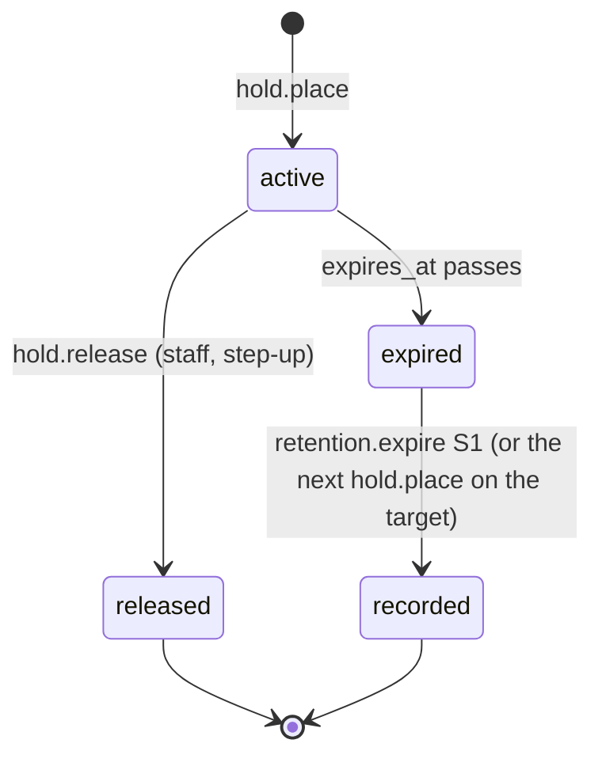
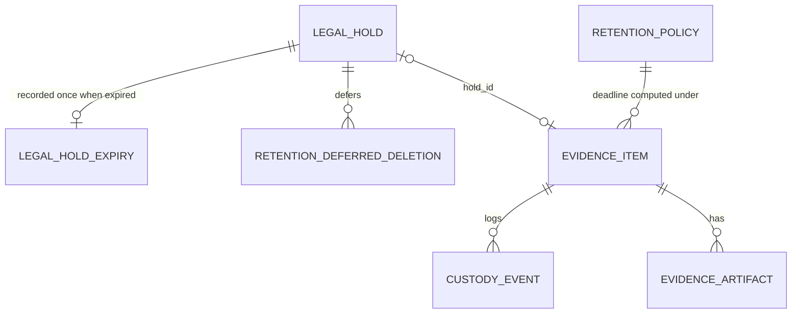

# Functional specification — U29 `t-309-retention-holds-custody`

**Draft written 2026-10-29**, ahead of the stage, on the owner's instruction to overlap design with builds. The lead finalises it and the reviewer checks it when the workflow reaches this Unit; then the files move to `<record>/construction/t-309-retention-holds-custody/functional-design/`.

Unit U29 (kind `library`, size L, **high risk**: retention, deletion, evidence) delivers T-309 for US7.3 (AC7.3.1, AC7.3.2, AC7.3.5, AC7.3.6; AC7.3.3 and AC7.3.4 are deferred by FD-088) and the hold side of AC10.3.3. Lead perspective: architect. Support perspectives: developer (SQL functions, grants, locks, the job, tests: §§ 8, 10) and security (threat cases and adversarial tests: § 11), synthesised in § 12. Because the Unit is high risk, collaborators are on at the stage, a separate agent writes the adversarial tests of § 11.2, and the owner signs off in writing before the phase gate.

Baseline read on 2026-10-29: `main` at `9cf860a` with T-010 merged (`14c21a9`), CR-006, CR-011 and CR-012 merged; T-011 is building on its Bolt branch. None of the Units this one depends on is built: U24 T-304, U12 T-105, U22 T-302 and U25 T-305 have drafts; **U30 T-401 has no draft**, so § 6.5 states the shapes this Unit needs from it (cross-Unit change X6).

Inputs are listed under Sources at the end and in `functional-design-questions.md` (Context). This file is the source of truth for the workflows and state transitions. The data shape is in `entities.md`; the decision logic is in `rules.md`. Every open point is in `functional-design-questions.md` (Questions 1–22), all decided by the recommended option under the owner's no-questions instruction of 2026-10-29. § 16 holds the six FD entries the build appends before code.

## 1. What changes, in one paragraph

Time and deletion become accountable. `retention_policies` stays the only source of the original, audit and notification periods; `retention.setPolicy` (Super Admin, step-up) adds a version that applies only to records created afterwards, and every expiry computes each row's own deadline from the version in force when that row was created, so shortening a period never shortens an existing deadline (Question 4). Staff with `holds.manage` place and release individual legal holds on six kinds of record; a hold pauses physical deletion of that record only and never changes what the public sees (Question 1). When an author deletes a held review, facility feedback or comment, the delete looks exactly like an unheld one to everyone, and its physical part waits in a retention-owned pending row until no hold covers the record (Question 2). The hourly `retention.expire` job, driven by the `Clock` port, records expired holds once, finishes deferred deletions, deletes the persona links that waited on a hold, gives every original a deadline (failed and never-published ones included, Question 6), deletes due originals from storage, warns about and purges expired drafts, and expires notifications and audit rows through their owners' commands, keeping everything a hold covers. The database side gets a narrow, auditable shape: the append-only escape hatch only works for the maintenance login (closes ISS-141), the audit expiry function moves to `rk_maintenance`, the worker's retention privileges shrink to what the job uses, and expired holds are recorded in an insert-only table so the worker never writes `legal_holds` (closes ISS-236). The demo clock moves time for the whole system in development and demo modes and cannot act in production. Staff read the custody log and the quarantine list from the evidence module, which owns that data.

## 2. As is (baseline 2026-10-29) and what this Unit can count on

- **Schema**: `legal_holds` uses the shared `target_kind` enum (no `account`), has no release-reason column and no index; `retention_policies` (`version` unique, `actor_account_id NOT NULL`, `superseded_by` unused); `retention_bulk_actions` (append-only); `demo_clock` single row, created by the common migrations in **every** mode; `evidence_items.hold_id` references `legal_holds`; the due-index covers `published` items only; `evidence_artifacts.deleted_at` exists.
- **Functions** (`0003_triggers.sql`): `fn_block_mutation()` lets a `DELETE` on `audit_events` through whenever the GUC `rk.audit_expiry` is on, which any role may set (ISS-141, S2, reproduced as `rk_app`). `fn_expire_audit(before)` is `SECURITY DEFINER` without a pinned `search_path`, has no hold clause, and is executable by `rk_maintenance` **and `rk_worker`**.
- **Grants** (`02-data-model.md` §16 after FD-092): `rk_worker` has full DML on `retention_policies` and `retention_bulk_actions`, SELECT only on `legal_holds` (ISS-236), UPDATE (`state`, `deleted_at`) on `reviews`, SELECT and UPDATE on `comments`, nothing on `persona_links`, `demo_clock`, `facility_reviews`. PA2 and PR1 are planned for this Unit. `rk_app` owns the database and every table.
- **Contracts**: `SetRetentionPolicyInput` lacks `notificationDays`; `HoldPlaceInput` uses `TARGET_KINDS`, `reason.min(1)` and an untyped `expiresAt`; `view-models/quarantine.ts` is a `TODO(T-407)` stub; `errors.ts` has `config.out_of_range` and `hold.active`; `CUSTODY_EVENTS` already holds `retention_changed`; `actor.ts` gives `config.write` and `retention.bulk` to `super_admin` only, `holds.manage` to `admin` and `super_admin`.
- **Database code and pins**: `repositories/retention.ts` is a stub class listed in `not-implemented.test.ts` (ISS-294); `retention.expire` is declared `exclusive` (ISS-253); the worker already schedules a job that carries `cron`. Pinned: both migration counts (9), the ISS-141 `it.fails` tripwire, the probe that `rk_worker` cannot update `legal_holds`, the CR-006 list of worker-executable `SECURITY DEFINER` functions (`fn_expire_audit(timestamptz)` only), and `append-only.int.test.ts` calling the old signature.
- **Seed**: policy version 1 (90/180/90, `sa_founder`), the `demo_clock` row; six published items with `retention_expires_at = seed time + 90 d` and **no `original` artifact** (ISS-181); e5 failed with none; no hold.
- **Copy**: `admin.legalHoldNote` says the held item "is hidden publicly", `admin.retention` hard-codes "90", `errors.hold.active` reads as a refusal; no `custody.*` key.
- **Not built yet**: application, adapters and domain are empty. U8 creates `defineCommand` (`requires` order, `onRefused`, `recorded`), `UnitOfWork`, `Clock.now()`, `JobQueue`, `Outbox`, `AuditWriter`, `Logger`, the worker subpath and the composition roots; U10 gives the Actor staff powers only on an approved device and adds `STEP_UP_PURPOSES` (no retention purpose); U25 declares `OriginalRetentionPolicy` (interim 90) and builds `evidence.purgeOriginal`.
- **Boundaries (T-010, FD-093)**: as listed in BR8.1; 80% line floor per package with untested files counted; the nine-step `pnpm check` with `format:check` and `check:identity`; CI before merge.

## 3. Settled before this stage

Listed in `functional-design-questions.md` ("Settled before this stage"): FD-064, FD-068/FD-082, FD-073/FD-079, FD-088, FD-090, FD-092, FD-076, FD-093 and the owner's answers. FD-094 allows parallel building; § 14 lists the files this Unit shares.

## 4. Workflows

Every command runs `parse → authorize → load and lock → decide (domain) → persist` in one `UnitOfWork` transaction with its audit and outbox rows (`01-conventions.md` §3), through U8's `defineCommand`. "Subject" means an implementation of Retention's `RetentionSubject` port (§ 6.2). Times come from the `Clock` port in the application and from `fn_app_now()` inside database functions (Question 18).

### WF0 — Code Generation order (the Unit end to end)

1. **Baseline**: `pnpm check` green on the Bolt branch; read the open ISSUES rows named in § 9; confirm U22, U25 and U30 are merged (this Unit edits their delete commands and wires their ports).
2. **Dependency log**: no new dependency; check that the log entry covering pg-boss cron and PostgreSQL 18 is under 3 days old, else add one.
3. **Decision log**: append the six rows of § 16 with the next free FD ids, in that order, before any code.
4. **Contracts**: `HOLD_TARGET_KINDS` and `DEFERRED_DELETION_ACTIONS` in `enums.ts`; `schemas/retention.ts` rewritten (§ 6.1); `view-models/quarantine.ts`, `view-models/retention.ts` (§ 7); `RETENTION_RANGES` moves here from the dropped config block.
5. **Domain** (`packages/domain/src/retention/`): `policy.ts`, `hold.ts`, `expiry.ts`, `demo-clock.ts`, with tests (§ 10).
6. **Database**: four forward-only migrations (§ 8.1), `schema/retention.ts` and `schema/enums.ts` updated, `repositories/retention.ts` (replaces the stub), `repositories/demo-clock.ts`, `retention/audit-expiry-gateway.ts` (maintenance connection), `retention/held-persona-links.ts`, evidence repository read and write methods (recorded additions), `queue-declaration.ts` entry; the pinned tests of § 2 updated in the same commit.
7. **Application**: `modules/retention/**` (§ 6.3), `modules/administration/commands/audit-expire.ts`, the five subjects (`evidence`, `review` with facility feedback, `community`, `directory`, `account`), `modules/evidence/queries/{custody-log,list-for-staff}.ts` (Question 20), the hold-check calls in `review.delete`, `facilityReview.delete` and `comment.delete`, `ports/clock.ts`, `ports/repositories/retention.ts`; worker entries exported from `application/src/worker.ts`.
8. **Adapters**: `adapters/src/clock/{system-clock,demo-offset-clock}.ts`.
9. **Composition**: web `server/container.ts` (subjects, `OriginalRetentionPolicy`, clock, boot guard), worker container and registry (`retention.expire` with `cron: '0 * * * *'`, subjects, maintenance gateway, boot guard).
10. **Web**: `app/api/demo/clock/route.ts`, `server/actions/retention.ts`.
11. **Script**: `scripts/demo-clock.ts`, `package.json` entry `demo:clock`.
12. **Seed**: stand-in private originals for published items (Question 21).
13. **i18n**: § 7.3 in both files in one commit.
14. **Docs**: `02-data-model.md` §0, §7 (ownership note, FD-064), §10, §15, §16; `03-routes-and-contracts.md` §1, §4, §5; `contract-summary.md` C1, C2, C3, C8 blocks; T-309's header (stories US7.3, FR67, FR86); each with a dated note.
15. **Tests and smoke** (§ 10), then `pnpm check` and `pnpm smoke`.

### WF1 — `retention.currentPolicy()` (query, internal; staff read through an action)

1. Load all policy rows ordered by `version` (a handful).
2. `currentOf(rows, now)`: the highest `version` whose `effective_from <= now`; none → the built-in version 0 `{originalDays: 90, auditDays: 180, notificationDays: 90, effectiveFrom: 1970-01-01}` (FD-004), marked `source: 'default'` (BR1.1).
3. Return `{version, originalDays, auditDays, notificationDays, effectiveFrom}` (C3). The staff action (`server/actions/retention.ts` `currentPolicy`) requires a staff role on an approved device and returns `RetentionPolicyVM` (§ 7).

### WF2 — `retention.setPolicy({originalDays, auditDays, notificationDays, reason})`

1. `requires: [capability 'config.write', stepUp]` (Super Admin only). A refusal writes nothing.
2. Parse: integers in `RETENTION_RANGES` (originals 1–3650, audit 30–3650, notifications 7–365), reason trimmed 10–500 characters; out of range → `config.out_of_range` with a field error per field (Question 15).
3. Load the current policy under `SELECT … FOR UPDATE` of the highest version row (serialises concurrent changes). Identical values → `ok({version: current, unchanged: true})`, nothing written.
4. Persist: insert version `current + 1` with `effective_from = now`, the actor and the reason. **No other row changes** (no evidence deadline, no older policy row; `superseded_by` stays unused). A unique-version conflict → `conflict`.
5. Audit stream `retention`, action `policy_set`, details `{fromVersion, toVersion, before: {originalDays, auditDays, notificationDays}, after: {…}}` (AC7.3.2: old value, new value, actor and result). Outbox `retention.policyChanged {version}`. No staff notice, no email.

### WF3 — `hold.place({targetKind, targetId, reason, expiresAt?})`

1. `requires: [capability 'holds.manage']` (Admin, Super Admin, approved device); no step-up (Question 11).
2. Parse: `targetKind ∈ HoldTargetKind`, `targetId` a UUID, reason trimmed 10–1000 characters, `expiresAt` an ISO time later than now and at most 3650 days ahead; `expiresAt` with `targetKind = account` → `validation` (Question 9).
3. Lock: the subject for the kind runs `lockTarget(tx, {targetKind, targetId})` (`SELECT … FOR UPDATE` of the record row, Question 12). Missing → `not_found`, nothing written.
4. Load the open hold of that target (`released_at is null`) `FOR UPDATE`. Active → `hold.active` (Question 15's copy). Open but past `expires_at` → end it now in this transaction exactly as WF6 S1 would (expiry row, audit `hold_expired`, outbox, evidence custody), then continue.
5. Persist: insert the hold (`placed_by_account_id = actor`, `placed_at = now`). The subject's `onHoldChanged(tx, {placed: true})`: for evidence, `evidence_items.hold_id = holdId` and custody `hold_placed {holdId}` actor `account:<staffId>`; other kinds do nothing. Audit stream `retention` action `hold_placed {holdId, targetKind, targetId, expiresAt?}` (no reason text; the reason lives on the hold row). Outbox `hold.changed {holdId, placed: true}`.
6. Nothing about visibility changes (Question 1). Return `{holdId}`.

### WF4 — `hold.release({holdId, reason})`

1. `requires: [capability 'holds.manage', stepUp]` (Question 11; step-up purpose `hold.release`, cross-Unit X1).
2. Parse: `holdId` a UUID, reason trimmed 10–1000 characters.
3. Load the hold `FOR UPDATE`; missing → `not_found`. Lock the target through its subject. Already released, or past `expires_at` → `conflict` (it has already ended; WF6 records it).
4. Persist: `released_at = now`, `released_by = actor`, `release_reason = reason` (new column). Subject `onHoldChanged(tx, {placed: false, auto: false})`: evidence clears `hold_id` when it equals this hold and writes custody `hold_released {holdId, auto: false}`. Audit `hold_released {holdId, targetKind}`. Outbox `hold.changed {holdId, placed: false}`. Every registered `HoldReleaseListener` runs in the same transaction (U39 T-410 registers one for `account`, X8; none before it). Enqueue `retention.expire` with the on-demand key in the same transaction, so deferred deletions and persona links finish within seconds (WF6).

### WF5 — The hold check on delete paths (`retention.deferIfHeldOn`)

`deferIfHeldOn(tx, {targetKind, targetId, action})` is an internal operation on the caller's transaction. The caller has already locked the record row (`FOR UPDATE`), so a concurrent `hold.place`, which locks the same row (WF3 step 3), is serialised with it (BR3.1).

1. Active hold on the target → insert a pending `retention_deferred_deletions` row `{targetKind, targetId, action, holdId, requestedAt: now}` (one pending row per target and action; a repeat returns the existing one) and audit stream `retention` action `deletion_deferred {targetKind, holdId, action}` actor `system:retention`; return `{deferred: true}`. Otherwise `{deferred: false}`, nothing written.
2. The result never reaches the author: no field, error, notice, email or log line differs (FD-079).

Callers (each change is limited to the call and its dependency, plus the hold cases in the command's test):

| Command (owner) | Action | Held behaviour |
|---|---|---|
| `review.delete` (U22) | `author_delete` | identical to unheld: tombstone or soft delete, `deleted_at`, `restore_until`, audit, outbox (release 1 has no physical step for reviews, Question 8) |
| `facilityReview.delete` (U22) | `author_delete` | identical to unheld (soft delete) |
| `comment.delete` (U30), with replies | `comment_body_clear` | the tombstone is set and shown exactly as unheld, but `body` is **kept**; the job clears it when the hold ends |
| `comment.delete` (U30), without replies | `author_delete` | identical to unheld (`deleted_at`, row kept, not projected) |

An author's restore of a held, deleted review within its window works as for an unheld one (T-302); the pending row later completes as `nothing_to_do`.

### WF6 — `retention.expire` (worker job, hourly and on demand)

The handler (`apps/worker/src/handlers/retention-expire.ts`) awaits `clock.sync()`, then calls `runRetentionExpiry(deps)` from `@rogikotha/application/worker`. Steps run in this order; each uses its own short transactions, is idempotent and logs `retention.expire.step {step, counts, durationMs}`. A failing step logs `retention.expire.step_failed {step, code}`, the later steps still run (each recomputes the holds it depends on), and the job fails at the end so pg-boss retries it (5 times with backoff, FD-076). Concurrent runs are safe: every write is guarded by a row lock or a conditional predicate.

- **S0 — Inputs.** `now = clock.now()`; `policies` (all versions); `active = activeHolds(now)`.
- **S1 — Record expired holds.** For each hold with `released_at is null`, `expires_at <= now` and no `legal_hold_expiries` row: one transaction inserts the expiry row (`ON CONFLICT DO NOTHING`); only when the insert happened: audit `hold_expired {holdId, targetKind}` actor `system:retention`, outbox `hold.changed {holdId, placed: false}`, subject `onHoldChanged(tx, {placed: false, auto: true})` (evidence: `hold_id` cleared, custody `hold_released {holdId, auto: true}`). The worker never writes `legal_holds` (Question 3, ISS-236).
- **S2 — Finish deferred deletions.** Pending rows whose target has no active hold, `FOR UPDATE SKIP LOCKED`, 100 per transaction: the subject's worker entry `completeDeferred(tx, row)` (`comment_body_clear`: clear `body` when the comment is still deleted; `author_delete`: nothing to do in release 1); then `completed_at = now`, `outcome`, audit `deferred_deletion_completed {targetKind, action, outcome}`.
- **S3 — Persona links that waited on a hold.** `select fn_delete_held_persona_links()` (BR5.3); log the count.
- **S4 — Give every original a deadline (Question 6).** For items with `retention_expires_at is null` and an undeleted `original` artifact: failed, rejected or removed items → anchor = time of the `failed` or `removed` custody event; items never published → anchor = the `received` event. Deadline = anchor + `originalDays` of the policy version in force at the anchor (prospective). Published items already have theirs (U25).
- **S5 — Delete due originals.** Items with `retention_expires_at <= now`, `hold_id is null`, no active hold on `(evidence, id)` or on `(review, review_id)` (Question 22), batch of 100 `FOR UPDATE SKIP LOCKED`, re-checked inside the transaction. Per item: `evidence.purgeOriginal(tx, {itemId, by: 'retention'})` (artifact `deleted_at`, custody `original_expired` actor `system:retention`, `published → original_expired`; other states keep their state); then `Storage.delete(key, {reason: 'retention'})` **before commit**, a missing file counting as success; a storage error rolls the item back and the next run retries (Question 7). After commit, `Storage.head(key)` must report missing (logged `retention.original_bytes_remaining` otherwise). An item with no original artifact (the seed today) gets custody `original_expired {original: 'absent'}` and the same state change, once (X3).
- **S6 — Drafts (FD-090).** Warn: drafts with `now < expires_at <= now + 4 d` whose account has no active account hold and for which no `outbox_events` row `draft.expiring` with the same `draftId` and `expiresOnDay` exists → outbox `draft.expiring {draftId, accountId, days, expiresOnDay}` (Question 16). Purge: `delete from review_drafts where expires_at <= now and account_id <> all(:heldAccounts)` through Review's worker entry. Neither reads `payload_enc`.
- **S7 — Notifications.** For each policy segment (BR1.8): `notification.expire {before: min(cutoff, segment end), createdFrom: segment start}` (C2, X2). Notifications are not paused by holds (Question 10).
- **S8 — Audit.** `audit.expire {keepTargets}` through the maintenance gateway (WF7); `keepTargets` = the evidence items of held reviews (their `evidence:<id>` streams); the function adds every active hold itself.
- **S9 — Run record.** Audit stream `retention` action `expire_run {holdsEnded, deferredCompleted, linksDeleted, deadlinesSet, originalsDeleted, draftsWarned, draftsPurged, notificationsExpired, auditExpired, failedSteps}` actor `system:retention`.

### WF7 — `audit.expire({keepTargets})` (internal, Administration, maintenance connection)

1. The worker composition root builds `PgAuditExpiryGateway` from `DATABASE_URL_MAINTENANCE` (read only there; never in the web; never logged).
2. `select fn_expire_audit($kinds, $ids)` as `rk_maintenance`; returns the deleted count.
3. The function (§ 8.1 M2) computes each row's deadline from the policy in force at its `created_at`, keeps rows whose target or stream matches an active hold or the keep list, and deletes the rest. Only a `rk_maintenance` login can pass the append-only trigger (ISS-141).

### WF8 — Hold queries

- `retention.activeHold({targetKind, targetId})` → `{holdId} | null` (C3); internal only.
- `retention.activeHoldsFor({targets, accountId})` → `{accountHold, held}` (C3); internal only (U39 T-410 plans with it).
- `retention.listHolds({targetKind?, state?: active | ended, page})` → `HoldListVM`, `requires: holds.manage`; newest first; 20 per page; exact counts.

### WF9 — Staff evidence reads (in the evidence module, Question 20)

- `evidence.custodyLog({itemId})`, `requires: reports.read` → `CustodyLogVM`: events oldest first, each with `labelKey: 'custody.<event>'`, time, an opaque actor (`staff` with a role when the details carry one, `author`, `worker`, `system`) and allowlisted details (BR7.1). Never a storage key, file name, hash, reason text or account id.
- `evidence.listForStaff({page, state?})`, `requires: reports.read` → `QuarantineVM`: every item not in `published` or `original_expired`, plus every held item; newest change first; stage flags from custody events; `fileLabel` `<publicId>.<jpg|png>` from `detected_mime` (else the public id); `originalBytes`, `retentionExpiresAt`, the hold summary from `retention.activeHold`, `failReason`. No uploader, file name or storage key.

### WF10 — Demo clock

- **Adapter selection** (composition roots): `APP_MODE = production` → `SystemClock`, the store is never built. `development | demo` → `DemoOffsetClock(systemClock, DemoClockStore)`: `now() = Date.now() + offset`; `sync()` re-reads the store when the cached value is older than 2 s; the web root awaits `sync()` when it builds the container and the adapter refreshes in the background on use; the worker awaits `sync()` before each `retention.expire` run.
- **Boot guard** (web and worker): `APP_MODE = production` and a `demo_clock` row with `offset_seconds <> 0` → refuse to start (Question 13).
- **`GET /api/demo/clock`**: production → 404; else `{now, offsetSeconds}`.
- **`POST /api/demo/clock`**: production → 404; not a staff account on an approved device → 404 (Question 14); cross-origin request → 403; body `{offsetSeconds}` (0 to 315 360 000) or `{advance: '+91d' | '+12h'}` (result within the same bounds); negative → `validation`. Command `demo.setClock` writes the row, audits `demo_clock_set {fromOffset, toOffset}` actor `account:<staffId>` on stream `retention`, enqueues `retention.expire` with the on-demand key in the same transaction, and updates the process's cached offset; returns `{now, offsetSeconds}`.
- **`pnpm demo:clock -- +91d | +12h | reset | now`**: refuses `APP_MODE = production`; writes through the same repository, audits with actor `system:script`, enqueues the on-demand run, prints the new "now". `reset` sets 0. U43 T-504's `pnpm demo:reset` calls `reset` (X11).

### WF11 — `evidence.publish` takes the current policy

The web composition root implements U25's `OriginalRetentionPolicy.originalDays(tx)` as `(await retention.currentPolicy(tx)).originalDays`, replacing U25's interim 90 (task step 9). `retention_expires_at = publishedAt + originalDays` (`expiryFor`, BR1.9).

## 5. State transitions

### 5.1 Legal hold

| State | Defined by | Enters by | Leaves by |
|---|---|---|---|
| `active` | `released_at` null and (`expires_at` null or later than now) | `hold.place` | `hold.release` → `released`; time passing `expires_at` → `expired` |
| `released` | `released_at` set | `hold.release`; or `hold.place` on the same target ending an expired hold (`released_at = expires_at`, `released_by` null) | — |
| `expired` | `released_at` null, `expires_at <= now` | time | the job records it (`legal_hold_expiries` row) → `expired, recorded` |



Text fallback: staff place a hold, which is active until staff release it or its expiry time passes. A released hold is ended at once. An expired hold is inactive straight away; the next job run, or the next hold placed on the same record, records its end once. Account holds have no expiry and end only by release.

### 5.2 Deferred deletion

`pending` (written by `deferIfHeldOn`) → `completed` with `outcome ∈ {completed, nothing_to_do, target_gone}` (job S2, once no active hold covers the target). No other transition; the row is never deleted (trigger).

### 5.3 Evidence, as far as this Unit moves it

| From | To | Trigger | Custody |
|---|---|---|---|
| `published` | `original_expired` | S5, original purged (or absent) | `original_expired` actor `system:retention` |
| `failed`, `rejected`, `removed`, pre-publish states | same state | S5, original purged | `original_expired` |
| any | same state | `hold.place` / `hold.release` / S1 | `hold_placed {holdId}` / `hold_released {holdId, auto}` |

Holds never change an evidence state; `evidence.remove` and `removeFile` on a held item still move it to `removed`, and S5 still skips its original while the hold lasts.

### 5.4 Demo clock offset

`0` → any value in 0–3650 days by POST or script; `reset` → `0`. Moving back is allowed (demo only): holds that looked expired become active again and a policy version set while time was ahead is not yet in force; `pnpm demo:reset` rebuilds the data (finding F22).

## 6. Interfaces

### 6.1 Commands, queries and jobs

| Operation | Kind | Input | Requires | Audit (stream `retention`) | Custody | Outbox | Expected errors |
|---|---|---|---|---|---|---|---|
| `retention.currentPolicy` | query | `{}` | internal; action: staff | — | — | — | — |
| `retention.setPolicy` | command | `{originalDays, auditDays, notificationDays, reason}` | `config.write` + stepUp | `policy_set` | — | `retention.policyChanged {version}` | `config.out_of_range`, `conflict`, `auth.step_up_required` |
| `hold.place` | command | `{targetKind, targetId, reason, expiresAt?}` | `holds.manage` | `hold_placed` (+ `hold_expired` when it ends an old one) | evidence: `hold_placed` | `hold.changed {holdId, placed}` | `not_found`, `hold.active` |
| `hold.release` | command | `{holdId, reason}` | `holds.manage` + stepUp | `hold_released` | evidence: `hold_released {auto: false}` | `hold.changed` | `not_found`, `conflict`, `auth.step_up_required` |
| `retention.activeHold` | query, internal | `{targetKind, targetId}` | never an action | — | — | — | — |
| `retention.activeHoldsFor` | query, internal | `{targets, accountId}` | never an action | — | — | — | — |
| `retention.listHolds` | query | `{targetKind?, state?, page}` | `holds.manage` | — | — | — | — |
| `retention.deferIfHeldOn` | internal, caller's tx | `{targetKind, targetId, action}` | the caller's | `deletion_deferred` | — | — | — |
| `demo.getClock` / `demo.setClock` | query / command | `{}` / `{offsetSeconds} \| {advance}` | non-production; set: staff | set: `demo_clock_set` | — | — | `validation` |
| `audit.expire` | internal (Administration) | `{keepTargets}` | maintenance connection | — | — | — | — |
| `evidence.custodyLog` | query (Evidence) | `{itemId}` | `reports.read` | — | — | — | `not_found` |
| `evidence.listForStaff` | query (Evidence) | `{page, state?}` | `reports.read` | — | — | — | — |
| job `retention.expire` | worker | `{}` | worker | `hold_expired`, `deferred_deletion_completed`, `expire_run` | `hold_released {auto: true}`, `original_expired` | `hold.changed`, `draft.expiring` | — |

Every refusal by `requires` writes nothing; the step-up failure audit is T-103's. Validation, `forbidden` and `internal` apply to every command (C3 common rule).

### 6.2 Ports declared by Retention (`modules/retention/ports.ts`, FD-067)

```
RetentionSubject (web)                      one per module, registered by kind
  kinds: HoldTargetKind[]
  lockTarget(tx, {targetKind, targetId}) -> Promise<{exists: boolean}>
  onHoldChanged?(tx, {targetKind, targetId, holdId, placed, auto}) -> Promise<void>

RetentionSubjectWorker (worker)            exported through @rogikotha/application/worker
  kinds: HoldTargetKind[]
  onHoldChanged?(tx, {...same}) -> Promise<void>
  completeDeferred?(tx, {targetKind, targetId, action}) -> Promise<{outcome}>
  expire?(tx, {now, policies, heldReviewIds, heldAccountIds}) -> Promise<{counts}>

HoldReleaseListener (web)                  zero or more; U39 T-410 adds the account one
  onReleased(tx, {holdId, targetKind, targetId}) -> Promise<void>

DemoClockStore     read() -> {offsetSeconds} | null;  write(tx, {offsetSeconds, setBy})
HeldPersonaLinks   finish() -> {deleted: int}        (calls fn_delete_held_persona_links)
```

Implementations (all built here): Evidence (`evidence`: lock, hold column and custody, deadlines and original expiry), Review (`review`, `facility_review`: lock, deferred completion, draft warning and purge), Community (`comment`: lock, deferred completion), Directory (`profile`: lock only), Account (`account`: lock only, web only; the worker never loads `modules/account`). The task's C3 signature (`expire?`, `onHoldChanged?`) is split into a web and a worker port so the worker never imports web-only code; C3 is updated in the same Bolt.

Ports used: `OriginalRetentionPolicy` (U25, implemented in the web root, WF11); Administration's `AuditExpiryGateway`; Notification's `notification.expire` (X2); `Storage.delete` and `head` (U23); `JobQueue`, `Outbox`, `AuditWriter`, `Clock`, `Logger`, `UnitOfWork` (U8).

### 6.3 Application files (`packages/application/src/modules/retention/`)

`commands/{set-policy,place-hold,release-hold,set-demo-clock}.ts`; `operations/defer-if-held.ts`; `queries/{current-policy,active-hold,active-holds-for,list-holds,demo-clock}.ts`; `jobs/expire.ts`; `ports.ts`; `authorization.ts`; tests beside each. `preview-bulk.ts` and `execute-bulk.ts` are not built (FD-088).

### 6.4 Server actions and route (`apps/web`)

`server/actions/retention.ts`: `currentPolicy`, `setPolicy`, `placeHold`, `releaseHold`, `listHolds`, `custodyLog`, `listQuarantine` (each thin: parse → actor → command or query → `Result`), consumed by U36 T-407 and U37 T-408. No action exposes `activeHold`, `activeHoldsFor` or `deferIfHeldOn`. `app/api/demo/clock/route.ts` per WF10.

### 6.5 Cross-Unit changes other drafts must pick up

| # | Unit | Change |
|---|---|---|
| X1 | U10 T-103 | `STEP_UP_PURPOSES` gains `retention.setPolicy` and `hold.release` (additive; nothing calls them before this Unit) |
| X2 | U34 T-405 | `notification.expire {before, createdFrom?}` (optional lower bound, by `created_at`); `draft.expiring` payload gains `expiresOnDay` (an integer day count) and its notice dedupe target includes it, so a re-saved draft is warned again |
| X3 | U25 T-305 | `purgeOriginal` handles an item with no current original (`original_expired {original: 'absent'}`, still `published → original_expired`); for retention the caller deletes the file before commit (U25's "after commit" stays for its own callers); `OriginalRetentionPolicy` is wired to `retention.currentPolicy` by this Unit |
| X4 | U24 T-304 | its F9/X4 (failed originals never expire) is designed here (Question 6); no change in U24's code |
| X5 | U22 T-302 | this Unit adds the hold-check call to `review.delete` and `facilityReview.delete` (both already lock the row); T-302's F9 is deferred by FD entry (b); its FD entry (b) (no worker review step) is assumed |
| X6 | U30 T-401 (no draft yet) | `comment.delete` locks the comment `FOR UPDATE` first; clearing the body is a separate repository call the command can skip; the thread renders a tombstone from the `tombstone` flag, never a stored body; worker method `clearBodyIfDeleted(tx, id) → boolean`; `CommunityRepository.lockComment(tx, id)` |
| X7 | U36 T-407 | renders `QuarantineVM`, `CustodyLogVM`, `HoldListVM` through `server/actions/retention.ts`; six stage steps (images only); copy keys of § 7.3 (`admin.legalHoldNote`, `admin.retention {days}`); C8's `evidence.listForStaff` is built here (Question 20) |
| X8 | U39 T-410 | plans with `activeHoldsFor`; writes `deferIfHeldOn` rows for held targets in its web transaction and adds its own deferred actions and completions (additive); registers a `HoldReleaseListener` for `account` that resumes the paused web steps; account holds carry no expiry (Question 9); the persona-link function covers held posts' links |
| X9 | U17 T-204 | if a profile merge deletes or rewrites the losing profile, it first checks `retention.activeHold('profile', id)` and refuses a held one (a staff action, so refusing is right) |
| X10 | U37 T-408 | the configuration view shows the periods from `retention.currentPolicy` and changes them only through `setPolicy` (FD-082) |
| X11 | U43 T-504 | `pnpm demo:reset` calls `pnpm demo:clock -- reset` |

## 7. View models, input schemas and copy (`packages/contracts`, `packages/i18n`)

### 7.1 Input schemas (`schemas/retention.ts`, all `.strict()`)

`SetRetentionPolicyInput {originalDays, auditDays, notificationDays, reason}`; `HoldPlaceInput {targetKind: HoldTargetKind, targetId: uuid, reason: 10–1000, expiresAt?: iso datetime}`; `HoldReleaseInput {holdId: uuid, reason: 10–1000}`; `ListHoldsInput {targetKind?, state?, page ≥ 1}`; `DemoClockInput {offsetSeconds} | {advance}`; `RetentionExpireJobInput {}`. The bulk schemas stay in the file, marked deferred (FD-088), unused.

### 7.2 View models (`view-models/retention.ts`, `view-models/quarantine.ts`)

Shapes in `entities.md`: `RetentionPolicyVM`, `HoldVM`, `HoldListVM`, `CustodyLogVM`, `QuarantineItemVM`, `QuarantineVM`, `DemoClockVM`. None carries an account id, email, file name, storage key or reason text other than the hold's own reason in `HoldVM` (holds.manage only). Missing values are absent fields, never 0.

### 7.3 Copy (both files, one commit; Bengali flagged for the owner's review, FD-042)

| Key | en | bn |
|---|---|---|
| `custody.received` | Received | গ্রহণ করা হয়েছে |
| `custody.validated` | File checked | ফাইল যাচাই হয়েছে |
| `custody.validation_failed` | File check failed | ফাইল যাচাই ব্যর্থ হয়েছে |
| `custody.scan_started` | Scan started | স্ক্যান শুরু হয়েছে |
| `custody.scan_clean` | Scan found nothing | স্ক্যানে কিছু পাওয়া যায়নি |
| `custody.scan_detected` | Malware detected | ম্যালওয়্যার পাওয়া গেছে |
| `custody.scan_unavailable` | Scanner unavailable | স্ক্যানার পাওয়া যায়নি |
| `custody.sanitised` | Metadata removed and re-encoded | মেটাডেটা সরিয়ে নতুন করে এনকোড করা হয়েছে |
| `custody.preview_ready` | Private preview ready | ব্যক্তিগত প্রিভিউ প্রস্তুত |
| `custody.redaction_applied` | Private details covered | ব্যক্তিগত তথ্য ঢাকা হয়েছে |
| `custody.privacy_confirmed` | Author confirmed privacy | লেখক গোপনীয়তা নিশ্চিত করেছেন |
| `custody.published` | Published | প্রকাশিত |
| `custody.failed` | Could not be published | প্রকাশ করা যায়নি |
| `custody.original_accessed` | Original opened by staff | স্টাফ মূল ফাইল খুলেছেন |
| `custody.hold_placed` | Legal hold placed | আইনি হোল্ড দেওয়া হয়েছে |
| `custody.hold_released` | Legal hold ended | আইনি হোল্ড শেষ হয়েছে |
| `custody.retention_changed` | Retention deadline changed | সংরক্ষণের সময়সীমা বদলানো হয়েছে |
| `custody.original_expired` | Original deleted on schedule | নির্ধারিত সময়ে মূল ফাইল মুছে ফেলা হয়েছে |
| `custody.removed` | Removed | সরানো হয়েছে |
| `custody.actor.staff` | Staff member | স্টাফ সদস্য |
| `custody.actor.author` | Author | লেখক |
| `custody.actor.worker` | Processing service | প্রসেসিং সার্ভিস |
| `custody.actor.system` | Scheduled retention | নির্ধারিত সংরক্ষণ ব্যবস্থা |
| `errors.hold.active` (changed) | This item already has an active legal hold. | এই আইটেমে ইতিমধ্যে একটি সক্রিয় আইনি হোল্ড আছে। |
| `admin.legalHoldNote` (changed) | A legal hold pauses scheduled deletion for this item only. It does not change what the public sees. | আইনি হোল্ড শুধু এই আইটেমের নির্ধারিত মুছে ফেলা স্থগিত রাখে। জনসাধারণ যা দেখেন, তা এতে বদলায় না। |
| `admin.retention` (changed) | Originals are deleted {days} days after publication. | প্রকাশের {days} দিন পর মূল ফাইল মুছে ফেলা হয়। |

`{days}` is filled from `retention.currentPolicy` and formatted with the active language's numerals; no string holds a number. The task's `errors.retention.outOfRange`, `notif.staff.holdPlaced|holdReleased|bulkExecuted` are not added (Questions 15, 17). The `custody.<event>` keys keep the enum's snake case so a label is found from the event value without mapping; i18n parity covers them.

## 8. Developer view — database and job mechanics

### 8.1 Migrations (next free numbers at build time; each raises both migration-count pins by one, with a comment)

- **M1 `<n>_hold_target_kinds.sql`** (FD-079): `CREATE TYPE hold_target_kind AS ENUM ('review','facility_review','comment','evidence','profile','account')`; `ALTER TABLE legal_holds ALTER COLUMN target_kind TYPE hold_target_kind USING target_kind::text::hold_target_kind`; add `release_reason text`; partial unique index `legal_holds_open_target_unique (target_kind, target_id) WHERE released_at IS NULL`; trigger `fn_guard_legal_hold()` refusing DELETE and any UPDATE except setting `released_at`, `released_by`, `release_reason` from null once; append-only trigger on `retention_policies`. The report `target_kind` enum is untouched.
- **M2 `<n>_fn_expire_audit_held_targets.sql`** (C1, ISS-141): `fn_app_now()` (`now()` plus `demo_clock.offset_seconds`, 0 when no row; `REVOKE ALL FROM PUBLIC`); `fn_block_mutation()` replaced so the audit bypass also requires `session_user = 'rk_maintenance'`, with its comment corrected; `DROP FUNCTION fn_expire_audit(timestamptz)`; new `fn_expire_audit(p_keep_kinds text[], p_keep_ids uuid[]) RETURNS integer SECURITY DEFINER SET search_path = pg_catalog, public`: per-row deadline `created_at + audit_days` of the policy version whose `effective_from` is the latest at or before `created_at` (version 0 defaults before the first row); keeps rows whose `(target_kind, target_id)`, or whose stream `<kind>:<id>`, matches an active hold (computed with `fn_app_now()`) or the keep arrays, and stream `account:<id>` of an active account hold; `GRANT EXECUTE … TO rk_maintenance` only (PR1).
- **M3 `<n>_fn_delete_held_persona_links.sql`** (FD-079, FD-090, PA2): `fn_delete_held_persona_links() RETURNS integer SECURITY DEFINER SET search_path = pg_catalog, public`: for the author personas of review, facility-feedback and comment holds that are no longer active, delete their `persona_links` rows whose account has `status = 'deleted'` and that no active hold keeps (an active hold on any review, facility feedback or comment of that persona, or an active account hold on that account); returns the count only; `REVOKE ALL FROM PUBLIC; GRANT EXECUTE TO rk_worker`.
- **M4 `<n>_retention_deferred_and_expiries.sql`**: tables `retention_deferred_deletions` and `legal_hold_expiries` with their triggers (no DELETE; completion fields set once; expiries insert-only); index `evidence_items_retention_due_idx (retention_expires_at) WHERE hold_id IS NULL`; grants: `rk_app` SELECT, INSERT, UPDATE on the deferred table and SELECT, INSERT on expiries; `rk_worker` SELECT and UPDATE (`completed_at`, `outcome`) on the deferred table, SELECT and INSERT on expiries, SELECT (`offset_seconds`) on `demo_clock`; `REVOKE INSERT, UPDATE, DELETE ON retention_policies FROM rk_worker`; `REVOKE ALL ON retention_bulk_actions FROM rk_worker`.

### 8.2 Locks and races

- `hold.place` locks the record row through its subject before reading the open hold; delete commands lock the same row before `deferIfHeldOn`; so a hold and a delete on one record are serialised (BR3.1).
- S5 selects with `FOR UPDATE SKIP LOCKED` and re-checks `hold_id is null` and the active holds inside the same transaction; `hold.place` on evidence updates `evidence_items.hold_id`, which waits for S5's row lock. If S5 committed first, the hold is still placed, and the custody order (`original_expired` before `hold_placed`) shows what happened.
- S1 and S2 use `ON CONFLICT DO NOTHING` and `completed_at is null` predicates, so two runs never double-log.

### 8.3 Segments (`expirySegments`)

Policies sorted by `effective_from`: version `i` covers rows created in `[from_i, from_{i+1})` (the first from −∞), with `cutoff_i = now − days_i`. A row is due when `created_at < cutoff_i` within its own segment. Computed in `application` (domain function) and passed as plain data to repositories, because `database` may not import `domain`.

### 8.4 Worker composition

`apps/worker/src/container.ts` builds the five worker subjects' repositories, `HeldPersonaLinks`, `PgAuditExpiryGateway` (maintenance pool, one connection, closed on shutdown), `DemoOffsetClock` or `SystemClock`, and passes them to `runRetentionExpiry`. The registry entry is `{ 'retention.expire': { handler, cron: '0 * * * *' } }`; the on-demand key is `retention.expire:on-demand`.

## 9. Findings and proposed ISS rows (each `Found in U29 T-309`)

| # | Sev | Area | Finding | Decision |
|---|---|---|---|---|
| F1 | S1 | retention | C1, C2 and C3 expire audit rows and notifications with one cutoff from the current policy, so shortening a period deletes rows created under the longer one: a retroactive change, against FD-020, AD-7 and this task's hard-rule checklist. | Designed out: per-row deadlines from the version in force at creation (Question 4, FD entry (d)); C1's `audit.expire` loses `before`; X2 for `notification.expire`. |
| F2 | S2 | database | ISS-141: any role can pass the append-only trigger with the GUC. | Designed out: `session_user = 'rk_maintenance'` gate, owner-run function, worker EXECUTE removed (Question 5); the tripwire becomes a passing test; closes ISS-141. |
| F3 | S2 | grants | ISS-236: step 6(a) auto-releases holds but the worker may not write `legal_holds`; AC7.3.6 still needs the end logged once. | Designed out: insert-only `legal_hold_expiries` (Question 3); closes ISS-236. |
| F4 | S2 | evidence | Originals of failed, rejected, removed and never-published items never get a deadline (U24 F9/X4), so malware and abandoned uploads are kept for ever, against FR67. | Designed out: anchored deadlines (Question 6). |
| F5 | S2 | demo | Storyboard step 22 cannot show an original expiring: the seed has no `original` artifacts (ISS-181) and U25's `purgeOriginal` returns `not_found` for them. | Designed out: seed stand-in originals (Question 21) and absent-original handling (X3). |
| F6 | S2 | ownership | Task step 7 puts `custodyLog` and `listQuarantine` in Retention, which would read `evidence_items` and custody rows it does not own (FD-064, ADR-002); C8 gives `listForStaff` to U36. | Designed out: both queries in the evidence module, built here (Question 20); C8 `built_by` corrected. |
| F7 | S2 | visibility | FR86's PRD text, `admin.legalHoldNote` and the prototype say a hold hides the item publicly; AD-17, FD-021 and the task say holds do not change visibility. | Designed out: holds never change visibility; copy corrected (Question 1, FD entry (a)). |
| F8 | S2 | review/community | T-302 F9: nothing purges an author-deleted review's or comment's stored content after the restore window, and `review_versions` never expire; so a review hold protects only audit rows and persona links today. | Deferred with FD entry (b) (Question 8); becomes S4 once recorded. |
| F9 | S2 | races | As written, a delete path reads the hold without locking the record, so a hold placed in between could be missed. | Designed out: both sides lock the record row (BR3.1). |
| F10 | S2 | evidence | Deleting the file after commit can leave bytes behind when the delete fails ("original deleted but bytes remain"). | Designed out: delete before commit, missing = success (Question 7). |
| F11 | S2 | deletion | An account hold that ends by expiry cannot resume U39's web-only deletion steps from the worker. | Designed out: account holds carry no expiry (Question 9); X8. |
| F12 | S2 | holds | AC7.3.5 keeps a held record's "evidence and audit records", but the task keys original expiry only on the item's own `hold_id`. | Designed out: a review hold also keeps its evidence originals and their audit streams (Question 22). |
| F13 | S3 | contracts | `SetRetentionPolicyInput` lacks `notificationDays`; `HoldPlaceInput` lacks `account`, has `reason.min(1)` and an untyped `expiresAt`. | Fixed (§ 7.1). |
| F14 | S3 | grants | The worker holds full DML on `retention_policies` and `retention_bulk_actions`, more than the job uses (FD-037). | Narrowed (Question 19, FD entry (c)). |
| F15 | S3 | database | `fn_expire_audit` is `SECURITY DEFINER` without a pinned `search_path`. | Fixed in M2; new functions pin it too. |
| F16 | S3 | contracts | C3 says `config.out_of_range`, the task `retention.out_of_range`; `errors.hold.active` reads as a refusal that FD-079 removed. | Decided (Question 15); copy changed. |
| F17 | S3 | notification | The task lists staff notice keys for holds; C15 routes `hold.changed` to no job and the triage view is deferred (FD-088). | Decided (Question 17). |
| F18 | S3 | staff | U10's `STEP_UP_PURPOSES` has no retention purpose. | X1. |
| F19 | S3 | drafts | Drafts slide their expiry on every save, so a once-only warning per draft would miss a second expiry. | Decided: once per draft and expiry day (Question 16). |
| F20 | S3 | database | `rk_app` owns every table, so append-only triggers bind application code, not the owning role (it could disable a trigger). | Open S3 for the production composition: a separate migration owner role (U41 T-502 or later). |
| F21 | S3 | evidence | Derivatives of removed and never-published items stay private for ever. | Open S3 follow-up after release 1 (needs U25's artifact rules). |
| F22 | S3 | demo | Moving the demo clock back re-activates expired holds and hides a policy set while ahead. | Accepted demo artefact; `pnpm demo:reset` rebuilds. |
| F23 | S3 | job | The task sets `retryLimit: 1`; FD-076 makes 5 retries with backoff the rule for jobs. | FD-076 applies. |
| F24 | S4 | contracts | `retention_changed` is already in `CUSTODY_EVENTS`; FD-088's "no `retention_changed` migration" holds trivially; its label is still added. | Noted. |
| F25 | S4 | moderation | ISS-164 (how auto-hidden evidence is represented) names T-309 but is a moderation decision. | Left open for U32 T-403 / U33 T-404. |

ISSUES rows: each finding gets a row at build time (next free `ISS-` id), `Found in` U29 T-309; F1–F7, F9–F12 marked fixed in U29 when built; F8 as S4 deferral naming FD entry (b); ISS-141 and ISS-236 closed; ISS-181 partly closed (originals); the Unit's Build and Test record lists them.

## 10. Developer view — tests

Builders and synthetic data only (`sa_founder`, `admin_nadia`, `mod_rashid`, `shirin_88`, items e1–e7, reviews r1, r2, comments k8–k10). Names read as sentences; each test can fail.

| Package | File | Covers |
|---|---|---|
| domain | `retention/policy.test.ts` | `currentOf` (none → version 0; future version ignored); ranges ±1; `expirySegments` with three versions incl. a shortening (BR1.1, BR1.3, BR1.8) |
| domain | `retention/hold.test.ts`, `expiry.test.ts`, `demo-clock.test.ts` | active/expired/released; reason and expiry bounds; account without expiry; `expiryFor`; anchors; `parseAdvance` and bounds |
| application | `retention/set-policy.test.ts` | happy path; Admin and Moderator refused, nothing written; stale step-up; unchanged values; existing deadlines unchanged (row count 0); config with a `retention` key rejected and policy unchanged (FD-068) |
| application | `retention/holds.test.ts` | place/release per kind; `report` refused; `hold.active`; expired open hold ended then replaced; release needs step-up; `activeHold`/`activeHoldsFor` |
| application | `retention/expire.test.ts` | FakeClock +91 d: e3 expires, storage delete once and head missing; held e1 untouched; release → e1 expires next run; auto-expiry recorded once with custody `{auto: true}`; review hold keeps its evidence; failed item deadline anchored; draft warn exactly once in 24 runs, expired draft purged, payload never read; notification by `created_at`; shortened audit period keeps older rows; a failing step fails the job after the rest ran |
| application | `review/retention-subject.test.ts`, `community/retention-subject.test.ts` | held, unheld, released, auto-expired; deferred completion once |
| application | review `delete.test.ts`, facility delete test, community `comment.delete` test | held and unheld results, outbox and public views identical; stored text kept; nothing mentions a hold |
| application | `evidence/queries/custody-log.test.ts`, `list-for-staff.test.ts` | labels resolve in both locales; no storage key, file name, reason or account id |
| application | `retention/import-boundary.test.ts` | no module but `retention` imports the retention repository or names its tables (FD-064) |
| database | `retention.int.test.ts` | repository methods; triggers; partial unique index; `fn_expire_audit` keeps held targets and per-row deadlines, refused for `rk_app` and `rk_worker`; `fn_delete_held_persona_links` deletes only eligible links, `rk_worker` cannot read `persona_links`; worker grants (§ 8.1 M4) as a real `rk_worker` session |
| database | `append-only.int.test.ts`, `validator-probes.int.test.ts`, `cr-006-adversarial.int.test.ts`, `migrations.int.test.ts` | updated pins; ISS-141 now a passing test |
| adapters | `clock/clock.test.ts` | offset applied in development and demo only; cache 2 s |
| web | `app/api/demo/clock/route.test.ts` | GET reflects offset; POST without staff → 404; production → 404; cross-origin → 403; boot guard throws with a non-zero offset in production |
| smoke | `retention.smoke.test.ts` | `currentPolicy` answers version 1 on the seed; a held evidence item survives one expiry run at +91 d |

## 11. Security view

### 11.1 Threat cases

| # | Threat | Mitigation | Rules |
|---|---|---|---|
| T1 | A hold placed while the job deletes the record | row locks on both sides, re-check inside the transaction | BR3.1, BR4.4 |
| T2 | Retroactive shortening through a policy change | per-row deadlines; setPolicy touches no row | BR1.4, BR1.8 |
| T3 | Audit rows of a held case expire | function keeps active holds itself plus the keep list | BR5.2 |
| T4 | Any role deletes audit rows with the GUC | `session_user` gate | BR5.1 |
| T5 | Worker escalates through retention tables | narrowed grants; insert-only expiries; no `legal_holds` write | BR5.5 |
| T6 | A caller fakes time to end holds early in SQL | functions ignore caller time and use `fn_app_now()` | BR5.4 |
| T7 | Author learns of a hold from a delete | identical results; deferral audited on the staff stream only | BR3.3–BR3.5 |
| T8 | Original "deleted" but bytes remain | delete before commit; head check after | BR4.4 |
| T9 | Demo clock moves time in production | adapter not built, route 404, boot guard | BR6.1–BR6.4 |
| T10 | Staff ends a hold silently | release needs step-up, reason, audit, outbox | BR2.7 |
| T11 | Hold placed on a typo id protects nothing | subject existence check under lock | BR2.4 |
| T12 | Held persona link deleted early | function re-checks every active hold of the persona and account | BR5.3 |

### 11.2 Adversarial angles for the separate agent (3–5 tests, defensive regression checks)

1. **A held record survives every deletion path.** Hold synthetic review r1, comment k8 (with reply k9) and evidence e1; the authors delete r1 and k8; advance the clock past the original, audit and notification periods; run `retention.expire` twice. Expect: r1's row, text, versions and audit stream, k8's body, e1's original bytes and their audit rows all stored; public views and author lists identical to the unheld controls r2 and k10. Release (and separately let an `expiresAt` pass): exactly one completion, k8's body cleared, e1's original deleted on the next run.
2. **Worker and app privilege escape.** As `rk_worker`: update `legal_holds`, insert into `retention_policies`, delete `audit_events` with the GUC set, execute `fn_expire_audit`, read `persona_links`; call `fn_delete_held_persona_links()` with a held persona of a deleted account and an unheld persona of a live account → nothing deleted. As `rk_app`: the two-statement GUC deletion of ISS-141 → `append_only_violation`.
3. **Races.** Two connections: `hold.place` against `comment.delete` on k8, and against S5 on e3, in both orders (a barrier or advisory lock in the test). Every interleaving either keeps the data under the hold or records the deletion before the hold in custody and audit order; none loses data after a committed hold.
4. **Authorization.** Moderator and Admin call `setPolicy`; Admin releases without step-up and with a stale step-up; a staff account on an unapproved device places a hold; an anonymous and a signed-in patient POST the demo clock; `APP_MODE=production` with a non-zero offset. Every refusal writes nothing and leaks no hold.
5. **Clock and policy abuse.** Shorten every period to its minimum; advance the clock; rows created under the old policy keep their old deadlines. POST negative, huge and malformed offsets → `validation`.

## 12. Synthesis — decisions and why

- **Holds never change visibility** (Q1): AD-17 and FD-021 already split preservation from visibility; FD-079 makes held deletes look normal, so a hold that also hid content would contradict it.
- **Deferral is recorded, not inferred** (Q2): a pending row makes "the author asked to delete this held record" explicit, auditable and exactly-once; a state-based sweep could not tell an author's tombstone from a moderator's.
- **The worker never writes `legal_holds`** (Q3, Q19): CR-006 kept it read-only; an insert-only expiry table gives the once-only log without that power.
- **Per-row deadlines** (Q4): the only reading of FD-020 that keeps existing records' deadlines when a period shrinks.
- **The database decides time and holds inside its functions** (Q5, Q18): callers pass no time and cannot widen what the functions delete.
- **Every original gets a deadline** (Q6) and **bytes go before the commit** (Q7): FR67 for every upload, and no orphaned bytes.
- **Content purge after delete is a follow-up** (Q8): it changes T-302's and T-401's semantics and grants; the hold mechanism here is built so the purge plugs into it.
- **Account holds end only by release** (Q9, Q10): the web-only deletion steps can resume only in the web.
- Remaining choices (Q11–Q17, Q20–Q22) follow the contract where it is clear and the narrower, reversible option elsewhere.

## 13. If the owner changes an answer

- **Q1 → B** (a hold hides publicly): each subject gains a `hide` step on `hold.place`, which needs Review's and Community's state commands and a moderation-style restore on release; FD entry (a) is rewritten.
- **Q2 → B** (state-based sweep): `retention_deferred_deletions` goes; Community needs a marker that tells an author's tombstone from a moderator's (a migration in U30's table).
- **Q3 → B** (column UPDATE on `legal_holds`): `legal_hold_expiries` goes; FD-092's ruling is re-opened.
- **Q4 → B** (one cutoff): `fn_expire_audit` takes `before` again; FD entry (d) is dropped and FD-020 needs its own exception entry.
- **Q8 → B** (purge now): a new step S2b, review and comment worker grants on content columns and a version-row expiry function; T-302's and T-401's restore and tombstone rules change.
- **Q9 → B** (account holds may expire): U39 must resume its web steps on the next web touch of the account; F11 reopens.
- **Q13 → C** (refuse when the table exists): production needs a migration that drops `demo_clock`.
- **Q20 → B** (queries in Retention): FD-064 needs an exception entry.

## 14. Owned paths, recorded additions and the parallel-build surface

Owned by the task (with FD-088's removals): see T-309 "Owned paths". **Recorded additions** (each named in the Build and Test record): `packages/database/src/migrations/*_retention_deferred_and_expiries.sql`; `schema/retention.ts`, `schema/enums.ts`, `contracts/src/enums.ts`, `contracts/src/view-models/retention.ts`; `modules/evidence/retention-subject.ts`, `modules/evidence/queries/{custody-log,list-for-staff}.ts` and the evidence repository methods they need; `modules/review/commands/facility-review-delete.ts` (the call only); `modules/directory/retention-subject.ts`; `modules/account/retention-subject.ts`; `packages/database/src/retention/{audit-expiry-gateway,held-persona-links}.ts`; `packages/test-support/src/seed/seed-evidence.ts` (stand-in originals); the pinned tests of § 2; `queue/queue-declaration.ts`; `apps/worker/src/{container,registry}.ts`; docs of WF0 step 14.

Files shared with other Units under FD-094 parallel building: `packages/i18n/messages/{en,bn}.json`, `contracts/src/enums.ts`, `apps/web/src/server/container.ts`, `apps/worker/src/{container,registry}.ts`, `application/src/worker.ts`, the migration journal and both migration-count pins, `not-implemented.test.ts`, `fakes/repositories.ts`, `02-data-model.md` §16. This Unit edits files of U22, U25 and U30, so it never shares a batch with them, nor with U36 T-407 and U39 T-410, which depend on it.

## 15. Acceptance mapping (T-309 acceptance checks)

| Check | Where |
|---|---|
| Prospective only | WF2; BR1.4; `set-policy.test.ts` |
| Preview → execute, Drift | deferred, FD-088 |
| Hold blocks expiry | WF6 S5; BR4.4; `expire.test.ts` |
| Hold auto-release | WF6 S1 (recorded, not released, Question 3); BR2.9 |
| Hold ≠ visibility | BR2.10; `expire.test.ts` |
| Audit expiry respects holds; `rk_app` cannot execute | WF7; BR5.2; `retention.int.test.ts` |
| Append-only untouched | BR5.6; `append-only.int.test.ts` |
| Demo clock | WF10; BR6.*; route test, `pnpm demo:clock -- +91d` |
| Custody VM | WF9; BR7.1; `custody-log.test.ts` (in the evidence module, Question 20) |
| FD-073 held review / held comment / release restores | WF5, WF6 S2; BR3.*; subject and delete tests (delete not refused, FD-079) |
| FD-068 one source | BR1.7; `set-policy.test.ts` |
| FD-064 retention owns holds | BR3.8; `import-boundary.test.ts` |
| FD-079 kinds; author delete of a held item | BR2.1, BR3.2–BR3.5 |
| FD-079 persona link survives / hold end finishes / function is narrow | BR5.3; `retention.int.test.ts` (with U39 for the deletion step) |
| FD-079 account hold keeps data | BR2.12; with U39 T-410 |
| C3 `activeHold`, `activeHoldsFor` | WF8; `holds.test.ts` |
| C1 `audit.expire` keeps held targets | WF7 (input `{keepTargets}`, F1) |
| C2 notifications by `created_at` | WF6 S7; BR4.8 |
| FD-090 draft purge and warning | WF6 S6; BR4.7 |
| FD-088 bulk not built | § 6.3; no bulk file, VM or migration |
| Tree | `pnpm check`, `pnpm smoke` |

## 16. FD entries the build appends before code

Appended to `docs/status/decision-log.md` in WF0 step 3, in this order, each with the next free FD id at build time in place of `FD-<next>` (FD-094 is the last on `main`; other Units may append theirs first). Rows use the log's three columns.

```text
| FD-<next> | **Legal holds pause deletion and never change visibility; held deletes are deferred, not refused (T-309 Questions 1, 2 and 22)**: placing, releasing or the expiry of a hold never hides or shows anything; each owning module's own rules decide what the public sees (AD-17). FR86's "publicly hides relevant content" is read as AC7.3.5 states it: a held record whose deletion falls due looks deleted wherever that deletion would have removed it, while its stored data, evidence and audit rows are kept. When an author deletes a held review, facility feedback or comment, the delete runs exactly as an unheld one for every public view and the author's own lists, and its physical part (in release 1 only clearing a comment tombstone's text) waits as a pending row in a new retention-owned table, `retention_deferred_deletions`, which the hourly `retention.expire` job completes once no active hold covers the record. A hold on a review also keeps that review's evidence originals and their audit rows. The prototype note `admin.legalHoldNote` is corrected in both languages. | AD-17 and FD-021 separate preservation from visibility, and FD-079 makes a held delete look normal, which a hiding hold would contradict; an explicit pending row makes the deferral auditable and exactly-once. Decided by the agent under the owner's no-questions instruction of 2026-10-29 |
| FD-<next> | **No purge of author-deleted content in release 1 (T-309 Question 8, T-302 finding F9)**: the stored text of reviews and facility feedback an author deleted, of deleted comments without replies, and the private `review_versions` rows stay stored, never shown, after the restore window; release 1 has no step that purges them. A follow-up after release 1 adds that purge after the audit period (FD-004); it must skip records that `retention.activeHold` reports as held and complete through `retention_deferred_deletions`. Comment tombstones keep clearing their text at deletion (T-401) unless a hold defers it. | Purging needs new worker privileges on review and comment content, an expiry path for append-only version rows and changes to T-302's restore window and T-401's tombstones; nothing is shown publicly meanwhile. Decided by the agent under the owner's no-questions instruction of 2026-10-29 |
| FD-<next> | **Retention database boundary (T-309 Questions 3, 5, 18, 19; closes ISS-141 and ISS-236)**: the append-only bypass on `audit_events` works only inside `fn_expire_audit` and only for a `rk_maintenance` login (`session_user`); `fn_expire_audit(keep kinds, keep ids)` replaces `fn_expire_audit(before)`, is executable by `rk_maintenance` only (the worker loses EXECUTE, PR1), keeps every row an active hold covers and pins its `search_path`; `fn_delete_held_persona_links()` (FD-079, FD-090, PA2) takes no arguments, finds the ended review, facility-feedback and comment holds itself, returns a count only and is executable by `rk_worker` only; both functions take "now" from `fn_app_now()` (database time plus the demo offset), never from the caller. `rk_worker` keeps SELECT only on `legal_holds` and records expired holds in a new insert-only table `legal_hold_expiries` (SELECT, INSERT); gets SELECT and UPDATE (`completed_at`, `outcome`) on `retention_deferred_deletions` and SELECT (`offset_seconds`) on `demo_clock`; keeps SELECT only on `retention_policies` and loses every privilege on `retention_bulk_actions`. `retention_policies` and `legal_hold_expiries` become append-only; `legal_holds` rows are never deleted and only their release fields may be set, once. The worker process reads `DATABASE_URL_MAINTENANCE` only for the audit expiry. `02-data-model.md` §10 and §16 record this. | Least privilege for the worker (AD-6, FD-037) and the shape CR-006 kept (FD-092); a caller-supplied time or cutoff would let a compromised caller widen a deletion. Data-boundary change. Decided by the agent under the owner's no-questions instruction of 2026-10-29 |
| FD-<next> | **Every expiry is prospective and every original has a deadline (T-309 Questions 4 and 6)**: an audit row, notification or original is due when its own age passes the period of the retention-policy version that was in force when it was created (for originals: when it was published, or for failed, rejected or removed items when that happened, or for items never published when they were received); a later, shorter period never shortens an existing deadline, and a longer one never lengthens it. C1's `audit.expire` takes `{keepTargets}` only, and `notification.expire` takes an optional `createdFrom` beside `before`. Originals of failed, rejected, removed and never-published items are deleted on that schedule too. | FD-020 and AD-7 make retention changes prospective; one cutoff from the current policy would delete rows created under a longer period. FR67 sets the original schedule for every upload, not only published ones. Decided by the agent under the owner's no-questions instruction of 2026-10-29 |
| FD-<next> | **Account holds (T-309 Questions 9 and 10)**: an account hold has no expiry time and ends only when staff release it in the web, so U39 T-410's paused web deletion steps resume in the web tier; while it lasts it pauses that account's deletion (FD-079), the purge of its drafts and the expiry of audit rows on its `account:<id>` stream. It does not pause the expiry of that account's evidence originals or notifications: staff hold the evidence items they need one by one. | The worker cannot run the web-only identity, directory and moderation steps (FD-077); the worker no longer knows an item's uploader (U24 T-304), and notifications carry no content. Decided by the agent under the owner's no-questions instruction of 2026-10-29 |
| FD-<next> | **Demo clock in production (T-309 Question 13, AD-14)**: in `APP_MODE=production` the system clock is used and the demo clock store is never read, `/api/demo/clock` answers 404 and `pnpm demo:clock` refuses; the web and the worker refuse to start when the `demo_clock` row holds a non-zero offset. The table itself stays in the shared migration set. This replaces T-309's "refuse to start when the table exists", which would block every production start because the common migrations create it. | Keeps AD-14 ("demo controls cannot exist in production") enforceable without a second migration set. Decided by the agent under the owner's no-questions instruction of 2026-10-29 |
```

## Entity-relationship view (derived from `entities.md`)



Text fallback: a legal hold may get one expiry record, may defer many deletions, and may be referenced by one evidence item; each evidence item's original deadline is computed under a retention policy version; items log custody events and own artifacts; the demo clock is a single row. Holds on reviews, facility feedback, comments, profiles and accounts reference their target by kind and id, not by foreign key.

## Rules summary (derived from `rules.md`)

BR1 policy (current, set, ranges, prospective segments, single source); BR2 holds (kinds, authorization, validation, existence, one open hold, effects, release, activity, expiry record, visibility, accountability, account and review scope); BR3 delete paths (lock, deferral, identical results, completion, ownership); BR4 the expiry job (schedule, time, order, originals, anchors, drafts, notifications, audit, logging, worker imports); BR5 database boundary (bypass gate, functions, app time, grants, triggers, migrations, maintenance credentials); BR6 demo clock; BR7 staff reads; BR8 placement and tests; BR9 process.

## Sources

- `docs/implementation/tasks/T-309-retention-holds-custody.md` (amendments, goal, steps 1–10, acceptance checks, tests, threat notes, hard-rule checklist); T-401 (steps 1, 4, 5, amendments), T-405 and T-410 (consumers), T-407 (consumer).
- `aidlc/spaces/default/intents/261011-aidlc-adoption/inception/`: `units-generation/unit-of-work.md` (U29, open points), `unit-of-work-dependency.md`; `user-stories/stories.md` US7.3, AC10.3.3; `requirements-analysis/requirements.md` FR13, FR65, FR67, FR69, FR71, FR83, FR86, FR87; `contract-design/contract-summary.md` C1, C2, C3, C8, C13, C14, C15, revision 2026-10-27; `domain-design/components.md` (Retention, Evidence).
- `docs/status/decision-log.md` FD-004 … FD-094 as listed in the inputs; `docs/architecture/ARCHITECTURE-SPINE.md` AD-6, AD-7, AD-14, AD-17.
- Code on `main`: `packages/database/src/schema/{retention,demo,evidence,audit,enums}.ts`, `migrations/0003_triggers.sql`, `0005_grants_part2.sql`, `repositories/retention.ts`, `queue/queue-declaration.ts`, the four pinned tests; `packages/contracts/src/{schemas/retention.ts,view-models/quarantine.ts,errors.ts,enums.ts,actor.ts}`; `packages/test-support/src/seed/{seed-config,seed-evidence}.ts`; `apps/worker/src/main.ts`; `infra/compose/postgres-init/01-roles.sql`; `packages/i18n/messages/{en,bn}.json`.
- Drafts under `docs/aidlc-migration/design-drafts/`: t-101, t-103, t-105, t-301, t-302 (F9, WF4, WF11, § 17), t-304 (F9/X4, § 5, § 6), t-305 (WF publish, purgeOriginal, OriginalRetentionPolicy).
- `docs/implementation/ISSUES.md` ISS-141, ISS-164, ISS-181, ISS-236, ISS-253, ISS-294; `docs/aidlc-migration/OWNER-REVIEW-QUEUE.md`; `ui-design-prototype/admin/app.js` `renderEvidence`, `shared/rogikotha-data.js` `moderation.quarantine`.
