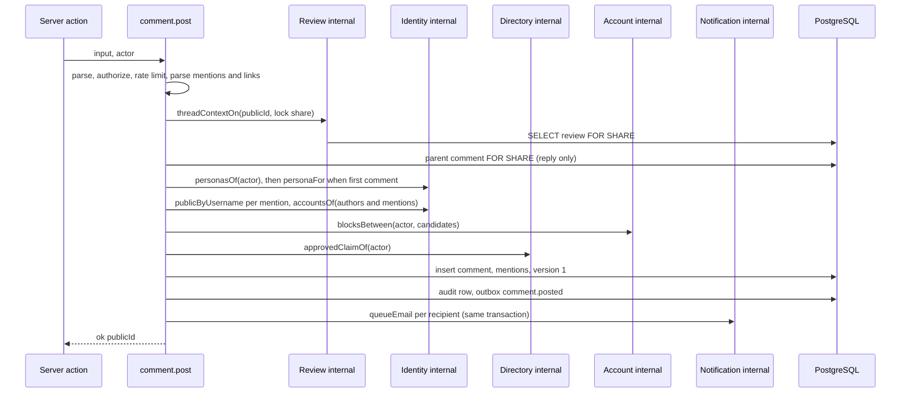
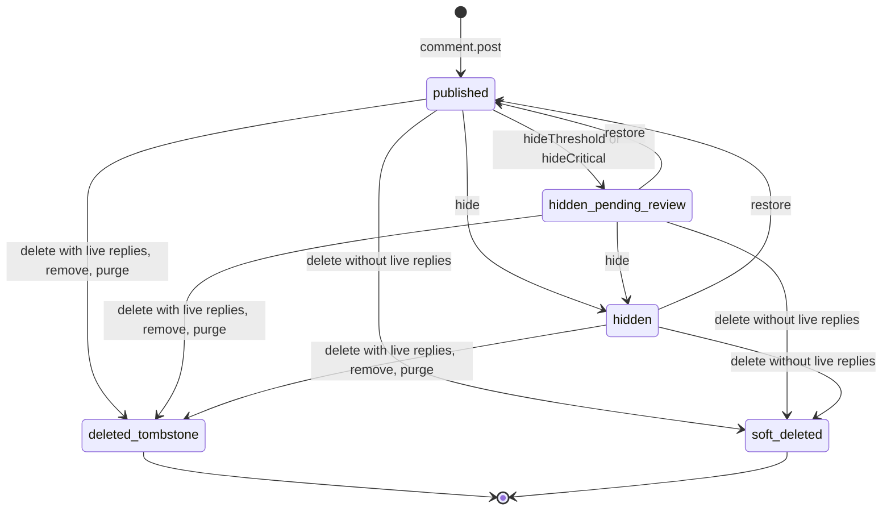
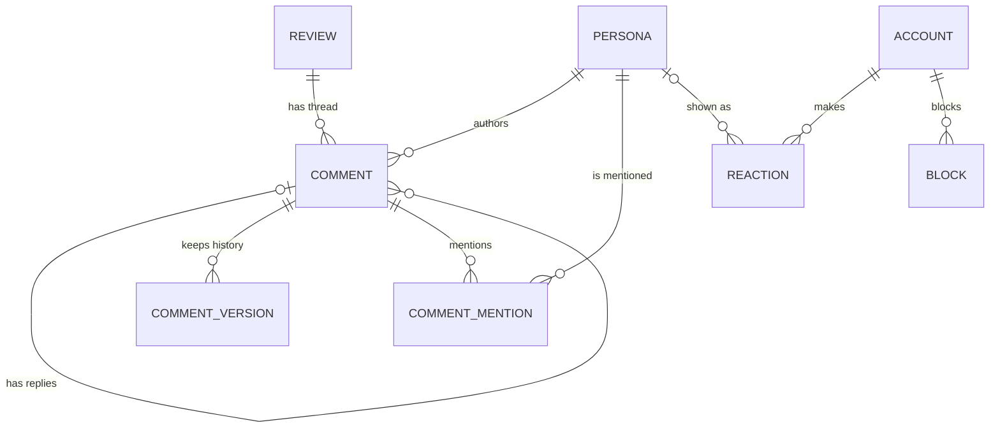

# Functional specification — U30 `t-401-community-module`

Unit U30 (kind `library`, size L) delivers T-401 for US8.1 and US8.2. `unit-of-work.md` does not mark it high risk, but it touches anonymity, identity, moderation hooks and account deletion, so it runs as a **high-risk Unit** (collaborators on, 3–5 adversarial tests by a separate agent, the owner's written sign-off; § 12, BR11.7). Lead perspective: architect. Support perspectives: developer (repository mechanics, locks, tests: §§ 10–11) and security engineer (threat cases and adversarial angles: § 12), synthesised in § 14. Draft written ahead of the stage on the owner's instruction to overlap work; the lead finalises it and the reviewer checks it when the workflow reaches this Unit; then it moves to `<record>/construction/t-401-community-module/functional-design/`.

**Drafted 2026-10-29** against `main` at `9cf860a` (T-010 merged as `14c21a9`, CR-012 merged), the refreshed drafts of every Unit this one depends on or calls (U8 T-101, U11 T-104, U12 T-105, U17 T-204, U21 T-301, U22 T-302) and the owner's answers in `docs/aidlc-migration/OWNER-REVIEW-QUEUE.md`. U34 T-405 has no draft yet; this design uses C2 and T-405's task file as amended. What this draft settles beyond the task text:

1. **Anonymity holds in discussion** (findings F1, F2, F3). The provider label is stored when the comment is written, never derived from private links when the thread is read (AD-3), and never shown on an alias. A block where the blocking party is anonymous in that thread is applied silently, because a `community.blocked` refusal there would tell the blocked user who wrote the anonymous review. Audit rows name the author persona, as U21 decided for reviews.
2. **Who comments as whom** (ISS-262, F4). The review's author comments under the review's persona; any other account picks named, pseudonymous or anonymous on its first comment in a thread (default pseudonymous, as the prototype posts) and keeps that persona there. This is what the prototype data shows (k2, k5, k16, k18, k42).
3. **Private history exists** (F5). A new `comment_versions` table keeps every posted and edited text privately, so AC8.1.3 and AC8.1.4 hold and the public row can drop its text on delete.
4. **Account deletion keeps comments, de-identified** (F6), as T-302 decided for reviews: the community deletion step deletes reactions only, in the web transaction; there is no worker step.
5. **Release 1 narrowings**: counts only, no public reaction lists (F7); rate limits fixed in code (F11); no restore of deleted comments.
6. **T-010 applied**: placement under the boundary matrix (BR11.1), the stub and migration-count pins (BR11.3), the 80% floor with untested files counted, CI before merge.
7. **Decided under the owner's no-questions instruction of 2026-10-29**: Questions 1–16. § 18 has the five FD entries the build appends before code.

Inputs: `unit-of-work.md` (U30, the deletion participants table, the open points on recipients and web-tier email), `unit-of-work-dependency.md`, `unit-of-work-story-map.md`, `requirements.md` (FR10, FR13, FR22, FR72–FR78, FR81), `stories.md` (US8.1, US8.2), `components.md` (Community, Account, Identity, Review, Directory), `contract-summary.md` (C2, C4, C5, C9, C10, C11, C13, C15), `docs/status/decision-log.md` (to FD-094), T-401 with its amendments, the T-402, T-403, T-404, T-405, T-409 and T-410 task files for what they expect from this Unit, `01-conventions.md` §1–§5, §10, §11, §13, `02-data-model.md` §0, §2, §3, §8, §12, §16, §17, `03-routes-and-contracts.md` §4 and §5, `PRODUCT.md`, the prototype (`concept-04b-quiet-clinic-minimal/app.js` 1040–1160 and 2970–3070; `shared/rogikotha-data.js`), the code listed in § 2, and the open rows ISS-142, ISS-262, ISS-267, ISS-270, ISS-294.

This file is the source of truth for the workflows and state transitions. The data shape is in `entities.md`; the decision logic is in `rules.md`.

## 1. What changes, in one paragraph

Patients can discuss a review: comment, reply one level deep, mention other members by `@username`, edit with an Edited mark and private history, and delete with a tombstone when replies depend on the comment. They can Like or Dislike reviews, facility feedback and comments, change or remove that reaction, and see counts only. They can block another member, which refuses direct interaction both ways without hiding the public discussion. Everything runs as application commands in `modules/community` (comments and reactions) and `modules/account` (blocks), each with authorization, a fixed rate limit, one audit row and its outbox row in one transaction; `comment.post` also queues the discussion email for each recipient through Notification's web-tier call (FD-075), with the recipients already filtered for self and blocks (C10). `community.thread` builds the `ThreadVM` the discussion UI (U31 T-402) renders. The Unit implements Review's `DiscussionPresence`, Identity's `RevealTarget` for comments, declares `ModerationSignals` with a default that flags nothing, builds the internal `comment.setState` for moderation (hide, restore, remove, purge) and the community step of account deletion (reactions). One forward-only migration adds `comment_versions`, four comment columns (`hidden_at`, `hidden_reason_code`, `removed_by`, `provider_label`), two indexes, and a stricter depth trigger. No hard rule changes; five FD entries record the anonymity, history, deletion and release-1 decisions (§ 18).

## 2. As is (baseline `main` at `9cf860a`, read 2026-10-29) and what Bolt 30 can count on

- **Schema** (`schema/community.ts`, `0002_content.sql`): `comments` (`public_id`, `seed_ref`, `review_id` FK cascade, `parent_id` self-FK, `author_persona_id`, `body`, `has_external_link`, `state`, `edited_at`, `deleted_at`, `tombstone`, `created_at`, `updated_at`), `comment_mentions (comment_id, mentioned_persona_id)` PK, `reactions` with `reactions_target_account_unique (target_kind, target_id, account_id)` and a CHECK on `target_kind`. No history table, no hidden or provider columns, no index on `comments.review_id`. `fn_comment_depth()` (`0003_triggers.sql`) refuses a reply to a reply on INSERT only; it does not check that the parent is in the same review. `blocks` is in `schema/account.ts` (Account). `schema/community.ts:22` names `0004_triggers.sql` (ISS-142).
- **Grants**: `rk_worker` holds SELECT and UPDATE on `comments` and nothing on `comment_mentions`, `reactions`, `blocks` or `persona_links` (02 §16 (c), (f); FD-092).
- **Repository stubs**: `PgCommunityRepository` has six methods (`postComment`, `editComment`, `deleteComment`, `setReaction` naming T-401; `thread`, `reactionsOf` naming T-402). `PgAccountRepository` has `setBlock`, `unsetBlock`, `isBlocked` naming T-401. `not-implemented.test.ts` lists both classes in `STUB_REPOSITORIES` (ISS-294). `FakeCommunityRepository` and `FakeAccountRepository.blocks` mirror them.
- **Contracts**: `schemas/community.ts` has `CommentPostInput` (body max 4000), `CommentEditInput`, `CommentDeleteInput`, `ReactionSetInput` (`like | dislike | null` for all three kinds), `BlockSetInput`, `BlockUnsetInput`, `GetThreadInput`, `ReactionsOfInput`; `view-models/thread.ts` is a T-003 stub (`authorLabel`, `likeCount`, `providerFor`, `TODO(T-402)`). Only `test-support/builders/comment.ts` and its test import these names. `errors.ts` already has `community.reply_depth`, `community.blocked`, `community.mention_anonymous`; `en.json`/`bn.json` already have `errors.community.{replyDepth,blocked,mentionAnonymous}`, `errors.common.rateLimited` and the prototype's discussion copy (`experience.commentGone`, `experience.linkWarning`, `experience.providerHere`, …).
- **Seed** (CR-012): 49 comments k1–k49 on 24 reviews, Bengali body only, `has_external_link` from the corpus `externalLink` while the link text itself is not in the body (k4, k27); named, pseudonymous and anonymous commenters (anonymous k5 on r6, k16 on r4, k31 on r15, k42 on r20); k3 and k31 seeded `hidden_pending_review` by MOD-2041 and MOD-2047, k27 by the appeal case MOD-2018; 683 real reaction rows from a reactor pool (`public_persona_id` null); no `comment_mentions` (ISS-270); no provider data on comments.
- **What the dependencies give** (their refreshed drafts): U8 `defineCommand` with the `requires` order, `sendsMail`, `UnitOfWork`, `AuditWriter` with allowlist builders, `Outbox`, `RateLimiter.hit(key, limit, windowSec)`, `Clock`, `Logger`; U11 `identity.personaFor`, `personasOf`, `accountsOf`, `publicByUsername`, `bylinesFor({personaIds, surface})`, `RevealTarget` with `targetCode`; U12 `ConfigProvider.current()` (no rate-limit values, F11); U17 `directory.approvedClaimOf({accountId})`; U21/U22 reviews with `author_persona_id`, `identity_mode`, `state`, `deleted_at`, the `DiscussionPresence` declaration and the review row lock; U34 `notification.queueEmail(tx, {accountId, category, messageKey, params, dedupeKey})` with the `discussion` category.
- **T-010 (FD-093)**: the boundary matrix of 01 §2; `pnpm check` with typecheck, lint, lint:boundaries, format:check, check:identity, test:coverage (80% lines per package, untested files counted), i18n:check, contrast, build; CI on `bolt/**`.

## 3. Settled before this stage

FD-015 (thread-scoped alias, nothing links it), FD-046 (no emergency banner, no classifier on comments), FD-062 (comments take Like and Dislike), FD-065 (one audit port, outbox in the same transaction), FD-070 and FD-075 (discussion email queued in the web tier by `comment.post`), FD-073 and FD-079 (hold checks are T-309's; a held delete looks normal), FD-077 (two-part deletion; no new worker grants), FD-087 (setState is silent), FD-088 (no appeals in release 1), C5 `account.blocksBetween`, C10 in full, C15 payloads, and the owner's answers: counts only (no percentages), "Former member" for de-identified named and pseudonymous personas. See `functional-design-questions.md` § "Settled before this stage".

## 4. Workflows

Every command follows `parse → authorize → rate limit → load (with locks) → decide (domain) → persist (rows, audit, outbox, email) → Result` in one `UnitOfWork` transaction (01 §3). Inputs carry public ids (BR1.8). Expected failures return `err`; a thrown database error becomes `internal` at the action boundary.

### WF1 — Code Generation order (the Unit end to end)

1. **Baseline**: `pnpm check` and `pnpm smoke` green on the Bolt branch; open ISS rows in `community` read (ISS-142, ISS-262, ISS-270).
2. **Decision log**: append the five FD entries of § 18 before any code.
3. **Migration** (§ 8), then `schema/community.ts` (new columns, `commentVersions`, the comment-name fix of ISS-142).
4. **Domain** `packages/domain/src/community/`: `comment.ts` (types, `isTopLevel`), `comment-state.ts` (BR4.1), `mention.ts` (`parseMentions`, `aliasTokens`, BR3.3, BR2.8), `policies.ts` (`detectExternalLink`, `extractExternalLinks`, `deleteOutcome(liveReplies)`, `threadPersonaRule`, `visibilityOf`, BR7.2), `reaction.ts` (`publicPersonaFor`, BR2.4), table tests.
5. **Contracts**: `schemas/community.ts` renamed to the C10 names with `identity?` and body 1–2000 (Question 14); `view-models/thread.ts` (§ 7); `errors.ts` adds `community.identity_fixed`.
6. **Ports**: `ports/repositories/community.ts` (§ 6.3), the block methods on `ports/repositories/account.ts`, `modules/community/ports.ts` (`ModerationSignals`), Review's `threadContextOn` and `facilityReviewContextOn` internals (BR10.5).
7. **Application**: commands, queries, internals, `authorization.ts`, `limits.ts`, `presence.ts`, `reveal-target.ts`; the block commands and `blocks-between.ts` in `modules/account` (Question 10).
8. **Database**: `repositories/community.ts` (real), the block methods of `repositories/account.ts`, the review context reads in `repositories/review.ts`; integration tests.
9. **Composition**: `apps/web/src/server/container.ts` wires the community module, the `DiscussionPresence` and `RevealTarget(comment)` implementations and the empty `ModerationSignals` default (no server action: U31 builds them).
10. **Test support**: fakes renamed to the port names, builders, `seed/seed-community.ts` plus one import line in `seed.ts` (BR11.4).
11. **i18n**: three new keys in both files (BR11.5).
12. **Pins and records**: `not-implemented.test.ts`, the two migration-count pins, the fake tests (BR11.3); 02 §8, §16 and 03 §4, §5 corrections; ISS rows (§ 9).
13. **Gate**: `pnpm check`, `pnpm smoke`, CI green; the adversarial pass (§ 12.2).

### WF2 — `comment.post({reviewId, parentId?, body, identity?})`



Text fallback: the command parses and authorizes, checks the rate limit and parses mentions and links; it loads the review with a share lock and, for a reply, the parent with a share lock; it reads the actor's personas and picks or creates the comment persona; it resolves mentioned usernames and the account ids of the review author, the parent author and the mentioned members, checks blocks between the actor and them, and checks the actor's approved claim; it inserts the comment, its mentions and history version 1, the audit row and the outbox row, queues one discussion email per remaining recipient, and returns the comment's public id.

1. Parse `PostCommentInput` (BR3.1). Authorize `authenticated → verifiedEmail → notRestricted` (BR1.1). Rate limit `comment:account:<id>` 30/h (BR1.7).
2. Domain: `aliasTokens(body)` non-empty → `community.mention_anonymous` (BR2.8); `parseMentions(body)` > 5 → `validation` (BR3.4); `hasExternalLink = detectExternalLink(body)`.
3. `ctx = review.threadContextOn(tx, {publicId: reviewId}, {lock: 'share'})`; none or not `acceptsComments` → `not_found` (BR7.1).
4. `parentId` given: parent by public id `FOR SHARE`; BR3.2 → `not_found` or `community.reply_depth`.
5. `own = identity.personasOf({accountId})`. Persona (BR2.1–BR2.3): the review persona when `ctx.authorPersonaId ∈ own`; else the actor's existing thread persona (`repo.threadPersonaOf(tx, ctx.reviewId, own)`); else `identity.personaFor(tx, {accountId, mode: identity ?? 'pseudonymous', reviewId})`. A conflicting `identity` → `community.identity_fixed`.
6. Mentions: `identity.publicByUsername` per token; not found → plain text (BR3.5).
7. Candidates: `identity.accountsOf([ctx.authorPersonaId, parent?.authorPersonaId, ...mentionPersonaIds])`. `B = account.blocksBetween({accountId, otherAccountIds})`. Refusals and silent filtering per BR5.4 and BR5.5. Recipients per BR8.1.
8. `providerLabel` per BR2.5 (`directory.approvedClaimOf`).
9. Persist: `repo.insertComment(tx, row)`, `repo.replaceMentions(tx, commentId, personaIds)`, `repo.insertVersion(tx, {commentId, version: 1, changeKind: 'post', body, actorKind: 'author'})`; audit (BR9.1); outbox `comment.posted` (BR8.2); `queueEmail` per recipient (BR8.3).
10. Result `ok({publicId})`.

### WF3 — `comment.edit({commentId, body})`

1. Parse, authorize (BR1.1), rate limit `comment-edit:account:<id>` 60/h.
2. Load the comment by public id; when it is a reply, lock the parent `FOR UPDATE` first, then the comment `FOR UPDATE` (BR4.10). BR1.4 → `not_found` / `forbidden`.
3. Unchanged normalised body → `ok({publicId})`, nothing written (BR4.3).
4. Re-check mentions and links as WF2 steps 2, 6 and 7 for the mentioned members only (BR3.8): alias → `community.mention_anonymous`; > 5 → `validation`; a block either way with a mentioned member → `community.blocked`.
5. Recompute `providerLabel` (BR2.5) with the comment's persona kind.
6. Persist: body, `has_external_link`, `provider_label`, `edited_at`, `updated_at`; mentions replaced; version `max + 1` (`edit`); audit `comment.edited`; outbox `comment.changed`. No notice, no email (BR8.4).

### WF4 — `comment.delete({commentId})`

1. Parse, authorize (BR1.1). No rate limit (a delete removes content).
2. Lock order and checks as WF3 step 2; delete states per BR1.4.
3. `live = repo.liveReplyCount(tx, commentId)`; `deleteOutcome(live)` → tombstone or removed (BR4.4).
4. Persist: `repo.markDeleted(tx, {commentId, tombstone, state, removedBy: 'author', at})` (body emptied, mentions deleted); when the comment is a reply, the parent cleanup of BR4.5; audit `comment.deleted {result, liveReplyCount}`; outbox `comment.changed`.
5. Result `ok({publicId, result: 'tombstone' | 'removed'})`. The result never mentions a hold (BR4.11).

### WF5 — `reaction.set({targetKind, targetId, value})`

1. Parse, authorize (BR1.1), rate limit `reaction:account:<id>` 100/h.
2. Target context (BR6.1): `review.threadContextOn` (review), `review.facilityReviewContextOn` (facility review), or the comment row plus its review's context (comment); not visible → `not_found`.
3. `publicPersonaId` per BR2.4 (`own = identity.personasOf`; thread persona; pseudonymous fallback through `personaFor(pseudonymous)`, which never creates).
4. `value` null → `repo.deleteReaction(tx, key)`; else `repo.upsertReaction(tx, {targetKind, targetId: internalId, accountId, publicPersonaId, value})` (BR6.2).
5. Result `ok({likes, dislikes, mine?})` read in the same transaction. No audit, no outbox (BR6.4).

### WF6 — `block.set({username})` and `block.unset({username})` (`modules/account`)

1. Parse; authorize `authenticated` (BR1.2); rate limit `block:account:<id>` 60/h.
2. `account.findByUsername` → not found or deleted → `not_found`; self → `validation` (BR5.1).
3. `set`: `repo.insertBlock(tx, {blocker, blocked})` returns `{inserted}`; `unset`: `repo.deleteBlock` returns `{deleted}`.
4. Only when a row changed: audit on `account:<actorId>` (BR9.2). No outbox. Result `ok({})`.

### WF7 — `community.thread({reviewId})` (query, anyone)

1. Parse `GetThreadInput`. `ctx = review.threadContextOn(db, {publicId}, {lock: 'none'})`; not readable → `not_found` (BR7.1).
2. `rows = repo.threadFor(db, ctx.reviewId, actor.accountId ?? null)`: every comment of the review with parent, persona id, state, `deleted_at`, `tombstone`, `removed_by`, body, `has_external_link`, `provider_label`, `edited_at`, `created_at`, mention usernames, like and dislike counts and the viewer's own value (BR7.9).
3. `own = actor.accountId ? identity.personasOf(...) : []`; `flags = moderationSignals.dangerousFlags(ids)`; `bylines = identity.bylinesFor({personaIds, surface: 'thread'})`.
4. Build top-level comments in order (BR7.5), each with its replies, by `visibilityOf` (BR7.2): shown, author-only with `moderationNotice`, placeholder (BR7.3) or left out. Flags per BR7.6; `links = extractExternalLinks(body)`.
5. Result `ok(ThreadVM)`. Never writes (BR7.11); the result is per viewer (BR7.10).

### WF8 — `community.reactionsOf({targetKind, targetId})` and `community.blockedList()`

- `reactionsOf`: target visibility as BR6.1; `repo.reactionCounts(db, target, actor.accountId ?? null)` → `{likes, dislikes, mine?}` (BR6.5). Used by U31 for the review-level buttons.
- `blockedList` (`modules/account`, authenticated): the usernames the actor blocked, newest first, deleted accounts left out (BR5.7). For U38 T-409.

### WF9 — `comment.setState(tx, {commentId, event, reasonCode?, caseCode?}, actor)` (internal)

1. Actor system or staff (BR1.5). Lock as WF3 step 2 (by internal id).
2. `comment-state.ts` refuses the pair → `err('conflict')`.
3. Apply BR4.7 (hide, restore, remove, purge); `hideThreshold` and `hideCritical` pass the table but their handling (reason and case code) is U32's addition to this file.
4. Audit `comment.state_changed` (actor `account:<staffId>` or `system`), outbox `comment.changed`, no email and no notice (BR4.8).
5. Result `ok({from, to, authorPersonaId})`; the deciding command finds the affected author through `identity.accountsOf`.

### WF10 — `DiscussionPresence.hasDiscussion(tx, reviewId)` (Review's port, BR10.1)

One `EXISTS` read on `comments` by `review_id` (internal uuid; the new index of § 8).

### WF11 — `RevealTarget(comment).resolve(tx, {targetKind: 'comment', targetId})` (Identity's port, BR10.2)

Row by public id in any state → `{subject: 'persona', personaId, targetCode: 'comment:<publicId>'}`; none → `not_found`. Registered in the container's resolver registry.

### WF12 — `community.deletionStepOn(tx, {accountId})` (internal, web tier, BR10.4)

`DELETE FROM reactions WHERE account_id = $1` → `{reactionsDeleted}`; idempotent; no audit. U39 wires it in `deletion-participant.ts`. The account's comments stay: Identity's step removes the persona links (except held ones, FD-079), so named and pseudonymous bylines read "Former member" and aliases stay as they were.

### WF13 — Review thread context (`modules/review/internal/thread-context.ts`, BR10.5)

`threadContextOn(q, {publicId}, {lock})` and `facilityReviewContextOn(q, {publicId})` call two new `ReviewRepository` reads (`threadContext`, `facilityReviewContext`); `lock: 'share'` appends `FOR SHARE` (T-302 F12). They return no body, title or account id.

## 5. State transitions



Text fallback: a comment is published when posted. Reports or a critical reason hide it pending review; a moderator hides or restores it. The author may delete it while it is published, pending review or hidden: with live replies it becomes a tombstone, without them it is soft-deleted (the stored state stays, `deleted_at` is set). A moderator's remove or purge always gives the stored state `deleted_tombstone`, with `tombstone` true only while live replies exist. Nothing leaves a deleted or removed state in release 1. `soft_deleted` is not a stored value: it is `deleted_at` set with the stored state unchanged (FD-049's mapping, as for reviews).

| Situation | `state` | `deleted_at` | `tombstone` | `removed_by` | `body` | Thread shows |
|---|---|---|---|---|---|---|
| Live | `published` | null | false | null | text | the comment |
| Danger flag | `published` or `hidden_pending_review` | null | false | null | text | the comment with the danger warning |
| Under review / hidden | `hidden_pending_review` / `hidden` | null | false | null | text | author: comment + notice; others: `withheld` placeholder only when a reply is shown |
| Author deleted, replies live | `deleted_tombstone` | set | true | `author` | `''` | `deleted` placeholder with replies |
| Author deleted, no live replies | unchanged | set | false | `author` | `''` | nothing |
| Moderator removed | `deleted_tombstone` | set | per live replies | `moderation` | `''` | `removed` placeholder with replies, or nothing |
| Purged | `deleted_tombstone` | set | per live replies | `moderation` | `''`, history deleted | as removed |

## 6. Ports and internals

### 6.1 Declared or implemented here

| Name | Where | Shape | Notes |
|---|---|---|---|
| `ModerationSignals` (declared) | `modules/community/ports.ts` | `dangerousFlags(commentIds: string[]): Promise<Set<string>>` | default returns an empty set; U32 implements (C11) |
| `DiscussionPresence` (Review's) | `modules/community/presence.ts` | `hasDiscussion(tx, reviewId): Promise<boolean>` | BR10.1 |
| `RevealTarget` (Identity's) | `modules/community/reveal-target.ts` | `resolve(tx, {targetKind: 'comment', targetId}) → Result<{subject: 'persona', personaId, targetCode}>` | BR10.2 |
| `comment.setState` | `modules/community/internal/set-state.ts` | `setStateOn(tx, {commentId, event, reasonCode?, caseCode?}, actor) → Result<{from, to, authorPersonaId}>` | BR4.7 |
| `community.deletionStepOn` | `modules/community/internal/deletion-step.ts` | `(tx, {accountId}) → {reactionsDeleted}` | BR10.4 |
| `account.blocksBetween` | `modules/account/queries/blocks-between.ts` | `(q, {accountId, otherAccountIds ≤ 50}) → {blocked: string[]}` | BR5.3 |
| `review.threadContextOn`, `facilityReviewContextOn` | `modules/review/internal/thread-context.ts` | § WF13 | BR10.5 |

### 6.2 Used from other Units

`identity.personaFor`, `personasOf` (Community added as a caller, additive to C4), `accountsOf`, `publicByUsername`, `bylinesFor` (U11); `directory.approvedClaimOf` (U17); `notification.queueEmail` (U34); `defineCommand`, `UnitOfWork`, `AuditWriter`, `Outbox`, `RateLimiter`, `Clock`, `IdGenerator`, `Logger` (U8).

### 6.3 `CommunityRepository` (`ports/repositories/community.ts`)

`insertComment(tx, row)`, `findByPublicId(q, publicId, {lock: 'share' | 'update' | 'none'})`, `findById(q, id, {lock})`, `threadPersonaOf(q, reviewId, personaIds) → personaId | null`, `liveReplyCount(tx, commentId)`, `updateBody(tx, {commentId, body, hasExternalLink, providerLabel, editedAt})`, `replaceMentions(tx, commentId, personaIds)`, `insertVersion(tx, row)`, `nextVersion(tx, commentId)`, `markDeleted(tx, {commentId, state, tombstone, removedBy, at})`, `clearTombstone(tx, commentId)`, `setState(tx, {commentId, state, hiddenAt, hiddenReasonCode})`, `purgeHistory(tx, commentId)`, `threadFor(q, reviewId, viewerAccountId | null)`, `upsertReaction(tx, row)`, `deleteReaction(tx, {targetKind, targetId, accountId})`, `reactionCounts(q, {targetKind, targetId}, viewerAccountId | null)`, `deleteReactionsOf(tx, accountId)`, `hasDiscussion(q, reviewId)`. `AccountRepository` gains `insertBlock`, `deleteBlock`, `blocksBetween`, `blockedUsernames` (replacing the three T-401 stubs). Every decision is made in the application layer; the repository writes what it is given (BR11.1).

## 7. View models, inputs, errors and copy

### 7.1 Inputs (`schemas/community.ts`, Question 14)

`PostCommentInput {reviewId, parentId?, body, identity?: 'named' | 'pseudonymous' | 'anonymous'}`, `EditCommentInput {commentId, body}`, `DeleteCommentInput {commentId}`, `SetReactionInput {targetKind: 'review' | 'facility_review' | 'comment', targetId, value: 'like' | 'dislike' | null}`, `SetBlockInput {username}`, `UnsetBlockInput {username}`, `GetThreadInput {reviewId}`, `ReactionsOfInput {targetKind, targetId}`. All `.strict()`; ids match the public-id pattern; body trimmed, NFC, 1–2000.

### 7.2 `ThreadVM` (`view-models/thread.ts`)

```ts
interface ThreadVM { reviewId: string; acceptsComments: boolean; truncated: boolean; comments: CommentVM[] }
type CommentVM = CommentShownVM | CommentPlaceholderVM;
interface CommentShownVM {
  publicId: string; tombstone: false;
  author: BylineVM;                 // Identity's one shape, thread surface
  body: string; mentions: string[]; links: string[]; hasExternalLink: boolean;
  postedAt: Iso8601; editedAt?: Iso8601;
  mine: boolean; canEdit: boolean; canDelete: boolean; canReply: boolean;
  providerHere: boolean; dangerous: boolean;
  moderationNotice?: 'pendingReview' | 'hidden';   // only when mine
  likes: number; dislikes: number; myReaction?: 'like' | 'dislike';
  replies: CommentVM[];             // empty on replies (one level)
}
interface CommentPlaceholderVM { publicId: string; tombstone: true; tombstoneReason: 'deleted' | 'removed' | 'withheld'; replies: CommentVM[] }
interface ReactionCountsVM { likes: number; dislikes: number; mine?: 'like' | 'dislike' }
```

`likeCount`, `authorLabel`, `providerFor` and `edited` of the T-003 stub go (T-401 step 2, FD-062). No field carries an id other than public ids, no banner or classification field (BR3.7).

### 7.3 Errors and copy

New `ErrorCode` `community.identity_fixed`. New keys in `en.json` and `bn.json` (Bengali flagged for the owner's review, FD-042):

| Key | English | Bengali |
|---|---|---|
| `errors.community.identityFixed` | You already take part in this discussion under another identity. | এই আলোচনায় আপনি আগেই অন্য পরিচয়ে অংশ নিয়েছেন। |
| `errors.community.tooManyMentions` | Mention at most 5 people in one comment. | এক মন্তব্যে সর্বোচ্চ ৫ জনকে উল্লেখ করুন। |
| `errors.community.blockSelf` | You can't block yourself. | আপনি নিজেকে ব্লক করতে পারবেন না। |

The withheld and removed placeholder copy and any identity choice in the composer are U31's keys (§ 19).

## 8. Migration (one, forward-only, the next free number at Code Generation)

1. `CREATE TABLE comment_versions (id uuid PRIMARY KEY, comment_id uuid NOT NULL REFERENCES comments(id) ON DELETE CASCADE, version int NOT NULL, body text NOT NULL, change_kind text NOT NULL CHECK (change_kind IN ('post','edit')), actor_kind text NOT NULL CHECK (actor_kind IN ('author','system')), created_at timestamptz NOT NULL DEFAULT now(), UNIQUE (comment_id, version))`; a `BEFORE UPDATE` trigger with `fn_block_mutation()` (rows are immutable; DELETE stays possible for purge and T-309's expiry). `rk_app` gets DML as for every content table; `rk_worker` gets nothing (FD-037).
2. `ALTER TABLE comments ADD hidden_at timestamptz, ADD hidden_reason_code text, ADD removed_by text CHECK (removed_by IN ('author','moderation')), ADD provider_label boolean NOT NULL DEFAULT false`.
3. `CREATE INDEX comments_review_created_idx ON comments (review_id, created_at, id)`; `CREATE INDEX comments_author_persona_idx ON comments (author_persona_id)`; `CREATE INDEX comments_parent_idx ON comments (parent_id) WHERE parent_id IS NOT NULL`.
4. Replace `fn_comment_depth()`: on INSERT refuse a parent that has a parent or whose `review_id` differs; `BEFORE UPDATE OF parent_id, review_id` refuse any change. The trigger name stays.
5. The comment-name fix in `schema/community.ts` (ISS-142) and the Drizzle schema for the new table and columns.

`rk_worker`'s table-level SELECT and UPDATE on `comments` cover the new columns; nothing in the worker uses them. 02 §16 lists `comment_versions` under (f).

## 9. Findings and proposed ISS rows (each `Found in U30 T-401`)

| # | Sev | Area | Finding | Resolution |
|---|---|---|---|---|
| F1 | S1 | community/identity | Task step 5 computes `providerHere` in the public thread query from the author persona's account, which reads `persona_links` in a public projection (AD-3) and would label an anonymous provider, naming the alias's author | Designed out: stored `provider_label`, never on an alias (Question 4, FD (b)) |
| F2 | S1 | community/identity | A `community.blocked` refusal on an anonymous thread is a deanonymisation oracle: a member blocked by one person learns which anonymous reviews or comments are that person's | Designed out: silent filtering where the blocker is anonymous in the thread (Question 2, FD (a)) |
| F3 | S2 | administration/identity | An audit actor `account:<id>` on comment rows would put the account of anonymous commenters into the moderation case timeline | Designed out: persona actor (Question 9, as U21 BR4.7) |
| F4 | S2 | community/identity | ISS-262: task step 4 lets only the review's anonymous author use an alias and gives everyone else the pseudonymous persona, but the prototype data has anonymous (k5, k16, k42) and named (k2, k18, k25) comments by other accounts | Designed out: per-thread identity choice (Question 1, FD (a)); closes ISS-262 |
| F5 | S2 | community/database | AC8.1.3 and AC8.1.4 need private version history; the schema has none and task step 4 clears the body on delete, which would destroy the text a hold or a moderator needs (FD-079) | Designed out: `comment_versions` (Question 5, FD (d)) |
| F6 | S2 | data-requests | C10's worker deletion entry and T-410 step 3 tombstone or delete the account's comments, contradicting FR13 and AC10.3.3; the worker also could not find them once the persona links are gone | Designed out: comments kept and de-identified; reactions only, web tier (Question 6, FD (c)) |
| F7 | S2 | community | FR77, AC8.2.3 and AC8.2.4 ask for public reaction lists and reactions on public activity; T-401 and 03 §4 say counts only and the prototype has no list | Decided: counts only in release 1 (Question 7, FD (e)) |
| F8 | S2 | units | U30 needs `directory.approvedClaimOf` (U17 T-204) but has no edge to U17, even transitively; under the swarm (FD-094) it could be built first | Designed out: add U17 → U30 to `unit-of-work-dependency.md` (Question 15) |
| F9 | S2 | database | `fn_comment_depth()` does not check that the parent is in the same review and runs on INSERT only | Designed out: migration step 4 and BR3.2 |
| F10 | S3 | community | Deleting the last reply under a tombstone leaves an empty tombstone and keeps `hasDiscussion` true | Designed out: BR4.5 |
| F11 | S3 | configuration | T-401 names T-105 "config for rate limits", but `ConfigValues` has no rate limits; the PRD baseline calls them configurable | Decided: fixed in code for release 1 (Question 12, FD (e)) |
| F12 | S2 | web/T-402 | T-402's Not in scope keeps comments like-only (stale against FD-062), and its reply box prefills `@<alias>` for anonymous parents, which BR2.8 refuses | Cross-Unit for U31 (§ 19) |
| F13 | S3 | test-support | Task step 7 asks for a new `seed/community.ts` mapping comments, but CR-012 already seeds them in `seed-content.ts`; mentions (ISS-270), links in the body and provider data are what is missing | `seed-community.ts` for the missing parts only (Question 16); closes ISS-270 |
| F14 | S2 | web | `ThreadVM` depends on the viewer (`mine`, own hidden comments); a shared cache would show them to others | BR7.10; cross-Unit for U31 and U27 |
| F15 | S4 | contracts | The T-003 input names (`CommentPostInput`, …) differ from C10 (`PostCommentInput`) and the body maximum is 4000 against the task's 2000 | Renamed to C10, 2000 (Question 14) |
| F16 | S4 | units | `unit-of-work.md` does not mark U30 high risk, though it carries anonymity and deletion rules like U11 and U39 | Run as high risk; mark it in `unit-of-work.md` (§ 19) |

ISS-267 (prototype comment counts) stays informational: the thread shows row counts.

## 10. Developer view — mechanics

### 10.1 Transactions and locks

- One `UnitOfWork` transaction per command. `comment.post`: review `FOR SHARE` (through Review's internal), parent `FOR SHARE`, then inserts. `comment.delete` and `setState`: parent `FOR UPDATE` (when the target is a reply), then the target `FOR UPDATE`, then `liveReplyCount` (BR4.10). Two concurrent replies and a parent delete therefore serialise: the delete sees both replies or neither commits before it.
- `reaction.set` relies on the unique index: `INSERT … ON CONFLICT (target_kind, target_id, account_id) DO UPDATE SET value = excluded.value, public_persona_id = excluded.public_persona_id, updated_at = now()`. Twenty concurrent likes leave one row; a like and a null racing end in whichever commits last, which is the user's last action.
- `identity.personaFor` with `anonymous` may insert a persona inside the caller's transaction (T-104 WF2, its own savepoint in the private repository); a later refusal in `comment.post` rolls it back with the comment.
- `queueEmail` runs on the same `tx`; U8's `defineCommand` ensures the `mail.send` queue before the transaction because the command is flagged `sendsMail`.

### 10.2 Thread read

`threadFor` is one SQL statement: comments of the review left-joined to aggregated mention usernames (`array_agg(p.username) FILTER (WHERE p.username IS NOT NULL)`) and to reaction counts (`count(*) FILTER (WHERE value = 'like')`, `… 'dislike'`) grouped per comment, plus the viewer's own value when an account is given; ordered `created_at, id`; `LIMIT 501` to set `truncated`. Bylines come in one `bylinesFor` call over the distinct persona ids.

### 10.3 Placement under the T-010 boundaries

| Files | Element | Note |
|---|---|---|
| `packages/domain/src/community/**` | domain | imports `domain/identity/alias.ts` only (same element) |
| `packages/contracts/src/{schemas/community.ts, view-models/thread.ts, errors.ts}` | contracts | `zod` only |
| `packages/application/src/{ports/repositories/community.ts, ports/repositories/account.ts (block methods), modules/community/**, modules/account/{commands/set-block.ts, commands/unset-block.ts, queries/blocks-between.ts, queries/blocked-list.ts}, modules/review/internal/thread-context.ts}` | application | no external package, no Node built-in, nothing re-exported from `src/worker.ts` |
| `packages/database/src/{repositories/community.ts, repositories/account.ts (blocks), repositories/review.ts (two reads), schema/community.ts, migrations/**}` | database | never imports `domain` |
| `apps/web/src/server/container.ts` | web-server (container) | wiring only |
| `packages/test-support/src/{fakes/**, builders/comment.ts, seed/seed-community.ts, seed/seed.ts}` | test-support, test-support-seed | |

### 10.4 Stubs, fakes, pins, coverage and gate

`PgCommunityRepository` becomes real and leaves `STUB_REPOSITORIES`; the three block stubs of `PgAccountRepository` become real; U8 T-101 implements most of that class and adjusts its entry in the stub test (its F32), and this Unit removes the block methods from whatever entry remains. The trace test still targets an existing stub. Both migration-count pins (`migrations.int.test.ts`, P8 in `validator-probes.int.test.ts`) go up by one. `FakeCommunityRepository` and the block part of `FakeAccountRepository` follow the port names; `repositories-superset.test.ts` and `fakes/repositories.test.ts` follow. Coverage: every new file in `domain`, `application`, `database`, `contracts` and `test-support` is tested to keep each package at 80% lines.

## 11. Developer view — tests

| Level | File | What it proves |
|---|---|---|
| domain | `comment-state.test.ts` | every cell of BR4.1, every refused pair |
| domain | `mention.test.ts` | the five task cases plus: `name@example.com` not a mention; `@patient-4f2k` gives an alias token, not `patient`; uppercase lowered; Bengali text next to `@user`; duplicates once; 6 tokens counted |
| domain | `policies.test.ts` | six link cases (`http://`, `https://`, `www.`, uppercase, inside parentheses, a dotted word that is not a link); `deleteOutcome(0)` removed, `(1)` tombstone; `visibilityOf` table (BR7.2) |
| application | `post-comment.test.ts` | happy path with one audit and one outbox row in the same fake transaction and details without text; reply to reply → `community.reply_depth`; parent from another review → `not_found`; alias mention → `community.mention_anonymous`; 6 mentions → `validation`; blocked review author (pseudonymous review) → `community.blocked`; blocker anonymous → success and no recipient; identity rules (BR2.1–BR2.3) including `community.identity_fixed`; 31st comment with `FakeClock` → `rate_limited` with `retryAfterSec`; FD-046 body unchanged; C10 payload rows; FD-075 email off/on, self and blocked none |
| application | `edit-comment.test.ts`, `delete-comment.test.ts` | Edited and version 2 (AC8.1.3); unchanged body no-op; foreign → `forbidden`; k8 → tombstone with k9, k10 → gone; last reply gone clears the tombstone; hidden comment edit refused, delete allowed |
| application | `set-reaction.test.ts` | like → dislike one row, counts move (AC8.2.1); dislike twice one row; null removes; anonymous author of r2 → `public_persona_id` null (AC8.2.3); unverified refused (AC8.2.6); hidden target `not_found` |
| application | `thread.test.ts` | ordering; placeholders carry only their fields; foreign comment `canEdit: false`; own hidden comment shown with notice, others see a `withheld` placeholder only with a reply; danger flag from a fake signal; no account or persona id anywhere in the VM (deep scan) |
| application | `engagement-isolation.test.ts` | no file under `modules/{review,search,directory,taxonomy,moderation}` imports `modules/community`; 10 dislikes on r1 comments leave U14's distributions unchanged (AC8.2.5) |
| application | `blocks.test.ts`, `presence.test.ts`, `reveal-target.test.ts`, `deletion-step.test.ts`, `set-state.test.ts` | the C5, C9/C10, C4, FD-077 and FD-087 rows |
| database | `community.int.test.ts` | each repository method; the unique reaction under 20 concurrent upserts; counts per comment; thread ordering; the depth trigger (reply to reply, cross-review parent, parent update) refused; `comment_versions` UPDATE refused; `rk_worker` denied `comment_versions` |
| smoke | `community.smoke.test.ts` | on the seed: r1's thread lists k8 with k9 nested and k1 with its counts; k5 shows the mention of `shafiq_ctg`; k2 is labelled provider |

The worker test of T-401's "`notification.deliver` needs no persona link" row runs in U34's worker project against the payload this Unit writes.

## 12. Security view — threat cases and adversarial angles

### 12.1 Threat cases

| # | Threat | Control |
|---|---|---|
| T1 | Linking an alias to an account through the provider label | BR2.5 (stored, never on an alias) |
| T2 | Block oracle on anonymous threads | BR5.5, BR5.6 (silent; `canReply` structural) |
| T3 | Linking through audit, logs or outbox | BR2.7, BR8.2, BR9.1, BR9.4 |
| T4 | Editing or deleting someone else's comment | BR1.3, BR1.4 (persona ownership, no ids from input) |
| T5 | Mentioning an alias to reach its account | BR2.8, BR3.3 |
| T6 | Deleted or hidden text leaking | BR4.4, BR4.6, BR7.2, BR7.3 |
| T7 | Engagement weighting summaries or ranking | BR6.6 |
| T8 | Reaction or comment flooding | BR1.7, BR6.2 |
| T9 | Thread corruption by crafted parents | BR3.2, migration step 4 |
| T10 | Server-side request through a link | BR3.6 |
| T11 | One viewer's own data served to another | BR7.10 |

### 12.2 Adversarial tests for the separate agent (defensive regression checks)

1. **Block oracle**: X blocks Y; X publishes r anonymously and comments on someone else's thread anonymously. Y comments on r, replies to X's alias comment and loads both threads. Expected: the same success result and view-model shape as for an unblocked member, no `community.blocked`, no notice or email to X; then on X's pseudonymous review, Y is refused `community.blocked`.
2. **Ownership forgery**: Y tries `comment.edit` and `comment.delete` on X's comment by public id, on a comment Y wrote in another thread under an alias (allowed, own), with a body carrying extra keys (`attachments`, `toAccountId`), and with a `parentId` from another review and a reply's id. Expected: `forbidden`, own success, `validation`, `not_found`, `community.reply_depth`; a direct SQL insert of a reply to a reply or a cross-review parent is refused by the trigger.
3. **Linkage scan**: after a scripted session (the anonymous author of r2 comments, reacts with like then dislike, is mentioned by alias, edits, deletes), scan `audit_events.actor` and `details`, `outbox_events.payload`, `email_deliveries.params`, captured logs and every `ThreadVM` and `reactionsOf` result. Expected: no account id beside the r2 thread except in `outbox_events` recipient fields and `reactions.account_id`; no comment text outside `comments` and `comment_versions`; `public_persona_id` null; no reactor list.
4. **Concurrency**: 20 parallel `reaction.set like` plus 20 `dislike` from one account on one comment; 10 parallel replies racing a delete of their parent. Expected: one reaction row; either a tombstone with every committed reply nested, or a refused reply; never a reply under a soft-deleted parent.
5. **Hidden-text leak**: a moderator hides k1 (no reply) and removes k8 (with k9); then the author of k10 deletes it. Expected for another viewer: k1 absent, k8 a `removed` placeholder carrying only `publicId`, `tombstoneReason` and replies, k10 absent; `comments.body` empty for k8 and k10; `comment_versions` still holds their texts; `purge` of k8 deletes its versions and leaves the placeholder.

## 13. Owned paths and recorded additions

Task owned paths, plus (recorded, each in the hand-off): `packages/application/src/modules/account/{commands/set-block.ts, commands/unset-block.ts, queries/blocked-list.ts}` (Question 10); `packages/application/src/ports/repositories/account.ts` and `packages/database/src/repositories/account.ts` (block methods only); `packages/application/src/modules/review/internal/thread-context.ts` and two reads in `ports/repositories/review.ts` and `repositories/review.ts` (BR10.5); `packages/database/src/schema/community.ts`, `migrations/**`, `migrations.int.test.ts`, `validator-probes.int.test.ts` (count), `repositories/not-implemented.test.ts`; `packages/contracts/src/errors.ts`; `apps/web/src/server/container.ts` (wiring); `packages/test-support/src/{fakes/repositories.ts, fakes/repositories.test.ts, fakes/repositories-superset.test.ts, seed/seed-community.ts, seed/seed.ts (one line), seed/seed.int.test.ts}`; `docs/implementation/{02-data-model.md, 03-routes-and-contracts.md, ISSUES.md}`, `docs/status/decision-log.md`.

## 14. Synthesis — decisions and why

- **Anonymity first** (Questions 1, 2, 4, 9). Every surface a comment touches (label, block refusal, audit actor, mention) was checked for a path from an alias to an account; each path found is closed by storing or silencing, never by a runtime read of `persona_links` in a public path.
- **History in its own table** (Question 5). It satisfies AC8.1.3 and AC8.1.4, lets the public row drop text on delete, and keeps what holds and moderators need, without touching `review_versions` or audit.
- **De-identify, not delete** (Question 6), matching FR13, AC10.3.3, T-302's review decision and the owner's "Former member" answer; it also removes the worker step that could not work.
- **Narrow where the prototype is narrow** (Questions 7, 12): no reactor lists, fixed limits; both are reversible additions later.
- **Ownership stays with the owner** (Questions 10, 15): blocks in Account, the thread context in Review, the claim check in Directory.

## 15. If the owner changes an answer

- **Q1 → B** (only the anonymous author uses an alias): drop `identity` from the input and `community.identity_fixed`; the seeded anonymous and named comments by other accounts become data the product cannot create (ISS-262 stays open).
- **Q2 → B** (refuse everywhere): one branch less, and the oracle of F2 is open; FD (a) loses its second half.
- **Q4 → B** (derive at read time, not for aliases): drop `provider_label`; the thread query needs a private read (AD-3 exception, an FD entry).
- **Q5 → B** (no history): drop `comment_versions`; AC8.1.3's private history becomes Deferred and delete must keep the body.
- **Q6 → B** (tombstone the account's comments): `deletionStepOn` gains a comment step in the web tier before Identity's step, resolving the account's comment ids while the links exist.
- **Q7 → B** (reactor lists): a `community.reactorsOf` query with thread-surface bylines and `public_persona_id`; aliases shown, anonymous-author reactions excluded from public activity.
- **Q8 → B** (audit reactions): audit with actor `persona:<thread persona>` or `system` for anonymous reactors.

## 16. Acceptance mapping (T-401 acceptance checks)

| Task row | Covered by |
|---|---|
| One reply level | BR3.2; `post-comment.test.ts` |
| k8/k9/k10 scenarios | BR4.4, BR7.2; `delete-comment.test.ts`, smoke |
| Mention refusal (`anon_author_r2`'s alias) | BR2.8, BR3.3; the test mentions r2's alias, and `@anon_author_r2` (that account's pseudonymous persona) is a valid mention that reveals nothing |
| Reaction idempotency | BR6.2; `community.int.test.ts` |
| Anonymous linkage | BR2.4, BR6.5 |
| Block effect | BR5.4, BR5.6 |
| Rate limits | BR1.7 |
| Audit + outbox | BR9.1, BR9.3, BR8.2 |
| Boundaries | BR11.1; `pnpm lint`, `pnpm lint:boundaries` |
| FD-062 rows (AC8.2.1, AC8.2.2, AC8.2.3, AC8.2.5) | BR6.2, BR6.3, BR2.4, BR6.6 |
| FD-075 discussion email | BR8.3 |
| C10 recipient ids; `notification.deliver` without links | BR8.1, BR8.2; U34's worker test |
| C5 `blocksBetween` | BR5.3 |
| C9/C10 `hasDiscussion` | BR10.1 |
| FD-077 community deletion step | BR10.4 — the row changes: "web entry removes all the account's reactions; the account's comments are unchanged; a second run changes nothing" (FD (c)); the worker half is dropped |
| FD-046 no banner; FR-EDIT-005 edit | BR3.7, BR4.3 |

## 17. Risks to verify in Code Generation and Build and Test

- U34's `queueEmail` signature and the `discussion` category as built; U11's `personasOf` and `bylinesFor` as built; U17's `approvedClaimOf` as built (F8).
- The share lock through Review's internal must run on the command's `tx`.
- The trigger replacement must keep the seeded data valid (no seeded reply crosses reviews; check before applying).
- The seed's link append must not change a body twice (idempotent by `seed_ref` and a contains check).
- `bylinesFor` limit (1–200 ids) against threads with many authors: batch in 200s.

## 18. FD entries the build appends before code

The next free numbers at build time (FD-094 is the owner's swarm decision; earlier drafts reserve theirs). Text, with the decision-log columns:

- **FD-<next> (a) — Who comments as whom, and blocks on anonymous threads (T-401 Questions 1–3, ISS-262)**: the review's author always comments in their own thread under the review's persona; any other account chooses named, pseudonymous or anonymous for its first comment in a thread (default pseudonymous), keeps that persona for later comments there (`community.identity_fixed` otherwise), and an anonymous commenter gets their own thread alias, never linked to their profile. A block, in either direction, refuses a comment on the other party's thread, a direct reply to them and a mention of them, wherever that party appears under a named or pseudonymous persona; where the party is anonymous in that thread the block is applied silently (the comment posts and the party gets no notice or email), so a refusal can never reveal who wrote an anonymous review or comment. Applies FD-015; changes T-401 step 4 and the Community behaviour in `components.md` ("an account that the review author has not blocked"). | The prototype data has anonymous and named comments by other accounts (k5, k16, k42; k2, k18); a refusal on an anonymous thread is a deanonymisation oracle. Decided by the agent under the owner's no-questions instruction of 2026-10-29
- **FD-<next> (b) — The provider label on comments is stored, never derived (T-401 Question 4)**: `comments.provider_label` is set when a comment is posted or edited, true only when the author's persona is named or pseudonymous and the author's account holds the approved claim on the review's doctor (`directory.approvedClaimOf`); the public thread reads the column and never reads persona links. A label set at posting time stays if the claim is later revoked; an anonymous persona never carries it. Replaces 02 §8's "providerFor: derived, not stored"; U30 gains the dependency on U17 T-204. | AD-3 forbids public projections from reading the persona-to-account link; a label on an alias would name the doctor behind it. Decided by the agent under the owner's no-questions instruction of 2026-10-29
- **FD-<next> (c) — Account deletion keeps comments, de-identified (T-401 Question 6)**: when an account is deleted, its comments stay as they are; Identity's step removes the persona links, so named and pseudonymous bylines read "Former member" and aliases stay as they were. The community deletion step deletes the account's reactions only, in the web transaction, and has no worker entry. Supersedes C10's `community.deletionStep` worker entry, the comment tombstones of FD-077's worker steps and the community line of T-410 step 3; blocks are deleted by the account step (U39). | FR13 and AC10.3.3 require retained contributions to be de-identified, not deleted; this matches the review decision of U22 T-302 Question 9; the worker cannot find an account's comments once the links are gone. Decided by the agent under the owner's no-questions instruction of 2026-10-29
- **FD-<next> (d) — Private comment history and moderation columns (T-401 Question 5)**: a new private table `comment_versions` keeps every posted and edited comment text (immutable rows, no worker privilege, never in a view model, audit row, payload or log); an author's delete and a moderator's removal empty `comments.body` and keep the history; a moderator's purge also deletes the history; `comments` gains `hidden_at`, `hidden_reason_code`, `removed_by (author | moderation)` and `provider_label`. Nothing restores a deleted or removed comment in release 1. Changes 02 §8 and §16; the history's retention is applied with T-309's expiry (until then it is kept). | AC8.1.3 and AC8.1.4 require private history; clearing the only copy would also break FD-079 (held data stays). Decided by the agent under the owner's no-questions instruction of 2026-10-29
- **FD-<next> (e) — Community in release 1 (T-401 Questions 7, 8, 12)**: reactions show counts only (Like and Dislike, the viewer's own state); public reaction lists and reactions on public activity and the dashboard (the list parts of FR77, FR78, AC8.2.3, AC8.2.4) move to release 2; `reactions.public_persona_id` is still stored (null when the reactor is anonymous in that thread) for that later list. `reaction.set` writes no audit row, the one recorded exception to 01-conventions §5. Comment, edit, reaction and block rate limits are fixed in code (30, 60, 100 and 60 per hour), not configurable (PRD baseline "configurable"); a configured retention period for tombstones and comment history waits for T-309. | The prototype shows counts only and T-401 and 03 §4 say counts only; an audit actor would link anonymous reactors; `ConfigValues` has no rate limits. Decided by the agent under the owner's no-questions instruction of 2026-10-29

## 19. Cross-Unit changes other drafts must pick up

| Unit | Change |
|---|---|
| U11 T-104 | `identity.personasOf` gains Community as a caller (thread ownership, `mine` flags); the T-104 traceability note "reaction lists rendered by U30/U31" becomes release 2 (FD (e)) |
| U17 T-204 | `approvedClaimOf` is called by U30; add the edge U17 → U30 to `unit-of-work-dependency.md` (F8) |
| U22 T-302 | `DiscussionPresence` is implemented and wired in the container by U30 (closes T-302 F11 earlier than U38); Review gains `internal/thread-context.ts` and two repository reads (BR10.5), built by U30 |
| U31 T-402 | render Like and Dislike on comments (FD-062; its Not in scope line is stale); no `@` prefill for an anonymous parent; render `tombstoneReason` (`deleted`, `removed`, `withheld`) with copy for the last two; optional identity choice on a first comment (default pseudonymous); `moderationNotice` on own hidden comments; never cache the thread across viewers (BR7.10); links shown as text with `experience.linkWarning` |
| U32 T-403 | extend `comment.setState` with `hideThreshold`/`hideCritical` (cells exist; write `hidden_at`, `hidden_reason_code`); implement `ModerationSignals` |
| U33 T-404 | use `comment.setState` remove and purge; find the affected author from the returned `authorPersonaId`; the case timeline reads the `comment:<id>` stream |
| U29 T-309 | hold checks in `comment.delete` and `purge`; the expiry of `comment_versions`; a held delete must look normal (BR4.11) |
| U34 T-405 | email message keys `email.discussion.{comment,reply,mention}` and the role precedence mention > reply > comment for one recipient; the in-app item uses the same precedence |
| U38 T-409 | `community.blockedList` and `block.unset` live in `modules/account`; public activity lists no reactions in release 1 |
| U39 T-410 | community step = reactions only, web tier; comments kept (FD (c)); blocks deleted by the account step; the plan row "k-comments by shirin with replies → tombstone" changes to "kept, de-identified" |
| Units Generation record | U30 marked high risk; the U17 → U30 edge |

## Entity-relationship view (derived from `entities.md`)



Text fallback: a review has a thread of comments; a top-level comment may have replies one level deep; each comment keeps private history versions and may mention personas; a persona authors comments. An account makes reactions on reviews, facility feedback or comments, each shown under a public persona or none; an account blocks other accounts.

## Rules summary (derived from `rules.md`)

BR1 authorization, ownership and limits; BR2 identity and anonymity; BR3 comment content; BR4 lifecycle and private history; BR5 blocks; BR6 reactions; BR7 thread projection; BR8 notifications and email; BR9 audit, outbox and logs; BR10 ports, internals and deletion; BR11 boundaries, verification and records. The one-line table of all 81 rules is at the end of `rules.md`.

## Sources

- `docs/implementation/tasks/T-401-community-module.md` (goal, steps, acceptance checks, hard-rule checklist, both amendment sections); T-402, T-403, T-404, T-405, T-409, T-410 task files (expectations of this Unit).
- `docs/status/decision-log.md` FD-009, FD-015, FD-016, FD-017, FD-021, FD-046, FD-047, FD-049, FD-062, FD-065, FD-069, FD-070, FD-073, FD-075, FD-077, FD-079, FD-086, FD-087, FD-088, FD-092, FD-093, FD-094; `aidlc/spaces/default/memory/project.md` and `team.md`.
- `docs/aidlc-migration/OWNER-REVIEW-QUEUE.md` (the no-questions instruction; counts only; Former member).
- `aidlc/spaces/default/intents/261011-aidlc-adoption/inception/units-generation/{unit-of-work.md, unit-of-work-dependency.md, unit-of-work-story-map.md}`; `inception/requirements-analysis/requirements.md`; `inception/user-stories/stories.md`; `inception/domain-design/components.md`; `inception/contract-design/contract-summary.md`.
- `docs/implementation/01-conventions.md`, `02-data-model.md`, `03-routes-and-contracts.md`; `docs/planning/01-requirement-baseline.md` (rate limits).
- Code on `main` at `9cf860a`: `packages/database/src/{schema/community.ts, schema/account.ts, schema/retention.ts, migrations/0002_content.sql, 0003_triggers.sql, 0005_grants_part2.sql, 0008_worker_grant_review.sql, repositories/community.ts, repositories/account.ts, repositories/not-implemented.test.ts}`, `packages/contracts/src/{schemas/community.ts, schemas/account.ts, view-models/thread.ts, view-models/experience.ts, errors.ts}`, `packages/i18n/messages/en.json`, `packages/test-support/src/{corpus/comments.ts, corpus/reviews.ts, seed/seed-content.ts, seed/seed-moderation.ts, fakes/repositories.ts, builders/comment.ts}`.
- Prototype: `ui-design-prototype/concepts/concept-04b-quiet-clinic-minimal/app.js` (1040–1160, 2970–3070), `ui-design-prototype/shared/rogikotha-data.js`.
- Drafts: `t-101-better-auth-adapter`, `t-104-identity-module`, `t-105-runtime-configuration`, `t-201-directory-and-taxonomy-modules`, `t-204-provider-submission-claim-field-change`, `t-301-review-module-core`, `t-302-review-changes-and-tombstones`, `t-307-experience-page-and-index`.
- `docs/implementation/ISSUES.md` ISS-142, ISS-158, ISS-262, ISS-263, ISS-267, ISS-270, ISS-294.
