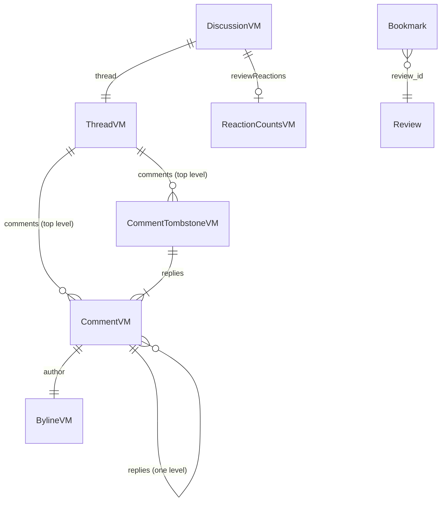

# Entities — U31 `t-402-discussion-ui`

Source of truth for the data shapes this Unit reads, holds and adds. The Unit adds no table, column or migration. It reads U30 T-401's thread view model and reaction counts. It adds the bookmark write side on the existing `bookmarks` table (Question 4), one page-level view model, the client thread state and form states, and four message keys. Decision logic is in `rules.md`, workflows in `functional-spec.md`, and component props in `frontend-components.md`.

Built from T-402 (with the FD-091 amendment), T-401's task file (no T-401 draft exists, so the consumed shapes below are what this Unit needs from T-401; `functional-spec.md` § 11 lists the changes), `contract-summary.md` C5, C9 and C10, `02-data-model.md` §2 and §8, `03-routes-and-contracts.md` §2 and §4, and the code on `main` at `14c21a9`: `packages/contracts/src/{view-models/thread.ts, schemas/community.ts, errors.ts, actor.ts, ids.ts}`, `packages/database/src/schema/account.ts` (`bookmarks`), `packages/database/src/repositories/{account,community}.ts` and `packages/i18n/messages/{en,bn}.json`. Also the T-104 (`BylineVM`), T-102 (`Viewer`) and T-307 (slot) drafts.

```yaml
entities:
  # ---------- consumed from U30 T-401 (the shape this Unit needs; T-401 defines it) ----------
  - id: ENT-001
    name: ThreadVM
    kind: value object (view model)
    owner: "U30 T-401, packages/contracts/src/view-models/thread.ts (replaces the T-003 stub)"
    attributes:
      - { name: reviewPublicId, type: text, required: true, constraints: "the review's public id (Question 5); never the internal id" }
      - { name: open, type: boolean, required: true, constraints: "true when the review is published; false under a tombstone (Question 14)" }
      - { name: visibleCount, type: integer, required: true, min: 0, constraints: "comments and replies the viewer sees, tombstones excluded" }
      - { name: comments, type: "ThreadItemVM[]", required: true, constraints: "top level, created_at ascending" }
    constraints:
      - "No accountId, personaId, email, reporter field, moderation case id or reason text (03 §2, FD-086)"
      - "hidden_pending_review comments appear only when the viewer is their author (Question 2 A)"
      - "Hard-removed comments (deleted_at set, no replies) are absent"

  - id: ENT-002
    name: CommentVM
    kind: value object (view model)
    owner: "U30 T-401"
    attributes:
      - { name: tombstone, type: "literal false", required: true }
      - { name: publicId, type: text, required: true, constraints: "comments.public_id" }
      - { name: author, type: BylineVM, required: true, constraints: "T-104's thread surface: alias for an anonymous persona, formerMember for a de-identified one" }
      - { name: body, type: text, required: true, constraints: "1–2000 characters, plain text, current version only (AC8.1.3)" }
      - { name: mentions, type: "text[]", required: true, constraints: "usernames as written after @, at most 5; never an anonymous persona" }
      - { name: hasExternalLink, type: boolean, required: true }
      - { name: postedAt, type: "ISO timestamp", required: true }
      - { name: editedAt, type: "ISO timestamp", required: false }
      - { name: mine, type: boolean, required: true, constraints: "author persona in the actor's persona set for this thread (T-401 step 3)" }
      - { name: canEdit, type: boolean, required: true, constraints: "mine and not tombstone" }
      - { name: canReply, type: boolean, required: true, constraints: "top level, published, thread open" }
      - { name: providerHere, type: boolean, required: true, constraints: "author holds an approved claim on the review's doctor (FR22)" }
      - { name: dangerFlag, type: boolean, required: true, constraints: "ModerationSignals.dangerousFlags: an open case with reason dangerous (C10); false until T-403 implements the port (Question 2 A)" }
      - { name: pendingReview, type: boolean, required: true, constraints: "true only when state = hidden_pending_review and mine (Question 2 A)" }
      - { name: likes, type: integer, required: true, min: 0 }
      - { name: dislikes, type: integer, required: true, min: 0, constraints: "FD-062" }
      - { name: myReaction, type: enum, required: false, allowed_values: [like, dislike] }
      - { name: replies, type: "CommentVM[]", required: true, constraints: "empty on a reply; one level only" }

  - id: ENT-003
    name: CommentTombstoneVM
    kind: value object (view model)
    owner: "U30 T-401"
    attributes:
      - { name: tombstone, type: "literal true", required: true }
      - { name: publicId, type: text, required: true }
      - { name: replies, type: "CommentVM[]", required: true, min_items: 1 }
    constraints:
      - "Carries no author, body, time, counts or flags (AC8.1.4)"

  - id: ENT-004
    name: ReactionCountsVM
    kind: value object
    owner: "U30 T-401, result of community.reactionsOf {targetKind, targetPublicId}"
    attributes:
      - { name: likes, type: integer, required: true, min: 0 }
      - { name: dislikes, type: integer, required: true, min: 0 }
      - { name: mine, type: enum, required: false, allowed_values: [like, dislike] }
    constraints:
      - "Counts only, never a list of reactors (Question 3 A, FD-<next>)"

  # ---------- consumed from other Units ----------
  - id: ENT-005
    name: BylineVM
    kind: value object (view model)
    owner: "U11 T-104 (packages/contracts/src/view-models/persona.ts)"
    attributes_used: [personaKind, displayName, username, profileUsername, alias, initials, avatarHue, formerMember]
    constraints:
      - "Rendered only through T-202's Byline variant comment"
      - "profileUsername is read only for the reply prefill (Question 7 A), never for an anonymous or former-member byline (it is absent there)"

  - id: ENT-006
    name: Viewer
    kind: value object
    owner: "U9 T-102 (loadViewer in the patient layout)"
    attributes_used: [kind, verified]
    constraints:
      - "Decides only which control shows (composer, gate button, disabled textarea); never authorization (T-102 BR10.6)"

  # ---------- added by this Unit ----------
  - id: ENT-007
    name: DiscussionVM
    kind: value object
    owner: "U31, apps/web/src/lib/discussion-vm.ts (type only; built by the route's loadDiscussion)"
    attributes:
      - { name: thread, type: ThreadVM, required: true }
      - { name: reviewReactions, type: ReactionCountsVM, required: false, constraints: "absent on a tombstone (T-307 shows no actions row there)" }
      - { name: saved, type: boolean, required: false, constraints: "absent for an anonymous actor; bookmark.stateOf for an account" }
    constraints:
      - "Serializable (crosses into client components); no internal id"

  - id: ENT-008
    name: ThreadUiState
    kind: client state
    owner: "U31, DiscussionState (React context inside Discussion)"
    attributes:
      - { name: replyingTo, type: text, required: false, constraints: "publicId of the comment whose reply box is open; at most one" }
      - { name: editing, type: text, required: false, constraints: "publicId of the comment being edited; opening one closes the other (prototype)" }
      - { name: justPosted, type: text, required: false, constraints: "publicId returned by the last successful post; drives the one-item reveal (Question 11 A)" }
    states: "idle → replying(id) | editing(id); replying → idle on cancel, post ok; editing → idle on cancel, save ok; any → idle on route change (RouteTransition remounts)"

  - id: ENT-009
    name: CommentFormState
    kind: value object (useActionState state)
    owner: "U31, apps/web/src/lib/discussion-vm.ts"
    attributes:
      - { name: status, type: enum, required: true, allowed_values: [idle, done, error] }
      - { name: publicId, type: text, required: false, constraints: "done after post or edit" }
      - { name: nonce, type: integer, required: false, constraints: "increments on done, so the form resets" }
      - { name: messageKey, type: text, required: false, constraints: "error only; an existing key (errors.community.*, errors.common.*)" }
      - { name: minutes, type: integer, required: false, constraints: "rate_limited only: ceil(retryAfterSec / 60)" }

  - id: ENT-010
    name: ActionOutcome
    kind: value object
    owner: "U31, apps/web/src/lib/discussion-vm.ts"
    shape: "{ok: true, value} | {ok: false, error: {code, messageKey, minutes?, correlationId}}"
    constraints:
      - "Returned by deleteComment, setReaction and setBookmark; a thrown command error becomes code internal with a correlation id (task Tests to write)"

  - id: ENT-011
    name: Bookmark
    kind: persisted (existing table)
    owner: "Account module; table bookmarks in packages/database/src/schema/account.ts"
    attributes:
      - { name: account_id, type: uuid, required: true, constraints: "fk account_profiles; private" }
      - { name: review_id, type: uuid, required: true, constraints: "fk reviews" }
      - { name: created_at, type: timestamp, required: true }
    constraints:
      - "pk(account_id, review_id): idempotent add (ON CONFLICT DO NOTHING) and remove"
      - "Private, never projected, no audit row, no outbox (02 §2); the worker holds no privilege on it (02 §16 (f))"
    operations_added_by_this_unit:
      - "bookmark.set {reviewPublicId, saved: boolean} → {saved} · authenticated + verifiedEmail · review must be published · ReviewLookup port"
      - "bookmark.stateOf {reviewPublicId} → {saved} · authenticated"
      - "PgAccountRepository.addBookmark, removeBookmark (stub owner T-409 → T-402), hasBookmark (new)"

  - id: ENT-012
    name: BookmarkSetInput
    kind: schema
    owner: "U31, packages/contracts/src/schemas/bookmark.ts"
    shape: "z.object({reviewPublicId: publicId, saved: z.boolean()}).strict(); BookmarkStateInput = {reviewPublicId}"

  - id: ENT-013
    name: ReportSheetContext
    kind: client contract
    owner: "U31 declares (discussion/report-context.tsx); U32 T-403 provides"
    shape: "{open(target: {kind: 'comment' | 'review', publicId: string}): void} | null"
    constraints:
      - "null until T-403 mounts its provider; then ReportButton opens T-403's sheet (Question 13 A)"
      - "The target carries a public id only; no reporter data flows back to the thread"

  - id: ENT-014
    name: MessageKeysAdded
    kind: i18n
    owner: "U31, packages/i18n/messages/{en,bn}.json (same commit)"
    keys:
      - { key: experience.commentPending, en: "Hidden while a moderator looks at reports about it. Only you can see it here.", bn: "এ নিয়ে আসা রিপোর্ট একজন মডারেটর দেখছেন, তাই এটি আপাতত লুকানো। এখানে শুধু আপনিই এটি দেখতে পাচ্ছেন।" }
      - { key: experience.commentPosted, en: "Comment posted.", bn: "মন্তব্য দেওয়া হয়েছে।" }
      - { key: experience.commentSaved, en: "Changes saved.", bn: "পরিবর্তন সংরক্ষিত হয়েছে।" }
      - { key: experience.commentDeleted, en: "Comment deleted.", bn: "মন্তব্য মুছে ফেলা হয়েছে।" }
    constraints:
      - "Bengali strings flagged for the owner's review (FD-042); no capital-letter transform in Bengali"
```

## Keys reused (exist in both dictionaries on `main`)

`experience.discussion`, `experience.providerNote`, `experience.commentBox`, `experience.commentHint`, `experience.commentPost`, `experience.replyLevel`, `experience.reply`, `experience.replyingTo`, `experience.replyCancel`, `experience.editComment`, `experience.saveComment`, `experience.cancelEdit`, `experience.deleteComment`, `experience.edited`, `experience.ownComment`, `experience.providerHere`, `experience.linkWarning`, `experience.dangerWarning`, `experience.commentGone`, `experience.commentGoneWhy`, `experience.bookmark`, `experience.bookmarked`, `experience.bookmarkNote`, `report.dangerous`, `review.helpful`, `review.notHelpful`, `review.reactionNote`, `review.report`, `mine.empty`, `auth.gate.title`, `auth.gate.verifyToAct`, `errors.community.replyDepth`, `errors.community.blocked`, `errors.community.mentionAnonymous`, `errors.common.rateLimited` (`{minutes}`), `errors.common.validation`, `errors.common.forbidden`, `errors.common.notFound`, `errors.common.internal`, `errors.common.conflict`. T-202 supplies `byline.commentBy`, `byline.identity.*` and `byline.formerMember`.

## Entity view (derived)



Text fallback: a `DiscussionVM` holds one `ThreadVM`, the review's reaction counts (not on a tombstone) and the saved flag. The thread lists top-level items, each a live comment or a tombstone. A live comment has a `BylineVM` author and zero or more replies, which never have replies of their own. A tombstone has at least one reply. A bookmark row links a private account to one review.
