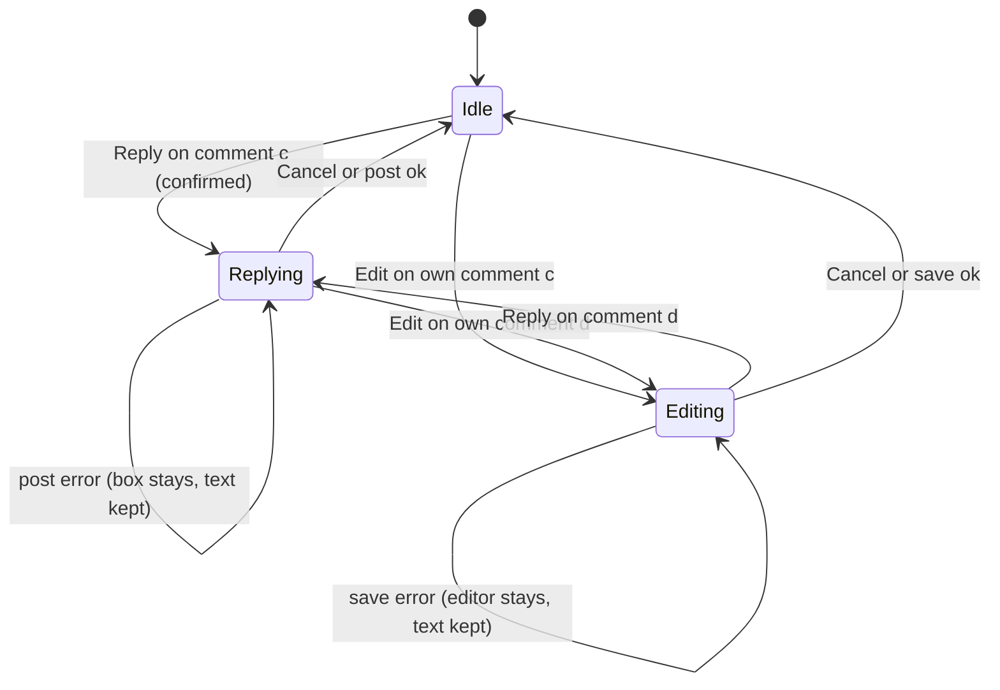

# Functional specification — U31 `t-402-discussion-ui`

**Drafted 2026-10-29** against `main` at `14c21a9` (T-010 merged; CR-012 merged as `7cce9bd`), the branch `bolt/t-011-patient-design-and-motion-system` (T-011 phase A, `1401e06`), and the drafts of every Unit this one depends on, except U30 T-401, which has no draft yet. This is a first draft, not a refresh. What it settles that the task file does not:
- **The thread-level advice warning is `experience.commentHint`, shown to every reader** (Q1). The task's `experience.dangerWarning` describes a single flagged comment. The prototype shows the hint only inside the composer, where signed-out readers never see it.
- **Comments take Like and Dislike** (FD-062, binding). The task's "like only" is superseded.
- **Flagged comments stay visible with the strong warning** (Q2, FR75, C10). A comment hidden pending review is shown to its author only, with one new note.
- **Counts only, with no list of who reacted** (Q3). An FD entry narrows FR77 and AC8.2.3's list half (§ 12).
- **Save gets a command.** No Unit had one (Q4). This Unit builds `bookmark.set` and `bookmark.stateOf` on the existing `bookmarks` table, and T-409 keeps only the `/saved` list.
- **Public ids only cross the browser** (Q5). T-401's inputs and `ThreadVM` change accordingly (§ 11).
- **T-010's constraints are kept.** Components import server actions only. The route loads the discussion (Q6). The stub repository test changes with the bookmark methods (ISS-294). `apps/web` stays at 80% lines.
- **T-011's motion hooks only.** A one-child `Reveal` for a new comment and for an opened reply box or editor. `data-press` on comment actions. Static notices. No motion rule is written here (Q11, Q12).
- **Findings F1–F16** (§ 9). Two S1 risks are designed out: dangerous advice with no warning, and the alias prefill. Seven S2 problems are designed out. One S2 stays open for the storyboard (step 15, with ISS-261).

| Field | Value |
|---|---|
| Unit | U31 `t-402-discussion-ui` (kind `ui`, size M, not high risk); Bolt 31; depends on U30 T-401, U27 T-307, U9 T-102, U3 T-010, U45 T-011. U42 T-503 depends on it; U32 T-403 plugs into its report trigger |
| Source | T-402 (`docs/implementation/tasks/T-402-discussion-ui.md`, with the FD-091 amendment) |
| Stories | US8.1 (AC8.1.1–AC8.1.6), US8.2 (AC8.2.1–AC8.2.6) — `unit-of-work-story-map.md`; also AC2.4.3–AC2.4.5 (FD-091 motion rows of the task) |
| Requirements | FR22, FR72, FR73, FR74, FR75, FR77, FR78, FR95, NFR4, NFR6, NFR7, NFR13 — `requirements.md` |
| Decisions | FD-009, FD-015, FD-017 (warning, no classifier, five-account hide), FD-024 (equal languages), FD-046 (no emergency banner), FD-062 (Like and Dislike on comments), FD-075 (discussion email from `comment.post`, not this Unit), FD-086 (no reporter data), FD-091 (patient redesign and motion), FD-093 (import boundaries), FD-094 (swarm: this Unit's paths must not collide with a parallel Unit's); the new FD entry of § 12 |
| Upstream design | `contract-summary.md` C10 (Community), C9 (Review), C5 (Account); T-401's task file (no draft); drafts `t-307-experience-page-and-index` (slot and actions row), `t-102-patient-auth-screens` (`guard`, `Viewer`), `t-202-doctor-index-and-profile` (`Byline`, `Badge`), `t-104-identity-module` (`BylineVM`), `t-011-patient-design-and-motion-system` (tokens, motion), `t-101-better-auth-adapter` (`getActor`, container, actions) |
| Questions | Q1–Q20 in `functional-design-questions.md`, all answered A, decided by the agent under the owner's no-questions instruction of 2026-10-29. Each is listed in `docs/aidlc-migration/OWNER-REVIEW-QUEUE.md` when this draft is finalised. § 13 lists what changes under the other options |
| Status | Draft written ahead of the stage on 2026-10-29. None of the upstream Units is built, so their drafts and T-401's task file are the interface this design builds on |

This file is the source of truth for the Unit's workflows and state transitions. `entities.md` holds the data shapes, `rules.md` the numbered rules, and `frontend-components.md` the component props, files, styles and tests.

## 1. What changes, in one paragraph

T-307's experience page has a discussion slot and a row of Like, Dislike, Report and Save buttons that do nothing yet. This Unit fills them. On the patient side's "Warm Paper, Soft Depth" look, it ports the prototype's thread:
- comments with one reply level, `@mentions`, the "Claimed this profile" and "Your comment" badges, and "(edited)" with its date;
- the external-link warning, the strong warning on a comment flagged as dangerous advice, and the tombstone that keeps a deleted comment's replies;
- the reply box, the inline editor and delete;
- Like and Dislike on the review and on every comment, and Save for the review.

Each write goes through a server action that calls T-401's commands (or this Unit's bookmark command). The route is then revalidated, so the thread always shows what the server stored. A persistent medical-advice warning sits at the top of every discussion for every reader. Signed-out and unconfirmed visitors meet T-102's gate on every contribution control, and the server refuses them anyway. Motion comes only from T-011: one-item reveals and press feedback, with warnings never animated. Four keys are added. One FD entry narrows FR77 to counts. No hard rule, data boundary or founder decision is otherwise changed.

## 2. As is (`main` at `14c21a9`) and what Bolt 31 can count on

| Element | Today | By Bolt 31 |
|---|---|---|
| Route | `experiences/[id]/page.tsx` renders a placeholder | U27 T-307: `experiences/[publicId]` with `ExperiencePage`, `Tombstone`, `DiscussionSlot` (h2 + provider note + `children`, public id only) and `ActionsRow` (gated, `aria-disabled` for a confirmed viewer, `TODO(T-402)`) |
| Thread data | `contracts/src/view-models/thread.ts` stub (`likeCount`, `authorLabel`, `dangerous`, `TODO(T-402)`); `schemas/community.ts` with `reviewId`/`commentId` and `COMMENT_BODY_MAX = 4000`; `PgCommunityRepository` stubs | U30 T-401: `community.thread`, `community.reactionsOf`, `comment.post/edit/delete`, `reaction.set`, `ModerationSignals` with a nothing-flagged default; the shapes of `entities.md` ENT-001–ENT-004 once § 11 is applied |
| Bookmarks | table `bookmarks` (pk account, review); `PgAccountRepository.addBookmark/removeBookmark/listBookmarks` stubs naming T-409; no command, no schema | unchanged unless this Unit builds them (Q4) |
| Gate | none | U9 T-102: `AuthGateProvider` in the patient layout, `useAuthGate().guard`, `Viewer {kind, verified}` from `loadViewer()` |
| Byline | none | U15 T-202: `Byline` (`variant: 'comment'`), `Badge`; U11 T-104: `BylineVM` (thread surface, alias, `formerMember`, `profileUsername`) |
| Container and actor | none | U8 T-101: `server/container.ts`, `getActor()`, the action pattern (parse → getActor → command → Result) |
| Look and motion | T-011 phase A on its branch: `motion.css` (press list including `.react`, `.btn`, `[data-press]`; `[data-static]`; `Reveal` children 1–6); `.comment*`, `.composer-box`, `.link-btn`, `.callout.*` restyled in `patient.css`; tokens `--space-1…8`, `--target`, `--fs-small` | U45 T-011 merged: the same, plus `check:motion` and `contrast:patient` in `pnpm check` |
| Keys | every key the prototype's thread uses; `errors.community.*` and `errors.common.rateLimited` already present (781 keys) | + T-302's, T-307's and this Unit's four |
| Live region | CR-004: `useAnnounce()`, one `LiveRegion` | unchanged |
| Seed | CR-012: comments k1–k30 from the prototype (k3 and one later comment `dangerous`, k4 and one later comment with a link, k2 and others `providerFor`, k8 with reply k9, k10 without replies, k5 and k16 by anonymous authors) | unchanged; T-401 maps `dangerous` to an open case only once T-403 builds cases, so until then no seeded comment is flagged (F13) |
| Gate and coverage | `pnpm check` nine steps; 80% lines per package; CI on `bolt/**` | eleven steps (T-011 adds `contrast:patient`, `check:motion`) |

## 3. Settled before this stage

See `functional-design-questions.md` § "Settled before this stage":
- the FD-091 look and T-011's hooks;
- FD-062's two reactions on comments;
- T-102's gate;
- T-202's byline on T-104's view model;
- T-403's report sheet;
- T-010's boundaries, coverage and CI;
- no anonymity caveat;
- counts only.

The decisions taken without a question are listed in the same file.

## 4. Workflows

### WF1 — Render the discussion (live page)

1. The page (`experiences/[publicId]/page.tsx`, T-307) parses the id and loads the experience. T-402's hunk then calls `loadDiscussion(publicId, actor)` (BR1.1). It does three reads in parallel:
   - `community.thread {reviewPublicId}`;
   - `community.reactionsOf {targetKind: 'review', targetPublicId}`;
   - for an account only, `bookmark.stateOf {reviewPublicId}`.
   The result is a `DiscussionVM`. A failed read is thrown to the error boundary, because the page cannot be shown half-right.
2. `ExperiencePage` passes `discussion.reviewReactions` and `discussion.saved` to `ActionsRow`. The row now mounts `ReactionPair(review)`, T-307's Report (until T-403) and `BookmarkButton`, followed by `review.reactionNote` and `experience.bookmarkNote` (BR5.3, BR5.5).
3. `DiscussionSlot` renders `h2` "Discussion" with `span.count` = `formatNumber(thread.visibleCount)` (BR2.9), then `experience.providerNote`. It takes `Discussion` as children.
4. `Discussion`:
   1. advice warning (BR3.1);
   2. `div.thread` of `Comment`s, or `p.note` "Nothing here yet" (`mine.empty`) when the count is 0;
   3. `p.note` `experience.replyLevel`;
   4. the composer area by viewer (WF8).
5. Each `Comment` renders per BR2.1–BR2.8. Seeded r1 shows k1, k2 ("Claimed this profile"), k3, k8 with reply k9, and k10. Signed in as `shirin_88`, k8 and k10 carry "Your comment", Edit and Delete.
6. The posted time is relative under seven days, otherwise a date (BR2.3). Numerals follow the language.

### WF2 — Post a top-level comment

1. A confirmed viewer types into `textarea#new-comment` and presses Post. An empty or whitespace-only body is stopped in the browser and focus stays (BR4.1).
2. `postComment(prev, form)` parses `{reviewPublicId, body}`, gets the actor and calls `comment.post`. T-401 does everything else in one transaction: the rate limit (30 per hour), the block check, mention resolution, the external-link flag, audit and outbox, and the discussion email through T-405 (FD-075).
3. On ok, the action returns `{status: 'done', publicId, nonce}`, and the route revalidates. The client resets the form (new `nonce`), announces "Comment posted.", sets `justPosted`, and refreshes if needed (BR1.3, BR4.2).
4. The re-rendered thread holds the new comment last among the top-level items. When it has no link warning or danger flag, it is wrapped in a one-child `Reveal` and fades and rises once (BR7.1). Focus moves to it.
5. On error, `p.error[role=alert]` shows the message in the active language, and the text stays in the box (BR4.6). For example, `rate_limited` shows "Too many attempts. Try again in {minutes} minutes." with Bengali numerals under `/bn`.

### WF3 — Reply

1. Reply appears only on top-level, published comments of an open thread (BR2.1). A press runs `guard`. For a confirmed viewer, `DiscussionState.replyingTo = publicId`, and any open editor closes.
2. `ReplyBox` opens under the comment's actions with the one-child reveal (BR7.2). It shows "Replying to" and the author's name as the byline shows it. The textarea is prefilled with `@profileUsername ` for named and pseudonymous authors and is empty for anonymous and former members (BR4.3, Q7). Focus goes to the end of the text.
3. Post calls `postComment` with `parentPublicId`. T-401 refuses a reply to a reply (`community.reply_depth`), a reply to a blocker (`community.blocked`) and a mention of an anonymous persona (`community.mention_anonymous`). Each refusal is shown in place (BR4.6).
4. On ok, the box closes, the reply appears nested one level under its parent, and the live region announces "Comment posted.". Cancel closes the box and returns focus to Reply.

### WF4 — Edit

1. Edit appears only when `canEdit` is true (BR4.5). A press sets `DiscussionState.editing`, closes any reply box, and swaps the body for `CommentEditor`, prefilled, which opens with the reveal (BR4.4).
2. Save calls `editComment {commentPublicId, body}`. T-401 re-parses mentions and links and sets `edited_at`. On ok, the editor closes and the live region announces "Changes saved.". The comment shows the new text with "(edited)" and the edit date (BR2.2). The previous text stays in T-401's private history only (AC8.1.3).
3. Cancel restores the view without a round trip.

### WF5 — Delete

1. Delete appears only when `canEdit` is true. A press calls `deleteComment(commentPublicId)` at once (Q15).
2. T-401 tombstones a comment that has replies and hard-removes one that has none. The thread re-renders: k8 becomes "This comment was deleted by its author." with "The replies below it are kept…" and k9 under it, and k10 disappears (BR2.8). Nothing animates. The live region announces "Comment deleted.", and focus moves per `frontend-components.md` § 4.

### WF6 — React (review and comments)

1. A press runs `guard`. Signed out, the sign-in sheet opens and nothing changes (smoke 81–87).
2. For a confirmed viewer, the next value is computed (BR5.1). The optimistic counts and pressed state update at once, inside a transition. `setReaction {targetKind, targetPublicId, value}` calls `reaction.set` and then re-reads `community.reactionsOf`, so the returned counts are the server's.
3. The live region announces the label and count, for example "Dislike 3", or in Bengali digits under `/bn` (BR5.2). On error, the values revert and the message is announced. `rate_limited` (100 per hour) carries its minutes.
4. Counts never animate, never combine into a score, and never open a list (BR5.3, BR5.4).

### WF7 — Save

1. A press runs `guard`. For a confirmed viewer, `BookmarkButton` flips optimistically and calls `setBookmark {reviewPublicId, saved}`, which runs `bookmark.set` (§ 7). The label switches between "Save" and "Saved", and `aria-pressed` follows.
2. On error, the button reverts and the message is announced. A repeated press is harmless, because the operation is idempotent (BR10.1).

### WF8 — Composer area by viewer

| Viewer | Composer area |
|---|---|
| Anonymous | `button.btn.small` "Sign in to take part", which runs `guard` and opens T-102's sign-in sheet with `auth.gate.body` |
| Unconfirmed | the textarea renders disabled with `p.note` "Confirm your email to do this.". Post opens the confirm-email sheet |
| Confirmed | `CommentComposer` |
| Thread not open | nothing (BR4.7) |

The server refuses an anonymous, unconfirmed or restricted actor whatever the page did (BR6.2). A restricted account sees `errors.common.forbidden`.

### WF9 — Report

Every live comment, the viewer's own included, has Report with `data-report="comment:<publicId>"` (BR6.3). It runs `guard`. When T-403's provider is mounted, it opens T-403's sheet for `{kind: 'comment', publicId}`. Before that, a confirmed viewer sees it as unavailable (`aria-disabled="true"`, `TODO(T-403)`, with an S3 row like T-307's).

### WF10 — Tombstoned review

`Tombstone` (T-307) shows the removal notice, then `DiscussionSlot` with this Unit's `Discussion`, then the disclaimer. `loadDiscussion` skips `reactionsOf`, because a tombstone has no actions row. The thread is read-only (`open: false`): there is no composer and no Reply. The advice warning stays, as do authors' Edit and Delete, the comment reactions and Report (BR4.7, BR3.1).

## 5. State transitions

### 5.1 Thread UI state (`DiscussionState`, ENT-008)

Text fallback: the thread starts idle. Reply opens one reply box, and Edit opens one editor. Opening either closes the other. A successful post or save, or Cancel, returns to idle. An error keeps the box open with the text. A route change remounts the provider (T-011's keyed `RouteTransition`), so the state never survives a navigation.

### 5.2 How one comment is displayed (derived from `CommentVM`, decided by T-401)

| VM | Display |
|---|---|
| `tombstone: true` | notice and replies only (BR2.8) |
| `pendingReview: true` (author only) | `.comment.pending`, the pending note, Edit and Delete only (BR2.7) |
| `dangerFlag: true` | `.comment.flagged`, danger callout, all actions (BR2.6) |
| otherwise | normal comment |

The comment's own lifecycle is T-401's: `published → hidden_pending_review | hidden | deleted_tombstone`, author delete → tombstone or removed. This Unit renders whichever state the VM says and never computes one.

### 5.3 A reaction pair

`none → like → dislike → none`. Pressing the active value clears it, and pressing the other value switches. Exactly one current value is kept, and the server's counts replace the optimistic ones on completion (AC8.2.1, AC8.2.2).

## 6. Server actions and loader

| Function | Input (public ids) | Calls | Result | Revalidates |
|---|---|---|---|---|
| `postComment` (form) | `reviewPublicId`, `parentPublicId?`, `body` | `comment.post` | `CommentFormState` | yes |
| `editComment` (form) | `commentPublicId`, `body` | `comment.edit` | `CommentFormState` | yes |
| `deleteComment` | `commentPublicId` | `comment.delete` | `ActionOutcome<{}>` | yes |
| `setReaction` | `targetKind` (`review` \| `comment`), `targetPublicId`, `value` \| null | `reaction.set`, then `community.reactionsOf` | `ActionOutcome<ReactionCountsVM>` | yes |
| `setBookmark` | `reviewPublicId`, `saved` | `bookmark.set` | `ActionOutcome<{saved}>` | yes |
| `loadDiscussion` (route helper, not an action) | `publicId`, `actor` | `community.thread`, `community.reactionsOf`, `bookmark.stateOf` | `DiscussionVM` | — |

Each action follows BR1.4 and BR1.5. `revalidatePath('/[locale]/experiences/[publicId]', 'page')` covers both locales. `facility_review` reactions are T-203's and are not wired here.

## 7. The bookmark backend (Question 4)

| Layer | File | Content |
|---|---|---|
| contracts | `packages/contracts/src/schemas/bookmark.ts` (new; export from the index) | `BookmarkSetInput {reviewPublicId, saved}`, `BookmarkStateInput {reviewPublicId}`, both `.strict()` with `isPublicId` |
| application | `modules/account/commands/set-bookmark.ts`, `modules/account/queries/get-bookmark-state.ts`, entries in the module's authorization map, `modules/account/ports.ts` gains `ReviewLookup.publishedIdOf(publicId): Promise<string \| null>` (FD-067 cycle-break pattern) | BR10.1, BR10.2; tests with fakes |
| application (Review) | `modules/review/review-lookup.ts` | implements `ReviewLookup` through the review repository's public-id read (T-301) |
| ports | `ports/repositories/account.ts` | `addBookmark`, `removeBookmark`, `hasBookmark` |
| database | `repositories/account.ts` (bookmark methods only), `account.int.test.ts` (bookmark part), `not-implemented.ts` and `not-implemented.test.ts` (BR10.3) | SQL on `bookmarks`; add with `ON CONFLICT DO NOTHING` |
| test-support | `fakes/account-repository.ts` (bookmark methods) | used by the application tests only |
| web | `server/container.ts` (one hunk: register the two operations and the `ReviewLookup`) | T-101's file; hunk noted |

No migration, grant or table change. The worker has no privilege on `bookmarks` (02 §16 (f)) and needs none. 03 §4 "account" and `contract-summary.md` C5 gain the two operations. This is additive and needs no FD (contract-summary common rules). T-409 then builds only `listBookmarks` and `/saved`.

## 8. Motion, layout and accessibility

- **Motion** (FD-091; `frontend-components.md` § 6). Only T-011's hooks are used:
  - a one-child `Reveal` for a just-posted comment (BR7.1) and for an opened reply box or editor (BR7.2);
  - press feedback through T-011's list and `data-press` (BR7.3).
  The advice warning, link warnings and danger callouts are `data-static="notice"`. They never join a view-transition group and are never inside a reveal (BR7.4). With reduced motion nothing moves (BR7.5). Nothing nudges anyone toward posting or reacting: no confetti, streak or animated count (AC2.4.5).
- **360 px.** The action row wraps. Every action is a 44 px target. Long words and URLs wrap, and the composer buttons wrap (BR8.1). T-307 owns the page's single-column layout.
- **Semantics.** The thread is a series of `article`s under the slot's `h2`. Replies are nested inside their parent's article. Every control is a native button with visible text and `aria-pressed` where it toggles. Every textarea is labelled. Errors use `role="alert"` with `aria-describedby`. The live region carries confirmations (BR8.2, BR5.2).
- **Rich, modern feel within the rules** (owner priority). T-011's card surfaces and soft depth carry the thread. On the comment's own surface, the flagged and pending states read as distinct tones. The one-item entry and the opening reply box give a calm, responsive feel. The press squeeze makes every action feel tactile. Nothing loops or decorates the warnings.

## 9. Findings

| ID | Sev | Area | Finding | Resolution |
|---|---|---|---|---|
| F1 | S1 | hard rule / FR75 | The task shows the dangerous-advice callout only to the author or staff, and the data model ties `dangerous` to a hidden state, so readers would see dangerous advice with no warning | designed out: Q2 A, BR2.6; T-401 adds `dangerFlag` from `ModerationSignals` (§ 11) |
| F2 | S1 | privacy / mentions | Prefilling `@<alias>` (`patient-xxxx`) makes `parseMentions` read `@patient`, which can mention and notify an unrelated account | designed out: Q7 A, BR4.3 |
| F3 | S2 | copy | Step 1 names `experience.dangerWarning` as the thread-level warning; its text describes one flagged comment | designed out: Q1 A, BR3.1 |
| F4 | S2 | task vs FD | "Not in scope" keeps like-only comments; FD-062 is binding | designed out: both buttons (BR5.1) |
| F5 | S2 | missing contract | No Unit builds a bookmark command; T-302 has none, and the stubs name T-409 (Bolt 37) | designed out: Q4 A, § 7 |
| F6 | S2 | requirement vs contract | FR77 and AC8.2.3 describe public reaction lists; C10 says counts only | designed out: Q3 A with the FD entry of § 12 |
| F7 | S2 | privacy / ids | T-401's inputs and `ThreadVM` use internal ids, which would sit in the DOM | designed out: Q5 A; T-401 change (§ 11) |
| F8 | S2 | a11y / 360 px | `.link-btn` has no 44 px target, and six actions overflow at 360 px | designed out: Q17 A, BR8.1 |
| F9 | S2 | flow | A tombstoned review would offer a composer whose every post is refused | designed out: Q14 A, BR4.7 (`ThreadVM.open`) |
| F10 | S2 | motion | `Reveal` animates only children 1–6, so a new comment late in a thread would not move, and wrapping the thread animates everything on arrival | designed out: Q11 A, BR7.1 |
| F11 | S2 | storyboard | Step 15 deletes k8 and k10 as `rafi_c`, but they are `shirin_88`'s. ISS-261 (open, S2) adds that `rafi_c` has no content | **open** for the storyboard: new ISSUES row (S2, found in U31) for T-504 with ISS-261; the Unit is walked per Q16 A |
| F12 | S3 | contracts | `COMMENT_BODY_MAX` is 4000 in the stub and 2000 in T-401's task | T-401 sets 2000 (Q19 A) |
| F13 | S3 | seed | No seeded comment is flagged until T-403 implements `ModerationSignals` (the default flags nothing), so k3's red callout first shows at Bolt 34 | recorded; the component test covers the flagged state with builders; T-403's demo row re-checks k3 |
| F14 | S3 | i18n | T-401 step 8 would re-add `errors.community.*` and `errors.rateLimited`; they already exist (as `errors.common.rateLimited`) | T-401 adds no key (§ 11) |
| F15 | S3 | task-file drift | The prototype line numbers are stale (discussion at 970, `commentHtml` at 1086, handlers at 2975–3060). "Reuse T-307's `Byline`" means T-202's | recorded in the plan |
| F16 | S4 | process | The task's owned paths do not list the composer, state, report trigger, loader, view-model types or bookmark backend files | owned-path additions recorded (`frontend-components.md` § 2, § 7) |

At finalisation, each finding gets an `ISS-` row in `docs/implementation/ISSUES.md` with "Found in: U31". The rows for F1–F10 and F12–F16 are closed by this Unit's Bolt when built. F11's row stays open until T-504 corrects the storyboard.

## 10. Build order inside the Bolt

1. Baseline: `pnpm check` green on the Bolt branch; read the open `ISSUES.md` rows for U31.
2. Append the FD entry of § 12 to `docs/status/decision-log.md`, and amend 03 §4 (account: `bookmark.set`, `bookmark.stateOf`) and `contract-summary.md` C5.
3. Bookmark backend (§ 7) with its application and integration tests, and the stub test update.
4. `lib/discussion-vm.ts`, then the server actions and their tests.
5. Components, bottom up: `ReactionPair`, `BookmarkButton`, `ReportButton` with its context, `CommentEditor`, `ReplyBox`, `Comment`, `CommentComposer`, `DiscussionState`, `Discussion`. Then their tests in `en` and `bn`.
6. The route loader and T-307 hunks (page, `ExperiencePage`, `Tombstone`, `ActionsRow`, `DiscussionSlot` `count`), the `pages.test.tsx` harness mock, and the smoke file.
7. T-402's CSS section, the four keys in both dictionaries, `npx impeccable detect apps/web/src --no-advisory`, `pnpm contrast`, `pnpm check`, `pnpm smoke`.

Swarm (FD-094): this Unit touches `repositories/account.ts`, `modules/account/**`, T-307's experience files and `server/container.ts`. It must not run in the same batch as another Unit editing those files. T-409 is later anyway (Bolt 37).

## 11. Cross-Unit changes other drafts must pick up

| Unit | Change | Why |
|---|---|---|
| U30 T-401 | `ThreadVM {reviewPublicId, open, visibleCount, comments}`; `CommentVM` per ENT-002: `author: BylineVM` (T-104, thread surface; replaces `{displayName, username?, kind, avatarHue}`), `dangerFlag` from `ModerationSignals`, `pendingReview` (author only), `likes`, `dislikes`, `myReaction`; tombstone per ENT-003. Hidden-pending comments are in the thread only for their author. | Q2, Q5, Q14, F1, F7 |
| U30 T-401 | Inputs take public ids: `CommentPostInput {reviewPublicId, parentPublicId?, body}`, `CommentEditInput {commentPublicId, body}`, `CommentDeleteInput {commentPublicId}`, `ReactionSetInput.targetPublicId`; `community.reactionsOf {targetKind, targetPublicId}`; resolution inside the command | Q5 |
| U30 T-401 | `COMMENT_BODY_MAX = 2000`, exported; no new `errors.community.*` keys (they exist); correct 02 §8's note (comments take `like` and `dislike`, FD-062; `dangerous` = an open case with reason `dangerous`, C10) | Q19, F12, F14 |
| U27 T-307 | `DiscussionSlot` gains `count?: number` (rendered as `span.count` through `formatNumber`); `ExperiencePage` and `Tombstone` accept `discussion?: DiscussionVM` and render `Discussion` in the slot; `ActionsRow` accepts `reactions` and `saved` and mounts `ReactionPair` and `BookmarkButton` in place of its gated placeholders; the page calls `loadDiscussion`. T-307 may build these props itself (preferred), or T-402 adds them as recorded hunks | BR1.1, BR2.9 |
| U32 T-403 | Mount a `ReportSheetContext` provider (ENT-013) in the experience page, and open its sheet from `ReportButton` for comments and the review. Implement `ModerationSignals.dangerousFlags` as C10 says: an open case with reason `dangerous`, the comment staying visible (FR75). The demo row re-checks k3's warning | Q2, Q13, F13 |
| U38 T-409 | Build only `listBookmarks` and `/saved`; `addBookmark`, `removeBookmark`, `hasBookmark`, `bookmark.set` and `bookmark.stateOf` are U31's | Q4 |
| U43 T-504 | Correct storyboard step 15: deletes of k8 and k10 as `shirin_88`; post, reply, edit, delete, react and bookmark as another confirmed account (with ISS-261's ruling on `rafi_c`) | Q16, F11 |
| U42 T-503 | The E2E journey for step 15 follows the corrected step. Axe and the 360 px run cover the thread and the gate | NFR4, NFR6 |
| docs | 03 §4 (account: the bookmark operations; community: public ids), `contract-summary.md` C5 and C10 amendments, `02-data-model.md` §8 note | Q4, Q5 |

## 12. FD entry the build appends before code

Appended to the founder-decisions table of `docs/status/decision-log.md`, with the next free number at build time. This Unit's own text uses `FD-<next>`.

> | FD-<next> | **Reactions show counts only in release 1 (T-402 Functional Design Q3)**: reviews and comments show their Like and Dislike counts and the viewer's own pressed reaction; no list of who reacted is shown, queried or exported to a page. This narrows FR77 ("view public reaction lists") and the list half of AC8.2.3: with no list, nothing can link reactions made in an anonymous thread to the author's profile, so FD-015 holds by construction. AC8.2.4's "appears on the content" is met by the counts and the pressed state; its public-activity and dashboard half stays with T-409. `community.reactionsOf` stays counts only, as `contract-summary.md` C10 and `03-routes-and-contracts.md` §4 already say. A reactor list can be added later only as its own decision, with a privacy review of anonymous threads. | Decided by the agent under the owner's no-questions instruction of 2026-10-29 (U31 T-402 Functional Design); listed in `docs/aidlc-migration/OWNER-REVIEW-QUEUE.md` for the owner to confirm or change |

No other decision of this Unit changes a hard rule, a data boundary or a founder decision:
- Q2 applies FR75 and C10 as written;
- Q4 adds operations on an existing private table in the web tier;
- Q5 changes T-401's not-yet-built contract inside the same release.

## 13. What changes under the other options

| Question | Other option | Effect on this design |
|---|---|---|
| Q1 B or C | `dangerWarning` at thread level, or a new key | BR3.1 text changes; B states something false; C adds one key for FD-042 |
| Q2 B | callout only on hidden comments | BR2.6 becomes author-only; F1 stays an S1 against FR75 |
| Q3 B | reactor sheet | a new T-401 query, a sheet component, about four keys and anonymity tests; § 12's FD entry is dropped |
| Q4 B or C | depend on T-409, or a disabled Save | B moves Bolt 31 after Bolt 37; C keeps `TODO(T-409)` and fails step 15's "Bookmark" until then; § 7 is dropped |
| Q5 B | the actions resolve public ids | an extra lookup per write; T-401's inputs unchanged |
| Q6 B or C | read action or client fetch | B exposes read endpoints; C adds loading states and needs JavaScript |
| Q7 B | `@display name` | F2 stays (S1) |
| Q8 B or C | no date, or "Edited {date}" | B misses AC8.1.3; C breaks smoke's `(edited)` |
| Q9 B | month and year | fresh posts read as old |
| Q10 B | auto-linking | a URL parser, scheme allowlist and anchor tests |
| Q11 B or C | wrap the thread, or a new T-011 hook | B animates on arrival and misses late comments; C waits on T-011 |
| Q12 B or C | a new fade hook, or no motion | B waits on T-011; C is static |
| Q13 B | no Report until T-403 | AC8.1.2 fails between Bolts 31 and 34 |
| Q14 B | interactive tombstone thread | posts are refused in the UI |
| Q15 B | confirm step | two keys, one more press, behaviour differs from the prototype |
| Q16 B | reassign k8 and k10 | seed and prototype data change; step 26 changes |
| Q17 B | restyle `.link-btn` globally | a T-011 change through ISSUES |
| Q18 B | click handlers only | nothing works before hydration |
| Q19 B | 4000 characters | T-401's tests change |
| Q20 B | hide the composer for unconfirmed accounts | no explanation shown |

## 14. Acceptance mapping

| Acceptance | Where it is met | Check |
|---|---|---|
| AC8.1.1 text, warned link, one reply level | BR2.1, BR2.4, BR2.5, BR4.3 | component tests; smoke |
| AC8.1.2 persistent warning, no classifier, report reachable | BR3.1, BR6.3, FD-046 (no banner, no check) | component tests; T-403 wires the sheet |
| AC8.1.3 edited timestamp, current text only | BR2.2, BR4.4 | component test; T-401 keeps the history |
| AC8.1.4 tombstone or removal | BR2.8, BR4.5 | smoke (k8, k9, k10) |
| AC8.1.5 provider comments like anyone's, with the label | BR2.2 (`providerHere`), no extra placement | component test (k2) |
| AC8.1.6 no images, attachments, nested reply or messages | textarea only; no Reply on replies; refusals shown in the active language (BR4.6) | component and action tests |
| AC8.2.1 Like then Dislike | BR5.1 | component test; T-401's application test |
| AC8.2.2 idempotent | server counts replace optimistic ones (BR5.1) | T-401's integration test; action test |
| AC8.2.3 anonymous thread | no list (BR5.4, § 12); alias only (BR2.11) | component test |
| AC8.2.4 appears on the content | counts and pressed state (BR5.2) | component test; public activity is T-409's |
| AC8.2.5 never a score | BR5.3 | review; T-401's test |
| AC8.2.6 unconfirmed or rate-limited refused | BR6.1, BR6.2, BR4.6 | action tests |
| AC2.4.3, AC2.4.4, AC2.4.5 | BR7.1–BR7.5 | `pnpm check:motion`; the reduced-motion walk |
| Task "Server round-trip" | WF2–WF7 on the seed | manual walk per Q16 A |

## 15. Sources

- Task and record: `docs/implementation/tasks/T-402-discussion-ui.md`, `T-401-community-module.md`, `T-409-personal-workspace.md` (bookmarks); `aidlc/spaces/default/intents/261011-aidlc-adoption/inception/{units-generation/unit-of-work.md, unit-of-work-dependency.md, unit-of-work-story-map.md, user-stories/stories.md, requirements-analysis/requirements.md, contract-design/contract-summary.md, delivery-planning/bolt-plan.md}`.
- Docs: `docs/status/decision-log.md` (FD-009, FD-015, FD-017, FD-046, FD-062, FD-075, FD-086, FD-091–FD-094), `docs/implementation/01-conventions.md`, `02-data-model.md` §2, §8, §16, `03-routes-and-contracts.md` §1, §2, §4, `05-demo-storyboard.md`, `ISSUES.md` (ISS-083, ISS-261, ISS-294), `docs/aidlc-migration/OWNER-REVIEW-QUEUE.md`.
- Code on `main` at `14c21a9`: `packages/contracts/src/{view-models/thread.ts, schemas/community.ts, errors.ts, actor.ts}`, `packages/database/src/repositories/{account,community,not-implemented.test}.ts`, `packages/database/src/schema/account.ts`, `packages/i18n/src/format.ts`, `packages/i18n/messages/{en,bn}.json`, `apps/web/src/lib/announce.ts`, `apps/web/src/server/actions/preferences.ts`. On the T-011 branch: `apps/web/src/styles/{motion,patient}.css`, `apps/web/src/components/patient/motion/Reveal.tsx`.
- Prototype: `ui-design-prototype/concepts/concept-04b-quiet-clinic-minimal/app.js` (970–994, 1034–1044, 1078–1156, 2975–3060), `ui-design-prototype/shared/rogikotha-data.js` (comments k1–k30), `tools/smoke.mjs` (73–200).
- Drafts: `docs/aidlc-migration/design-drafts/{t-307-experience-page-and-index, t-102-patient-auth-screens, t-202-doctor-index-and-profile, t-104-identity-module, t-011-patient-design-and-motion-system, t-101-better-auth-adapter, t-302-review-changes-and-tombstones}/`.
