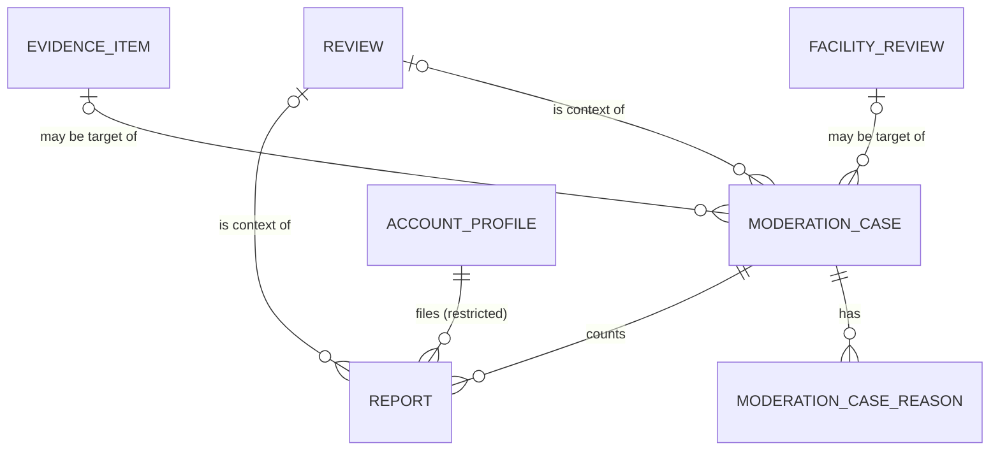

# Entities — U32 `t-403-reports-and-thresholds`

Source of truth for the data shape this Unit reads and writes. Built from T-403 (with its FD-069, FD-070/FD-075, FD-080, FD-086, FD-087 and C11 amendments), `02-data-model.md` §0, §6–§9, §11, §16 and §17, `components.md` (Moderation), `contract-summary.md` (C2, C4, C9, C10, C11, C15), the schema on `main` at `9cf860a` (`schema/moderation.ts`, `schema/review.ts`, `schema/evidence.ts`, `schema/community.ts`), the seed (`seed-moderation.ts`) and the answers in `functional-design-questions.md`. Workflows, port signatures and the screen are in `functional-spec.md`; decision logic is in `rules.md`.

The Unit adds no table. Its one forward-only migration, `<n>_moderation_case_origin_and_worker_grant.sql` (`<n>` the next free number at build time), adds:

1. the enum `moderation_case_origin` (`report`, `repeat_episode`) and `moderation_cases.origin` (FD-080);
2. `reports.case_id` (Question 1), backfilled from the seeded cases, then `NOT NULL`, with an index;
3. the partial unique index `moderation_cases_open_target_unique` on (`target_kind`, `target_id`, `origin`) where `status = 'open'` (BR2.2, Question 11);
4. the partial unique index `moderation_cases_repetition_unique` on (`target_id`) where `origin = 'repeat_episode'` (BR6.3);
5. `evidence_items.hidden_at` and `hidden_reason_code` (Question 3, ISS-164) and the same two columns on `facility_reviews` (Question 15), each pair both-or-neither;
6. the FD-080 worker grant: `SELECT, INSERT, UPDATE` on `moderation_cases`, `USAGE` on `moderation_case_seq`; nothing on `reports`, `moderation_case_reasons`, `moderation_decisions` or `appeals`.

The sequence stays `moderation_case_seq` starting at 2050, as on `main`: the seed's fixed codes end at MOD-2047, so the first live case is MOD-2050 (finding F11; the task's `moderation_case_code_seq` at 2100 is not created).

```yaml
entities:
  - name: Report
    owner: Moderation
    description: "One account's report of one target (table reports). Written only by report.file; never updated by this Unit (U33's de-identify clears reporter_account_id, FD-069/FD-078)."
    attributes:
      - { name: id, type: uuid, required: true, unique: true, constraints: "the report reference T-404's reveal uses (Question 12); never in a public view model" }
      - { name: case_id, type: uuid, required: true, references: ModerationCase.id, constraints: "new (Question 1); the case this report was counted in" }
      - { name: target_kind, type: enum, required: true, allowed_values: [review, facility_review, comment, evidence, profile] }
      - { name: target_id, type: uuid, required: true, constraints: "internal id of the target; profile = a doctor (BR1.5)" }
      - { name: review_id, type: uuid, required: false, references: Review.id, constraints: "context review: the review itself, the comment's or evidence item's review; absent for facility_review and profile" }
      - { name: reporter_account_id, type: uuid, required: true, references: AccountProfile.id, constraints: "RESTRICTED. Never in a SELECT list or RETURNING clause outside RevealTarget(report) and U33's de-identify; never in any payload, view model, audit detail, log line, notice param or error (BR4.1-BR4.6). NOT NULL until U33's FD-078 migration makes it nullable" }
      - { name: reason, type: enum, required: true, allowed_values: [privacy, threat, harassment, hate, spam, impersonation, dangerous, unsafeFile, ownership, duplicate, offtopic, factual, other], constraints: "must be in the enabled config.reportReasons at filing time (BR1.3)" }
      - { name: detail, type: text, required: false, max: 2000, constraints: "the reporter's free text; staff-only; never audited, logged or put in an outbox payload" }
      - { name: evidence_note, type: text, required: false, max: 2000, constraints: "the private text the sheet's 'Attach something privately' field holds (Question 8); staff-only" }
      - { name: created_at, type: timestamp, required: true }
    constraints:
      - "unique (target_kind, target_id, reporter_account_id): one report per account per target, ever (reports_target_reporter_unique, BR1.6)"
      - "index (case_id)"
    relationships:
      - { to: ModerationCase, cardinality: "many-to-one", direction: "Report is counted in one ModerationCase" }
      - { to: AccountProfile, cardinality: "many-to-one", direction: "Report is filed by one AccountProfile (restricted)" }

  - name: ModerationCase
    owner: Moderation
    description: "A case on one target (table moderation_cases). Created and updated by report.file; created by the worker job moderation.openRepetitionCase; decided by U33."
    attributes:
      - { name: id, type: uuid, required: true, unique: true }
      - { name: code, type: text, required: true, unique: true, constraints: "'MOD-' || nextval('moderation_case_seq'), assigned by the column default; format ^MOD-\\d+$" }
      - { name: origin, type: enum, required: true, default: report, allowed_values: [report, repeat_episode], constraints: "new (FD-080)" }
      - { name: lane, type: enum, required: true, allowed_values: [critical, standard, appeals], constraints: "report.file writes critical or standard; never downgrades critical (BR2.6)" }
      - { name: status, type: enum, required: true, allowed_values: [open, decided, appealed, closed], constraints: "report.file creates open and counts only into open cases; U33 moves it on" }
      - { name: target_kind, type: enum, required: true }
      - { name: target_id, type: uuid, required: true }
      - { name: review_id, type: uuid, required: false, references: Review.id }
      - { name: report_count, type: integer, required: true, default: 0, min: 0, constraints: "+1 per counted report; 0 on a repetition case" }
      - { name: distinct_reporters, type: integer, required: true, default: 0, min: 0, constraints: "+1 per counted report (one report per account per target, so every counted report is a new account); never recounted, so de-identification does not lower it (FD-069)" }
      - { name: auto_hidden, type: boolean, required: true, default: false, constraints: "true once report.file has hidden the target in this case; never reset by this Unit (BR3.4)" }
      - { name: coordinated_signal, type: boolean, required: true, default: false, constraints: "monotonic: once true stays true (BR2.8)" }
      - { name: summary_en, type: text, required: false, constraints: "seed only; report.file and the job leave it null" }
      - { name: summary_bn, type: text, required: false }
      - { name: opened_at, type: timestamp, required: true }
      - { name: sla_due_at, type: timestamp, required: true, constraints: "set at creation and on a lane upgrade (BR2.7); the column is nullable in the schema, this Unit always fills it" }
      - { name: assigned_to, type: uuid, required: false, references: AccountProfile.id, constraints: "staff; U33" }
      - { name: closed_at, type: timestamp, required: false }
    constraints:
      - "partial unique (target_kind, target_id, origin) WHERE status = 'open' (BR2.2)"
      - "partial unique (target_id) WHERE origin = 'repeat_episode' (BR6.3)"
    relationships:
      - { to: Report, cardinality: "one-to-many", direction: "ModerationCase counts Report" }
      - { to: ModerationCaseReason, cardinality: "one-to-many", direction: "ModerationCase has ModerationCaseReason" }

  - name: ModerationCaseReason
    owner: Moderation
    description: "Reason chips of a case (table moderation_case_reasons)."
    attributes:
      - { name: case_id, type: uuid, required: true, references: ModerationCase.id }
      - { name: reason, type: enum, required: true }
      - { name: count, type: integer, required: true, min: 1, constraints: "+1 per counted report with this reason; sum over a case = report_count" }
    constraints:
      - "primary key (case_id, reason)"
      - "eligible reporters of a case = sum(count) where reason <> factual (BR2.5)"

  - name: ReportTarget
    kind: value object (internal, per target kind)
    owner: "the target's module (Review, Community, Evidence, Directory)"
    description: "What report.file needs to know about a target, read through the owning module's moderation-target loader (BR1.4)."
    attributes:
      - { name: kind, type: enum, required: true, allowed_values: [review, facility_review, comment, evidence, profile] }
      - { name: id, type: uuid, required: true }
      - { name: reviewId, type: uuid, required: false }
      - { name: visibility, type: enum, required: true, allowed_values: [visible, hiddenPendingReview, other], constraints: "visible = published and not deleted (and, for evidence, hidden_at null); hiddenPendingReview = the temporary hide; other = draft, pending, hidden, deleted, tombstone, rejected, merged, failed, removed" }
      - { name: authorPersonaId, type: uuid, required: false, constraints: "absent for profile; evidence and comment authors per BR5.3" }

  - name: EvidenceItem (moderation columns)
    owner: Evidence
    description: "Two new columns on evidence_items (Question 3, FD entry (b)). Written only by Evidence's internal hide, called by report.file here and U33's decide and restore."
    attributes:
      - { name: hidden_at, type: timestamp, required: false }
      - { name: hidden_reason_code, type: text, required: false, constraints: "auto_threshold | auto_critical here; U33 codes later" }
    constraints:
      - "both or neither (check)"
      - "a public evidence read requires state = published AND hidden_at IS NULL (BR3.7)"
      - "the worker pipeline and retention never write either column (BR3.7)"

  - name: FacilityReview (moderation columns)
    owner: Review
    description: "hidden_at and hidden_reason_code on facility_reviews, as reviews already have (Question 15)."
    attributes:
      - { name: hidden_at, type: timestamp, required: false }
      - { name: hidden_reason_code, type: text, required: false }
    constraints:
      - "both or neither; written only by facilityReview.setState (BR3.6)"

  - name: FileReportInput
    kind: input schema (packages/contracts/src/schemas/moderation.ts)
    attributes:
      - { name: targetKind, type: enum, required: true, allowed_values: [review, facility_review, comment, evidence, profile] }
      - { name: targetId, type: string, required: true, constraints: "a public id (PublicId schema, narrowed from string.min(1)); the internal uuid is never accepted" }
      - { name: reason, type: enum, required: true, constraints: "REPORT_REASONS; enabled-ness checked in the command" }
      - { name: detail, type: string, required: true, max: 2000, constraints: "may be empty" }
      - { name: evidenceNote, type: string, required: false, max: 2000 }
    constraints:
      - ".strict(); unknown keys refused"

  - name: ReportSheetInput
    kind: input schema (new, same file)
    attributes:
      - { name: targetKind, type: enum, required: true }
      - { name: targetId, type: string, required: true, constraints: "PublicId" }

  - name: ReportSheetVM
    kind: view model (packages/contracts/src/view-models/report.ts, new)
    description: "Result of the report.status query (task step 5), which also carries the reasons so the sheet needs one call."
    attributes:
      - { name: alreadyReported, type: boolean, required: true, constraints: "about the actor only; false for an unknown or unreportable target (no oracle, BR1.8)" }
      - { name: reasons, type: "ReportReason[]", required: true, constraints: "enabled reasons in sheet order (BR8.2)" }
    constraints:
      - "no account id, persona id, count or case code"

  - name: ReportFiledPayload
    kind: outbox payload (report.filed, C15)
    attributes:
      - { name: caseCode, type: text, required: true }
      - { name: caseOpened, type: boolean, required: true }
      - { name: hidden, type: boolean, required: true }
      - { name: affectedAccountId, type: uuid, required: false, constraints: "only when there is an author outcome (caseOpened or hidden), the target is not a profile, the author account resolves and is not the reporter (BR5.2)" }
    constraints:
      - "exactly these keys; no reporter field (FD-086)"

  - name: ReportAuditDetails
    kind: audit details (stream case:<code>)
    attributes:
      - { name: reason, type: enum, required: true }
      - { name: distinctReporters, type: integer, required: true }
      - { name: caseOpened, type: boolean, required: true }
      - { name: hidden, type: boolean, required: true }
      - { name: coordinated, type: boolean, required: true }
    constraints:
      - "actor is the literal reporter:restricted; target_kind/target_id are the case target; no free text, no reporter id (BR4.3)"

  - name: ModerationEmailRequest
    kind: call to notification.queueEmail (C2)
    attributes:
      - { name: accountId, type: uuid, required: true, constraints: "affectedAccountId" }
      - { name: category, type: enum, required: true, allowed_values: [moderation] }
      - { name: messageKey, type: text, required: true, allowed_values: [notif.moderation.reported, notif.moderation.hiddenPending] }
      - { name: params, type: object, required: true, constraints: "{caseCode} only" }
      - { name: dedupeKey, type: text, required: true, constraints: "report:<caseCode>:opened | report:<caseCode>:hidden (BR5.4)" }

  - name: CoordinationSample
    kind: value object (repository result)
    attributes:
      - { name: reportCreatedAt, type: timestamp, required: true }
      - { name: reporterCreatedAt, type: timestamp, required: false, constraints: "account_profiles.created_at through a join; null once de-identified; the account id never leaves SQL" }

  - name: ReportRef
    kind: value object (internal reportRefsOf result, for U33)
    attributes:
      - { name: reportId, type: uuid, required: true }
      - { name: reason, type: enum, required: true }
      - { name: createdAt, type: timestamp, required: true }
    constraints:
      - "staff-side only; never the reporter"

  - name: RepetitionJobPayload
    kind: job payload (moderation.openRepetitionCase)
    attributes:
      - { name: eventId, type: uuid, required: true }
      - { name: name, type: text, required: true, allowed_values: [review.published] }
      - { name: payload, type: object, required: true, constraints: "{reviewId, doctorId, branchId?, repeatEpisode}" }
    constraints:
      - "singletonKey repetition:<reviewId>"
```

## Enum and constant changes

| Name | Where | Change |
|---|---|---|
| `moderation_case_origin` | `schema/enums.ts`, `contracts/enums.ts` (`MODERATION_CASE_ORIGINS`) | new: `report`, `repeat_episode` |
| `REPORT_SHEET_ORDER` | `contracts/enums.ts` | new: `privacy, threat, unsafeFile, dangerous, factual, spam, impersonation, harassment, hate, ownership, duplicate, offtopic, other` (BR8.2) |
| `CRITICAL_REPORT_REASONS` | `contracts/enums.ts` | unchanged; `domain/moderation/report-policy.ts` keeps its own copy (domain imports nothing) and a test pins both equal |
| `ALWAYS_ENABLED_REPORT_REASONS` | `contracts/enums.ts` | read, built by U12 T-105 |
| hide reason codes | `domain/moderation/report-policy.ts` | `auto_threshold`, `auto_critical` |

## Reporter-column readers (BR4.1)

| Where | Use of `reports.reporter_account_id` | Returns it? |
|---|---|---|
| `insertReport` | INSERT value from `actor.accountId`; `RETURNING id` only | no |
| `alreadyReported` (report.file, report.status) | `WHERE reporter_account_id = $actor` | no (boolean) |
| `reportsForCoordination` | `JOIN account_profiles ON id = reporter_account_id`, selects two timestamps | no |
| unique index `reports_target_reporter_unique` | key column | no |
| `RevealTarget(report).resolve` (this Unit) | `SELECT` for one report id, called only by `identity.reveal` | yes, to Identity only |
| U33 de-identify (FD-069) | `UPDATE … SET NULL WHERE reporter_account_id = $id` | no |

## Entity-relationship view



Text fallback: a case counts many reports and has reason chips; each report is filed by one account (restricted) and counted in one case; a review is the context of reports and cases; any of the five target kinds (review, facility review, comment, evidence item, doctor profile) may be a case's target, referenced by kind and id, not by a foreign key.
