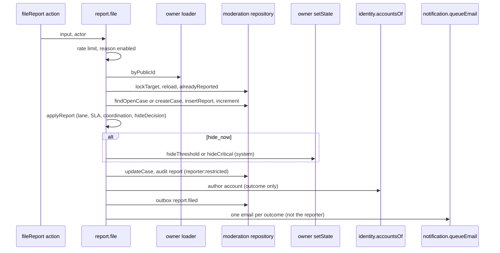
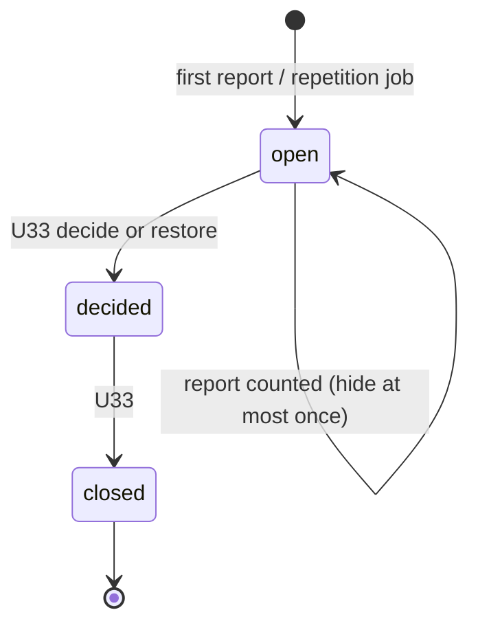

# Functional specification — U32 `t-403-reports-and-thresholds`

Unit U32 (kind `library` with a small UI slice, size L) delivers T-403 for US9.1. It is **high risk** (moderation): `unit-of-work.md` and `bolt-plan.md` do not mark it, but US9.1's INVEST note does and `team.md` lists moderation as a high-risk class, so collaborators are on, a separate agent writes 3–5 adversarial tests (§ 12) and the owner signs off in writing (finding F8). Lead perspective: architect. Support perspectives: developer (locks, increments, the migration, tests: §§ 8, 11) and security engineer (authorization, audit, reporter-leak channels: § 10), synthesised in § 14. Draft written ahead of the stage on the owner's instruction to overlap work; the lead finalises it and the reviewer checks it when the workflow reaches this Unit (Bolt 34). Then it moves to `<record>/construction/t-403-reports-and-thresholds/functional-design/`.

**Written 2026-10-29** against U3 T-010 as merged on `main` (`14c21a9`, branch head `9cf860a`) and the drafts of the Units it depends on or touches: U8 T-101, U11 T-104, U12 T-105, U14 T-201, U21 T-301, U22 T-302, U24 T-304 and U27 T-307. U30 T-401 and U34 T-405, both declared dependencies, have no draft yet; this design uses their task files and C10, C2 and C15, and § 18 lists what they must provide. What this draft settles:
1. **Counting is per case and excludes factual reports.** Reports gain `case_id`; a case hides at most once; the threshold counts the case's non-factual reports (Questions 1, 2). This closes a re-hide loop after a moderator restore and a path where disagreement pushed content over the threshold (findings F3, F4).
2. **Every target kind can be hidden by its owner.** Evidence gets a temporary hide (`evidence_items.hidden_at`, closes ISS-164, Question 3); facility feedback gets `facilityReview.setState` (Question 15); doctor profiles never auto-hide (Question 4).
3. **Reporter privacy is closed on every channel**: column readers allowlisted, audit actor `reporter:restricted`, no account id in logs, no self-report id in `report.filed`, no reporter notice, and the sheet's sent message no longer promises an update (findings F2, F9, F10).
4. **T-010 applied**: placement under the boundary matrix (application imports nothing external; the database repository decides nothing; the worker job through `@rogikotha/application/worker`); the pins of § 13 move in the same commit; 80% lines with untested files counted; CI before merge.
5. **Owner answers applied**: counts only (no percentage, no count shown to authors or the public); release 1 settings narrowed (no new setting: the coordination windows and the rate limit are code constants; the threshold and SLA come from the existing `thresholds` block); the limited-data threshold range 2–50 is not touched here.
6. **Decided under the owner's no-questions instruction of 2026-10-29:** Questions 1–18, all A. § 19 lists the three FD entries the build appends before code.

Inputs: listed under Sources. This file is the source of truth for the workflows and state transitions. The data shape is in `entities.md`; the decision logic is in `rules.md`.

## 1. What changes, in one paragraph

A confirmed account can report an experience, a comment or a published document from a sheet ported from the prototype, choosing one of the enabled reasons, and is told only that the report was sent. `report.file` counts each account once per target, opens or updates the one open case on that target, sets its lane (critical for privacy, threat, unsafe file or dangerous advice), SLA (24 hours or three Bangladesh business days, from the configuration) and coordination signal, and hides the target temporarily, exactly once per case, on the first critical report or when the case's non-factual reports reach the configured threshold (five by default). Factual disagreement never hides and never counts toward a hide; doctor profiles never hide on reports. The hide always runs through the owner's state command, silently and as `system`; `report.file` itself appends `report.filed` and queues the affected author's one moderation email per outcome ("Content reported" when the case opens, "Hidden pending review" when it hides), and nothing ever goes to the reporter. The reporter's account id never leaves the moderation repository except through Identity's audited reveal. The worker job `moderation.openRepetitionCase` opens a standard-lane case, with no hide and no author notice, when a review is published as a possible repetition (FD-080). Moderation also implements Community's `ModerationSignals`, Identity's `RevealTarget` for reports, and gives U33 the report references of a case. One migration adds the case origin, `reports.case_id`, two partial unique indexes, the temporary-hide columns on evidence and facility feedback, and the FD-080 worker grant.

## 2. As is (baseline `main` at `9cf860a`, read 2026-10-29) and what Bolt 34 can count on

- **Schema** (`schema/moderation.ts`): `reports` (`target_kind`, `target_id`, `review_id`, `reporter_account_id` NOT NULL, `reason`, `detail`, `evidence_note`, unique `reports_target_reporter_unique`), no `case_id`. `moderation_cases` (`code` defaulting to `'MOD-' || nextval('moderation_case_seq')`, `lane`, `status`, counts, `auto_hidden`, `coordinated_signal`, `summary_*`, `sla_due_at` nullable), no `origin` and **no uniqueness on open cases** (finding F12). `moderation_case_seq` starts at 2050; the seed's fixed codes run MOD-2011..MOD-2047 (finding F11). `evidence_items` has no hidden state (ISS-164); `facility_reviews` has no `hidden_at` (finding F13). Migrations `0000`–`0008` on `main`; earlier Units add theirs, so this Unit takes the next free number.
- **Grants**: `rk_worker` holds nothing on `reports` (FD-092) or any moderation table; `constraints.int.test.ts` asserts the denial on `moderation_cases` and `validator-probes` P15 the denial on `reports` (finding F14). It holds INSERT on `audit_events`, DML on `staff_notifications`, SELECT on `reviews` and `config_versions` (02 §16).
- **Contracts**: `FileReportInput {targetKind, targetId: string.min(1), reason, detail: max 2000, evidenceNote?}`; `CaseTrayVM.reporter: 'restricted'`; `ERROR_CODES` has `moderation.duplicate_report` and `rate_limited`; `CRITICAL_REPORT_REASONS`; `ConfigValues.thresholds` and `reportReasons` (all 13 reasons by default). No `view-models/report.ts`.
- **i18n**: `report.*` exists for all 13 reasons and every sheet string; `report.threat` reads "Threat or harassment" and `report.spam` "Spam or duplicate" beside separate `harassment` and `duplicate` options (finding F7); `report.sent` promises "You will be told the outcome" (finding F2); `errors.moderation.duplicateReport` exists.
- **Repository stub** `PgModerationRepository`: `fileReport`, `queue`, `getCase` labelled T-403 and the rest T-404; C11 gives `queue` and `case` to U33 (finding F17).
- **Seed**: ten cases (open, or appealed for the appeals lane) on ten different targets, reports from `reporter_1..6`; `k3` is `hidden_pending_review` under MOD-2041 with reports from `reporter_1` and `reporter_2`, so storyboard step 16 ("report k3 as spam … after the fifth distinct account it flips") cannot happen (finding F1).
- **By Bolt 34** (from the drafts and the bolt plan): U8 `defineCommand` (`requires` order, `sendsMail`, `onRefused`), the shared ports (`Clock`, `RateLimiter.hit`, `ConfigProvider.current(): Promise`, `AuditWriter` with allowlist builders, `Outbox`, `Logger`, `UnitOfWork`) and the `@rogikotha/application/worker` subpath; U9 `useAuthGate`; U11 `identity.accountsOf`, the `RevealTarget` registry with `report` in `reveal_target_kind`; U12 `ALWAYS_ENABLED_REPORT_REASONS` and the async configuration; U21/U22 `setStateOn(tx, {reviewId, event, reasonCode?}, actor)` with every cell including `hideThreshold` and `hideCritical`, audited as `system`; U30 `comment.setState` and the `ModerationSignals` port with a flag-nothing default; U34 `notification.queueEmail`, `report.filed` routing (staff `newReport`; author `notif.moderation.reported` / `notif.moderation.hiddenPending`); U27 the experience page with a disabled `TODO(T-403)` Report control; U28 the evidence viewer; U31 the `Comment` component with `onReport`.
- **Gate (T-010, FD-093)**: nine-step `pnpm check` (eleven after U45), 80% lines per package with untested files counted, `format:check`, `check:identity`, CI before merge, the boundary matrix of `01-conventions.md` §2.

## 3. Settled before this stage

FD-009 and FD-017 (no classifier; five distinct confirmed accounts; logged restore), FD-018 (thresholds are runtime settings), FD-069/FD-078 (de-identification keeps rows and counts; U33 makes the column nullable), FD-080 (repetition case in the worker, `origin`, the grant), FD-086 (no reporter notice, no reporter id anywhere), FD-087 (the deciding command queues the one email and notice; `setState` is silent), FD-088 (no appeal route in notices), FD-092 (the worker holds nothing on `reports`), FD-093 (boundaries), C11 (operations, payloads, the job), T-302's `setStateOn` (owns every review cell), U12's always-enabled reasons, the owner's answers (counts only; release 1 settings narrowed). See `functional-design-questions.md` § "Settled before this stage".

## 4. Workflows

Every command follows `parse → authorize → load → decide → persist` in one transaction with its audit and outbox rows (C11 common rules). Configuration is read once per call with `await config.current()`. Expected failures return `Result`; nothing throws across a boundary.

### WF1 — Code Generation order (the Unit end to end)

1. **Baseline.** `pnpm infra:up`; `pnpm check` and `pnpm smoke` green on the Bolt branch; read the open ISS rows in moderation, evidence, review, community and test-support (ISS-164, ISS-174, ISS-259, ISS-261, ISS-294 and § 9's new rows). Confirm the prerequisites of § 2 exist; where a shape differs, adapt the frame and keep the rules (§ 17).
2. **FD entries.** Append § 19 (a)–(c) to `docs/status/decision-log.md` before any code (`project.md` Mandated).
3. **Domain** `packages/domain/src/moderation/`: `report-policy.ts` (`isCriticalReason`, `eligibleReporters`, `laneFor`, `mergeLane`, `hideDecision`, `slaDueAt`, `addBusinessDays`, `coordinationSignal`, the hide reason codes), `case.ts` (`applyReport` — the pure step from a case snapshot and a report to the new counts, lane, SLA and decision), `case-code.ts` (`isCaseCode`, `caseCodeNumber`); table tests for each.
4. **Migration** `<n>_moderation_case_origin_and_worker_grant.sql` as in `entities.md` (custom drizzle-kit migration so its journal timestamp follows the last one); schema files `moderation.ts`, `enums.ts`, `evidence.ts`, `review.ts`. Raise both migration-count pins by one; rewrite the `constraints.int.test.ts` worker assertion and its report inserts (BR9.3).
5. **Contracts**: `FileReportInput.targetId` narrowed to `PublicId`; `ReportSheetInput`; `view-models/report.ts` (`ReportSheetVM`); `MODERATION_CASE_ORIGINS`, `REPORT_SHEET_ORDER` in `enums.ts`; 03 §2 gains no error code (a disabled reason is `validation` with a field error).
6. **Ports and repository**: `ports/repositories/moderation.ts` (§ 8); `repositories/moderation.ts` replaces the `fileReport` stub and relabels `queue`/`getCase` to T-404; `not-implemented.test.ts` and the fake follow (BR9.3).
7. **Owner-module pieces** (recorded owned-path additions, § 13): the four `moderation-target.ts` loaders; `modules/review/commands/facility-review-set-state.ts`; `modules/evidence/internal/set-hidden.ts` and the evidence public predicate; if U30 merged without the threshold events, add them to `comment.setState` (Question 14 fallback).
8. **Moderation module**: `commands/report-file.ts`, `queries/report-status.ts`, `authorization.ts`, `signals.ts`, `reveal-target.ts`, `internal/report-refs.ts`, `jobs/open-repetition-case.ts`, the index (`internal` export) and the worker subpath export; application tests on fakes.
9. **Worker**: `apps/worker/src/handlers/open-repetition-case.ts`, the relay-map entry `review.published → moderation.openRepetitionCase` beside `search.refresh`, the job registration.
10. **Web**: `server/actions/moderation.ts` (`fileReport`, `getReportSheet`), the container wiring (`ModerationSignals`, the `report` resolver in the identity registry, the loaders), `components/patient/ReportSheet.tsx`, the three mounts (BR8.5); component tests in `en` and `bn`.
11. **i18n** (BR8.6); the prototype copy changes of Questions 6–7 in `ui-design-prototype/shared/rogikotha-data.js` under a comment naming this Unit, re-ported (`pnpm --filter @rogikotha/i18n port`) if the port owns those keys.
12. **Seed and storyboard**: `seed-moderation.ts` writes `case_id` on every report; storyboard step 16 targets `k1` (Question 18, under FD-039's rule); ISS-261 stays the owner's.
13. **Documents**: `02-data-model.md` §0 (origin enum), §6 (facility_reviews columns), §7 (evidence columns and the public predicate), §8 (the `dangerous` flag as C10 defines it, finding F20), §9 (`case_id`, `origin`, the two indexes), §16 (PA1 moves to the applied list); 03 §4 (`report.file` rules, `report.status`), §5; a dated note on C11 in `contract-summary.md` (notRestricted, `report.status`, `reportRefsOf`, profile and evidence hides); `05-demo-storyboard.md` step 16.
14. **Issue register**: ISS-164 fixed in U32; § 9's rows; list the ids in the Build and Test record.
15. **Gate**: `pnpm check`, `pnpm smoke`, CI on the branch head; collaborators' review; adversarial tests by a separate agent (§ 12); the owner's written sign-off; fill the T-403 hand-off with every owned-path addition and its reason.

### WF2 — `report.file({targetKind, targetId, reason, detail, evidenceNote?})`

`defineCommand({name: 'report.file', requires: [authenticated, verifiedEmail, notRestricted], sendsMail: true, logActor: false})`.

1. **Rate limit** (BR1.2): `RateLimiter.hit('report:account:<id>', 20, 86400)` → `rate_limited`.
2. **Reason** (BR1.3): `values = await config.current()`; not enabled → `validation` (`fieldErrors.reason = errors.moderation.reasonDisabled`).
3. **Target** (BR1.4, BR1.5): `loaders[targetKind].byPublicId(tx, targetId)`; null or `visibility = other` → `not_found`.
4. **Lock** (BR2.1): `moderation.lockTarget(tx, kind, id)`; reload the target under the lock (it may have changed); now `other` → `not_found`.
5. **Duplicate** (BR1.6): `alreadyReported(tx, kind, id, actor.accountId)` → `moderation.duplicate_report` (rolled back, nothing written).
6. **Case** (BR2.2): `findOpenCase(tx, kind, id, 'report')`; none → `createCase` with `laneFor([reason])` and `slaDueAt` (BR2.7); `caseOpened = true`.
7. **Report** (BR2.4): `insertReport(tx, {caseId, kind, id, reviewId, reporterAccountId: actor.accountId, reason, detail, evidenceNote})` `ON CONFLICT DO NOTHING RETURNING id`; no row → `moderation.duplicate_report` (rolled back).
8. **Counts** (BR2.3): `incrementCase(tx, caseId)` and `incrementReason(tx, caseId, reason)` → the new snapshot `{reportCount, distinctReporters, reasonCounts, lane, slaDueAt, autoHidden, coordinated}`.
9. **Decide** (domain `applyReport`): new lane (BR2.6) and SLA on upgrade (BR2.7); `coordinated` (BR2.8, reading `reportsForCoordination` only while false); `hideDecision` (BR3.1–BR3.3, BR3.8) → `hide_now | no_change` with the event.
10. **Hide** (BR3.4–BR3.7): on `hide_now`, call the owner's internal with the `system` actor: `setStateOn` (review), `comment.setState` (comment), `facilityReview.setState`, `evidence.setHidden`. `changed` → `hidden = true`, `autoHidden = true`, audit `case:<code>` action `hide` actor `system:auto` details `{event}`.
11. **Persist the case**: `updateCase(tx, caseId, {lane, slaDueAt, coordinated, autoHidden})`.
12. **Audit** (BR4.3): `case:<code>` action `report` actor `reporter:restricted` details `{reason, distinctReporters, caseOpened, hidden, coordinated}`.
13. **Author** (BR5.1–BR5.3): outcome `hiddenPending` if `hidden` (also when the case opened in the same report, Question 17), else `reported` if `caseOpened`, else none. With an outcome and a non-profile target: `identity.accountsOf({personaIds: [authorPersonaId]})`; `affectedAccountId` = that account unless absent or equal to `actor.accountId`.
14. **Outbox**: `report.filed {caseCode, caseOpened, hidden, affectedAccountId?}` (the owner's command appended its own `review.hidden`, `comment.changed` or `review.changed` in step 10).
15. **Email** (BR5.4): with `affectedAccountId`, `notification.queueEmail(tx, {accountId, category: 'moderation', messageKey, params: {caseCode}, dedupeKey: 'report:<caseCode>:<hidden|opened>'})`; `suppressed` is success; `err` rolls back.
16. Return `ok({})`.

Unhappy paths: signed out → `forbidden`; unverified → `auth.email_unverified`; restricted, suspended, banned → `forbidden` (their message keys); over the limit → `rate_limited`; disabled reason → `validation`; unknown or unreportable target → `not_found`; repeat → `moderation.duplicate_report`; a refused `setState` pair (the author deleted the review during the request) → the report still counts, `hidden = false` (BR3.4); an infrastructure error → `internal`, rolled back.



Text fallback: the action calls `report.file`; it checks the limit and the reason, loads the target through its owner, locks it, refuses a repeat, finds or opens the case, inserts the report and increments the counts, decides lane, SLA, coordination and hide in the domain, hides through the owner's command as `system` when due, updates the case, audits with the restricted actor, resolves the author only when there is an outcome, appends `report.filed` and queues the one email.

### WF3 — `report.status({targetKind, targetId})` (query)

Requires `authenticated`. `values = await config.current()`; `reasons = REPORT_SHEET_ORDER ∩ values.reportReasons`; the loader resolves the target; unknown or unreportable → `{alreadyReported: false, reasons}`; else `{alreadyReported: alreadyReported(kind, id, actor.accountId), reasons}` (BR1.8, BR8.2). Writes nothing; logs no account id.

### WF4 — `facilityReview.setState` (`facilityReviewSetStateOn(tx, {facilityReviewId, event, reasonCode?}, actor)`)

Built here (C9). Lock the row; derive the state; apply the table of BR3.6; same state → `{changed: false}`; refused pair → `conflict`; write `state`, `hidden_at`, `hidden_reason_code`; audit `facility_review:<id>`; no outbox, no email, no notice. Callers: `report.file` and U33.

### WF5 — evidence temporary hide (`evidence.setHiddenOn(tx, {itemId, event, reasonCode?}, actor)`)

Built here in `modules/evidence/internal/set-hidden.ts` (Question 3). Lock the item; `hideThreshold | hideCritical | hide` on a published, unhidden item → set `hidden_at`, `hidden_reason_code`; on an already hidden item → `{changed: false}`; `restore` on a hidden item → clear both; any other state → `conflict`; audit `evidence:<id>` (`evidence_hidden` / `evidence_shown`); outbox `review.changed {reviewId, doctorId, branchId?}` for search; no custody event (the custody chain records file handling, not visibility), no notice. U33's `removeFile` stays `evidence.remove`.

### WF6 — `moderation.openRepetitionCase` (worker job, FD-080)

1. Parse `{eventId, name, payload: {reviewId, doctorId, branchId?, repeatEpisode}}`; `repeatEpisode` false → done.
2. In one worker transaction: read the review's state and `deleted_at` (SELECT on `reviews`); not `published` or `hidden_pending_review`, or deleted → done (log `moderation.repetition_skipped {reviewId}`).
3. `values = await config.current()`; insert the case (BR6.2) `ON CONFLICT … DO NOTHING RETURNING id, code`; no row → done (replay).
4. Audit `case:<code>` `repetitionFlag` actor `system` details `{origin: 'repeat_episode'}` (worker INSERT on `audit_events`).
5. Staff notice through Notification's transaction-taking internal (§ 18, U34): kind `newReport`, `target_code` the case code, key `notif.staff.repetition`, params `{caseCode}`, route `/staff/queue?case=<code>`, dedupe `repetition:<reviewId>`.
6. Commit. Retries 5 with backoff (C11 common rules); every step is idempotent.

### WF7 — `ModerationSignals.dangerousFlags(commentIds)`

BR7.1; registered in the web container for `community.thread`, replacing U30's flag-nothing default.

### WF8 — `RevealTarget(report).resolve` and `reportRefsOf`

BR7.2 and BR7.3. The resolver is registered in the identity registry in the web container only; U33's `moderation.revealReporter` picks a report reference from `reportRefsOf` (Question 12) and calls `identity.reveal {targetKind: 'report', targetId: reportId, reason}`.

### WF9 — the report sheet

1. A mount (BR8.5) renders a Report button; click → `guard(open)` (BR8.1).
2. `open` → `getReportSheet({targetKind, targetId})` → `ReportSheetVM`; `alreadyReported` → the sheet shows `errors.moderation.duplicateReport` and no form.
3. The form (BR8.3): reasons, factual note, detail, the private note, the identity note, submit, target line.
4. Submit → `fileReport(input)`; states per BR8.4; the Sheet keeps focus inside and returns it to the Report button on close (`components/shared/Sheet`).
5. Styling: the FD-091 patient tokens and the ported `.opt`, `.field`, `.callout`, `.callout.warn`, `.btn`, `.note` classes; a missing class is added to `patient.css` with `/* added: T-403 reason */`; no motion beyond the Sheet's own (U45).

## 5. State transitions

### Target publication (this Unit's cells)

| Target | From | Event | To | Through |
|---|---|---|---|---|
| review | `published` | `hideThreshold`, `hideCritical` | `hidden_pending_review` | `setStateOn` (U22) |
| comment | `published` | `hideThreshold`, `hideCritical` | `hidden_pending_review` | `comment.setState` (U30) |
| facility_review | `published` | `hideThreshold`, `hideCritical` | `hidden_pending_review` | `facilityReview.setState` (here) |
| evidence | `published`, `hidden_at` null | `hideThreshold`, `hideCritical` | `hidden_at` set (state unchanged) | `evidence.setHiddenOn` (here) |
| profile | any | — | no change (BR3.8) | — |

Every other cell (moderator `hide`, `restore`, `remove`) is the owners' and U33's.

### Case (this Unit's part)

| From | Trigger | To | Notes |
|---|---|---|---|
| — | first counted report on a target with no open report case | `open`, origin `report` | `caseOpened` |
| `open` | counted report | `open` | counts, lane, SLA, coordination, at most one hide |
| — | `review.published {repeatEpisode: true}` | `open`, origin `repeat_episode` | standard, no hide, once per review |
| `open` | U33 decide or restore | `decided` → `closed` | U33; a later report opens a new case (BR2.2) |



Text fallback: a case opens on the first report or from the repetition job, stays open while reports are counted (hiding its target at most once), and leaves `open` only by U33's decision; a later report on the same target opens a new case.

## 6. Ports and internals

```text
Declared and used here (ports/repositories/moderation.ts, ModerationRepository)
  lockTarget(tx, kind, id): Promise<void>
  alreadyReported(tx, kind, id, accountId): Promise<boolean>
  findOpenCase(tx, kind, id, origin): Promise<CaseSnapshot | null>
  createCase(tx, {origin, lane, kind, id, reviewId?, openedAt, slaDueAt}): Promise<CaseSnapshot>
  insertReport(tx, {caseId, kind, id, reviewId?, reporterAccountId, reason, detail, evidenceNote?}): Promise<{inserted: boolean}>
  incrementCase(tx, caseId): Promise<void>
  incrementReason(tx, caseId, reason): Promise<ReasonCounts>
  reportsForCoordination(tx, caseId, limit = 500): Promise<CoordinationSample[]>
  updateCase(tx, caseId, {lane, slaDueAt, coordinated, autoHidden}): Promise<CaseSnapshot>
  dangerousCommentIds(commentIds): Promise<string[]>
  reporterOf(tx, reportId): Promise<{accountId: string | null, caseCode} | null>     (reveal path only)
  reportRefsOf(tx, caseId): Promise<ReportRef[]>
  openRepetitionCase(tx, {reviewId, openedAt, slaDueAt}): Promise<{caseId, code} | null>
  CaseSnapshot = {id, code, lane, reportCount, distinctReporters, reasonCounts, slaDueAt, autoHidden, coordinated}

Owner loaders (one file per owning module, internal)
  moderationTarget.byPublicId(tx, publicId): Promise<ReportTarget | null>     review, facility_review (Review), comment (Community), evidence (Evidence), profile (Directory)

Owner state commands called (internal, transaction-taking, actor system)
  setStateOn(tx, {reviewId, event, reasonCode}, actor) -> {from, to, changed}         U22
  commentSetStateOn(tx, {commentId, event, reasonCode}, actor) -> {from, to, changed} U30
  facilityReviewSetStateOn(tx, {facilityReviewId, event, reasonCode}, actor)          here
  evidenceSetHiddenOn(tx, {itemId, event, reasonCode}, actor)                          here

Other modules called
  identity.accountsOf({personaIds}) -> [{personaId, accountId}]                        U11
  notification.queueEmail(tx, {...}) -> {deliveryId} | {suppressed: true}              U34
  notification.raiseStaffNotice(tx, {...}) (worker-exported)                           U34 (§ 18)

Implemented here for other modules
  Community.ModerationSignals.dangerousFlags(commentIds): Promise<Set<string>>
  Identity.RevealTarget['report'].resolve(tx, {targetKind, targetId}) -> {subject: 'account', accountId | null, targetCode}
  moderation.internal.reportRefsOf(tx, {caseId}) -> ReportRef[]                        for U33

Shared ports used: Clock, RateLimiter (hit), ConfigProvider, AuditWriter, Outbox, Logger, UnitOfWork
```

The application layer receives only booleans, counts, timestamps and the case snapshot from the repository; `reporterOf` is the one method that returns the column and is wired only into the reveal resolver (BR4.1).

## 7. Contracts and view models

- `FileReportInput`: `targetId` becomes `PublicId` (a narrowing of an unused input; no caller exists before this Unit). Unknown keys refused.
- `ReportSheetInput {targetKind, targetId}`; `ReportSheetVM {alreadyReported, reasons}` in `view-models/report.ts`, re-exported from `contracts/src/index.ts`.
- `report.filed` payload: exactly `{caseCode, caseOpened, hidden, affectedAccountId?}` (C15).
- No new error code: a disabled reason is `validation` with `fieldErrors.reason`; the sheet's "choose a reason" is client-side (`report.reasonRequired`) with the same server check.
- `CaseTrayVM` is unchanged here (U33/U35 own it); a type test asserts it has no field whose name contains `reporter` other than the literal `reporter: 'restricted'`.

## 8. Developer view — repository and migration

- **Locking**: `lockTarget` is `select pg_advisory_xact_lock(hashtextextended($kind || ':' || $id, 0))`. The 64-bit key makes collisions between targets negligible; a collision only serialises two unrelated reports.
- **Increments**: `update moderation_cases set report_count = report_count + 1, distinct_reporters = distinct_reporters + 1 where id = $1`; reasons `insert … on conflict (case_id, reason) do update set count = moderation_case_reasons.count + 1 returning` the case's full reason list.
- **insertReport** uses Drizzle's `onConflictDoNothing({target: [targetKind, targetId, reporterAccountId]})` and `.returning({id})`; never `.returning()` without columns.
- **reportsForCoordination**: `select r.created_at, ap.created_at from reports r left join account_profiles ap on ap.id = r.reporter_account_id where r.case_id = $1 order by r.created_at desc limit 500`.
- **Migration order**: enum and `origin`; `case_id` nullable; backfill `update reports r set case_id = (select c.id from moderation_cases c where c.target_kind = r.target_kind and c.target_id = r.target_id order by c.opened_at desc limit 1)`; `set not null` (a report with no case fails the migration loudly: none exists in the seed); the index; the two partial unique indexes (they fail loudly if two open cases share a target: none in the seed); the evidence and facility-review columns with their both-or-neither checks; the grants. `rk_worker` gets no grant on the new columns of `reports` (it has none on the table).
- **Seed**: `seed-moderation.ts` inserts the case first and passes `caseId` on each report; nothing else changes. An existing local database migrates in place; `pnpm demo:reset` is not required.
- **Fakes**: `FakeModerationRepository` implements the port with the same increment semantics and a `Map`-based lock; fakes for the four loaders and the two new internals.

## 9. Findings and proposed ISS rows

| # | Sev | Area | Finding | Handling |
|---|---|---|---|---|
| F1 | S2 | storyboard/seed | Step 16 reports `k3`, which the seed already hides under MOD-2041 with reports from `reporter_1` and `reporter_2`: no flip at the fifth report, and `reporter_1` is a duplicate at once | Designed out: step 16 targets `k1` (Question 18, FD-039 rule); ISS row |
| F2 | S2 | copy/privacy | `report.sent` promises the reporter the outcome, which FD-086 rules out | Designed out: reworded (Question 6, FD (c)) |
| F3 | S2 | moderation | Reports carry no case: counting every report on a target lets one new report re-hide content a moderator restored, and a case cannot name its reports (T-104 F14) | Designed out: `reports.case_id`, per-case counting (Question 1, FD (a)) |
| F4 | S2 | moderation/hard rule | The task's `hideDecision` counts all distinct reporters whenever the current report is not factual, so factual reports push content over the threshold (AC9.1.5) | Designed out: eligible reporters exclude factual (Question 2, FD (a)) |
| F5 | S2 | evidence/hard rule | Evidence has no hidden state (ISS-164): a privacy or unsafe-file report on a document cannot hide it | Designed out: `evidence_items.hidden_at` (Question 3, FD (b)); ISS-164 fixed in U32 |
| F6 | S2 | authorization | C11 `requires: verified` lets a restricted or suspended account with a live session keep reporting | Designed out: `notRestricted` (Question 9, FD (a)) |
| F7 | S2 | copy/hard rule | "Threat or harassment" maps to the critical `threat` reason, so plain harassment hides on one report; "Spam or duplicate" duplicates the `duplicate` option | Designed out: relabelled (Question 7, FD (c)) |
| F8 | S2 | process | U32 is not marked high risk in `unit-of-work.md` or `bolt-plan.md`, though US9.1 says high risk and `team.md` lists moderation | Designed out here; the Units table is corrected at the next Units revision |
| F9 | S2 | privacy | A command helper or server action that logs `actor.accountId` would put the reporter in logs | Designed out: `logActor: false`, BR4.5; U8 adds the flag (§ 18) |
| F10 | S2 | privacy | A self-report would put the reporter's id in `report.filed.affectedAccountId` | Designed out: BR5.2 (Question 10) |
| F11 | S3 | schema | The task names `moderation_case_code_seq` from 2100; `main` has `moderation_case_seq` from 2050 | Keep `main`'s sequence; ISS row |
| F12 | S3 | schema | No uniqueness on open cases | Partial unique index and advisory lock (BR2.1, BR2.2) |
| F13 | S3 | schema | `facility_reviews` has no `hidden_at` | Added (Question 15) |
| F14 | S3 | tests | `constraints.int.test.ts` asserts the worker is denied on `moderation_cases`; its report inserts have no `case_id` | Rewritten in the same commit (BR9.3) |
| F15 | S3 | cross-Unit | U33's `reopen` could make a second open case on a target | U33 refuses a reopen when another open case of the same origin exists (§ 18) |
| F16 | S4 | grants | FD-080's UPDATE on `moderation_cases` is unused by the job | Kept as FD-080 states; ISS row proposing a narrowing later |
| F17 | S3 | stubs | `queue` and `getCase` stubs are labelled T-403; C11 gives them to U33 | Relabelled T-404 (ISS-091 precedent) |
| F18 | S3 | copy | The prototype prints the raw target (`account:r1`) in the sheet | Localised target line (Question 7, FD (c)) |
| F19 | S3 | records | The U8 T-101 draft names FD-094..FD-097, but FD-094 is already the D13 change in the decision log | U8 renumbers at build; noted in § 18 |
| F20 | S3 | docs | 02 §8 derives "dangerous" from `hidden_pending_review` plus a case; C10 from any open case with the reason | C10 wins; 02 §8 corrected |
| F21 | S4 | copy | Task step 8's duplicate message differs from the existing key | Keep the existing key and copy |

## 10. Security view

### Authorization matrix

| Operation | Caller | Requires | Refusal |
|---|---|---|---|
| `report.file` | server action `fileReport` | authenticated, verifiedEmail, notRestricted; 20/day | `forbidden`, `auth.email_unverified`, `rate_limited` |
| `report.status` | server action `getReportSheet` | authenticated | `forbidden` |
| `facilityReview.setState`, `evidence.setHiddenOn` | `report.file` (system), U33 (staff) | `{system: true}` or `{staffRole: any}`; not exported to actions | programmer error |
| `ModerationSignals` | `community.thread` | — (returns comment ids only) | — |
| `RevealTarget(report)` | `identity.reveal` only | `identity.reveal` capability + stepUp (U11) | U11 |
| `reportRefsOf` | U33 commands | staff (U33's requires) | U33 |
| `moderation.openRepetitionCase` | worker | `rk_worker` grant (BR6.5) | permission denied |

### Audit

| Event | Stream | Action | Actor | Details |
|---|---|---|---|---|
| counted report | `case:<code>` | `report` | `reporter:restricted` | reason, distinctReporters, caseOpened, hidden, coordinated |
| report-caused hide | `case:<code>` | `hide` | `system:auto` | event |
| same hide, on the target | `review:<id>`, `comment:<id>`, `facility_review:<id>`, `evidence:<id>` | the owner's action | `system` | event, from, to, reasonCode |
| repetition case | `case:<code>` | `repetitionFlag` | `system` | origin |

### Threat cases

| # | Threat | Control | Rules |
|---|---|---|---|
| T1 | Reporter identity leaks to the reported person | no id in payloads, params, VMs, audit, logs, errors; self-report omitted; column readers allowlisted; worker holds nothing on `reports` | BR4.1–BR4.6, BR5.2 |
| T2 | One person inflates the count | one report per account per target, ever; confirmed and unrestricted accounts only; rate limit | BR1.1, BR1.2, BR1.6 |
| T3 | Sybil accounts (accepted residual risk, Phase 1) | coordination signal for the moderator; never hides | BR2.8 |
| T4 | Disagreement used to remove content | factual neither hides nor counts | BR2.5, BR3.3 |
| T5 | Re-hiding restored content, double emails | per-case counts, at most one hide per case, dedupe per outcome | BR2.2, BR3.4, BR5.4 |
| T6 | Parallel requests open two cases or hide twice | advisory lock, partial unique index | BR2.1, BR2.2 |
| T7 | Existence oracle on hidden content | one `not_found` for every unreportable target; `report.status` never errors | BR1.4, BR1.8 |
| T8 | A patient path that hides without a case | internals not reachable from actions | BR7.4 |
| T9 | The worker reads reporters or rewrites cases broadly | narrow grant, no `reports` access | BR6.5 |
| T10 | Automated classification | none: every hide follows a human report | BR2.8, FD-009 |

## 11. Developer view — tests

| Level | File | What it proves |
|---|---|---|
| domain | `report-policy.test.ts`, `case.test.ts`, `case-code.test.ts` | every policy table: critical set equals contracts', eligible count, lane merge, SLA hours, business days across Thursday/Friday/Saturday and Dhaka midnight, both coordination rules and their boundaries (2 vs 3 reports, 9:59 vs 10:01, 23:59 vs 24:00 h, 4 vs 5 same-week), hideDecision for every reason × visibility × autoHidden × profile |
| application | `report-file.test.ts` | each acceptance row of § 16 on fakes; refusals write nothing; the email key per outcome; self-report omits the author; restricted refused; disabled reason refused |
| application | `report-status.test.ts`, `signals.test.ts`, `reveal-target.test.ts`, `open-repetition-case.test.ts`, `facility-review-set-state.test.ts`, `set-hidden.test.ts` | WF3–WF8 |
| database | `moderation.int.test.ts` | both partial unique indexes; the backfill; `insertReport` conflict; 10 parallel `report.file` (threshold 5) give one case, one hide, counts 10/10; the advisory lock; `reportsForCoordination` returns no id |
| database | `validator-probes.int.test.ts`, `constraints.int.test.ts` | as `rk_worker`: SELECT, INSERT, UPDATE on `moderation_cases` and `nextval('moderation_case_seq')` succeed; SELECT on `reports` and `appeals`, DELETE on `moderation_cases` denied |
| database | `reporter-column.test.ts` | the grep of BR4.1 over `packages/` and `apps/` |
| worker | `open-repetition-case.int.test.ts` (worker-int) | as `rk_worker`: twice → one case, one audit, one staff notice; `repeatEpisode: false` → nothing |
| web | `ReportSheet.test.tsx` | reasons from the VM in order, radio semantics and keys, sent state, duplicate state at open and after submit, rate-limit message, target line; `en` and `bn` |
| web-int | `actions/moderation.int.test.ts` | the action end to end against compose PostgreSQL; captured logs and the outbox hold no reporter id |
| smoke | `report.smoke.test.ts` | a critical report on a seeded published comment hides it and `report.filed` has exactly its four keys |

Tests insert their own rows and never assume an empty table (CR-007). Coverage: `domain`, `application`, `database`, `contracts` and `web` each stay at or above 80% lines with untested files counted.

## 12. Adversarial test candidates (written later by a separate agent)

1. **Reporter-leak sweep.** File reports on all five target kinds, including a self-report and a report that opens and hides at once, then scan `outbox_events.payload`, `pgboss.job.data`, `audit_events` (actor and details), `notifications.params`, `staff_notifications.params`, `email_deliveries.params` and `dedupe_key`, captured web and worker logs, every returned `AppError` and every view model for the reporters' account ids, usernames, emails and persona ids. Expected: none, apart from `RevealTarget` returning the id to `identity.reveal`.
2. **Threshold gaming.** One account reports the same target twice in parallel with different reasons; four eligible reports plus any number of factual ones; a fifth eligible report after a moderator restore closed the first case; reports on content already hidden; the threshold lowered in the configuration between reports. Expected: one counted report per account, no hide from factual reports, no re-hide from old reports, exactly one hide and one hide email per case.
3. **Concurrency race.** Twenty parallel `report.file` calls from twenty accounts on one comment with the threshold at 5, mixed with one critical report and one moderator restore. Expected: one open case, one `setState` change, counts equal to the inserted rows, one hide email, no deadlock, no unique-index violation surfacing as `internal`.
4. **Authorization and oracle probing.** Signed out, unverified, restricted, suspended; a reason the configuration disabled; a reason outside the enum; extra input keys; internal uuids instead of public ids; targets in every non-reportable state; a facility branch id as a profile; calling the internal state commands through any server action. Expected: the documented refusal, nothing written, identical `not_found` for unknown and unreportable targets.
5. **Worker boundary.** As `rk_worker`, try `select` on `reports` and `appeals`, `delete` on `moderation_cases`, an `update` of `reviews.state` through the job path; replay `review.published {repeatEpisode: true}` three times and send a forged payload naming an earlier review. Expected: denied, one case, no author notice, no stored link to another review.

## 13. Owned paths and recorded additions

Owned (T-403): `packages/domain/src/moderation/{report-policy,case,case-code}.ts` and tests; `packages/application/src/modules/moderation/{commands/report-file.ts, queries/report-status.ts, authorization.ts, signals.ts, reveal-target.ts, jobs/open-repetition-case.ts}` and tests; `ports/repositories/moderation.ts`; `packages/contracts/src/schemas/moderation.ts`, `view-models/report.ts`; `packages/database/src/repositories/moderation.ts`, the migration; `apps/worker/src/handlers/open-repetition-case.ts`; `apps/web/src/components/patient/ReportSheet.tsx`, `apps/web/src/server/actions/moderation.ts`; `packages/test-support/src/builders/report.ts`, fakes; `packages/i18n/messages/{en,bn}.json`.

Not edited although the task lists them: `modules/review/commands/set-state.ts` (U22 builds every cell, T-302 draft Question 11) and `modules/community/commands/set-state.ts` (U30 builds every event, Question 14, unless it merged without them).

Recorded additions (each with its reason in the hand-off): `modules/moderation/internal/report-refs.ts` (Question 12); `modules/review/commands/facility-review-set-state.ts` (C9 assigns it to U32); `modules/{review,community,evidence,directory}/moderation-target.ts` (BR1.4); `modules/evidence/internal/set-hidden.ts` and the public-evidence predicate in `repositories/evidence.ts` (Question 3); schema files `enums.ts`, `evidence.ts`, `review.ts`; `contracts/src/enums.ts`, `index.ts`; the worker relay map and job registration; the web container; the three mount points in `ExperiencePage`, `Comment` and the evidence viewer (BR8.5); `apps/web/src/styles/patient.css` if a class is missing; `packages/application/package.json` worker subpath export list; `seed-moderation.ts`; the pinned tests of BR9.3; the prototype data file (Questions 6–7); the documents of WF1 step 13.

## 14. Synthesis — decisions and why

- **Count per case, by increment** (Q1). A moderator's restore closes the case, so the next case starts from zero and each account can still report a target only once. Increments keep FD-069's "counts stay as counted" true after de-identification, and the application never needs the reporter column.
- **Factual reports are tracked, not counted** (Q2). They open and update the case and show in its chips, so the moderator sees the disagreement; they never move content toward a hide.
- **Every hide goes through the owner** (Q3, Q14, Q15). Moderation decides; Review, Community and Evidence change their own rows, audit as `system` and stay silent. Evidence keeps its pipeline state machine and gains only a visibility column, so retention and processing are untouched.
- **Profiles are directory facts, not posts** (Q4). The prototype's own note on MOD-2029 says correcting them is a profile action; one account must not be able to remove a doctor's page.
- **One lock, taken first** (F12). An advisory lock per target serialises reports without touching another module's table; the partial unique index is the backstop.
- **The reporter column stays inside one file** (BR4.1). The application gets booleans, counts and timestamps; the only exit is the audited reveal.
- **Copy that tells the truth** (Q6, Q7). The sent message no longer promises an update; the critical "threat" option no longer swallows harassment.
- **Smallest surface for the worker** (BR6.5). The job writes one case, one audit row and one staff notice, idempotently, with FD-080's grant and nothing on `reports`.

## 15. If the owner changes an answer

- **Q1 → B (per target, all time):** drop `case_id`; counts come from all reports on the target; a restore must then also block auto-hide for that target, which needs a new flag. **→ C:** counts from reports after the last decision's time; no column, but the window logic moves into SQL.
- **Q2 → B (task literal):** `eligibleReporters` becomes `distinctReporters`; FD (a) loses its sentence; F4 stays open as an S2.
- **Q3 → B (new evidence state):** `evidence_state` gains `hidden_pending_review` and the pipeline and retention tables change; **→ D:** evidence reports only open a critical case and FD (b) records a hard-rule exception.
- **Q4 → B:** the directory loader gains `setProfileState` for the threshold events and profile hides notify nobody (FD-087).
- **Q5 → C:** report buttons also on facility feedback rows and doctor profiles, as prototype additions.
- **Q9 → B:** `requires` drops `notRestricted`; the FD (a) sentence goes.
- **Q10 → B:** a self-report returns a new error code `moderation.own_content` (03 §2 first).
- **Q11 → B:** the open-case key drops `origin`; reports join an open repetition case and its counts start counting.
- **Q12 → B or C:** U33's reveal changes; this Unit's `reportRefsOf` stays.

## 16. Acceptance mapping (T-403 acceptance checks)

| Check | Covered by | Note |
|---|---|---|
| Five distinct accounts | BR2.3, BR2.5, BR3.2, BR3.4 | 4 → published; 5th → hidden, `auto_hidden`, one `setState` call |
| Duplicate | BR1.6 | count unchanged (rolled back) |
| Factual | BR3.3, BR2.6 | 6 factual → published, standard lane |
| Critical | BR3.1, BR2.6, BR2.7 | one privacy report → hidden, critical, `sla_due_at = +24h` |
| Threshold from config | BR3.2 | `fiveAccountHide = 3` → hide on the 3rd |
| Coordination | BR2.8 | 5 same-week accounts → signal, not hidden when factual |
| Reporter privacy | BR4.1–BR4.3 | grep and VM tests |
| FD-069 column readers | BR4.1 | the allowlist adds the `WHERE`-only and join uses and the reveal resolver |
| FD-087 hide email | BR5.1, BR5.4 | preference off → no row, notice still; on → one row, `to_email_enc` filled; 6th report adds none |
| FD-087 one per outcome | BR5.1 | open → "Content reported"; 5th → "Hidden pending review"; open-and-hide → one |
| FD-087 setState silent | BR3.5, BR3.6, BR3.7 | zero emails, jobs, notices |
| FD-087 every target kind | BR5.3, BR3.8 | review, facility review, comment, evidence: one each; profile: none (and, by Q4, no hide) |
| FD-086 no reporter notice | BR4.2, BR5.5 | `report.filed` keys exactly the four |
| FD-080 repetition case, no-op, grant, flag text | BR6.1–BR6.5 | the flag-text row is U33's view |
| C11 ModerationSignals | BR7.1 | |
| Concurrency | BR2.1, BR2.2 | one hide, one case |
| Sheet | BR8.1–BR8.6 | reasons from config, sent, duplicate |

## 17. Risks to verify in Code Generation and Build and Test

- The shapes of `defineCommand` (`logActor`), `setStateOn`, `comment.setState`, `queueEmail` and the staff-notice internal may differ at build time; the rules hold, the frame adapts, and each difference is recorded.
- The migration's NOT NULL and partial unique indexes fail on a database with an orphan report or two open cases on one target; none exists in the seed, and the failure is loud by design.
- The evidence predicate must reach every public evidence read (getPublic, the file route, document counts, search); the adversarial sweep includes a hidden document.
- Twenty parallel reports in the int test must stay under the test timeout on CI.

## 18. Cross-Unit changes other drafts must pick up

| Unit | Change |
|---|---|
| U8 T-101 | `defineCommand` gains `logActor: false` (no account id in the command's log lines); renumber its draft FD entries, FD-094 is taken (F19) |
| U11 T-104 | none beyond the planned `report` resolver; it receives `accountId: null` after de-identification |
| U14 T-201 | document counts and the docs filter use the evidence public predicate (`hidden_at is null`) |
| U18 T-205 | `search.refresh` uses the same predicate for `evidence_groups`; `review.changed` after an evidence hide triggers it |
| U21/U22 T-301/T-302 | the review and facility-review `moderation-target.ts` loader (added here if absent); U22's `setStateOn` keeps the threshold events; this Unit adds `facility-review-set-state.ts` beside U21's facility commands |
| U24 T-304 | the pipeline never writes `evidence_items.hidden_*`; ISS-164 closed here |
| U25/U28 T-305/T-308 | `evidence.getPublic` and the file route exclude hidden items; the viewer gets a Report control per published item (added here) |
| U27 T-307 | the `TODO(T-403)` Report control becomes the ReportSheet mount (added here) |
| U30 T-401 | build `comment.setState` with all events including `hideThreshold`/`hideCritical` (system actor, `comment.changed`, no notice) and the comment loader; the container's `ModerationSignals` default is replaced here |
| U31 T-402 | `Comment.onReport` opens the ReportSheet (wired here) |
| U33 T-404 | take `lockTarget` before any row lock; decide and restore move the case off `open`; `reopen` refuses when another open case of the same origin exists; `revealReporter` picks a report from `reportRefsOf`; FD-078's nullable migration; render the repetition flag (key in both locales) |
| U34 T-405 | `notif.moderation.reported` / `hiddenPending` keys and their email templates; a transaction-taking `raiseStaffNotice` exported through the worker subpath; routing for `report.filed` as in its task (staff for every event; author only when `affectedAccountId` is present) |
| Units generation | mark U32 high risk (F8) |

## 19. FD entries the build appends before code

The next free FD numbers at build time (the decision log ends at FD-094 today; earlier Units append theirs first). Text, with the decision-log columns:

- **(a) Report counting and the temporary hide (T-403 Questions 1, 2, 4, 9, 11)**: each report belongs to the one open case on its target (`reports.case_id`); a target has at most one open case per origin (`report`, `repeat_episode`), and a decided case is never reused, so a later report opens a new case that counts only its own reports. An account reports a target once, ever. The five-account threshold counts the case's reports whose reason is not `factual`; factual reports open and update the case but never hide content or count toward a hide; `dangerous` counts like any other eligible reason. A case hides its target at most once. Doctor profiles are never hidden by reports, whatever the reason; their case waits for a moderator. Restricted, suspended and banned accounts cannot report. Refines FD-017 and FR81 and narrows C11's `report.file` requirement. | Decided by the agent under the owner's no-questions instruction of 2026-10-29
- **(b) Temporary hide of evidence and facility feedback (T-403 Questions 3, 15; ISS-164)**: `evidence_items` gains `hidden_at` and `hidden_reason_code` (both or neither), set only by the Evidence module's internal hide that moderation calls; every public evidence read, the file route, document counts and search require `state = published` and `hidden_at is null`; the processing pipeline and retention never write the columns, and the evidence state machine is unchanged. `facility_reviews` gains the same two columns, written only by `facilityReview.setState`. Changes `02-data-model.md` §6 and §7; no worker grant changes. | Decided by the agent under the owner's no-questions instruction of 2026-10-29
- **(c) The report sheet in release 1 (T-403 Questions 5–8; FD-086; AC9.1.1)**: report controls appear on experiences, comments and published evidence items; facility feedback and doctor profiles are reportable by the command but have no report control in release 1, as in the prototype. The sent message no longer promises the reporter an outcome ("Report sent. A moderator will look at it. To keep you private, we do not send updates about reports."); the critical `threat` option reads "Threat to someone's safety" and `spam` reads "Spam", because harassment and duplicates have their own options; the private "Attach something privately" field is text only; the prototype's raw target id is replaced by a localised target line. The prototype data file and both message files change together; the Bengali copy awaits the owner's review (FD-042). Narrows AC9.1.1's report entry points for release 1. | Decided by the agent under the owner's no-questions instruction of 2026-10-29

## Entity-relationship view (derived from `entities.md`)

See the diagram in `entities.md`: a case counts many reports and has reason chips; each report is filed by one restricted account; a review is the context of reports and cases; a case targets one of five kinds by kind and id.

## Rules summary (derived from `rules.md`)

BR1 intake and authorization; BR2 case and counts (lock, one open case, increments, eligible reporters, lane, SLA, coordination); BR3 the hide (critical, threshold, factual, once per case, owners' commands, evidence, profiles); BR4 reporter privacy; BR5 notices and the one email per outcome; BR6 the repetition job; BR7 ports and internals; BR8 the sheet; BR9 boundaries, tests and records. The one-line table of all 56 rules is at the end of `rules.md`.

## Sources

- `docs/implementation/tasks/T-403-reports-and-thresholds.md` (goal, steps 1–9, acceptance checks, threat notes, amendments FD-069, FD-070/FD-075, FD-080, FD-086, FD-087, C11); `T-401`, `T-404`, `T-405` task files (C10, C11, C2 and routing).
- `docs/status/decision-log.md` FD-009, FD-015, FD-017, FD-018, FD-039, FD-042, FD-065, FD-067, FD-069, FD-070, FD-075, FD-078, FD-079, FD-080, FD-085–FD-088, FD-091–FD-094; `aidlc/spaces/default/memory/project.md` and `team.md`.
- `aidlc/spaces/default/intents/261011-aidlc-adoption/inception/units-generation/unit-of-work.md` (U32 and the open points naming it), `unit-of-work-dependency.md`; `inception/delivery-planning/bolt-plan.md` (Bolt 34); `inception/user-stories/stories.md` US9.1; `inception/requirements-analysis/requirements.md` FR75, FR79–FR82; `inception/domain-design/components.md` (Moderation); `inception/contract-design/contract-summary.md` C2, C4, C9, C10, C11, C15.
- `docs/implementation/01-conventions.md` §2–§5, §10, §11; `02-data-model.md` §0, §6–§9, §11, §12, §16, §17; `03-routes-and-contracts.md` §2, §4, §5; `05-demo-storyboard.md` steps 15–19, 24.
- Code on `main` at `9cf860a`: `packages/database/src/schema/moderation.ts`, `repositories/moderation.ts`, `constraints.int.test.ts`, `validator-probes.int.test.ts`, `migrations.int.test.ts`; `packages/contracts/src/{schemas/moderation.ts, view-models/case-tray.ts, config-values.ts, enums.ts, errors.ts}`; `packages/i18n/messages/{en,bn}.json`; `packages/test-support/src/seed/seed-moderation.ts`.
- Prototype: `ui-design-prototype/concepts/concept-04b-quiet-clinic-minimal/app.js` (`openReport`, the `data-report` buttons on experiences and comments, handlers); `ui-design-prototype/shared/rogikotha-data.js` (`moderation.cases`, `thresholds`, `auditLog`, the comments, the `report.*` copy).
- Design drafts: `t-101-better-auth-adapter`, `t-104-identity-module` (F14, the `RevealTarget` shape), `t-105-runtime-configuration` (always-enabled reasons), `t-201-directory-and-taxonomy-modules` (format, document counts), `t-301-review-module-core`, `t-302-review-changes-and-tombstones` (`setStateOn`, F6), `t-304-worker-evidence-pipeline` (Question 19), `t-307-experience-page-and-index` (gated controls).
- `docs/implementation/ISSUES.md` ISS-079, ISS-091, ISS-164, ISS-174, ISS-259, ISS-261, ISS-294; `docs/aidlc-migration/OWNER-REVIEW-QUEUE.md`.
