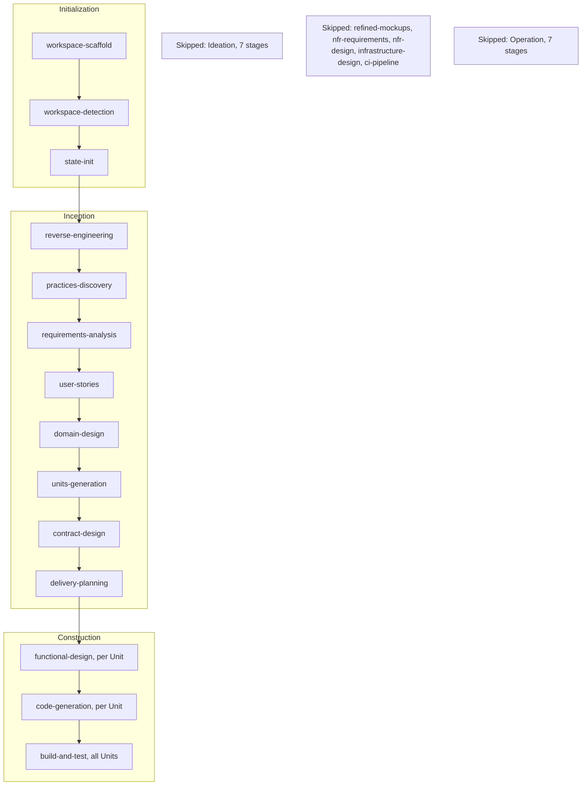

# How RogiKotha release 1 was built with AWS AI-DLC

[Back to the docs index](README.md)

RogiKotha release 1 was built under AWS AI-DLC 2.11.0 (AI-Driven Development Life Cycle). The
version is pinned in `.aidlc-version`. One human, the owner, directed the work and approved the early
gates in person (for example the practices on 2026-10-15 and the batch 1 Code Generation plans on
2026-11-05). From 2026-11-04 the owner delegated approvals and open decisions to the agents,
and Construction ran in autonomous mode, so most later gates were approved under that delegation. AI agents did the analysis, design, building,
reviewing and testing.
Agent sessions start without memory of earlier ones, so every rule and decision they needed was
written down: in the team rules under `aidlc/spaces/default/memory/`, in the decision log, and
in the intent record.

All paths below are relative to the repository root. `<record>` stands for
`aidlc/spaces/default/intents/261011-aidlc-adoption`.

## The intent

| Field | Value (from `<record>/aidlc-state.md`) |
|---|---|
| Intent | `261011-aidlc-adoption`, started 2026-10-11 |
| Project type | Brownfield: the demo build was already under way when AI-DLC was adopted |
| Scope | `classic`, with a tailored plan of 14 stages |
| Depth and test strategy | Minimal and Minimal |
| Construction | stage-major, checkpoints enabled, autonomy mode `autonomous`, unit ownership `solo` |
| Walking skeleton | off: the Phase 0 foundation already ran end to end on `main` |
| Verification command | `pnpm infra:up && pnpm check && pnpm smoke` (`<record>/verification-command.txt`) |

Because the project was brownfield, Inception started with Reverse Engineering of the existing
code and Practices Discovery, which wrote down the team's way of working, testing posture,
deployment and code style. The owner affirmed those practices on 2026-10-15; they are in
`aidlc/spaces/default/memory/team.md` and `project.md`. The requirements, stories, architecture,
data model and contracts already existed in `docs/`, so the Inception stages transcribed them into
AI-DLC artifacts instead of deriving them again.

A second, smaller intent, `261030-demo-slice` (scope `express`), built a thin demo slice in late
October (FD-099 to FD-101). The release-1 Units later replaced its code.

## Lifecycle stages that ran

Text version of the diagram:

1. Initialization: workspace-scaffold, workspace-detection, state-init.
2. Inception: reverse-engineering, practices-discovery, requirements-analysis, user-stories,
   domain-design, units-generation, contract-design, delivery-planning.
3. Construction: functional-design and code-generation for each Unit, then one build-and-test
   over all Units.
4. Skipped by the plan: all seven Ideation stages (intent-capture, market-research, feasibility,
   scope-definition, team-formation, rough-mockups, approval-handoff); refined-mockups;
   nfr-requirements, nfr-design and infrastructure-design; ci-pipeline; all seven Operation
   stages. The `classic` scope ends at Build and Test, which delivers the local demo (FD-031).

## Timeline

| Date | Milestone | Where |
|---|---|---|
| 2026-10-11 | AI-DLC adopted, intent created | `<record>/aidlc-state.md` |
| 2026-10-12 | Reverse Engineering of `apps/`, `packages/`, `infra/` | `<record>/inception/reverse-engineering/developer-scan.md` |
| 2026-10-15 | Practices affirmed by the owner | `<record>/inception/practices-discovery/team-practices.md` |
| 2026-10-29 | U3: boundary lint, 80% coverage floor, format and identity checks (commit `14c21a9`) | `<record>/construction/t-010-boundary-lint-and-ci/` |
| 2026-11-04 | FD-105: release 1 cut to 10 active Units; Units Generation, Contract Design and Delivery Planning re-run (commit `bc63889`) | `docs/status/decision-log.md` |
| 2026-11-04 to 11-05 | Functional Design for all ten Units, in five waves, each reviewed | `<record>/construction/*/functional-design/` |
| 2026-11-06 to 11-08 | Code Generation in five batches; each Unit reviewed READY and merged | `<record>/construction/*/code-generation/` |
| 2026-11-08 | Build and Test over all Units (commit `caa8a12`) | `<record>/construction/build-and-test/` |
| 2026-11-09 | Manual demo checks M3 to M6 and the clean-clone rehearsal walked by an agent under the owner's delegation; Build and Test approved under that delegation; workflow complete | `docs/validation/U50-walkthrough.md` |

## The ten release-1 Units

Unit IDs are frozen once assigned, so the release-1 Units keep their numbers from the full plan
of 50 (`<record>/inception/units-generation/unit-of-work.md`). FD-105 merged 13 Units into five
new ones (U46 to U50) and assigned 18 to release 2.

| Unit | Slug (record folder) | Built from | What it delivered | High risk | Commit on `main` |
|---|---|---|---|---|---|
| U9 | `t-102-patient-auth-screens` | T-102 | Check-your-email and POST-only confirm, reset and set-new-password, security page with sessions and "sign out everywhere", the contribution gate | yes | `21c1c59` |
| U11 | `t-104-identity-module` | T-104, narrowed | Named and pseudonymous personas, a random alias per thread for anonymous posts, a public projection that never leaks the account; private linkage with no reveal in release 1 | yes | `a135232` |
| U46 | `u46-directory` | T-201, T-202, T-203 | Directory and taxonomy modules; doctor, facility and topic indexes and profiles; member-added doctors (FD-100) | no | `153a65c` |
| U20 | `t-207-discover-emergency-about` | T-207 | Home with condition chips and teaser rows, emergency page, About, Terms, Privacy, not-found | no | `a77d70a`, fixes `dbc9c03` |
| U47 | `u47-reviews` | T-301, T-306, T-307 | Review module (drafts, publish, anonymity and aliases, reviewer labels), the four-step composer with autosave and safety checks, experience page, index and author pages | no | `f3eec20`, fixes `1924f24` |
| U22 | `t-302-review-changes-and-tombstones` | T-302, narrowed | Author corrections of a published review with versions, the original wording public under "Show original", a private version list | no | `16fd56b`, fixes `995e3c6` |
| U49 | `u49-comments` | T-401, T-402 | Community module: comments, one reply level, owner delete; the comment thread on the experience page | no | `f065c1b`, fixes `efcac8c` |
| U48 | `u48-evidence` | T-303, T-304 | Quarantined upload with idempotency, the worker's structure, hash and ClamAV checks, fail-closed end states, the author's file list, the public evidence note and count | yes | `a9a2ffe`, fixes `1110c4c` |
| U41 | `t-502-security-hardening` | T-502, narrowed | Host and Origin checks in the proxy, nonce CSP and security headers, size caps before the body is read, cookie settings, log allowlist and scrubbing, threat notes | yes | `a3d9a56`, fixes `729aaa2` |
| U50 | `u50-release-check` | T-503, T-504, T-505 | `pnpm demo` with preflight and reset, health probes, the Playwright suite in `en` and `bn` at 360 px and desktop, the walk-through record | no | `039b326`, fixes `957d46e` |

Nine earlier Units were already merged before FD-105 and form the base release 1 builds on: U1
(CR-009), U2 (CR-007), U3 (T-010), U4 (CR-011), U5 (CR-006), U6 (CR-012), U7 (CR-004), U8
(T-101, the Better Auth adapter) and U45 (T-011, the patient design and motion system). Their
records are under `<record>/construction/` too.

Delivery Planning grouped the ten Units into five batches by dependency level
(`<record>/inception/delivery-planning/bolt-plan.md`). Units in one batch were built at the same
time, each in its own git worktree, Bolt branch and test database, and merged into `main` one at
a time (FD-094). The orchestrating agent ran the parallel builds in separate git worktrees outside the engine's
swarm mode; the engine's state field reads `serial`.

| Batch | Units |
|---|---|
| 1 | U46, U9, U11 |
| 2 | U47, U20 |
| 3 | U48, U22, U49 |
| 4 | U41 |
| 5 | U50, then Build and Test |

## What each Unit went through

1. **Functional Design.** The architect agent wrote the functional spec, business rules, entities
   and frontend components for the Unit (`functional-design/`). A separate reviewer agent read
   it (`functional-design/reviews/review-01.md`); fixes were applied before the stage completed.
2. **Code Generation plan.** The plan lists every step, the owned paths and the Testing Contract
   (`code-generation/code-generation-plan.md`). The owner approved the batch 1 plans (U9, U11, U46) in person on
   2026-11-05. Plan approval was then switched off, and the later plans went ahead under the owner's
   delegation of 2026-11-04, in the `autonomous` Construction mode.
3. **Build.** On a Bolt branch from `main`, inside the Unit's owned paths, with tests written
   with each layer (test-after, per `team.md`) and at least one new smoke assertion. The Unit
   ends with `pnpm check` and `pnpm smoke` green.
4. **Review.** A separate reviewer agent read the full diff for authorization, audit rows,
   Bengali and English parity, import boundaries, private data in view models or logs, files
   outside the owned paths, and tool identity. All ten Units were reviewed READY
   (`code-generation/reviews/review-01.md`).
5. **Review fixes.** Findings were fixed on a separate branch and merged as their own commit
   (the "fixes" column above). In batch 1 the fixes went into the Unit commits.
6. **Merge.** Squash-merged into `main`, then `pnpm check` again on `main`.

Each Unit's `code-generation/code-summary.md` records what was built, the gate run, the
coverage per package and every defect found. `unit-test-instructions.md` lists the Unit's own
test commands; Build and Test ran the 116 distinct commands from all 19 Units.

## High-risk Units

For Units in the auth, identity, evidence, moderation, retention and deletion classes, a
separate agent, one that did not write the code, wrote and ran adversarial tests that try to
break the Unit. A delegated sign-off was recorded for each of the Units in the table (see Delegation below).

| Unit | Adversarial tests | What they found |
|---|---|---|
| U9 auth screens | 27 tests in five angles, real test database where needed | one break: an unconfirmed account could comment and publish, fixed with a contributor check |
| U11 identity | 18 tests in 4 files | one ordering defect, fixed with a regression test |
| U48 evidence | 25 tests in five angles (forged files, races, ownership, paths, scanner down) | one break: two uploads with the same idempotency key at once, fixed by taking the review lock first |
| U41 security | five angles, A1 to A5 | two breaks, both fixed and kept as tests: a server action on internal paths without `Origin` and a code-shaped error text in a worker log |

The earlier high-risk Units U5 and U8 also had adversarial tests written by a separate agent (U5: five
tests in `code-generation/adversarial-tests.md`; U8: three separate testers).

**Delegation.** On 2026-11-04 the owner delegated the high-risk sign-offs and the open decisions
to the agents. The written sign-offs for the high-risk Units U9, U11, U48 (evidence) and U41
(security hardening), the acceptance of FD-116 (the release-1 security posture) and the Bengali
copy review were written by agents under that delegation, not by the owner in person.

## Build and Test

Build and Test ran once over all ten Units on 2026-11-08 on `main` at `e09b558`, and was
approved on 2026-11-09 under the owner's delegation, after the manual checks were walked and
the last fixes (FD-123 and the `demo:reset` order fix found at M6) landed. The rows below are from 2026-11-08 at `e09b558`
unless they say otherwise.

| Check | Result |
|---|---|
| `pnpm build` and strict typecheck | green |
| `pnpm check` | exit 0: 366 files, 4504 tests passed; lines 96.10%, every package at or above 80% |
| Re-run 2026-11-09 on `main` at `29a2567` | `pnpm check`: 366 files, 4513 passed, 1 skipped, lines 96.13%; `pnpm smoke`: 31 files, 60 passed |
| `pnpm test:int` | 65 files, 437 passed on `main`; 446 passed on the fix branch `release-1-security-fixes` |
| `pnpm smoke` | 31 files, 60 tests |
| `pnpm e2e` | 231 of 231, 0 flaky, 0 skipped (360 px 72, desktop 121, reduced motion 32, log scan 6); 101 `bn` and 101 `en` tests |
| `pnpm e2e:perf` | 9 of 9: median LCP 891 to 1206 ms, INP 32 to 34 ms, CLS 0 to 0.019 |
| Security specs | 15 of 15; a foreign `Host` or `X-Forwarded-Host` answers 403 |
| Stopped scanner and stopped mail | `/api/health` reports the failed probe (M1, M2) |
| Rollback drill | a breaking commit reverted, `db:reset` and `db:seed`, the demo back up, `pnpm check` and `pnpm smoke` green |
| Unit-scoped commands | 116 distinct commands from all 19 Units' test instructions, 116 of 116 green |
| Cross-unit traceability | 0 uncovered: 151 covered, 4 verified at Build and Test, 148 assigned to release 2 by name (FD-105), 1 retired, 2 not applicable |
| Manual checks (U50) | M3 to M6 and the clean-clone rehearsal walked on 2026-11-09 by an agent under the owner's delegation; clean clone to the banner in 2 min 26 s (146 s, cached images; target under 6 minutes) |

Build and Test also tuned its own tooling during the stage: the performance probe now finds the
LCP element under Lighthouse 13, the Lighthouse navigation handling was fixed, one Unit's
coverage command and some stale test paths were corrected, and the eight requirement keys without
a coverage entry were resolved. All of this fit within the stage's limit of two attempts, with no
product code changed and no threshold loosened. The details are in
`<record>/construction/build-and-test/test-results.md`.

## Where to look

| What | Path |
|---|---|
| Workflow state: stages run and skipped, current status | `<record>/aidlc-state.md` |
| The original request | `<record>/project-description.json` |
| Team rules the agents followed | `aidlc/spaces/default/memory/org.md`, `team.md`, `project.md` |
| Practices discovered and affirmed | `<record>/inception/practices-discovery/team-practices.md` |
| Scan of the existing code | `<record>/inception/reverse-engineering/developer-scan.md`, `aidlc/spaces/default/codekb/rogikotha/` (snapshot of 2026-10-30) |
| Requirements (FR, NFR) | `<record>/inception/requirements-analysis/requirements.md` |
| User stories and personas | `<record>/inception/user-stories/stories.md`, `personas.md` |
| Components and design decisions | `<record>/inception/domain-design/components.md`, `decisions.md` |
| Units of work, dependencies, story map | `<record>/inception/units-generation/unit-of-work.md`, `unit-of-work-dependency.md`, `unit-of-work-story-map.md` |
| Contracts between Units | `<record>/inception/contract-design/contract-summary.md` |
| Bolt plan and sequencing | `<record>/inception/delivery-planning/bolt-plan.md`, `risk-and-sequencing-rationale.md` |
| A Unit's design | `<record>/construction/<unit>/functional-design/` |
| A Unit's plan, summary and review | `<record>/construction/<unit>/code-generation/` |
| Build and Test | `<record>/construction/build-and-test/build-and-test-summary.md`, `test-results.md`, `cross-unit-traceability.md` |
| Stage reviews | `reviews/` folders beside the reviewed stages' artifacts |
| Audit log (append-only) | `<record>/audit/` |
| Founder decisions | `docs/status/decision-log.md` |

A short reading path: `requirements.md`, then `unit-of-work.md`, then one Unit (for example
`construction/u46-directory/functional-design/functional-spec.md` and
`code-generation/code-generation-plan.md`), then `build-and-test-summary.md`.

In a fresh clone the per-user cursor `aidlc/spaces/default/intents/active-intent` is not
present, because it is git-ignored. Select the intent before using the AI-DLC commands:
`aidlc engine intent switch aidlc-adoption`.

The records are append-only history. Where they cite earlier working files (the task files under
`docs/implementation/tasks/`, the migration notes under `docs/aidlc-migration/` and the validation
working papers), those files are kept on branch `archive/full-project-2026-11-09`.
