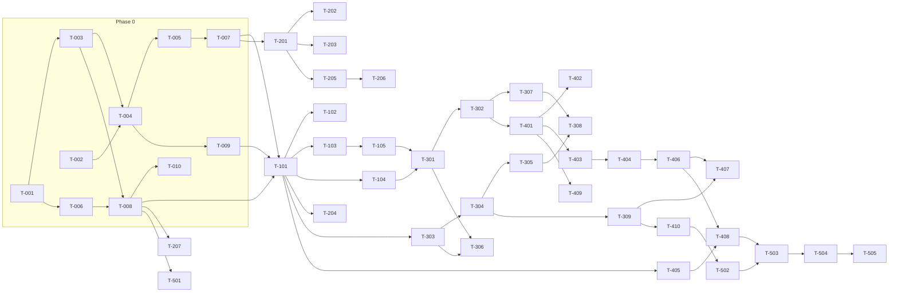

# RogiKotha — Demo implementation master plan

**Status:** Approved for execution (founder decisions FD-031 to FD-035, 2026-09-10)
**Goal:** A locally runnable RogiKotha that looks and behaves like the finished product — the approved
04b patient UI and the Chart Tray staff console, on a real Next.js + PostgreSQL backend, with real
sign-up/sign-in, real writes, a real quarantine-first evidence pipeline, and the synthetic corpus
seeded in — so the founder can demo it end to end on one laptop.
**Audience:** the human running the build, and every AI agent implementing a task. Agents read this file
first, then `01-conventions.md`, then their task file under `tasks/`.

Related: [README](README.md) (how to run a task) · [Conventions](01-conventions.md) ·
[Data model](02-data-model.md) · [Routes and contracts](03-routes-and-contracts.md) ·
[Auth screens spec](../design/auth-screens-spec.md) · [Demo storyboard](05-demo-storyboard.md) ·
[Handoff and validation protocol](04-handoff-and-validation.md) · [Change requests](06-change-requests.md) · [Phase 2 — document evidence](07-phase-2-document-evidence.md) · [Model research](../planning/research/model-assignment-2026-09-10/research.md)

---

## 1. What is being built

| Surface | Source of truth for look and behaviour | Becomes |
|---|---|---|
| Patient UI (13 hash routes) | `ui-design-prototype/concepts/concept-04b-quiet-clinic-minimal/` | `apps/web` routes under `/{locale}/…` |
| Staff console (5 hash routes) | `ui-design-prototype/admin/` | `apps/web` routes under `/{locale}/admin/…` |
| Auth screens (new — no design exists yet) | `docs/design/auth-screens-spec.md`, then a prototype pass | patient `/register`, `/sign-in`, … and staff `/admin/sign-in`, … |
| Data and copy | `ui-design-prototype/shared/rogikotha-data.js` (6 doctors, 5 facilities, 8 conditions, 12 accounts, 8 facility accounts, 10 comments, 7 evidence items, moderation fixtures, 568 EN+BN strings) | seed corpus in `packages/test-support`, dictionaries in `packages/i18n` |
| Rules | `PRODUCT.md` hard rules, `docs/architecture/ARCHITECTURE-SPINE.md` AD-1…AD-17, `docs/scope-of-work.md` | enforced in `packages/domain` + tests |

The prototype's `state.role` chip, the "Design exploration" banner logic and localStorage persistence
are replaced by real accounts, real sessions and the database. A small **synthetic-data marker** stays
(hard rule: synthetic content is never presented as real), reworded to "Demo — fictional records".

## 2. Founder decisions recorded for this plan

Recorded in `docs/status/decision-log.md`; summarised here because every task depends on them.

| ID | Decision |
|---|---|
| FD-031 | The demo runs the **local-development composition** of the architecture: real Next.js app, PostgreSQL 18 in Docker, Better Auth email/password, pg-boss worker, filesystem storage, Mailpit as the mail sink. It is *not* the read-only USD 0 public demo of ADR-0010; that composition stays defined but is not built now. |
| FD-032 | The frontend **ports the approved prototype CSS and tokens as plain CSS** into React components. Tailwind, shadcn and Radix are **not** adopted for Phase 1. Pixel fidelity to 04b / Chart Tray beats framework conformance. Supersedes those rows of `DEPENDENCY-SELECTIONS.md`. |
| FD-033 | **Trimmed monorepo**: `apps/web`, `apps/worker`, `packages/{contracts,domain,application,database,adapters,i18n,test-support}`. The spine's `auth`, `evidence`, `search`, `ui` packages fold into `adapters`/`database`/`web` for now; extraction seams are kept (see §4). |
| FD-034 | Auth screens: **spec now** (`docs/design/auth-screens-spec.md`) **and a prototype pass** before the auth UI tasks run. Staff sign in with the **same account system** (a staff role on the account), with real new-device email approval and password recheck. The admin role switcher is removed; three seeded staff accounts replace it. |
| FD-035 | In scope and **real** in the demo: staff new-device approval, retention and legal-hold jobs (with a demo clock), account export and deletion plan, PWA manifest with safe shell caching, PostgreSQL search. ClamAV runs as a container and is **optional at start-up but fail-closed at scan time**. |
| FD-036 | Phase 1 evidence upload accepts **JPEG and PNG images only**. PDF (and later HEIC/Office) intake, rasterisation, derivative-PDF assembly and the multi-page viewer move to Phase 2 (`07-phase-2-document-evidence.md`). Recorded 2026-09-12 as CR-001. |

## 3. Stack (pinned for this build)

Verified 2026-09-10 — see `docs/status/dependency-check-log.md` (entry 2026-09-10). Re-verify any row
older than 3 days before first install, per `AGENTS.md`.

| Concern | Choice | Version | Why this and not the newest |
|---|---|---|---|
| Runtime | Node.js LTS | 24.x (local 24.19) | Node 26 is Current, not LTS until 2026-10-28 |
| Package manager | pnpm | **11.x** (local 11.20) | pnpm 12 (2026-08-26) is a Rust rewrite two weeks old; not yet proven |
| Web | Next.js App Router | 16.3.4 | current stable; Aug-2026 security release included |
| UI | React | 19.3.0 | current stable; React2Shell (CVE-2025-55182) fixed since 19.2.1 |
| Language | TypeScript | **6.x latest** | TS 7 (Go rewrite) has no stable programmatic API yet — breaks typescript-eslint; revisit at TS 7.1 |
| Database | PostgreSQL | 18 (`postgres:18` image) | `uuidv7()`, FTS, `pg_trgm` |
| SQL | Drizzle ORM + drizzle-kit | 0.45.2 + 0.31.10 (exact pins) | pre-1.0; 1.0 RC exists — do not adopt mid-build |
| Driver | `pg` (node-postgres) | 8.23.x | one driver shared by Drizzle and pg-boss |
| Jobs | pg-boss | 12.30.x | durable jobs on PostgreSQL, no Redis |
| Auth | Better Auth | **1.7.3** | 1.7 is now the stable line and carries the 2026 CVE fixes; ADR-0003's "exclude 1.7 prereleases" is satisfied |
| Password hashing | `@node-rs/argon2` | 2.2.x | Argon2id per requirement; no node-gyp |
| i18n | next-intl | 4.14.x | locale-prefixed routes `/bn`, `/en` (AD-9) |
| Validation | Zod | 4.5.x | boundary schemas in `packages/contracts` |
| IDs | `uuid` | 13.x (`v7()`) | UUIDv7 at boundaries (spine convention) |
| Images | sharp | 0.35.x | re-encode JPEG/PNG, strip metadata |
| PDF rasterise / assemble | **Phase 2** — pdfjs-dist + `@napi-rs/canvas`, `@cantoo/pdf-lib` | — | FD-036: the demo accepts images only; see `07-phase-2-document-evidence.md` |
| Magic bytes | file-type | 22.x (ESM) | extension/MIME/magic triple check |
| Malware scan | ClamAV (`clamav/clamav:1.5.4`) + one custom `.ndb` test signature | 1.5.4 | speaks clamd INSTREAM over TCP 3310; fail closed; the custom signature makes detection demonstrable with a harmless JPEG |
| Mail (dev) | Mailpit (`axllent/mailpit`) + nodemailer | current stable | SMTP 1025, web UI 8025 |
| Storage | filesystem adapter under `.data/storage/` | — | Garage 2.3 stays the deferred production candidate; MinIO CE is dead |
| Tests | Vitest **4.1.x**, Testing Library 16.3, Playwright 1.63, `@axe-core/playwright` 4.13, jsdom 30 | — | Vitest 5 shipped 2026-09-03 with 33 breaking changes; not adopting a one-week-old major |
| Lint | ESLint 10 flat config, typescript-eslint (TS 6), `eslint-plugin-boundaries` 7.2 (fallback dependency-cruiser 18.2), Prettier 3.9 | — | boundary rules enforce the spine |
| CSS | plain CSS ported from the prototype (FD-032) | — | no Tailwind, no CSS-in-JS |

Not used in Phase 1: Tailwind, shadcn, Radix, Motion, Storybook, MSW, Matomo, Garage, LibreOffice.

## 4. Repository layout (FD-033)

```text
apps/
  web/                      Next.js 16 — public UI, staff console, route handlers, server actions, Better Auth
    src/app/[locale]/…      patient routes (see 03-routes-and-contracts.md §1)
    src/app/[locale]/admin/… staff routes
    src/app/api/…           route handlers (auth, upload, health, evidence artifacts)
    src/components/         React components ported 1:1 from prototype render functions
    src/styles/             tokens.css, patient.css, admin.css (ported), globals.css
    src/server/             composition root: wires adapters into application services
  worker/                   Node process — pg-boss handlers: evidence, mail, retention, export, deletion
packages/
  contracts/                Result<T>, error codes, enums, zod schemas, view models, Actor
  domain/                   entities, value objects, state machines, policies — pure TS, zero deps
  application/              commands, queries, ports (interfaces), authorization — depends on domain + contracts
  database/                 drizzle schema, migrations, repositories, PostgreSQL search adapter, pg-boss queue adapter
  adapters/                 non-DB adapters: fs storage, smtp mail, clamd client, image + pdf processors, clock
  i18n/                     en.json, bn.json (ported from STRINGS), parity test, formatters (Bengali numerals)
  test-support/             synthetic corpus builders, seed script, fake ports, clock control
infra/
  compose/                  docker-compose.yml: postgres, mailpit, clamav; .env.example
docs/implementation/        this plan
```

Dependency direction (enforced by lint): `web|worker → application → domain`; `web|worker → database|adapters → application(ports) + contracts`; `domain` imports nothing; `contracts` imports only zod. Components never import `test-support` or `database`.

The `pgboss` schema is created by a migration run as `rk_app` (with grants to `rk_worker`), not by the worker at start-up; `apps/web/src/proxy.ts` (Next 16's renamed middleware) carries locale redirects, the `x-pathname` header and security headers.

Extraction seams retained: every port is an interface in `packages/application/src/ports/`; `apps/web/src/server/container.ts` is the single composition root; the worker composes its own container with **no** auth adapter and **no** reveal/delete capabilities (AD-6).

## 5. Phases, tasks, estimates

Estimate unit = **agent-hours**: wall-clock for one implementing agent session including running tests and fixing its own findings, given the task file and the reference docs. Ranges are low–high. Validation = an independent agent in a separate session inspecting the diff (see `README.md` §4). Human = your review, answering the agent's questions, and small change requests. Classes M0–M4 and the model routing are in §7.

Definitions used in every task file: **Class** (M0 mechanical, M1 routine, M2 frontend port, M3 high-risk/cross-cutting, M4 independent review), **Depends** (task IDs that must be `PASS` first), **Lane** (A = backend, B = frontend; lanes may run in parallel).

### Phase 0 — Foundation (nothing user-visible yet)

| ID | Task | Class | Lane | Est. | Depends |
|---|---|---|---|---|---|
| T-001 | Workspace scaffold: pnpm workspace, TS base, ESLint flat + Prettier, Vitest, scripts, `.env.example` | M1 | A | 2–3 | — |
| T-002 | Local infra: docker-compose (postgres 18, mailpit, clamav), health checks, `pnpm infra:*` | M0 | A | 1–1.5 | — |
| T-003 | `packages/contracts`: Result, error codes, enums, ids/time helpers, Actor, zod base schemas, view-model types | M1 | A | 3–4 | T-001 |
| T-004 | `packages/database` part 1: Drizzle + migrations + schema for accounts, staff devices, identity, directory, taxonomy, config, audit | M1 | A | 3–4 | T-001, T-002 |
| T-005 | `packages/database` part 2: reviews, timeline, evidence, community, moderation, notifications, retention, deletion plans, bookmarks, feedback | M1 | A | 3–4 | T-004 |
| T-006 | `packages/i18n`: port all 568 keys to `en.json`/`bn.json`, parity test, Bengali numeral formatter, next-intl config | M0 | B | 2–3 | T-001 |
| T-007 | `packages/test-support`: typed synthetic corpus (port of `rogikotha-data.js`), builders, `pnpm db:seed`, seeded demo accounts | M1 | A | 4–5 | T-003, T-005 |
| T-008 | `apps/web` shell: Next app, `/[locale]` routing, ported CSS (tokens/patient/admin), root layout (lang/theme/motion attrs), masthead/tabs/footer, sr-live, skip link, demo marker, `/api/health` | M2 | B | 4–6 | T-003, T-006 |
| T-009 | `apps/worker` skeleton: pg-boss connection, job registry, outbox relay, graceful shutdown, structured logs | M1 | A | 1.5–2 | T-004, T-005 |
| T-010 | Boundary lint (`eslint-plugin-boundaries`), `pnpm check` (typecheck, lint, test, i18n parity, build), GitHub Actions workflow | M1 | A | 1.5–2 | T-001, T-008, T-009 |

Phase 0 total: **26–35 h**. Critical path: T-001 → T-004 → T-005 → T-007 (≈12 h) with T-006 → T-008 in lane B.

### Phase 1 — Accounts, identity, staff access, configuration

| ID | Task | Class | Lane | Est. | Depends |
|---|---|---|---|---|---|
| T-101 | Better Auth adapter: Drizzle adapter, Argon2id hasher, email verification (24 h, rate-limited resend), reset, 30-day DB sessions, cookie/origin config, throttling, anti-enumeration, mail port → SMTP, `Actor` mapping | M3 | A | 5–7 | T-004, T-008, T-009 |
| T-102 | Patient auth screens: register, sign-in, verify (pending + confirm), reset (request + set), `/me/security` sessions + revoke-all + change password; header account entry | M2 | B | 4–6 | T-101, auth spec + prototype pass |
| T-103 | Staff access: roles + capability matrix, `/admin` guard, staff sign-in screen, new-device email approval + password recheck, trusted devices, `/admin/security` | M3 | A | 5–7 | T-101 |
| T-104 | Identity module: personas (named/pseudonymous/anonymous), per-thread anonymous alias, private linkage table, public projection allowlist, audited reveal (Super Admin; Admin/Mod only when enabled) | M3 | A | 4–6 | T-101 |
| T-105 | Runtime configuration module: versioned bounded settings (thresholds, retention, limited-data threshold, report reasons, capability toggles), validation, audit, rollback, password-recheck token | M3 | A | 3–4 | T-103 |
| T-106 | Auth + identity negative-matrix validation (enumeration, replay, expiry, revoke-all, CSRF/cookie, alias leakage) — cross-vendor | M4 | — | 3–4 | T-101…T-105 |

Phase 1 total: **24–34 h**. T-102 (lane B) runs beside T-103/T-104 (lane A).

### Phase 2 — Directory, taxonomy, search, public reading

| ID | Task | Class | Lane | Est. | Depends |
|---|---|---|---|---|---|
| T-201 | Directory + taxonomy modules: doctor/facility/branch/condition queries, provenance per field, "Registration not verified", conditions-per-doctor counts, view models | M1 | A | 3–4 | T-005, T-007 |
| T-202 | Doctor index + doctor profile pages (port of `renderDoctorIndex`, `renderProfile`, distributions, chambers, condition breakdown, filter) | M2 | B | 4–5 | T-201, T-008 |
| T-203 | Facility index/profile + condition index/page (port of `renderFacilityIndex`, `renderFacility`, criteria distributions, `renderTopicIndex`, `renderCondition`) | M2 | B | 4–5 | T-201, T-008 |
| T-204 | Provider submission, claim, field-change commands + patient UI (add-a-doctor panel, claim sheet) | M1 | A | 3–4 | T-201, T-101 |
| T-205 | Search module: `search_documents`, NFC keys, `simple` FTS, `pg_trgm`, alias table (Bangla/English/Banglish), neutral ranking, publication filter, suggestions, "resolved note / keep original" | M1 (XL) | A | 5–7 | T-201 |
| T-206 | Search page port: tabs, filter rail, neutral sort + "why", result cards, compare tray + compare sheet | M2 | B | 4–6 | T-205 |
| T-207 | Discover (home), Emergency, About, Terms, Privacy pages port — half A (emergency/about/terms/privacy) after T-008; half B (Discover) after the shared patient primitives and search box exist | M2 | B | 2–3 | half A: T-008 · half B: T-202, T-203, T-206 |

Phase 2 total: **25–34 h**.

### Phase 3 — Accounts (reviews) and evidence

| ID | Task | Class | Lane | Est. | Depends |
|---|---|---|---|---|---|
| T-301 | Review module core: drafts with encrypted server autosave, quick/detailed, publish, publication state machine, public projection, aggregates with denominators and limited-data threshold, facility accounts with criteria | M3 | A | 5–7 | T-104, T-105, T-201 |
| T-302 | Review module changes: dated corrections, follow-ups, later care, versioning, tombstone with discussion context, 30-day restore, hard-rule tests | M3 | A | 4–6 | T-301 |
| T-303 | Evidence intake (**JPEG/PNG only**, FD-036): upload route streaming to quarantine, limits (10 files / 15 MB / 100 MB), extension+MIME checks, custody events, job enqueue | M3 | A | 4–5 | T-005, T-009, T-101 |
| T-304 | Worker pipeline (images): validate (magic) → clamd scan (fail closed) → sanitise (sharp re-encode, metadata stripped) → preview-ready; artifacts with SHA-256; bounded retries; failure states | M3 | A | 3–5 | T-303 |
| T-305 | Privacy preview + manual redaction flattening + author confirmation + publish derivative + processed-image download | M3 | A | 3–4 | T-304 |
| T-306 | Composer wizard port (`renderCompose`, `renderPreview`, safety checks, add-doctor, tags/Not sure, sentiment/outcome, claims, identity, evidence attach + redaction canvas, publish, save-and-exit) | M2 | B | 6–8 | T-301, T-303 |
| T-307 | Experience page + index port (`renderAccount`, thirteen sections, spine, follow-ups, later care, related cards; `renderExperienceIndex`) | M2 | B | 5–6 | T-302 |
| T-308 | Processed-image viewer port (zoom/fit/pan/item-to-item paging/rotate/fullscreen/download) + evidence sections + pipeline state chips | M2 | B | 3–4 | T-305, T-307 |
| T-309 | Retention, holds, custody: policy versions (90/180), prospective changes, retention job, legal hold, previewed bulk command, custody log, **demo clock** | M3 | A | 5–6 | T-304, T-105 |

Phase 3 total: **38–51 h** (after FD-036 removed PDF handling). Longest phase; T-303 → T-304 → T-305 is strictly sequential.

### Phase 4 — Discussion, moderation, notifications, workspace, staff console

| ID | Task | Class | Lane | Est. | Depends |
|---|---|---|---|---|---|
| T-401 | Community module: comments (one reply level, mentions, external-link warning, edit/delete/tombstone), idempotent reactions, blocking, rate limits | M1 | A | 4–6 | T-302, T-104 |
| T-402 | Discussion UI: comment thread, reply box, editor, reactions, bookmark, advice warning, report entry (port of `commentHtml`, `replyBox`, `reactBtn`) | M2 | B | 3–4 | T-401, T-307 |
| T-403 | Reports + thresholds: reasons, distinct-account counting, critical-first-hide, five-account auto-hide, coordination signal, queue item, audit, notifications; report sheet UI | M3 | A | 4–6 | T-401, T-105 |
| T-404 | Moderation module: lanes/SLA, bounded reason-coded actions, no-narrative-rewrite invariant, restore, appeals with fresh checklist, warn/restrict/suspend/ban, block effects, append-only audit timeline | M3 | A | 6–8 | T-403 |
| T-405 | Notifications: outbox → in-app rows (5 kinds), read state, preferences, essential email via worker (allowlist, no content), 90-day retention; patient `/notifications` page | M1 | A | 4–5 | T-009, T-101 |
| T-406 | Staff console shell + queue port: grouped nav + counts, bottom tab bar, crumbs, lanes, case tray, action chips, reason, audit preview + timeline, **Record decision** dock, bulk toolbar + preview sheet | M2 | B | 6–8 | T-404, T-103 |
| T-407 | Staff evidence + providers port: quarantine table with stages, retention/hold controls, custody log; pending profiles, claims, protected-field changes with approve/reject/merge | M2 | B | 4–6 | T-309, T-204, T-406 |
| T-408 | Staff notifications + config port: triage list (open/ack); thresholds, retention, report reasons, capability matrix, version history + rollback, password recheck sheet | M2 | B | 4–5 | T-105, T-405, T-406 |
| T-409 | Personal workspace port: `/me` (published/drafts, preferences, feedback, data requests), `/saved`, public profile `/authors/[username]` (noindex), blocked users | M2 | B | 4–6 | T-302, T-401 |
| T-410 | Export + deletion orchestration: export bundle job, per-module deletion plan, holds respected, tombstone/de-identify, status surface | M3 | A | 5–6 | T-309, T-401 |

Phase 4 total: **44–60 h**.

### Phase 5 — PWA, hardening, parity, demo composition

| ID | Task | Class | Lane | Est. | Depends |
|---|---|---|---|---|---|
| T-501 | PWA: manifest, icons, service worker with public-shell allowlist, sign-out purge | M1 | B | 2–3 | T-008 |
| T-502 | Security hardening: CSP + headers, origin/CSRF checks, action/account/network rate limiter, upload limits, cookie audit, log scrubbing | M3 | A | 4–5 | Phases 1–4 |
| T-503 | Bilingual parity + accessibility + viewport E2E: Playwright + axe over the critical journeys, both locales, five viewports, reduced motion; fix findings | M2 | B | 6–8 | all UI tasks |
| T-504 | Demo composition: `pnpm demo` one-command up, seeded scenarios, demo clock + reset, storyboard walk-through verified | M1 | A | 3–4 | all |
| T-505 | Final validation + docs: coverage matrix, validation log, current status, decision log | M4 | — | 3–4 | T-504 |

Phase 5 total: **18–24 h**.

### Roll-up

| | Low | High |
|---|---|---|
| Implementation agent-hours (46 tasks + D-001) | 178 | 242 |
| Independent validation (≈30 %) | 53 | 73 |
| Handoff, issue logging and re-work after FAIL verdicts (≈8 %, see `04-handoff-and-validation.md`) | 14 | 19 |
| **Agent-hours total** | **≈245 h** | **≈335 h** |
| Human review, questions, small change requests | 15 | 25 |

**Wall-clock with two lanes** (two agents in parallel, plus the validation and handoff protocol of `04-handoff-and-validation.md`): the critical path is
T-001 → T-004 → T-005 → T-007 → T-101 → T-104 → T-301 → T-302 → T-401 → T-403 → T-404 → T-406 → T-408 → T-503 → T-504 → T-505 ≈ **85–110 h** of agent runtime; lane B fills in behind it. At roughly 8 supervised agent-hours per day that is **13–17 working days** of implementation; validation runs in parallel in the other vendor's tool, and handoffs add about an hour a day. Add the 20–30 % buffer the research recommends for re-work and waiting (METR's RCT found AI-assisted developers slower than they believed): plan **4–5 calendar weeks** for the image-only demo, **3–4** if the first phase shows fewer FAIL verdicts than budgeted. One lane only would be 6–8 weeks; three lanes save little because the critical path is mostly sequential M3 work. Phase 2 (PDF evidence) is a further **≈ 1 week** with one lane.

**Where the time goes:** Phase 4 (moderation + staff console, ≈28 %) and Phase 3 (evidence pipeline + composer, ≈27 %). **Where the risk is:** T-101 (Better Auth ↔ Next 16 friction reported on 16.0.x), T-205 (Bangla/Banglish relevance), T-406 (largest UI port). PDF rasterisation, previously the riskiest evidence step, moved to Phase 2 (FD-036).

## 6. Dependency graph



## 7. Model routing (which model does what)

Full research with sources and benchmark caveats: `docs/planning/research/model-assignment-2026-09-10/research.md`.
Both your subscriptions are flat-rate, so "cost" here means **rate-limit budget**: spend Opus 5 and
GPT-5.6 Sol only where the class says so, and let the mid-tier models do the volume.

| Class | Implementer (primary) | Implementer (alternate) | Independent validator | Effort setting | Used for |
|---|---|---|---|---|---|
| **M0** mechanical | GPT-5.6 **Luna** (Codex) | Claude **Haiku 4.5** | Sonnet 5, quick pass | Luna `medium`; Haiku default | T-002, T-006 — ports of data/strings/config where the task file is the whole spec |
| **M1** routine | Claude **Sonnet 5** | GPT-5.6 **Terra** | the *other* vendor's mid-tier (Terra validates Sonnet, Sonnet validates Terra) | `high` | contracts, schema, modules with clear rules, notification plumbing, demo composition |
| **M2** frontend port | Claude **Sonnet 5** (this repo's `impeccable` skill, prototype familiarity) | GPT-5.6 Terra | Terra | `high` | every 1:1 port of a prototype render function into React |
| **M3** high-risk | Claude **Opus 5** | GPT-5.6 **Sol** when Opus quota is exhausted | the other vendor's top tier **plus your approval** | Opus `xhigh`; Sol `high` | auth, staff access, identity, config, review state machine, evidence, retention, moderation, deletion, hardening |
| **M4** review | Claude Opus 5 **or** GPT-5.6 Sol (whichever did *not* implement) | Fable 5.1 for the final security read if available | — | `high`/`xhigh` | T-106, T-505, and any `VALIDATE` step of an M3 task |

Why: Anthropic positions Sonnet 5 as "best combination of speed and intelligence" and OpenAI positions Terra as "balances intelligence and cost"; their vendor-reported SWE-bench Pro scores are within a point (63.2 vs 63.4), so they are interchangeable for spec-following work. Opus 5 leads Sol on Terminal-Bench 4.0 in Anthropic's table (52.3 vs 37.3) while OpenAI's own table puts Sol at 88.8 on Terminal-Bench 2.1, above Opus's 89.1 only in "ultra" mode — every cross-vendor number is the reporting vendor's run, so treat them as "same tier". Cross-vendor validation is required by AD-16 for high-risk work regardless.

Practical rules:

0. If most work runs in puku-cli with Claude Opus 4.8, use the mapping in `08-agent-prompts.md` §4: Opus 4.8 implements M0–M3, validates M0–M2 in a fresh session, and M3 validation goes to Codex (Sol/Terra) or a different model with your written approval.
1. Never let the same session implement and validate. Open a fresh session for `VALIDATE`.
2. Do not use Fable 5.1 for implementation; it is 5× Sonnet's price per token and its always-on thinking is wasted on a task that already has a spec.
3. If a Sonnet/Terra run on an M1/M2 task fails validation twice, escalate that task to Opus/Sol rather than a third retry.
4. Codex CLI and Claude Code both read `AGENTS.md`. Codex ignores `CLAUDE.md`; the task prompt in `README.md` §3 repeats the no-attribution rule so it holds on both tools.

## 8. Execution order (what to start, in what order, with two lanes)

| Step | Lane A (backend) | Lane B (frontend) | Gate before next step |
|---|---|---|---|
| 1 | T-001, T-002 | — | `pnpm install` clean; `pnpm infra:up` healthy |
| 2 | T-003 → T-004 → T-005 | T-006 → T-008 | schema migrates from empty; shell renders `/en` and `/bn` |
| 3 | T-007, then T-009, then T-010 | D-001 auth-screens prototype pass (design, not code — `tasks/D-001-auth-screens-prototype.md`); founder reviews it | `pnpm db:seed` loads corpus; `pnpm check` green; D-001 approved |
| 4 | T-101 → T-103 → T-105 | T-207 half A, then T-102 (after T-101 and D-001) | T-106 PASS; you can register, confirm in Mailpit, sign in, sign in as staff on a new device |
| 5 | T-104, T-201, T-205 | T-202, T-203 | doctor/facility/condition pages read from PostgreSQL |
| 6 | T-204, T-301 → T-302 | T-206, then T-207 half B | search works in Bangla, English and Banglish; home page is live |
| 7 | T-303 → T-304 → T-305, T-309 | T-306, T-307 → T-308 | an upload is scanned, rasterised, redacted, published; originals never served |
| 8 | T-401 → T-403 → T-404, T-405 | T-402, T-409 | five distinct accounts hide content; comments/reactions/notifications work |
| 9 | T-410, T-502 | T-406 → T-407 → T-408, T-501 | staff can record a decision, approve a profile, put a hold, roll back config |
| 10 | T-504 | T-503 | storyboard runs end to end in both languages |
| 11 | T-505 | — | validation log and coverage matrix updated |

Branching follows `docs/planning/11-worktree-safe-execution-plan.md`: integration branch `build/demo`, one branch + worktree per task (`task/t-101-better-auth`), merge in dependency order after `PASS`.

## 9. Out of scope for this demo (stays in the backlog)

Production deployment topology, encrypted off-host backups and restore drills (STORY-OPS-001), analytics (STORY-OPS-002), Garage object storage, PDF/HEIC/Office evidence formats (Phase 2, `07-phase-2-document-evidence.md`), BMDC verification, MFA/passkeys, the read-only USD 0 public demo composition, native apps, public API. None of these are needed to show the finished product locally.

## 10. How to change this plan

Small changes you request while building go into `06-change-requests.md` (one row each: date, what, which task absorbs it, size). A change that alters a hard rule, a data boundary, or a founder decision needs a new FD in the decision log first. Task files are the contract an agent works to; edit the task file, not the agent's memory.
