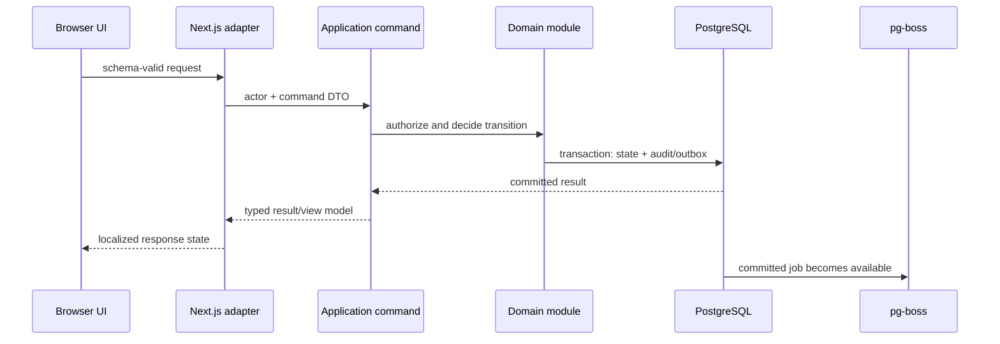
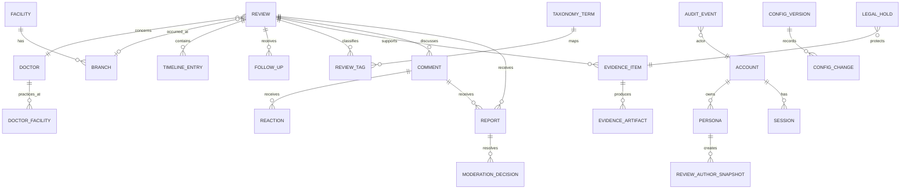
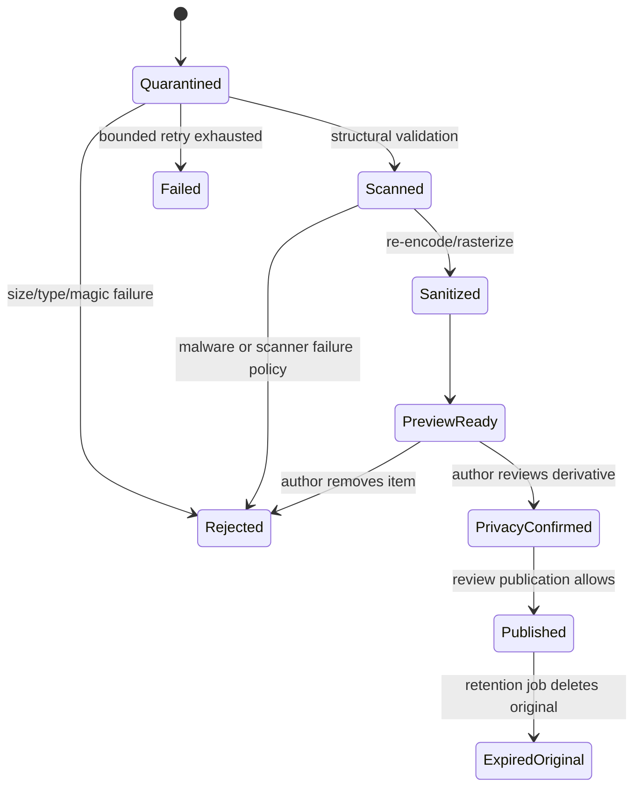

# RogiKotha recommended architecture

**Status:** Final planning recommendation after Gate 1 approval  
**Date:** 2026-08-30  
**Binding spine:** [ARCHITECTURE-SPINE.md](../architecture/ARCHITECTURE-SPINE.md)  
**Decision records:** [docs/architecture/decisions](../architecture/decisions/)

## Recommendation

Build RogiKotha as a TypeScript monorepo containing a ports-and-adapters modular monolith and a separately runnable evidence/maintenance worker. Use Next.js for the responsive web application and server adapters, PostgreSQL as the system of record and first search engine, Better Auth behind an application-owned identity boundary, pg-boss for durable PostgreSQL jobs, and private object storage behind a small storage port.

This is the lowest-complexity architecture that still treats identity, publication, hostile files, retention, and moderation as real boundaries. It runs on one production host initially but does not bake one-host assumptions into code. Option B—a separate Fastify API—remains the first extraction path if independent clients or evidence isolation justify another service. The Python/Django option is not selected because Phase 1 has no Python-only capability that offsets a second language and deployment stack.

## Product modes

| Mode | Audience and data | Enabled | Disabled |
|---|---|---|---|
| Local development | Builders; deterministic synthetic data | All role/state simulators, mock services, tests | Real mail, real uploads, external analytics |
| USD 0 public demo | Anyone; visibly synthetic/read-only data | Every navigable prototype surface, locale/concept/role/state switching | Account creation, mutation, uploads, analytics, production integrations |
| Production | Unrestricted public after readiness reviews | Real accounts, content, evidence pipeline, moderation, persistence, backups | Demo-only controls and synthetic-content ambiguity |

The demo is not a weakened production deployment. It is a different composition of the same UI contracts. A build-time/runtime mode assertion prevents production persistence from starting with demo configuration and prevents demo markers from being hidden.

## Module map and ownership

| Module | Owns | May call | Must not access directly |
|---|---|---|---|
| Account | account status, preferences, email-confirmed actor | identity, notification ports | public persona records by table |
| Identity | real/pseudonymous/anonymous personas, private linkage, reveal grants | account commands, audit | analytics, public search |
| Directory | doctor/facility/branch profiles, claims, correction state | taxonomy, moderation | evidence originals |
| Taxonomy | conditions, symptoms, specialties, treatments, aliases | search refresh port | review mutation |
| Review | quick/detailed review, timeline, follow-up, sentiment/outcome snapshot | identity, directory, taxonomy, evidence commands | identity private linkage |
| Evidence | intake, custody, processing state, public derivative, retention | storage/scanner/converter ports, audit | account secrets, general admin data |
| Community | comments, flat replies, mentions, reactions | identity snapshots, moderation commands | review/private evidence mutation |
| Moderation | reports, thresholds, queue, decisions, appeals, tombstones | publication commands, notification, audit | direct table updates in owned modules |
| Notification | in-app/email delivery preferences and jobs | mail port, public-safe view models | raw evidence/review content in email |
| Search | search documents, aliases, ranking, suggestions | PostgreSQL query adapter | private/unpublished data |
| Administration | bounded configuration, audit queries, dashboards | each module's declared admin commands | cross-module direct writes |
| Operations | health, backup/restore, retention scheduler, diagnostics | declared operational ports | public route handlers |

## Request and state flow



No page component decides publication, anonymity, retention, or moderation state. The same command path serves web actions, admin actions, worker completions, and scheduled retention jobs.

## Core data model

The database schema is code-owned and migration-driven. The following aggregates are stable; attributes remain story-level design.



Public author snapshots are immutable even if the account later changes display name. A private linkage maps snapshot/persona to account and is excluded from ordinary repositories. Evidence originals and derivatives are separate artifacts with different permissions, hashes, retention clocks, and custody events.

## Public projection and publication state

Profiles, reviews, comments, and evidence share a vocabulary such as `draft`, `pending_review`, `published`, `hidden_pending_review`, `hidden`, `deleted_tombstone`, and `rejected`. Each aggregate owns legal transitions, but only `published` and defined tombstones enter the public projection.

All public surfaces—including search, condition pages, feeds, notifications, sitemaps, metadata, caches, and analytics—query that projection. This makes a hidden item disappear consistently and prevents one forgotten endpoint from leaking it.

Five distinct confirmed-account reports create a reversible `hidden_pending_review` transition for eligible content. Duplicate reports by the same account do not increment the threshold. Moderator decisions are reason-coded; restoration is first-class and preserves the report/decision history.

## Authentication and identity

Select Better Auth 1.6.22 as the Phase 1 candidate, pinned only after the implementation-day advisory check. Configure email/password registration, confirmed email, password reset, database sessions, secure cookies, anti-enumeration responses, rate limits, and suspicious-attempt challenge. Do not enable OAuth, MFA, passkeys, organizations, or unrelated plugins in Phase 1.

Application code maps an authenticated library session to an internal actor. Role and capability checks remain outside library callbacks. Anonymous-author identity reveal is a dedicated application query requiring:

1. Super Admin authority, or an active Admin/Moderator role grant configured separately by Super Admin;
2. a stated moderation/security/legal reason;
3. a target content ID;
4. a new audit event recording requester, target, reason, time, and result.

It is normally disabled for Admin and Moderator; Super Admin access is still purpose-bound and audited. The possibility of authorised access appears only in Privacy Policy/Terms, per FD-022.

## Search and bilingual behavior

Bengali and English are equal interface languages. Locale-prefixed routes (`/bn`, `/en`) make links deterministic; first visit may suggest from browser preferences, but the visible switch and remembered choice control thereafter. All system strings, emails, errors, metadata, admin copy, and critical tests ship for both locales in the same change.

PostgreSQL search uses:

- preserved original values for display;
- NFC-normalised, case/spacing/punctuation-normalised keys;
- `simple` full-text configuration for mixed-language token recall;
- `pg_trgm` for misspelling/fuzzy recall;
- curated Bangla/English/Banglish aliases with provenance;
- exact native and registration-number matches before alias/fuzzy results;
- neutral relevant-review count only after relevance, never sentiment/outcome/evidence/reactions.

A labelled local corpus is the acceptance oracle. If the corpus cannot meet agreed relevance and latency thresholds, the search port permits an external engine without changing domain records.

## Evidence pipeline



The web service streams to quarantine and creates metadata; it never parses or serves the original. Worker jobs are idempotent and resource-bounded. ClamAV 1.5.4 scans, image tooling re-encodes JPEG/PNG, and the PDF path is proven with a malicious/fidelity corpus before release. PDF.js views the derivative but does not sanitise or redact it. LibreOffice 26.2.5 remains installed only for later Office-format experiments and is not reachable from the Phase 1 allowlist.

Every artifact records SHA-256, byte size, detected type, scanner/signature version, sanitizer version, source artifact, state, and custody events. The author sees the exact processed public copy and confirms that unnecessary personal information was removed. No automated PII claim is made.

## Storage, jobs, and retention

The storage port supports private streaming write/read, immutable derivative publish, metadata/head, retention transition, and audited delete. The demo uses in-memory/static adapters. Local development uses filesystem storage. Production conditionally uses Garage 2.3.0 after its exact S3 operation/failure/upgrade spike; another S3-compatible provider can replace it without domain changes.

pg-boss 12.26.0 supplies durable at-least-once jobs without Redis. Handlers use idempotency keys and explicit retry/dead-letter rules. Job payloads contain opaque IDs, not document text or credentials.

Retention policy versions have effective dates. A new 90/180 value affects future records. A retroactive bulk command shows counts and deletion/extension consequences before execution and records actor/reason. A legal hold pauses deletion for named records until expiry/release; holds do not silently change the default.

Account and content deletion use an orchestrated plan rather than database cascades. Account, identity, review, community, evidence, search and notification modules each return and execute an owned action such as delete, de-identify, tombstone, remove from public projection, retain to deadline, or retain under a scoped hold. Public hiding and physical preservation are separate decisions, and partial failure is safely retryable.

## API and mock seam

UI consumers depend on service interfaces returning view models, not database rows. During Gate 3–4, deterministic mock adapters provide synthetic Bangladesh-focused doctors, facilities, reviews, timelines, evidence derivatives, roles, locales, design concepts, and state variants. Production adapters use server routes/application queries with the same schemas.

Recommended contract shape:

```text
Result<T> = { ok: true, data: T, meta?: PageMeta }
          | { ok: false, error: { code, messageKey, fieldErrors?, correlationId } }
```

Commands likely to be retried accept idempotency keys. Cursor pagination is used for feeds/comments/notifications; bounded page pagination is used for admin tables and search. Contracts use opaque IDs, RFC 3339 UTC timestamps, locale-independent enums, and localized display strings only where server ownership is required.

## Deployment and cost posture

Production begins as separately permissioned containers on one Linux VPS: reverse proxy, web, worker, PostgreSQL, Garage candidate, ClamAV, converter sandbox, and optional monitoring. Matomo is deferred. Only the proxy exposes public ports. Worker/converter networks have no public egress except controlled malware-signature updates through the scanner service.

The USD 100 target is a constraint, not permission to omit backups. Minimum real-user production includes encrypted off-host PostgreSQL dumps/base backups, object inventory/copy, configuration/secret recovery material, monitoring of backup age, and a documented full restore drill. If the complete stack cannot fit safely, split the worker first or use managed object storage; record cost and lock-in before the change.

## Security and privacy controls

- Deny-by-default command authorization with resource ownership tests.
- CSRF/origin/host validation, secure cookies, content security policy, safe proxy trust, and output encoding.
- Rate limits by action, account, target, and network signals; never IP-only for shared mobile networks.
- Strict upload limits for bytes, count, pixels, pages, processing time, memory, CPU, and concurrency.
- Logs, errors, email, and analytics contain no raw search, review, evidence, filename, medical, or private-linkage data.
- Secrets are mounted, scoped per service, rotated, and absent from images/source.
- Admin configuration and anonymous reveals are audited; high-impact bulk operations require preview and human confirmation.
- Dependency/container digests and advisories are checked at install and release; scanner signatures update automatically.

## Testing architecture

| Layer | Primary evidence |
|---|---|
| Domain | Vitest tables/properties for state, authorization, retention, ranking, identity snapshots |
| Application | Command/query integration tests with real PostgreSQL and fake ports |
| Adapters | Contract tests shared by mock and production adapters; storage/S3 conformance |
| Evidence | Malicious/fidelity corpus, resource limits, failure injection, derivative/redaction inspection |
| UI | Testing Library/Vitest behavior; both locales; long/mixed text; role/state variants |
| Journey | Playwright Chromium/Firefox/WebKit at required viewports; keyboard and reduced motion |
| Accessibility | axe-core plus manual keyboard, screen reader, zoom/reflow, language, focus and error pass |
| Operations | migration, deploy, rollback, backup age, full restore, disk/resource pressure drills |

Independent validators inspect actual diffs and tests. High-risk stories require cross-vendor validation and human approval as defined in [07-agent-model-assignment.md](07-agent-model-assignment.md).

## Migration and extraction paths

- **Separate API:** expose current application commands/queries behind Fastify/OpenAPI; Next.js remains a consumer.
- **External search:** publish sanitized search documents from the transactional outbox; PostgreSQL stays authoritative.
- **Split worker:** move worker/scanner/converter to another host using database/storage ports and scoped credentials.
- **Change object storage:** copy by inventory/checksum through the storage port; no public URLs stored as domain truth.
- **Add auth factors:** enable Better Auth factor adapters while keeping account/actor IDs and authorization policies.
- **Replace analytics:** switch the allowlisted analytics port; no domain module imports Matomo.

## Architecture acceptance gates

Before real-user production, demonstrate:

1. Auth registration/reset/session/revocation and protected-command authorization.
2. Anonymous identity separation and audited, normally-disabled staff reveal.
3. Publication filtering across direct URL, search, cache, notification, sitemap, and analytics.
4. Evidence malicious-corpus processing, bounded failure, exact derivative preview, and original isolation.
5. Retention defaults, prospective changes, previewed bulk action, holds, deletion idempotency, and restore.
6. Bengali and English parity across every critical journey and state.
7. Five-reporter auto-hide resistance to duplicate-account actions and logged restoration.
8. Full production backup restore within the agreed recovery objective.

## Deferred decisions

Office/HEIC formats, Matomo, persistent staging, MFA/passkeys, BM&DC verification, external search, and the final visual concept remain explicit later gates. They do not block the synthetic design lab, and no Phase 1 code should simulate that they are already trustworthy.
