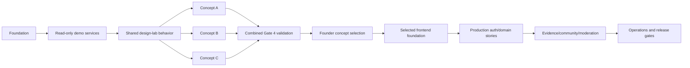

# Worktree-safe execution plan

Status: Ready for future Gate 4 authorization; no implementation started

## Safety baseline

The current root worktree contains pre-existing user changes, including `AGENTS.md`, `README.md` and deletion of `install.log`. They are not part of the planning package and must not be overwritten, restored, staged or committed by an implementation task unless the user explicitly scopes them in.

Before every task, record:

```powershell
git status --short
git diff --name-status
git branch --show-current
git rev-parse HEAD
```

The task owner compares its planned paths with existing modifications. An overlap that cannot be avoided is escalated before editing.

## Branch and worktree pattern

1. Create an integration branch from the founder-approved checkpoint; do not branch from uncommitted unrelated changes.
2. Give each independently runnable task a branch such as `task/found-001-a` and a sibling worktree outside the root checkout. The human chooses/creates the parent directory.
3. One task owns one declared path set. Parallel tasks may share read-only contracts but cannot concurrently edit them.
4. Concept work is safely parallel only after `TASK-PROT-002-A` freezes shared services/behavior. A, B and C then own `concept-a`, `concept-b` and `concept-c` directories respectively.
5. Commit only task paths after inspecting `git diff --cached`. Use the human's configured identity and no agent/tool attribution.
6. Independent validation runs before merge. `FAIL` returns to the same task branch; `PASS WITH FOLLOW-UP` requires a recorded owner/gate.
7. Merge in dependency order into the integration branch, rerun the combined checks, and update status/validation records. Never use destructive reset/checkout/clean to resolve a dirty worktree.

## Task start checklist

- Story is Ready and all prerequisite task IDs are `PASS`.
- Dependency check is less than three days old or refreshed in the log.
- Required ADRs, story, task and risk notes are loaded.
- Exact planned files and tests are declared; current dirty paths are checked.
- Implementer and independent validator are different sessions; high-risk human owner is named.
- No new ambiguity changes architecture, public behavior or data policy. If it does, stop and request a decision.

## Integration order



Production auth/domain work shown after selection is not authorized by this plan. Gate 4 authorization permits only the read-only synthetic concept path.

## Parallel ownership table

| Group | May run together | Frozen/shared inputs | Conflict rule |
|---|---|---|---|
| Prototype concepts | PROT-002 B/C/D | contracts, services, fixtures, primitives | shared change goes through one coordinator task first |
| Early production modules | AUTH-002-A, DIR-001-A, PLAT-001-A | actor/locale/base contracts | no cross-module tables or shared schema edits without sequencing |
| Review dependants | REV-002-A, COM-001-A, NOTIF-001-A | published review/event contracts | contract version bump blocks parallel merges until rebased/revalidated |
| Search and operations | SRCH-001-A, OPS-001-A | stable public projection | neither may mutate owning domain rules |

High-risk evidence, moderation, identity reveal, retention/deletion and admin capability tasks are deliberately sequential within their domain.

## Status update after each task

Append/update repository records with task/story/requirement IDs, changed paths, exact commit/diff, commands and outcomes, independent verdict, residual risk, human approval when required, and next unblocked tasks. A task is not complete merely because code exists.

## Recovery rules

- If a task touches an unrelated user file, stop and revert only the task's own known patch through a reviewed inverse patch; never blanket checkout/reset.
- If dependency installation changes unexpected files, inspect and either include the justified lock/config changes or remove only those exact task-created changes.
- If combined integration fails, identify the first conflicting task by dependency order and fix forward on a new branch.
- If a worktree is no longer needed, the human removes it only after commits/evidence are confirmed reachable; no recursive cleanup is part of an implementation task by default.
